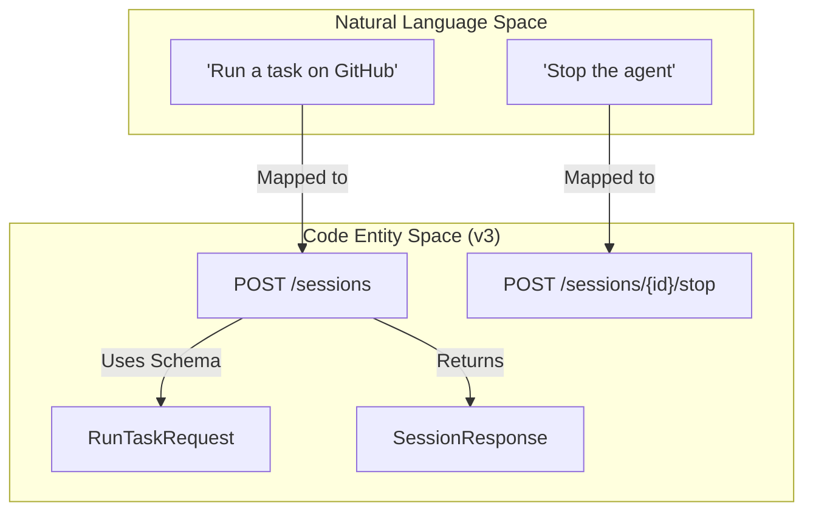
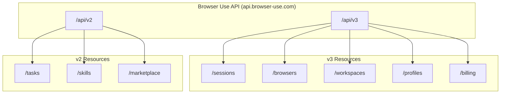

<!-- source: DeepWiki mcp.deepwiki.com · repo browser-use/sdk · page 7 API Reference and OpenAPI Specs · fetched 2026-10-30 -->

# API Reference and OpenAPI Specs

Relevant source files

The following files were used as context for generating this wiki page:

- [docs/cloud/api-reference.mdx](docs/cloud/api-reference.mdx)
- [docs/cloud/openapi/v2.json](docs/cloud/openapi/v2.json)
- [docs/cloud/openapi/v3.json](docs/cloud/openapi/v3.json)
- [docs/docs.json](docs/docs.json)
- [docs/openapi/v2.json](docs/openapi/v2.json)
- [docs/openapi/v3.json](docs/openapi/v3.json)
- [snapshots/v2.json](snapshots/v2.json)
- [snapshots/v3.json](snapshots/v3.json)

This page provides a high-level overview of the Browser Use REST API architecture, the locations of the OpenAPI specifications, and the interactive tools available for exploring the API surface. The Browser Use Cloud API is the foundation upon which the Python and TypeScript SDKs are built, maintaining a strict 1:1 mapping with the underlying REST endpoints.

## API Architecture Overview

The Browser Use API is structured into two primary versions: **v3 (Current)** and **v2 (Legacy)**. While both are supported, v3 introduces a session-centric model that allows for more complex, multi-turn agent interactions and improved resource management.

### Version Comparison

| Feature | v3 (Session-Centric) | v2 (Task-Centric) |
| :--- | :--- | :--- |
| **Primary Resource** | `Sessions` [snapshots/v3.json:15]() | `Tasks` [snapshots/v2.json:62]() |
| **Lifecycle** | Created → Idle → Running → Stopped [snapshots/v3.json:221]() | Created → Running → Finished [snapshots/v2.json:195]() |
| **Persistence** | `keep_alive` allows multi-turn tasks [snapshots/v3.json:21]() | Usually one-off execution |
| **Base URL** | `https://api.browser-use.com/api/v3` [snapshots/v3.json:10]() | `https://api.browser-use.com/api/v2` [snapshots/v2.json:10]() |

For details on the specific endpoints and schemas of each version, see:
* **[v3 API Reference](#7.1)** — Modern session-based agent API.
* **[v2 API Reference](#7.2)** — Legacy task-based API.

---

## OpenAPI Specification Locations

The repository maintains "Source of Truth" OpenAPI JSON files used for documentation and SDK code generation. These files are located in the `docs/` and `snapshots/` directories.

### v3 Specification
* **Source:** [docs/openapi/v3.json:1-7]()
* **Snapshot:** [snapshots/v3.json:1-7]()
* **Title:** Browser Use Public API v3
* **Version:** 3.0.0

### v2 Specification
* **Source:** [docs/openapi/v2.json:1-7]()
* **Snapshot:** [snapshots/v2.json:1-7]()
* **Title:** Browser Use Public API v2
* **Version:** 2.0.0

---

## Interactive API Playground

Browser Use provides an interactive playground for testing endpoints directly from the browser. This is configured via the `docs.json` file, which enables the Mintlify interactive API display [docs/docs.json:31-34]().

### Authentication
All requests to the API, whether via the playground, `curl`, or SDKs, require an API key passed in the `X-Browser-Use-API-Key` header [docs/cloud/api-reference.mdx:8-14]().

### Request Mapping
The following diagram illustrates how a Natural Language request in the playground or SDK maps to specific Code Entities defined in the OpenAPI spec.

**API Request Mapping: Language to Entity**

**Sources:** [snapshots/v3.json:15-60](), [snapshots/v3.json:215-222]()

---

## API Resource Hierarchy

The API surface is organized into logical resource groups. The SDKs mirror this structure by providing resource managers (e.g., `client.sessions`, `client.browsers`).

**System Resource Hierarchy**

**Sources:** [docs/docs.json:138-170](), [snapshots/v3.json:14-15](), [snapshots/v2.json:14-15]()

### Core Resources
* **Sessions (v3):** The primary entry point for managing agent lifecycles and tasks [snapshots/v3.json:15]().
* **Browsers:** Direct access to managed browser instances, providing `cdpUrl` and `liveUrl` [docs/docs.json:78-84]().
* **Workspaces (v3):** File management system for agent I/O [docs/docs.json:72]().
* **Profiles:** Identity containers for persisting browser state like cookies and logins [docs/docs.json:86-93]().
* **Billing:** Access to account balances and credit usage [snapshots/v2.json:15]().

---

## Detailed References

* **[v3 API Reference](#7.1)** — Detailed documentation of the modern `/sessions` API, including `RunTaskRequest` fields, `BuAgentSessionStatus` lifecycle, and cursor-based message pagination.
* **[v2 API Reference](#7.2)** — Documentation for the legacy `/tasks` and `/skills` API, including migration paths for moving from v2 `TaskStatus` to v3 session states.

**Sources:**
- [docs/docs.json:1-171]()
- [snapshots/v3.json:1-222]()
- [snapshots/v2.json:1-211]()
- [docs/cloud/api-reference.mdx:1-58]()

---

