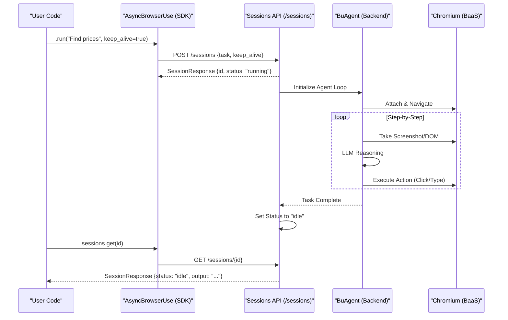
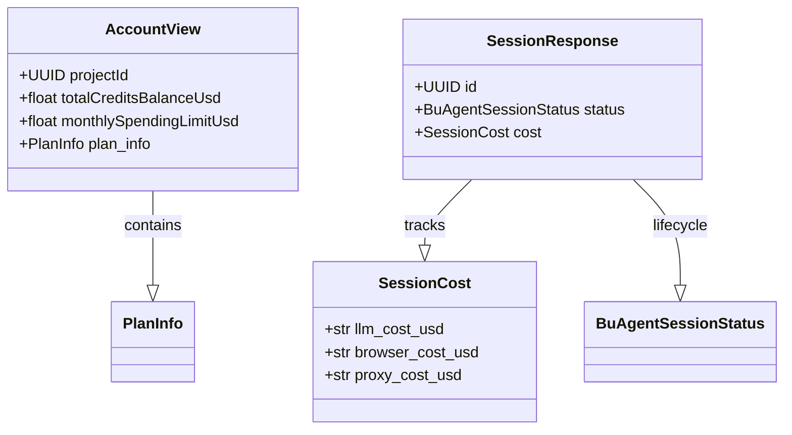

<!-- source: DeepWiki mcp.deepwiki.com · repo browser-use/sdk · page 7.1 v3 API Reference · fetched 2026-10-30 -->

# v3 API Reference

Relevant source files

The following files were used as context for generating this wiki page:

- [browser-use-node/src/generated/v3/types.ts](browser-use-node/src/generated/v3/types.ts)
- [browser-use-python/src/browser_use_sdk/generated/v3/models.py](browser-use-python/src/browser_use_sdk/generated/v3/models.py)
- [docs/cloud/legacy/skills.mdx](docs/cloud/legacy/skills.mdx)
- [docs/cloud/new-features/api-v3.mdx](docs/cloud/new-features/api-v3.mdx)
- [docs/cloud/openapi/v2.json](docs/cloud/openapi/v2.json)
- [docs/cloud/openapi/v3.json](docs/cloud/openapi/v3.json)
- [docs/openapi/v2.json](docs/openapi/v2.json)
- [docs/openapi/v3.json](docs/openapi/v3.json)
- [snapshots/v2.json](snapshots/v2.json)
- [snapshots/v3.json](snapshots/v3.json)

This page provides a comprehensive technical reference for the Browser Use v3 REST API. The v3 API introduces a session-centric model designed for multi-turn agent interactions, persistent file workspaces, and advanced browser control.

## Overview and Base URL

The v3 API is hosted at:
`https://api.browser-use.com/api/v3` [snapshots/v3.json:10-10]()

Unlike v2, which focused on discrete tasks, v3 operates on **Sessions**. A session encapsulates the browser instance, the agent's state, and an optional workspace.

### Session Lifecycle
Sessions transition through several states defined by the `BuAgentSessionStatus` enum:
- `created`: Initial state after POST request.
- `running`: The agent is actively executing a task.
- `idle`: The browser is active, but no task is running (waiting for next command).
- `stopped`: The session has been explicitly terminated.
- `timed_out`: The session reached its maximum duration.
- `error`: A fatal error occurred during execution.

Sources: [browser-use-python/src/browser_use_sdk/generated/v3/models.py:101-107](), [snapshots/v3.json:21-30]()

---

## Sessions Resource (`/sessions`)

The Sessions resource is the primary entry point for agent execution.

### Create or Dispatch Task
`POST /sessions`

This endpoint is polymorphic based on the provided parameters in the `RunTaskRequest`:
1.  **New Idle Session**: Provide neither `session_id` nor `task`. Used to setup a browser/workspace before commands.
2.  **New Task Session**: Provide `task` but no `session_id`. Creates a session and starts the agent immediately.
3.  **Follow-up Task**: Provide both `session_id` and `task`. Dispatches a new command to an existing `idle` session.

| Parameter | Type | Description |
| :--- | :--- | :--- |
| `task` | `string` | The natural language command for the agent. |
| `session_id` | `UUID` | (Optional) Target an existing session. |
| `keep_alive` | `boolean` | If `false` (default), session stops after task. If `true`, stays `idle`. |
| `output_schema` | `object` | JSON Schema for structured data extraction. |
| `model` | `BuModel` | Tier: `bu-mini`, `bu-max`, `bu-ultra`, etc. |

Sources: [snapshots/v3.json:15-60](), [browser-use-python/src/browser_use_sdk/generated/v3/models.py:317-380]()

### Stop Strategy
`POST /sessions/{session_id}/stop`

Controls how a session is terminated via the `StopSessionRequest`:
- `strategy="session"` (Default): Destroys the browser sandbox and workspace mapping. Session moves to `stopped`.
- `strategy="task"`: Interrupts the current agent run but keeps the browser alive. Session moves to `idle`.

Sources: [snapshots/v3.json:215-221](), [browser-use-python/src/browser_use_sdk/generated/v3/models.py:383-393]()

---

## Data Flow: Natural Language to Agent Execution

The following diagram illustrates how a request flows from the SDK into the v3 Session architecture.

**v3 Execution Flow**

Sources: [docs/cloud/new-features/api-v3.mdx:21-29](), [snapshots/v3.json:21-30](), [browser-use-python/src/browser_use_sdk/generated/v3/models.py:276-314]()

---

## Workspaces Resource (`/workspaces`)

Workspaces provide persistent file storage (`/home/user/`) for sessions.

### Key Operations
- `POST /workspaces`: Create a named container.
- `GET /workspaces/{workspace_id}/files`: List files with `prefix` filtering and `next_cursor` pagination.
- `POST /workspaces/{workspace_id}/upload-url`: Generates presigned S3 URLs for file uploads.
- `DELETE /workspaces/{workspace_id}/files/{path}`: Remove specific assets.

### Workspace Data Structure
The `FileInfo` object tracks file metadata:
- `path`: Relative path in the sandbox.
- `size`: Size in bytes.
- `url`: Presigned download URL (only if `includeUrls=true` is passed to the list endpoint).

Sources: [browser-use-python/src/browser_use_sdk/generated/v3/models.py:179-218](), [snapshots/v3.json:444-480]()

---

## Browsers Resource (`/browsers`)

Used for **Browser-as-a-Service (BaaS)** use cases where a raw CDP/Playwright connection is required without the Browser Use Agent.

### BrowserSessionView Fields
| Field | Description |
| :--- | :--- |
| `liveUrl` | Real-time interactive stream of the browser. |
| `cdpUrl` | Endpoint for `playwright.chromium.connect_over_cdp()`. |
| `timeoutAt` | Absolute timestamp for hard-timeout. |
| `proxyCost` | Cumulative cost of residential proxy usage. |

Sources: [browser-use-python/src/browser_use_sdk/generated/v3/models.py:26-98](), [snapshots/v3.json:712-750]()

---

## Billing and Cost Tracking

The `Billing` resource provides account-level balances and per-session cost breakdowns.

### Session Cost Vectors
Every `SessionResponse` contains a `cost` field of type `SessionCost`, which aggregates:
1.  **LLM Cost**: `llm_cost_usd` - Based on tokens used by the agent.
2.  **Browser Cost**: `browser_cost_usd` - Hourly rate for the browser infrastructure (pro-rated to the minute).
3.  **Proxy Cost**: `proxy_cost_usd` - Based on megabytes transferred via residential proxies.

**Entity Mapping: Billing to Code**

Sources: [browser-use-python/src/browser_use_sdk/generated/v3/models.py:251-274](), [snapshots/v2.json:15-60]() (Billing shared across versions), [browser-use-python/src/browser_use_sdk/generated/v3/models.py:276-314]()

---

## Profiles Resource (`/profiles`)

Profiles are persistent storage for browser state (cookies, localStorage, indexedDB).
- **Persistance**: You must call `sessions.stop()` or `browsers.update(status='stopped')` to trigger the sync of state from the live browser back to the profile storage.
- **Usage**: Pass `profile_id` in the `RunTaskRequest` to resume a logged-in session.

Sources: [browser-use-node/src/generated/v3/types.ts:171-196](), [browser-use-python/src/browser_use_sdk/generated/v3/models.py:230-249]()

---

