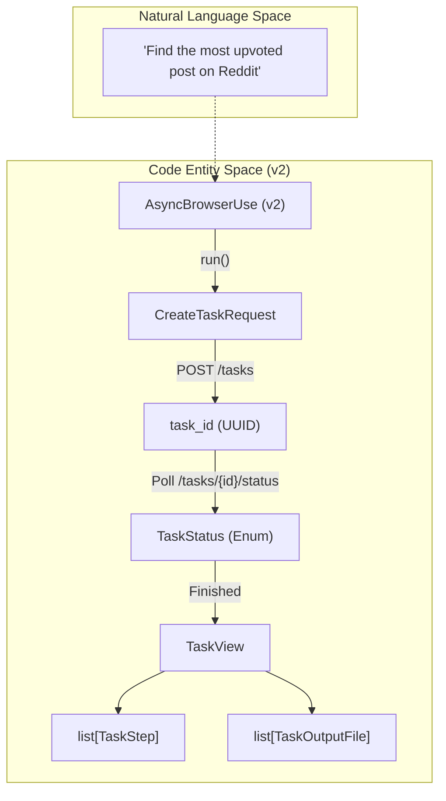
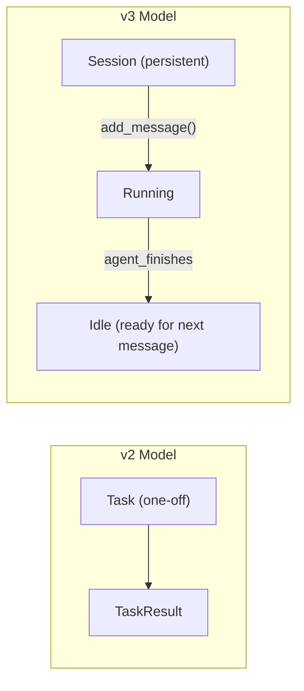

<!-- source: DeepWiki mcp.deepwiki.com · repo browser-use/sdk · page 7.2 v2 API Reference · fetched 2026-10-30 -->

# v2 API Reference

<details>
<summary>Relevant source files</summary>

The following files were used as context for generating this wiki page:

- [browser-use-node/src/generated/v2/types.ts](browser-use-node/src/generated/v2/types.ts)
- [browser-use-python/src/browser_use_sdk/generated/v2/models.py](browser-use-python/src/browser_use_sdk/generated/v2/models.py)
- [docs/cloud/api-v2-overview.mdx](docs/cloud/api-v2-overview.mdx)
- [docs/cloud/browser/proxies.mdx](docs/cloud/browser/proxies.mdx)
- [docs/cloud/legacy/agent.mdx](docs/cloud/legacy/agent.mdx)
- [docs/cloud/legacy/public-share.mdx](docs/cloud/legacy/public-share.mdx)
- [docs/open-source/browser-use-cli.mdx](docs/open-source/browser-use-cli.mdx)
- [docs/open-source/customize/integrations/mcp-server.mdx](docs/open-source/customize/integrations/mcp-server.mdx)
- [docs/open-source/development/n8n-integration.mdx](docs/open-source/development/n8n-integration.mdx)

</details>


The v2 API is the legacy task-centric interface for the Browser Use Cloud platform. While v3 focuses on persistent sessions and message-based interaction, v2 is designed around discrete `Task` objects that encapsulate an agent's goal, execution steps, and resulting files.

## Task-Centric Architecture

In the v2 model, a `Task` is the primary unit of work. When you call `client.run()`, the SDK creates a task that manages its own lifecycle.

### Data Flow: Task Execution
This diagram shows the transition from a natural language goal to a structured `TaskView` in the v2 system.


Sources: [browser-use-python/src/browser_use_sdk/generated/v2/models.py:30-98](), [browser-use-node/src/generated/v2/types.ts:27-62]()

## Core Resources

### Tasks (`/tasks`)
The central resource for v2. Tasks can be created with or without an explicit `sessionId`. If no `sessionId` is provided, the system auto-creates a session and closes it upon completion (`keep_alive=false`).

*   **Create Task**: `POST /tasks`. Accepts parameters like `task` (goal), `llm`, `output_schema`, and `session_settings`. [browser-use-node/src/generated/v2/types.ts:41-56]()
*   **Get Status**: `GET /tasks/{task_id}/status`. A lightweight endpoint optimized for polling that returns status, output, and cost without the overhead of full step logs. [browser-use-node/src/generated/v2/types.ts:87-106]()
*   **Update Task**: `PATCH /tasks/{task_id}`. Used to `stop`, `pause`, or `resume` execution. [browser-use-node/src/generated/v2/types.ts:80-84]()

### Sessions (`/sessions`)
In v2, sessions are containers for browsers. A session can host multiple sequential tasks.
*   **Lifecycle**: Use `POST /sessions` to pre-configure a browser (e.g., proxy country, screen dimensions) before running tasks. [browser-use-node/src/generated/v2/types.ts:149-153]()
*   **Persistence**: Sessions remain `active` until explicitly `stopped` or until they hit their `timeout_at` timestamp. [browser-use-python/src/browser_use_sdk/generated/v2/models.py:31-53]()

### Files (`/files`)
V2 uses a two-step process for file I/O:
1.  **Uploads**: Request a presigned URL via `client.files.session_url`, then POST the file content to that URL. [docs/cloud/legacy/agent.mdx:36-82]()
2.  **Outputs**: Completed tasks may produce `TaskOutputFile` objects. Access these by getting a download URL from `client.files.task_output`. [docs/cloud/legacy/agent.mdx:88-104]()

## Status Model and Lifecycle

The v2 status model uses a combination of `status` enums and boolean flags to indicate success.

| Entity | Status Values | Success Indicator |
| :--- | :--- | :--- |
| **Task** | `pending`, `running`, `finished`, `stopped`, `failed` | `isSuccess` (bool) |
| **Session** | `active`, `stopped` | N/A |

Unlike v3, which uses an `idle` state to wait for new messages, a v2 task transitions directly to `finished` once the goal is reached or the agent calls the `stop` tool.

Sources: [browser-use-python/src/browser_use_sdk/generated/v2/models.py:17-20](), [browser-use-node/src/generated/v2/types.ts:95-106]()

## Model Tiers (v2)

V2 supports a specific set of model strings passed via the `llm` parameter.

| Model Name | API String | Role |
| :--- | :--- | :--- |
| **Browser Use 2.0** | `browser-use-2.0` | Default high-performance model |
| **Browser Use LLM** | `browser-use-llm` | Cost-optimized model |
| **O3** | `o3` | High-reasoning model |
| **Claude Sonnet 4.5**| `claude-sonnet-4-5-20250929`| Premium performance |

Sources: [docs/cloud/legacy/agent.mdx:7-18]()

## Legacy Concepts

### Actor and Sandbox
The v2 API contains references to "Actors" and "Sandboxes" (legacy internal terms for the execution environment). In the SDK, these are largely abstracted into `Task` execution. 
*   **Skills**: V2 allows creating `Skills` (reusable browser scripts). These can be cloned from the `Marketplace` or created via `POST /skills`. [browser-use-python/src/browser_use_sdk/generated/v2/models.py:159-189]()
*   **Marketplace**: A repository of public skills that can be executed directly or added to an agent's `skill_ids`. [browser-use-node/src/generated/v2/types.ts:11]()

## Migration to v3

Users are encouraged to migrate to v3 for improved reliability and lower latency. Key differences include:

1.  **Session-Centric**: In v3, you interact with a `Session` by sending `Messages`. There is no top-level `Task` object.
2.  **Status**: v3 introduces the `idle` status, meaning the browser is open and waiting for the next instruction, whereas v2 tasks simply finish.
3.  **File I/O**: v3 replaces the `/files` resource with `/workspaces`, allowing for a more traditional filesystem feel within the agent's environment.


Sources: [browser-use-node/src/generated/v2/types.ts:95-106](), [docs/cloud/legacy/agent.mdx:118-136]()

## SDK Usage Example (v2)

### Streaming a Task
```python
from browser_use_sdk import AsyncBrowserUse

client = AsyncBrowserUse()
# run() returns an AsyncTaskRun (v2) which is an AsyncIterator
run = client.run("Search for latest news", llm="browser-use-2.0")

async for step in run:
    print(f"Agent is at: {step.url}")

# Result is populated after iteration
print(f"Final Output: {run.result.output}")
```
Sources: [docs/cloud/legacy/agent.mdx:113-123]()

---

