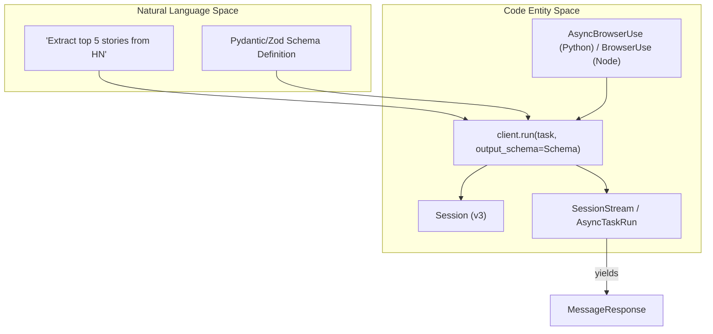
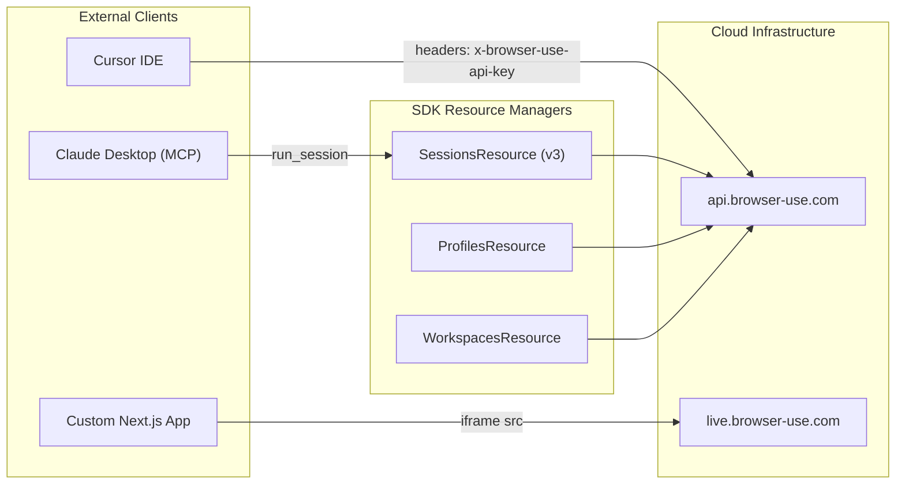

<!-- source: DeepWiki mcp.deepwiki.com · repo browser-use/sdk · page 8 Tutorials and Integration Examples · fetched 2026-10-30 -->

# Tutorials and Integration Examples

Relevant source files

The following files were used as context for generating this wiki page:

- [docs/cloud/agent/cache-script.mdx](docs/cloud/agent/cache-script.mdx)
- [docs/cloud/agent/human-in-the-loop.mdx](docs/cloud/agent/human-in-the-loop.mdx)
- [docs/cloud/agent/models.mdx](docs/cloud/agent/models.mdx)
- [docs/cloud/agent/workspaces.mdx](docs/cloud/agent/workspaces.mdx)
- [docs/cloud/browser/live-preview.mdx](docs/cloud/browser/live-preview.mdx)
- [docs/cloud/faq.mdx](docs/cloud/faq.mdx)
- [docs/cloud/guides/authentication.mdx](docs/cloud/guides/authentication.mdx)
- [docs/cloud/guides/mcp-server.mdx](docs/cloud/guides/mcp-server.mdx)
- [docs/cloud/tutorials/chat-ui.mdx](docs/cloud/tutorials/chat-ui.mdx)
- [docs/cloud/tutorials/grow-therapy-compare.mdx](docs/cloud/tutorials/grow-therapy-compare.mdx)

This page provides a high-level overview of practical implementation patterns and third-party integrations for the Browser Use SDK. It serves as a directory for developers looking to move beyond basic API calls into production-grade workflows, such as building interactive UIs, handling complex file I/O, or connecting to external automation platforms.

## Common Patterns and Recipes

The SDK supports several advanced interaction patterns that extend the utility of the browser agent. These patterns focus on maximizing efficiency, reducing LLM costs, and providing better user experiences.

### Interaction and UI Patterns
*   **Streaming and Callbacks**: Using the `run()` method with `for await` (TypeScript) or `async for` (Python) to process agent messages in real-time as they arrive, rather than waiting for task completion [docs/cloud/tutorials/chat-ui.mdx:74-84]().
*   **Human-in-the-Loop**: Implementing workflows where an agent performs initial navigation, pauses for human input (e.g., 2FA, payment approval, or product selection), and then resumes execution within the same session [docs/cloud/agent/human-in-the-loop.mdx:24-52]().
*   **Live Preview Embedding**: Using the `live_url` (Python) or `liveUrl` (TypeScript) returned by `sessions.create()` to embed the agent's browser directly into an application via an `<iframe>` [docs/cloud/browser/live-preview.mdx:49-57]().

### Data and Performance Patterns
*   **Structured Output**: Utilizing Pydantic (Python) or Zod (TypeScript) schemas with the `output_schema` parameter to ensure the agent returns strictly typed JSON data [docs/cloud/tutorials/grow-therapy-compare.mdx:41-69]().
*   **Deterministic Rerun (Caching)**: Using `@{{parameter}}` syntax and `workspaces` to cache browser navigation scripts. This allows subsequent runs with different parameters to execute at $0 LLM cost [docs/cloud/agent/cache-script.mdx:13-31]().
*   **Workspace File I/O**: Managing persistent storage for agents to read uploaded files (like CSVs for bulk processing) or save generated assets (like reports or screenshots) for later download [docs/cloud/agent/workspaces.mdx:14-47]().

For detailed code examples and implementation guides, see [Common Patterns and Recipes](#8.1).

### Bridging Concepts to Code: Session Execution
The following diagram illustrates how natural language tasks are transformed into executable code entities within the SDK.

**Task to Execution Flow**

Sources: [docs/cloud/tutorials/chat-ui.mdx:74-84](), [docs/cloud/tutorials/grow-therapy-compare.mdx:87-93](), [docs/cloud/agent/human-in-the-loop.mdx:24-52]()

---

## Third-Party Integrations

Browser Use is designed to be an extensible component of a larger AI and automation ecosystem. It integrates with popular development tools and workflow engines.

### Developer Tools and IDEs
*   **Model Context Protocol (MCP)**: The SDK provides an MCP server implementation that allows AI coding assistants like **Claude Desktop**, **Cursor**, and **Windsurf** to directly execute browser tasks using tools like `run_session` and `send_task` [docs/cloud/guides/mcp-server.mdx:7-67]().
*   **Browser Automation Frameworks**: Integration with Playwright, Puppeteer, and Selenium via the `cdpUrl` provided by the `browsers` resource, allowing existing automation scripts to run on Browser Use's managed, stealth infrastructure [docs/cloud/browser/live-preview.mdx:131-143]().

### Workflow and Agent Platforms
*   **n8n Integration**: Using Browser Use as a node within n8n workflows to automate complex web-based triggers and actions.
*   **Agent Frameworks**: Guides for connecting the SDK to higher-level agentic frameworks like Hermes Agent and OpenClaw.

For integration steps and configuration snippets, see [Third-Party Integrations](#8.2).

### Bridging Concepts to Code: External Tooling
This diagram shows how external clients interact with the SDK's internal resource managers.

**Integration Architecture**

Sources: [docs/cloud/guides/mcp-server.mdx:71-80](), [docs/cloud/tutorials/chat-ui.mdx:22-28](), [docs/cloud/browser/live-preview.mdx:59-63]()

---

## Summary Table: Feature Comparison

| Feature | Primary Code Entity | Typical Use Case |
| :--- | :--- | :--- |
| **Live View** | `session.live_url` | Real-time monitoring / Human-in-the-loop [docs/cloud/browser/live-preview.mdx:11-20]() |
| **Persistence** | `ProfilesResource` | Maintaining logins and cookies [docs/cloud/guides/authentication.mdx:7-21]() |
| **Cost Savings** | `cache_script=True` | High-frequency repetitive scraping [docs/cloud/agent/cache-script.mdx:85-92]() |
| **File Handling** | `WorkspacesResource` | Uploading data or downloading generated reports [docs/cloud/agent/workspaces.mdx:7-10]() |
| **Structured Data** | `output_schema` | Converting web pages into typed JSON [docs/cloud/tutorials/grow-therapy-compare.mdx:37-69]() |

Sources: [docs/cloud/browser/live-preview.mdx:11-20](), [docs/cloud/guides/authentication.mdx:7-21](), [docs/cloud/agent/cache-script.mdx:85-92](), [docs/cloud/agent/workspaces.mdx:7-10](), [docs/cloud/tutorials/grow-therapy-compare.mdx:37-69]()

---

