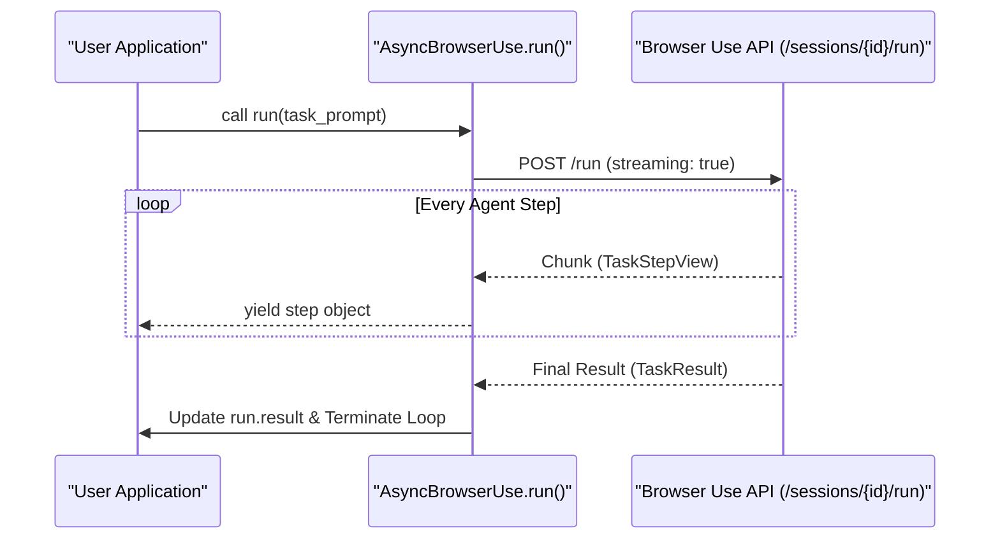
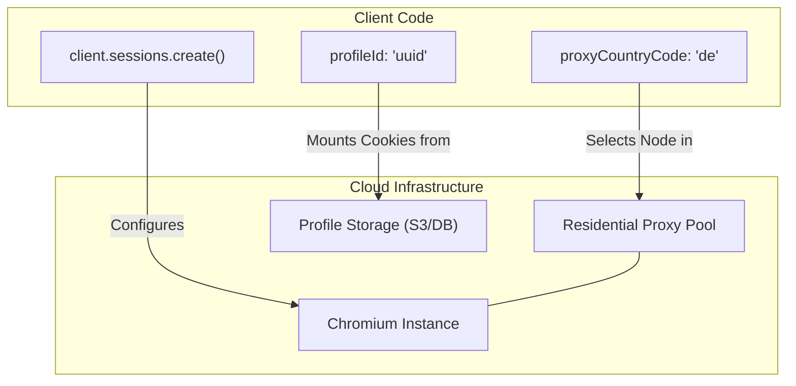

<!-- source: DeepWiki mcp.deepwiki.com · repo browser-use/sdk · page 8.1 Common Patterns and Recipes · fetched 2026-10-30 -->

# Common Patterns and Recipes

<details>
<summary>Relevant source files</summary>

The following files were used as context for generating this wiki page:

- [browser-use-node/examples/authentication.ts](browser-use-node/examples/authentication.ts)
- [browser-use-node/examples/basic.ts](browser-use-node/examples/basic.ts)
- [browser-use-node/examples/profiles.ts](browser-use-node/examples/profiles.ts)
- [browser-use-node/examples/sessions.ts](browser-use-node/examples/sessions.ts)
- [browser-use-node/examples/stealth.ts](browser-use-node/examples/stealth.ts)
- [browser-use-node/examples/streaming.ts](browser-use-node/examples/streaming.ts)
- [browser-use-node/examples/structured-output.ts](browser-use-node/examples/structured-output.ts)
- [browser-use-python/examples/authentication.py](browser-use-python/examples/authentication.py)
- [browser-use-python/examples/basic.py](browser-use-python/examples/basic.py)
- [browser-use-python/examples/streaming.py](browser-use-python/examples/streaming.py)
- [browser-use-python/examples/structured_output.py](browser-use-python/examples/structured_output.py)
- [browser-use-python/tests/test_prod.py](browser-use-python/tests/test_prod.py)

</details>


This page provides practical code examples and architectural patterns for using the Browser Use SDK. It covers common workflows such as basic task execution, real-time streaming, structured data extraction, and session management.

## Basic Task Execution

The simplest way to use the SDK is the `run()` method. This method abstracts away session creation, task monitoring, and polling. It returns a result object containing the agent's final answer and the execution metadata.

### Python Pattern
In Python, you can use the synchronous `BrowserUse` client or the `AsyncBrowserUse` client. The `run()` method returns a `TaskResult` [browser-use-python/tests/test_prod.py:94-97]().

```python
from browser_use_sdk import AsyncBrowserUse
import asyncio

async def main():
    client = AsyncBrowserUse()
    # run() returns TaskResult with output and metadata
    result = await client.run("Search for the top 10 Hacker News posts")
    print(f"Output: {result.output}")
    print(f"Status: {result.status}")
```
Sources: [browser-use-python/examples/basic.py:12-21](), [browser-use-python/tests/test_prod.py:92-104]()

### Node.js Pattern
The Node.js SDK provides a similar interface through the `BrowserUse` class.

```typescript
import { BrowserUse } from "browser-use-sdk";

async function main() {
  const client = new BrowserUse();
  const result = await client.run("Find the top 10 Hacker News posts");
  console.log(result.output);
}
```
Sources: [browser-use-node/examples/basic.ts:7-16]()

---

## Streaming with Message Callbacks

For long-running tasks, streaming allows you to monitor the agent's progress step-by-step. The `run()` method in both SDKs supports an `async for` (Python) or `for await` (Node.js) pattern.

### Data Flow: Streaming Execution
The following diagram illustrates how the `TaskStream` (v2) or `SessionStream` (v3) yields updates from the backend to the client.

**Agent Progress Streaming**

Sources: [browser-use-python/examples/streaming.py:12-22](), [browser-use-node/examples/streaming.ts:7-21]()

### Implementation Example
In Python, the `run` object itself is an async iterator [browser-use-python/examples/streaming.py:19-20](). In Node.js, you can iterate directly over the `client.run()` call [browser-use-node/examples/streaming.ts:10-14]().

```python
# Python Streaming
run = client.run("Go to wikipedia.org")
async for step in run:
    print(f"[Step {step.number}] {step.next_goal}")
print(f"Final: {run.result.output}")
```
Sources: [browser-use-python/examples/streaming.py:15-22](), [browser-use-node/examples/streaming.ts:10-20]()

---

## Structured Output with Pydantic/Zod

To extract machine-readable data, you can pass a schema to the `run()` method. The SDK handles the JSON schema conversion and automatically parses the LLM's response into the specified type.

| Feature | Python Implementation | Node.js Implementation |
| :--- | :--- | :--- |
| **Schema Library** | `pydantic.BaseModel` | `zod.z` |
| **Parameter** | `schema=MyModel` | `{ schema: MyZodObject }` |
| **Result Access** | `result.output` (typed) | `result.output` (typed) |

### Python Example (Pydantic)
```python
from pydantic import BaseModel
from browser_use_sdk import AsyncBrowserUse

class HackerNewsPost(BaseModel):
    title: str
    url: str
    score: int

class SearchResult(BaseModel):
    posts: list[HackerNewsPost]

async def main():
    client = AsyncBrowserUse()
    result = await client.run("Find top 10 HN posts", schema=SearchResult)
    # result.output is now a SearchResult instance
    for post in result.output.posts:
        print(post.title)
```
Sources: [browser-use-python/examples/structured_output.py:17-38](), [browser-use-python/tests/test_prod.py:108-128]()

---

## Session Management and Keep-Alive

Sessions allow you to run multiple tasks within the same browser context, preserving cookies, tabs, and local storage. This is critical for multi-turn workflows or when you need to perform actions across different domains in one "sitting".

### Multi-Turn Workflow Pattern
1.  **Create Session**: Initialize a persistent browser instance.
2.  **Execute Task 1**: Perform an action (e.g., log in).
3.  **Execute Task 2**: Perform a follow-up action using the state from Task 1.
4.  **Stop/Delete**: Explicitly clean up to avoid billing for idle time.

```typescript
const session = await client.sessions.create({ proxyCountryCode: "uk" });

// Task 1: Search
await client.run("Search for 'browser automation'", { sessionId: session.id });

// Task 2: Summarize (State is preserved)
const result = await client.run("Summarize the first result", { sessionId: session.id });

await client.sessions.stop(session.id);
```
Sources: [browser-use-node/examples/sessions.ts:13-35](), [browser-use-python/tests/test_prod.py:157-179]()

---

## Geo-Scraping with Proxies

Browser Use provides residential proxies by default. You can specify the `proxyCountryCode` during session creation to route traffic through a specific region.

**Code Entity to Infrastructure Mapping**
This diagram maps SDK parameters to the underlying browser infrastructure.


Sources: [browser-use-node/examples/stealth.ts:20-27](), [browser-use-node/examples/profiles.ts:17-21]()

### Implementation
```python
# Create a session with a German proxy
session = await client.sessions.create(proxy_country_code="de")
result = await client.run("What is my IP location?", session_id=str(session.id))
```
Sources: [browser-use-node/examples/stealth.ts:20-27](), [browser-use-python/examples/authentication.py:22-28]()

---

## Authentication and Persistent Profiles

To avoid logging in repeatedly, use **Profiles**. A Profile stores the browser's state (cookies, localStorage). When you stop a session associated with a profile, the state is saved and can be reloaded in future sessions.

1.  **Create a Profile**: `client.profiles.create(name="MyProfile")` [browser-use-node/examples/profiles.ts:13]().
2.  **Attach to Session**: Pass `profile_id` when creating a session [browser-use-python/examples/authentication.py:22]().
3.  **Persistence**: You **must** call `sessions.stop()` to trigger the state save operation [browser-use-node/examples/profiles.ts:21]().

```python
# Reuse a profile to stay logged in
session = await client.sessions.create(profile_id="your-profile-id")
output = await client.run("Check my LinkedIn notifications", session_id=str(session.id))
await client.sessions.stop(str(session.id)) # Saves state
```
Sources: [browser-use-python/examples/authentication.py:15-31](), [browser-use-node/examples/profiles.ts:13-31]()

---

## Error Handling Recipes

The SDK raises `BrowserUseError` for API-level issues (4xx/5xx). It is recommended to wrap execution in try/except blocks, especially when managing sessions to ensure cleanup.

```python
from browser_use_sdk._core.errors import BrowserUseError

try:
    result = client.run("Some complex task")
except BrowserUseError as e:
    if e.status_code == 404:
        print("Resource not found")
    elif e.status_code == 429:
        print("Rate limited")
```
Sources: [browser-use-python/tests/test_prod.py:185-200]()

---

