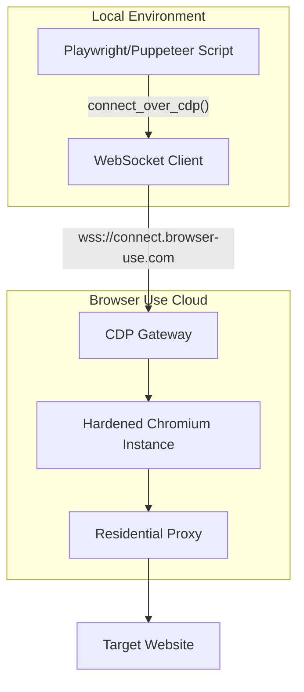
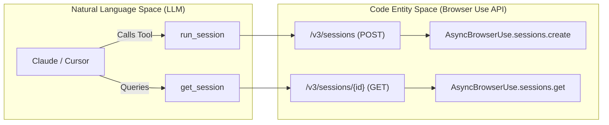
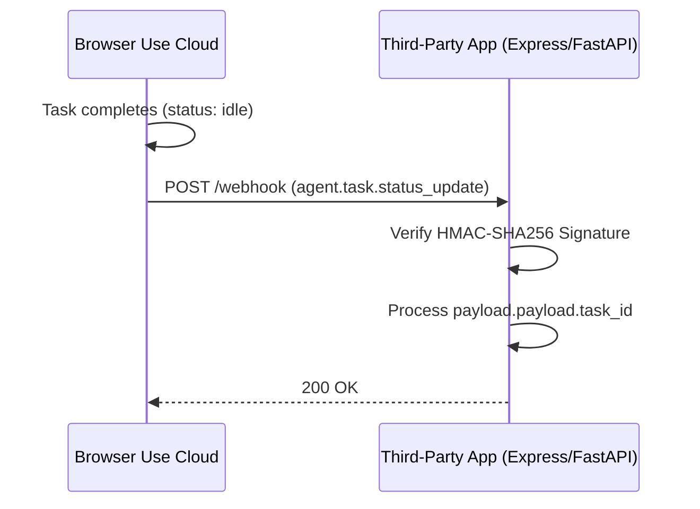

<!-- source: DeepWiki mcp.deepwiki.com · repo browser-use/sdk · page 8.2 Third-Party Integrations · fetched 2026-10-30 -->

# Third-Party Integrations

Relevant source files

The following files were used as context for generating this wiki page:

- [docs/cloud/agent/cache-script.mdx](docs/cloud/agent/cache-script.mdx)
- [docs/cloud/agent/follow-up-tasks.mdx](docs/cloud/agent/follow-up-tasks.mdx)
- [docs/cloud/agent/models.mdx](docs/cloud/agent/models.mdx)
- [docs/cloud/agent/streaming.mdx](docs/cloud/agent/streaming.mdx)
- [docs/cloud/agent/structured-output.mdx](docs/cloud/agent/structured-output.mdx)
- [docs/cloud/browser/playwright-puppeteer-selenium.mdx](docs/cloud/browser/playwright-puppeteer-selenium.mdx)
- [docs/cloud/browser/stealth.mdx](docs/cloud/browser/stealth.mdx)
- [docs/cloud/faq.mdx](docs/cloud/faq.mdx)
- [docs/cloud/guides/mcp-server.mdx](docs/cloud/guides/mcp-server.mdx)
- [docs/cloud/guides/webhooks.mdx](docs/cloud/guides/webhooks.mdx)
- [docs/cloud/tutorials/grow-therapy-compare.mdx](docs/cloud/tutorials/grow-therapy-compare.mdx)
- [docs/cloud/tutorials/integrations/hermes-agent.mdx](docs/cloud/tutorials/integrations/hermes-agent.mdx)
- [docs/cloud/tutorials/integrations/n8n.mdx](docs/cloud/tutorials/integrations/n8n.mdx)
- [docs/cloud/tutorials/integrations/openclaw.mdx](docs/cloud/tutorials/integrations/openclaw.mdx)
- [docs/cloud/tutorials/integrations/playwright.mdx](docs/cloud/tutorials/integrations/playwright.mdx)

This page provides technical guides for integrating Browser Use with external automation frameworks, workflow tools, and AI agent ecosystems. Browser Use provides multiple integration surfaces: direct CDP (Chrome DevTools Protocol) for existing automation scripts, an MCP (Model Context Protocol) server for IDE-based agents, and specialized connectors for tools like n8n, Hermes, and OpenClaw.

## 1. Playwright, Puppeteer, and Selenium

Browser Use provides a hardened Chromium infrastructure accessible via WebSocket. This allows developers to point existing automation scripts at Browser Use's stealth browsers without rewriting logic.

### Implementation via WebSocket URL
The simplest integration method bypasses the SDK and connects directly using a formatted WebSocket URL. Configuration is handled via query parameters.

| Parameter | Type | Description |
|-----------|------|-------------|
| `apiKey` | `string` | **Required.** Your Browser Use API key. |
| `proxyCountryCode` | `string` | Proxy country code (e.g. `us`, `de`). |
| `profileId` | `string` | Load a saved browser profile (cookies/state). |
| `timeout` | `int` | Session timeout in minutes (Default: 15). |

### Data Flow: External Framework to Cloud Browser
The following diagram illustrates how external libraries connect to the Browser Use infrastructure using the `cdp_url`.

**CDP Connection Architecture**

### SDK-Managed Connection
Alternatively, use the SDK to manage the lifecycle of the browser and retrieve the `cdp_url` programmatically.

- **Python**: `await client.browsers.create()` returns a `BrowserResponse` containing the `cdp_url` [docs/cloud/browser/playwright-puppeteer-selenium.mdx:101-102]().
- **Node.js**: `await client.browsers.create()` provides `browser.cdpUrl` [docs/cloud/browser/playwright-puppeteer-selenium.mdx:119-120]().

Sources: [docs/cloud/browser/playwright-puppeteer-selenium.mdx:9-113](), [docs/cloud/browser/playwright-puppeteer-selenium.mdx:115-130]()

---

## 2. MCP Server (Claude, Cursor, Windsurf)

Browser Use exposes an MCP (Model Context Protocol) server endpoint at `https://api.browser-use.com/v3/mcp`. This allows AI assistants like Claude Desktop or Cursor to execute browser tasks directly.

### Available Tools
The MCP server exposes several key functions that map to SDK resource managers:

| MCP Tool | SDK Mapping | Description |
|----------|-------------|-------------|
| `run_session` | `sessions.create` | Starts a task with `model` and `output_schema` support. |
| `get_session` | `sessions.get` | Polls status, step count, and retrieves the `live_url`. |
| `send_task` | `sessions.create` | Sends follow-up tasks to an `idle` keep-alive session. |
| `stop_session` | `sessions.stop` | Terminates the task or the entire sandbox. |

**MCP Tool to Code Entity Mapping**

Sources: [docs/cloud/guides/mcp-server.mdx:1-80]()

---

## 3. n8n Workflow Automation

Browser Use integrates with n8n as a standard HTTP service. This allows for long-running, asynchronous browser tasks within a visual workflow.

### Integration Pattern
1.  **Authentication**: Use "Header Auth" with `Authorization: Bearer YOUR_API_KEY` [docs/cloud/tutorials/integrations/n8n.mdx:10-15]().
2.  **Execution**: Send a `POST` to `/api/v3/sessions` to initiate a task [docs/cloud/tutorials/integrations/n8n.mdx:21-34]().
3.  **Polling/Webhooks**:
    *   **Polling**: Loop a `GET` request to `/api/v3/sessions/{id}` until `status` is `idle` or `stopped` [docs/cloud/tutorials/integrations/n8n.mdx:41-51]().
    *   **Webhooks**: Configure a Webhook node in n8n to receive `agent.task.status_update` events [docs/cloud/tutorials/integrations/n8n.mdx:53-55]().

Sources: [docs/cloud/tutorials/integrations/n8n.mdx:1-60](), [docs/cloud/guides/webhooks.mdx:1-28]()

---

## 4. Webhooks

Webhooks provide real-time notifications for task status changes, eliminating the need for manual polling in high-scale integrations.

### Payload and Verification
Webhooks are sent with an `X-Browser-Use-Signature` (HMAC-SHA256) to ensure authenticity. The signature is calculated over the string `{timestamp}.{body}` [docs/cloud/guides/webhooks.mdx:32-37]().

**Webhook Lifecycle**

Sources: [docs/cloud/guides/webhooks.mdx:1-180]()

---

## 5. Hermes Agent and OpenClaw

These integrations allow specialized AI agents to leverage Browser Use's stealth and proxy infrastructure.

### Hermes Agent
Hermes can be configured in two modes:
1.  **Cloud Browser Backend**: Pointing Hermes's native `browser_navigate` tools to Browser Use via the `BROWSER_USE_API_KEY` in `~/.hermes/.env` [docs/cloud/tutorials/integrations/hermes-agent.mdx:10-44]().
2.  **CLI Mode**: Installing the `browser-use` CLI as a skill, allowing the agent to run terminal commands for browser control [docs/cloud/tutorials/integrations/hermes-agent.mdx:53-99]().

### OpenClaw
OpenClaw connects to Browser Use primarily via CDP. By adding a profile in `~/.openclaw/openclaw.json`, the agent can direct its `openclaw browser` commands to the remote WebSocket endpoint [docs/cloud/tutorials/integrations/openclaw.mdx:10-41]().

Sources: [docs/cloud/tutorials/integrations/hermes-agent.mdx:1-100](), [docs/cloud/tutorials/integrations/openclaw.mdx:1-66]()

---

