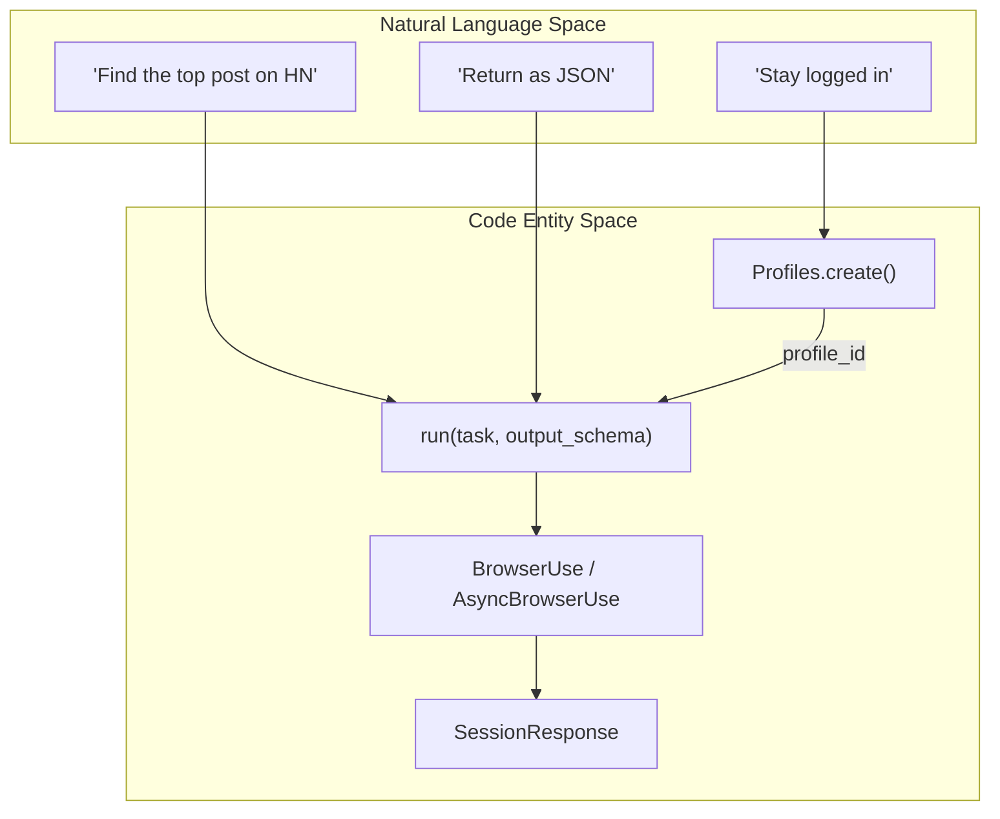
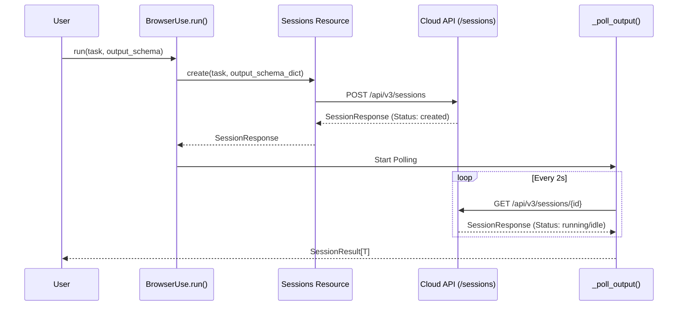

<!-- source: DeepWiki mcp.deepwiki.com · repo browser-use/sdk · page 9 Glossary · fetched 2026-10-30 -->

# Glossary

Relevant source files

The following files were used as context for generating this wiki page:

- [.claude/commands/generate.md](.claude/commands/generate.md)
- [.env.example](.env.example)
- [.gitignore](.gitignore)
- [RUNBOOK.md](RUNBOOK.md)
- [browser-use-node/.gitignore](browser-use-node/.gitignore)
- [browser-use-node/pnpm-lock.yaml](browser-use-node/pnpm-lock.yaml)
- [browser-use-node/src/core/http.ts](browser-use-node/src/core/http.ts)
- [browser-use-node/src/generated/v3/types.ts](browser-use-node/src/generated/v3/types.ts)
- [browser-use-node/src/v3/client.ts](browser-use-node/src/v3/client.ts)
- [browser-use-node/src/v3/helpers.ts](browser-use-node/src/v3/helpers.ts)
- [browser-use-node/src/v3/resources/browsers.ts](browser-use-node/src/v3/resources/browsers.ts)
- [browser-use-python/src/browser_use_sdk/_core/http.py](browser-use-python/src/browser_use_sdk/_core/http.py)
- [browser-use-python/src/browser_use_sdk/generated/v3/models.py](browser-use-python/src/browser_use_sdk/generated/v3/models.py)
- [browser-use-python/src/browser_use_sdk/v3/client.py](browser-use-python/src/browser_use_sdk/v3/client.py)
- [browser-use-python/src/browser_use_sdk/v3/helpers.py](browser-use-python/src/browser_use_sdk/v3/helpers.py)
- [browser-use-python/src/browser_use_sdk/v3/resources/browsers.py](browser-use-python/src/browser_use_sdk/v3/resources/browsers.py)
- [browser-use-python/src/browser_use_sdk/v3/resources/sessions.py](browser-use-python/src/browser_use_sdk/v3/resources/sessions.py)
- [docs/cloud/llms-full.txt](docs/cloud/llms-full.txt)
- [docs/cloud/llms.txt](docs/cloud/llms.txt)
- [docs/generate-llms-txt.sh](docs/generate-llms-txt.sh)
- [docs/llms-full.txt](docs/llms-full.txt)
- [docs/llms.txt](docs/llms.txt)
- [docs/open-source/llms-full.txt](docs/open-source/llms-full.txt)
- [docs/open-source/llms.txt](docs/open-source/llms.txt)
- [docs/openapi/v2.json](docs/openapi/v2.json)
- [docs/openapi/v3.json](docs/openapi/v3.json)
- [snapshots/v2.json](snapshots/v2.json)
- [snapshots/v3.json](snapshots/v3.json)
- [static/sdks-banner.png](static/sdks-banner.png)

This page provides a comprehensive reference for terms, domain concepts, and implementation-specific identifiers used throughout the Browser Use SDK codebase. It serves as a technical bridge for engineers to map high-level automation concepts to specific code entities.

## Core Concepts & Lifecycle

The SDK revolves around managed browser automation. The transition from v2 to v3 represents a shift from "Task-centric" to "Session-centric" design.

### Agent vs. Browser
While both involve Chromium instances, they represent different levels of abstraction:
*   **Agent**: An AI-driven entity that interprets natural language, plans steps, and executes actions. It is managed via the `Sessions` resource [browser-use-python/src/browser_use_sdk/v3/resources/sessions.py:19-21]().
*   **Browser (BaaS)**: "Browser as a Service". Raw access to a stealth browser instance via CDP (Chrome DevTools Protocol) or Playwright/Puppeteer. Managed via the `Browsers` resource [browser-use-python/src/browser_use_sdk/v3/resources/browsers.py:13-15]().

### Session Lifecycle (v3)
The `BuAgentSessionStatus` enum defines the state machine for an agent session:
1.  **`created`**: Initial state upon calling `sessions.create()`.
2.  **`running`**: The agent is actively interacting with a webpage or processing LLM logic.
3.  **`idle`**: The task is finished, but the browser is kept alive for follow-up tasks (requires `keep_alive=True`).
4.  **`stopped`**: The session is terminated and resources are released.
5.  **`timed_out` / `error`**: Terminal failure states.

**Sources**: [browser-use-python/src/browser_use_sdk/generated/v3/models.py:101-107](), [snapshots/v3.json:21-30]()

### Natural Language to Code Mapping

The following diagram maps user-facing concepts to the primary classes and methods in the SDK.

**Sources**: [browser-use-python/src/browser_use_sdk/v3/client.py:25-131](), [docs/cloud/llms-full.txt:173-189]()

---

## Technical Glossary

| Term | Definition | Code Pointer |
| :--- | :--- | :--- |
| **BaaS** | Browser as a Service. Managed stealth browser infrastructure. | `BrowsersResource` [browser-use-python/src/browser_use_sdk/v3/client.py:46]() |
| **CDP URL** | Chrome DevTools Protocol endpoint used to connect external tools (Playwright/Puppeteer) to a cloud browser. | `BrowserSessionView.cdp_url` [browser-use-python/src/browser_use_sdk/generated/v3/models.py:42-47]() |
| **Deterministic Rerun** | A feature that executes a previously recorded script for $0 LLM cost using template variables. | `cache_script` parameter in `run()` [browser-use-python/src/browser_use_sdk/v3/client.py:123-131]() |
| **Keep Alive** | Boolean flag that prevents a session from stopping after a task completes, allowing multi-turn interactions. | `RunTaskRequest.keep_alive` [snapshots/v3.json:29-30]() |
| **Live URL** | A WebSocket-powered URL used to view the agent's browser in real-time within a web UI. | `BrowserSessionView.live_url` [browser-use-python/src/browser_use_sdk/generated/v3/models.py:36-41]() |
| **Output Schema** | A Pydantic (Python) or Zod (TS) model used to force the agent to return structured data. | `resolved_schema` logic in `run()` [browser-use-python/src/browser_use_sdk/v3/client.py:135-143]() |
| **Profile** | A persistent container for browser state (cookies, localStorage, sessions). | `Profiles` resource [browser-use-python/src/browser_use_sdk/v3/resources/profiles.py]() |
| **Stealth** | Modified Chromium binaries designed to bypass bot detection (fingerprint randomization, etc.). | `docs/cloud/llms.txt:39-39`() |
| **Workspace** | A virtual file system attached to a session for uploading inputs or downloading agent-generated files. | `Workspaces` resource [browser-use-python/src/browser_use_sdk/v3/resources/workspaces.py]() |

---

## Architecture Components

### The HTTP Layer
Both SDKs utilize a specialized HTTP client that handles authentication via the `X-Browser-Use-API-Key` header and manages timeouts.

*   **Python**: `SyncHttpClient` and `AsyncHttpClient` in `_core/http.py`.
*   **Node.js**: `HttpClient` in `core/http.ts`.

### Data Flow: Task Execution
The following diagram illustrates the internal data flow when a developer calls `client.run()`.

**Sources**: [browser-use-python/src/browser_use_sdk/v3/client.py:104-163](), [browser-use-python/src/browser_use_sdk/v3/helpers.py:17-17]() (for `_poll_output`)

---

## Resource Managers

Resource managers are the primary interface for interacting with the Cloud API. They are organized into logical groups under the main client.

### Sessions (v3)
The core resource for agent interaction.
*   **Implementation**: `Sessions` [browser-use-python/src/browser_use_sdk/v3/resources/sessions.py:19]()
*   **Key Methods**: `create`, `get`, `stop`, `messages`, `wait_for_recording`.

### Browsers
Used for raw browser access without the AI agent layer.
*   **Implementation**: `BrowsersResource` [browser-use-python/src/browser_use_sdk/v3/resources/browsers.py:13]()
*   **Pricing Logic**: Charged per hour, proportional refund on `stop`. [browser-use-node/src/generated/v3/types.ts:123-132]()

### Workspaces
Handles file I/O for agent tasks.
*   **Implementation**: `Workspaces` [browser-use-python/src/browser_use_sdk/v3/resources/workspaces.py]()
*   **Concept**: Files are uploaded to S3 via presigned URLs before being accessed by the agent sandbox.

### Profiles
Manages persistent browser identities.
*   **Implementation**: `ProfilesResource` [browser-use-python/src/browser_use_sdk/v3/resources/profiles.py]()
*   **Requirement**: Must call `sessions.stop(strategy='session')` to ensure state is persisted back to the cloud.

**Sources**: [browser-use-python/src/browser_use_sdk/v3/client.py:45-49](), [browser-use-node/src/generated/v3/types.ts:189-196]()