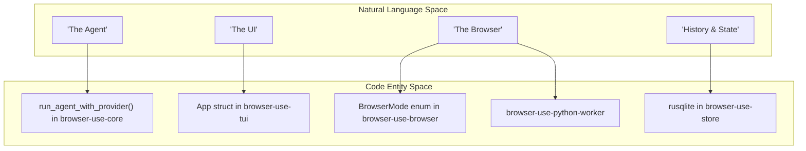
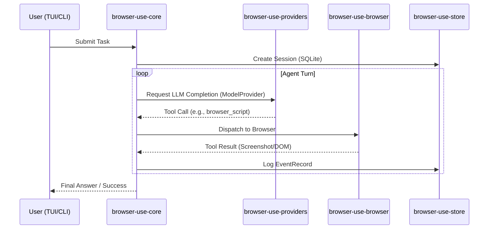

<!-- source: DeepWiki mcp.deepwiki.com · repo browser-use/terminal · page 1 Overview · fetched 2026-10-30 -->

# Overview

<details>
<summary>Relevant source files</summary>

The following files were used as context for generating this wiki page:

- [Cargo.lock](Cargo.lock)
- [Cargo.toml](Cargo.toml)
- [README.md](README.md)
- [docs/public-launch-checklist.md](docs/public-launch-checklist.md)
- [static/terminal-preview.png](static/terminal-preview.png)

</details>


Browser Use Terminal is a high-performance, browser-first LLM harness and interactive terminal user interface (TUI) written in Rust [README.md:9-10](). It provides a direct control plane for Large Language Models to interact with web browsers via the Chrome DevTools Protocol (CDP) [README.md:31-32]().

The system is designed to be "steerable," allowing users to watch agent progress in real-time, stop execution, provide manual feedback, and resume tasks [README.md:25](). It supports multiple browser modes, including local Chrome instances (preserving user login state), headless Chromium, and remote cloud browsers [README.md:23-24]().

## System Architecture

The architecture bridges a high-level Rust agent loop with a low-level browser runtime. Rust manages the durable state (SQLite), LLM orchestration, and the TUI, while a specialized Python worker handles complex browser interactions [README.md:33-42]().

### Conceptual Bridge: Natural Language to Code Entities

The following diagram maps high-level system concepts to their specific implementations within the codebase.

**Diagram: System Entity Mapping**

Sources: [README.md:39-42](), [Cargo.lock:173-292](), [Cargo.toml:1-11]()

## Key Components

The project is organized as a Cargo workspace with several specialized crates [Cargo.toml:1-11]():

| Component | Crate / Entity | Responsibility |
| :--- | :--- | :--- |
| **Orchestrator** | `browser-use-core` | Manages the `AgentLoop`, tool dispatch, and LLM provider abstraction [Cargo.lock:204-224](). |
| **Interface** | `browser-use-tui` | A `ratatui`-based interface for real-time steering and transcript visualization [Cargo.lock:274-292](). |
| **Browser** | `browser-use-browser` | Manages CDP connections and browser lifecycle [Cargo.lock:173-184](). |
| **Interaction** | `browser-use-python-worker` | Executes `browser_script` commands via a Python sub-process [Cargo.lock:250-258](). |
| **Persistence** | `browser-use-store` | Durable event logging and session management using SQLite [Cargo.lock:261-271](). |
| **CLI** | `browser-use-cli` | Command-line interface for headless runs and configuration [Cargo.lock:187-201](). |

For a detailed breakdown of the internal dependencies and folder structure, see **[Workspace Structure and Crate Layout](#1.2)**.

## Execution Flow

When a user submits a prompt, the system initiates a session that coordinates between the LLM, the local store, and the browser runtime.

**Diagram: Request Execution Lifecycle**

Sources: [README.md:33-46](), [Cargo.lock:204-224](), [Cargo.lock:235-247]()

## Getting Started

To install Browser Use Terminal, use the official installation script:

```bash
curl -fsSL https://browser-use.com/terminal/install.sh | sh
```

### Initial Setup
1. **Launch**: Run `browser` to start the TUI [README.md:13]().
2. **Authentication**: Use the `/auth` slash command to configure LLM providers (OpenAI, Anthropic, etc.) [README.md:76]().
3. **Configuration**: Use `/browser` to select between local Chrome or cloud-based browser instances [README.md:78]().

For detailed installation instructions, environment variable references, and first-run troubleshooting, see **[Getting Started](#1.1)**.

## Telemetry and Observability
The system includes anonymous telemetry for product analytics, which can be completely disabled by setting the environment variable `BUT_TELEMETRY=0` [README.md:101-103](). Detailed tracing is managed via OpenTelemetry integration in the core crate [Cargo.lock:215-217]().

Sources: [README.md:101-103](), [Cargo.lock:215-217]()

---

