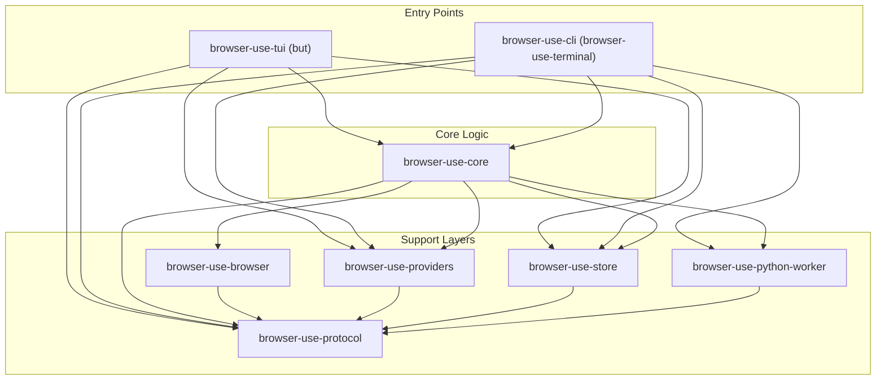
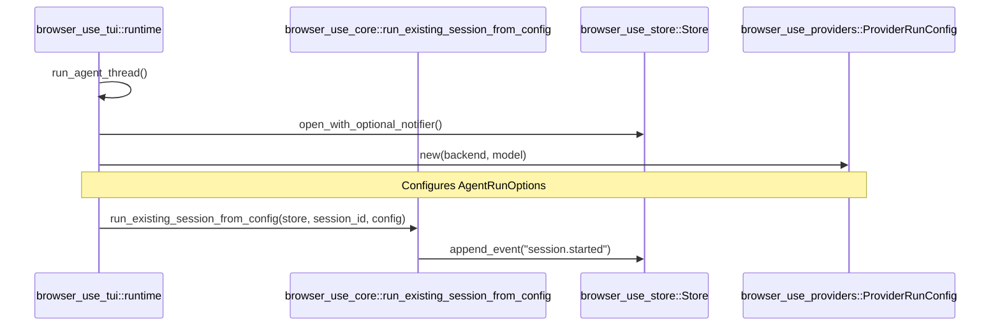

<!-- source: DeepWiki mcp.deepwiki.com · repo browser-use/terminal · page 1.2 Workspace Structure and Crate Layout · fetched 2026-10-30 -->

# Workspace Structure and Crate Layout

Relevant source files

The following files were used as context for generating this wiki page:

- [Cargo.lock](Cargo.lock)
- [Cargo.toml](Cargo.toml)
- [crates/browser-use-browser/Cargo.toml](crates/browser-use-browser/Cargo.toml)
- [crates/browser-use-cli/Cargo.toml](crates/browser-use-cli/Cargo.toml)
- [crates/browser-use-core/Cargo.toml](crates/browser-use-core/Cargo.toml)
- [crates/browser-use-providers/Cargo.toml](crates/browser-use-providers/Cargo.toml)
- [crates/browser-use-tui/Cargo.toml](crates/browser-use-tui/Cargo.toml)
- [crates/browser-use-tui/src/runtime.rs](crates/browser-use-tui/src/runtime.rs)
- [python/llm_browser_worker/rust_cli.py](python/llm_browser_worker/rust_cli.py)

This page describes the organization of the `browser-use-terminal` Cargo workspace. The project is structured as a multi-crate Rust workspace to enforce clear boundaries between the core agent logic, the terminal UI, the browser control plane, and the persistence layer.

## Cargo Workspace Overview

The project uses a Cargo workspace defined in the root `Cargo.toml` [Cargo.toml:1-11](). It centralizes dependency management using workspace inheritance [Cargo.toml:19-44](), ensuring all crates use consistent versions of shared libraries like `ratatui`, `anyhow`, and `serde`.

### Dependency Graph

The following diagram illustrates the internal dependency relationships between the crates in the workspace.

**Crate Dependency Flow**

**Sources:** [crates/browser-use-tui/Cargo.toml:11-25](), [crates/browser-use-cli/Cargo.toml:11-22](), [crates/browser-use-core/Cargo.toml:7-24](), [crates/browser-use-providers/Cargo.toml:7-15](), [crates/browser-use-store/Cargo.toml:261-271]().

---

## Crate Responsibilities

### `browser-use-tui`
The primary interactive interface. It implements the `ratatui` application loop and orchestrates the agent's execution within a terminal environment.
- **Binary Name:** `but` [crates/browser-use-tui/Cargo.toml:8]().
- **Key Function:** Spawns the agent thread using `run_agent_thread` [crates/browser-use-tui/src/runtime.rs:12-19]().
- **Responsibilities:** Rendering the transcript, handling keyboard input, and managing local settings/API keys [crates/browser-use-tui/src/runtime.rs:21-42]().

### `browser-use-cli`
A non-interactive command-line interface for session management, evaluation, and automation.
- **Binary Name:** `browser-use-terminal` [crates/browser-use-cli/Cargo.toml:8]().
- **Responsibilities:** Exporting/importing sessions, running dataset evaluations, and providing direct access to agent providers via CLI flags.

### `browser-use-core`
The "brain" of the system. It contains the main agent loop and tool dispatch logic.
- **Key Function:** `run_existing_session_from_config` [crates/browser-use-core/Cargo.toml:4-4]() (referenced in [crates/browser-use-tui/src/runtime.rs:50]()).
- **Responsibilities:** Managing the `AgentLoop`, coordinating between LLM providers and the browser, and handling multi-agent hierarchies.

### `browser-use-browser`
The Rust-side control plane for browser interactions.
- **Responsibilities:** Managing the CDP (Chrome DevTools Protocol) connection [crates/browser-use-browser/Cargo.toml:15](), handling different `BrowserMode` variants (Managed, Local, Cloud), and providing the high-level browser tool interface.

### `browser-use-providers`
Abstracts different Large Language Model (LLM) backends.
- **Responsibilities:** Implementing the `ModelProvider` trait for OpenAI, Anthropic, and other backends. It handles authentication and request/response normalization [crates/browser-use-providers/Cargo.toml:7-15]().

### `browser-use-store`
The persistence layer.
- **Responsibilities:** Managing the SQLite database, handling migrations, and providing the `Store` and `StoreNotifier` for event logging [crates/browser-use-store/Cargo.toml:261-271]().

### `browser-use-protocol`
Contains shared data types and schemas used across all crates.
- **Responsibilities:** Defining `EventRecord`, `SessionMeta`, and tool call/result structures to ensure type safety during serialization [crates/browser-use-protocol/Cargo.toml:227-232]().

### `browser-use-python-worker`
A bridge to the Python-based `browser-use` library.
- **Responsibilities:** Spawning and communicating with the Python subprocess that executes complex page-level interactions (via Playwright/CDP) [crates/browser-use-python-worker/Cargo.toml:250-258]().

---

## Data Flow: Code Entity Space

The following diagram maps high-level system operations to specific code entities and crate boundaries.

**Agent Initialization Data Flow**

**Sources:** [crates/browser-use-tui/src/runtime.rs:12-20](), [crates/browser-use-tui/src/runtime.rs:43-50](), [crates/browser-use-tui/src/runtime.rs:51-57]().

---

## Workspace Integration with Python

While the core logic resides in Rust, the project maintains a Python footprint for specific interactions. The `python/` directory contains helper scripts that can invoke the Rust binaries.

| Python Entry Point | Target Rust Binary | Function |
| :--- | :--- | :--- |
| `rust_cli.main()` | `browser-use-terminal` | Executes the CLI [python/llm_browser_worker/rust_cli.py:9-10]() |
| `rust_cli.tui_main()` | `but` | Executes the TUI [python/llm_browser_worker/rust_cli.py:13-14]() |

The `_exec_rust_binary` function [python/llm_browser_worker/rust_cli.py:17-25]() handles locating the compiled artifacts in `target/debug/` or running them via `cargo run` if the source code is present.

**Sources:** [python/llm_browser_worker/rust_cli.py:1-26]()

---

