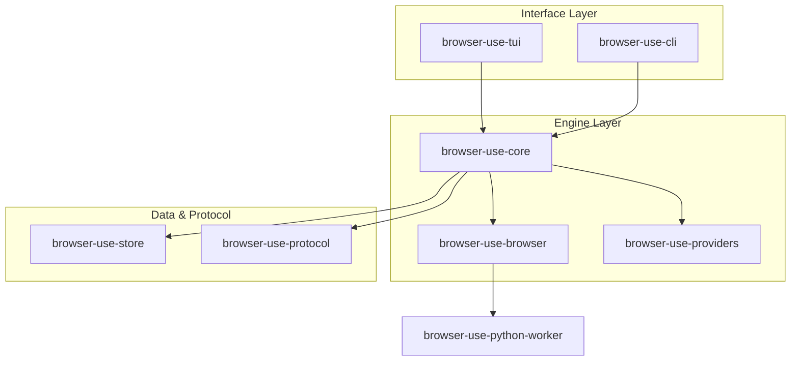
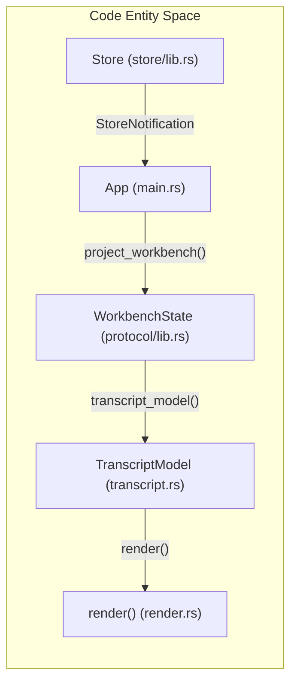

<!-- source: DeepWiki mcp.deepwiki.com · repo browser-use/terminal · page 10 Glossary · fetched 2026-10-30 -->

# Glossary

Relevant source files

The following files were used as context for generating this wiki page:

- [README.md](README.md)
- [crates/browser-use-browser/src/lib.rs](crates/browser-use-browser/src/lib.rs)
- [crates/browser-use-core/src/lib.rs](crates/browser-use-core/src/lib.rs)
- [crates/browser-use-core/src/telemetry.rs](crates/browser-use-core/src/telemetry.rs)
- [crates/browser-use-protocol/src/lib.rs](crates/browser-use-protocol/src/lib.rs)
- [crates/browser-use-store/src/lib.rs](crates/browser-use-store/src/lib.rs)
- [crates/browser-use-tui/src/main.rs](crates/browser-use-tui/src/main.rs)
- [crates/browser-use-tui/src/render.rs](crates/browser-use-tui/src/render.rs)
- [crates/browser-use-tui/src/theme.rs](crates/browser-use-tui/src/theme.rs)
- [crates/browser-use-tui/src/transcript.rs](crates/browser-use-tui/src/transcript.rs)
- [docs/public-launch-checklist.md](docs/public-launch-checklist.md)
- [scripts/tui-terminal-smoke.py](scripts/tui-terminal-smoke.py)
- [tests/golden-events/artifact-image-session/events.jsonl](tests/golden-events/artifact-image-session/events.jsonl)

This glossary defines technical terms, abbreviations, and domain-specific concepts used within the Browser Use Terminal codebase.

## System Architecture Overview

The system is structured as a Rust workspace where the core logic (agent loop, browser control, and storage) is decoupled from the user interfaces (TUI and CLI).

### Core Components Diagram

Sources: [crates/browser-use-tui/src/main.rs:16-31](), [crates/browser-use-core/src/lib.rs:15-25]()

---

## Domain Terms & Definitions

### Agent & Execution

| Term | Definition | Code Pointer |
|:---|:---|:---|
| **Agent Loop** | The main execution cycle that takes a task, fetches LLM completions, and executes tools until completion. | `run_agent_with_provider` in [crates/browser-use-core/src/lib.rs:241-241]() |
| **Turn** | A single iteration of the Agent Loop, consisting of one model request and the execution of the resulting tool calls. | `AgentRunOptions::max_turns` in [crates/browser-use-core/src/lib.rs:123-123]() |
| **Tool Registry** | A central manifest of all capabilities (functions) available to the LLM. | `ToolRegistry` in [crates/browser-use-core/src/lib.rs:29-29]() |
| **Context Compaction** | The process of pruning or summarizing history to fit within LLM token limits. | `sanitized_agent_context_from_events` in [crates/browser-use-protocol/src/lib.rs:16-16]() |
| **Sub-agent** | A child agent spawned by a parent agent to handle a specific sub-task. | `ChildAgentRunner` in [crates/browser-use-core/src/lib.rs:101-101]() |

### Browser Runtime

| Term | Definition | Code Pointer |
|:---|:---|:---|
| **CDP** | Chrome DevTools Protocol. The underlying websocket protocol used to control the browser. | `CdpConnection` in [crates/browser-use-browser/src/lib.rs:102-102]() |
| **Browser Mode** | Specifies the environment where the browser runs (Local, Managed, Cloud). | `BrowserMode` in [crates/browser-use-browser/src/lib.rs:57-63]() |
| **Python Worker** | A sidecar process that executes Python scripts for complex page interactions. | `PythonWorker` in [crates/browser-use-core/src/lib.rs:24-24]() |
| **Bridge** | A TCP-based communication channel between the Rust core and the Python worker. | `run_bridge` in [crates/browser-use-browser/src/lib.rs:239-241]() |

### Persistence & Protocol

| Term | Definition | Code Pointer |
|:---|:---|:---|
| **Session** | A unique execution instance of a task, identified by a 12-character ID. | `SessionMeta` in [crates/browser-use-protocol/src/lib.rs:5-13]() |
| **Event Record** | The atomic unit of history in the system, stored in SQLite. | `EventRecord` in [crates/browser-use-protocol/src/lib.rs:57-65]() |
| **Artifact** | A file generated during execution (e.g., screenshots, downloads). | `ArtifactMeta` in [crates/browser-use-protocol/src/lib.rs:68-77]() |
| **Store** | The SQLite-backed persistence layer managing sessions and events. | `Store` in [crates/browser-use-store/src/lib.rs:27-31]() |

---

## TUI Entities & Rendering

The TUI is built using `ratatui` and follows a state-projection pattern where the database state is projected into a `WorkbenchState` for rendering.

### TUI Architecture Diagram

Sources: [crates/browser-use-tui/src/main.rs:191-212](), [crates/browser-use-tui/src/render.rs:93-129](), [crates/browser-use-tui/src/transcript.rs:27-35]()

### Key UI Components

*   **Surface**: An enum representing different UI screens or overlays (e.g., `Main`, `Setup`, `History`). [crates/browser-use-tui/src/main.rs:117-130]()
*   **Composer**: The multi-line text input widget for user prompts. [crates/browser-use-tui/src/main.rs:66-66]()
*   **Transcript Node**: A single renderable unit in the chat history (e.g., a prompt, assistant reply, or tool status). [crates/browser-use-tui/src/transcript.rs:43-48]()
*   **Slash Palette**: The command menu triggered by `/`. [crates/browser-use-tui/src/main.rs:67-67]()

---

## Telemetry & Observability

The system uses **Laminar** (an OpenTelemetry-compatible backend) for tracing agent execution.

*   **Agent Span**: The root span covering the entire session. [crates/browser-use-core/src/telemetry.rs:87-93]()
*   **Model Turn Span**: A span representing a single LLM request and its response. [crates/browser-use-core/src/telemetry.rs:124-124]()
*   **BUT_TELEMETRY**: An environment variable to toggle anonymous product analytics. [README.md:103-103]()

---

## Testing & Verification

*   **Golden Events**: JSONL fixtures representing "perfect" sessions used for regression testing the TUI rendering. [crates/browser-use-tui/src/render.rs:26-32]()
*   **Smoke Test**: A Python script that controls the TUI via `tmux` to verify real-world terminal behavior. [scripts/tui-terminal-smoke.py:1-7]()
*   **Deterministic Dump**: The ability to render the TUI to a plain-text string for automated comparison. [crates/browser-use-tui/src/render.rs:26-32]()

Sources: [crates/browser-use-tui/src/main.rs](), [crates/browser-use-core/src/lib.rs](), [crates/browser-use-browser/src/lib.rs](), [crates/browser-use-protocol/src/lib.rs](), [crates/browser-use-store/src/lib.rs](), [crates/browser-use-tui/src/transcript.rs](), [crates/browser-use-tui/src/render.rs](), [crates/browser-use-core/src/telemetry.rs]()