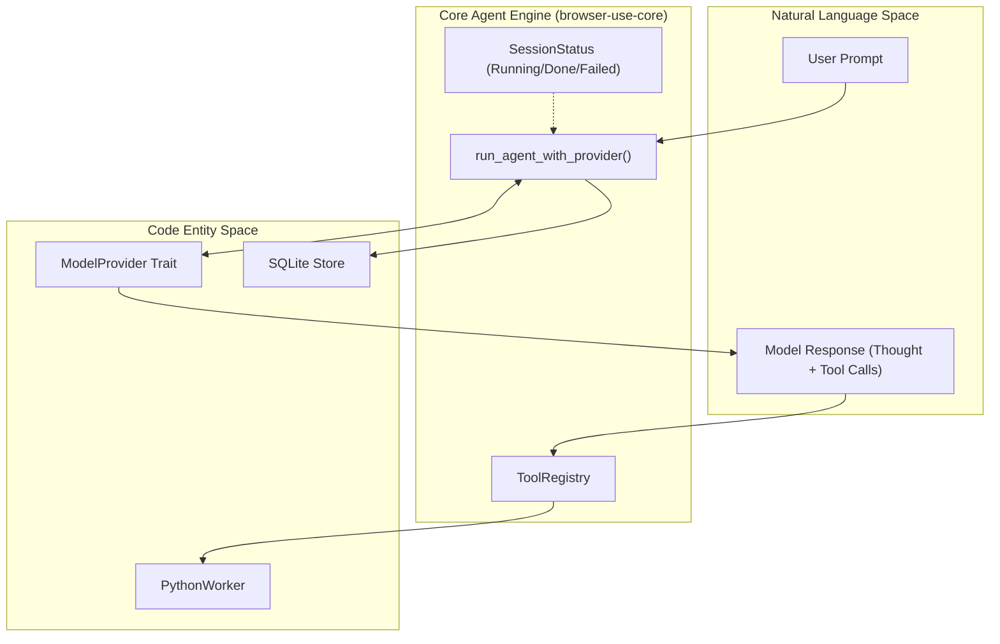
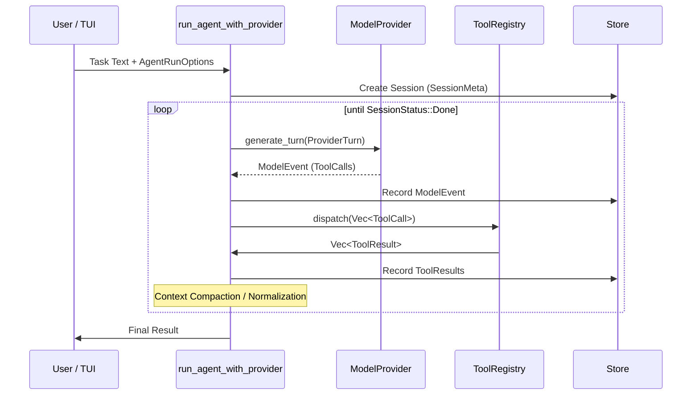

<!-- source: DeepWiki mcp.deepwiki.com · repo browser-use/terminal · page 2 Core Agent Engine · fetched 2026-10-30 -->

# Core Agent Engine

Relevant source files

The following files were used as context for generating this wiki page:

- [crates/browser-use-core/src/lib.rs](crates/browser-use-core/src/lib.rs)

The Core Agent Engine, implemented in the `browser-use-core` crate, is the central orchestrator of the Browser Use Terminal. It manages the lifecycle of an agent session, coordinates communication between LLM providers and the local environment, and handles the execution of complex tool chains.

The engine is designed to be provider-agnostic, supporting multiple LLM backends while maintaining a consistent execution environment for tools ranging from local shell commands to remote browser automation.

### System Architecture Overview

The engine operates as a stateful loop that bridges natural language intent with concrete system actions. It manages the transition from user prompts to model-generated tool calls, executes those calls via a `ToolRegistry`, and feeds the results back into the model context.

**Sources:** [crates/browser-use-core/src/lib.rs:207-213](), [crates/browser-use-core/src/lib.rs:29-30]()

---

### Key Components

#### 1. Agent Loop and Session Lifecycle
The execution entry point is `run_agent_with_provider`. This function manages the "Turn" logic, where each turn consists of sending the current context to an LLM, receiving tool calls, and executing them. It handles session persistence via the `Store` and manages state transitions from `Created` to `Running`, and finally to terminal states like `Done` or `Failed`.
*   **For details, see [Agent Loop and Session Lifecycle](#2.1)**

#### 2. Tool Registry and Dispatch
The `ToolRegistry` defines the capabilities of the agent. It maps model-requested tool names (e.g., `exec_command`, `browser_script`) to internal Rust handlers or external Python processes. The engine supports parallel tool execution and manages "spilling" large tool outputs to disk to keep the LLM context window manageable.
*   **For details, see [Tool Registry and Dispatch](#2.2)**

#### 3. Multi-Agent Hierarchy
The engine supports recursion through the `spawn_agent` tool. A parent agent can delegate sub-tasks to child agents, which operate in their own isolated session contexts. The `ChildAgentRunner` handles the instantiation of these sub-agents, allowing for complex hierarchical problem-solving.
*   **For details, see [Multi-Agent Hierarchy and Sub-agents](#2.3)**

#### 4. LLM Providers
The `ModelProvider` trait abstracts away the differences between various LLM APIs. Whether using Anthropic, OpenAI, or local Codex instances, the engine interacts with a unified interface for message normalization and response parsing.
*   **For details, see [LLM Providers](#2.4)**

---

### Data Flow and Entity Mapping

The following diagram maps the high-level conceptual flow to the specific Rust structs and traits used in the `browser-use-core` crate.

**Sources:** [crates/browser-use-core/src/lib.rs:122-148](), [crates/browser-use-core/src/lib.rs:15-23]()

### Core Configuration
The engine is configured via `AgentRunOptions`, which controls:
*   `max_turns`: Prevents infinite loops [crates/browser-use-core/src/lib.rs:137]().
*   `max_context_chars`: Threshold for triggering context compaction [crates/browser-use-core/src/lib.rs:138]().
*   `browser_mode`: Determines the browser environment (Local, Managed, Cloud) [crates/browser-use-core/src/lib.rs:177-205]().
*   `child_agent_runner`: The hook for spawning sub-agents [crates/browser-use-core/src/lib.rs:166-169]().

**Sources:**
- `crates/browser-use-core/src/lib.rs`
- `crates/browser-use-protocol/src/lib.rs`
- `crates/browser-use-providers/src/lib.rs`

---

