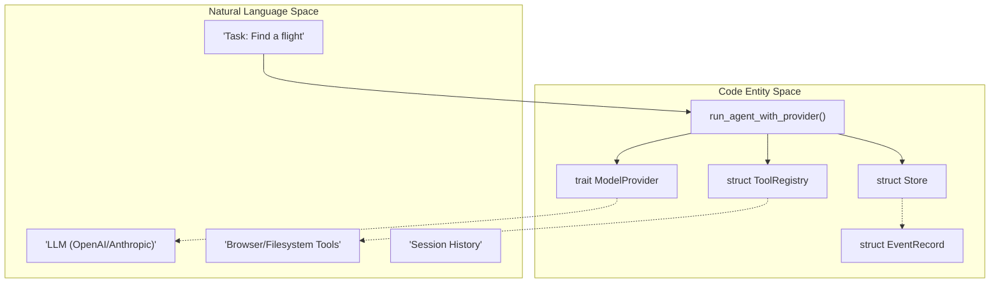
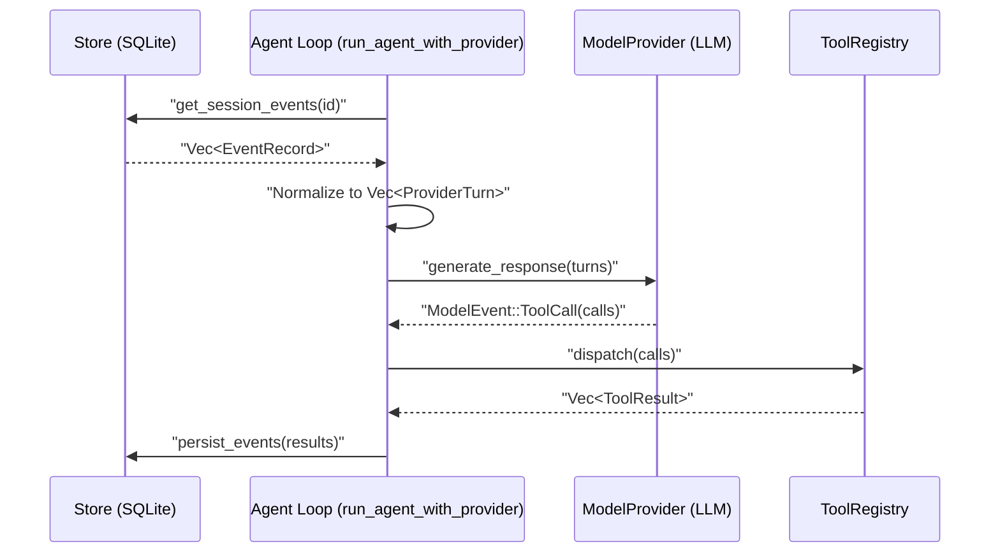

<!-- source: DeepWiki mcp.deepwiki.com · repo browser-use/terminal · page 2.1 Agent Loop and Session Lifecycle · fetched 2026-10-30 -->

# Agent Loop and Session Lifecycle

<details>
<summary>Relevant source files</summary>

The following files were used as context for generating this wiki page:

- [crates/browser-use-core/src/lib.rs](crates/browser-use-core/src/lib.rs)
- [crates/browser-use-protocol/src/lib.rs](crates/browser-use-protocol/src/lib.rs)
- [crates/browser-use-store/src/lib.rs](crates/browser-use-store/src/lib.rs)
- [tests/golden-events/artifact-image-session/events.jsonl](tests/golden-events/artifact-image-session/events.jsonl)

</details>


The agent loop is the central execution engine of Browser Use Terminal. It orchestrates the interaction between the LLM provider, the tool registry, and the browser runtime. This page details the implementation of the main loop, how session states transition, and the mechanisms for context management and retry logic.

## 1. The Core Agent Loop: `run_agent_with_provider`

The primary entry point for executing an agent is the `run_agent_with_provider` function [crates/browser-use-core/src/lib.rs:275-275](). This function manages a single session's execution until it reaches a terminal state (Done, Failed, or Cancelled).

### Execution Flow
1.  **Initialization**: The session status is updated to `Running` in the `Store` [crates/browser-use-core/src/lib.rs:296-298]().
2.  **Turn Management**: The agent enters a loop that continues until `max_turns` is reached or a terminal condition is met [crates/browser-use-core/src/lib.rs:328-330]().
3.  **Context Construction**: In each turn, the agent fetches the session history and normalizes it into a provider-specific format (e.g., `ProviderTurn`) [crates/browser-use-core/src/lib.rs:335-341]().
4.  **LLM Call**: The `ModelProvider` is invoked to generate a response, which may include text deltas, thinking blocks, or tool calls [crates/browser-use-core/src/lib.rs:360-362]().
5.  **Tool Execution**: If the LLM requests tool usage, the `ToolRegistry` dispatches these calls [crates/browser-use-core/src/lib.rs:400-410]().
6.  **Persistence**: Every event (model usage, tool results, text) is persisted to the SQLite `Store` [crates/browser-use-core/src/lib.rs:388-392]().

### Natural Language to Code Entity Space: Agent Execution
The following diagram maps high-level agent concepts to specific code entities and functions.

Title: Agent Execution Mapping

Sources: [crates/browser-use-core/src/lib.rs:275-275](), [crates/browser-use-providers/src/lib.rs:24-24](), [crates/browser-use-core/src/tools/mod.rs:43-43](), [crates/browser-use-store/src/lib.rs:27-27](), [crates/browser-use-protocol/src/lib.rs:57-57]()

## 2. Session Lifecycle and State Machine

A session moves through a strictly defined set of states defined in the `SessionStatus` enum [crates/browser-use-protocol/src/lib.rs:17-23]().

| State | Description | Transitions To |
| :--- | :--- | :--- |
| `Created` | Session metadata exists in DB but execution hasn't started. | `Running` |
| `Running` | The agent loop is actively processing turns. | `Done`, `Failed`, `Cancelled` |
| `Done` | The agent successfully called the `done` tool. | (Terminal) |
| `Failed` | An unrecoverable error occurred or `max_turns` was exceeded. | (Terminal) |
| `Cancelled` | The user manually stopped the session. | (Terminal) |

### State Machine Diagram
Title: Session State Machine
```mermaid
stateDiagram-v2
    [*] --> Created: "Store::create_session()"
    Created --> Running: "run_agent_with_provider()"
    Running --> Done: "Tool: done"
    Running --> Failed: "Error / Max Turns"
    Running --> Cancelled: "SIGINT / CLI cancel"
    Done --> [*]
    Failed --> [*]
    Cancelled --> [*]
```
Sources: [crates/browser-use-protocol/src/lib.rs:17-23](), [crates/browser-use-core/src/lib.rs:296-298](), [crates/browser-use-core/src/lib.rs:445-447]()

## 3. Context Management and Compaction

To prevent token limit exhaustion, the agent employs several context management strategies:

*   **Message Normalization**: The agent converts raw `EventRecord` objects from the database into `ProviderTurn` objects [crates/browser-use-core/src/lib.rs:335-341](). This involves filtering out internal metadata and formatting tool results.
*   **Token Budgeting**: Tool outputs are truncated if they exceed `MAX_TOOL_OUTPUT_TEXT_TOKENS` (default 4,000) [crates/browser-use-core/src/lib.rs:32-32]().
*   **Context Compaction**: If the total context exceeds `max_context_chars`, the agent summarizes older turns to fit within the budget [crates/browser-use-core/src/lib.rs:124-124]().
*   **Image Budgeting**: Images are budgeted separately at `IMAGE_CONTEXT_BUDGET_TOKENS` (default 2,000) to ensure visual history doesn't displace critical text instructions [crates/browser-use-core/src/lib.rs:33-33]().

## 4. Turn Management and Retry Logic

Each iteration of the loop is considered a "turn." The agent handles various turn-level scenarios:

### Parallel Tool Execution
When the LLM returns multiple tool calls in a single response, the agent attempts to execute them in parallel if they are marked as thread-safe [crates/browser-use-core/src/lib.rs:400-410]().

### Error Handling and Retries
*   **Transient Provider Errors**: If the LLM provider fails (e.g., rate limit or 500 error), the agent implements a basic retry mechanism before failing the session [crates/browser-use-core/src/lib.rs:360-365]().
*   **Tool Errors**: If a tool fails, the error is returned to the LLM as a `ToolResult` where `ok: false` [crates/browser-use-protocol/src/lib.rs:109-109](). This allows the agent to "see" the error and attempt a correction in the next turn.
*   **Max Turns**: If the agent reaches `max_turns` (default 80) without calling the `done` tool, the session is transitioned to `Failed` to prevent infinite loops [crates/browser-use-core/src/lib.rs:137-137]().

### Data Flow: Turn Lifecycle
Title: Single Turn Data Flow

Sources: [crates/browser-use-core/src/lib.rs:335-341](), [crates/browser-use-core/src/lib.rs:360-362](), [crates/browser-use-core/src/lib.rs:400-410](), [crates/browser-use-core/src/lib.rs:388-392]()

## 5. Key Functions and Data Structures

### `AgentRunOptions`
This struct configures the behavior of the loop, including limits and environment settings [crates/browser-use-core/src/lib.rs:121-132]().
*   `max_turns`: Hard limit on the number of LLM interactions.
*   `max_context_chars`: Threshold for context window management.
*   `python_tool_timeout_seconds`: Timeout for the `browser_script` and `python` tools.

### `ProviderTurn`
A normalized representation of a conversation turn used to interface with different LLM backends [crates/browser-use-providers/src/lib.rs:22-22](). It encapsulates:
*   User prompts or tool results.
*   Assistant text, thinking, or tool calls.

Sources: [crates/browser-use-core/src/lib.rs:121-132](), [crates/browser-use-core/src/lib.rs:275-275](), [crates/browser-use-protocol/src/lib.rs:17-23](), [crates/browser-use-store/src/lib.rs:195-203]()

---

