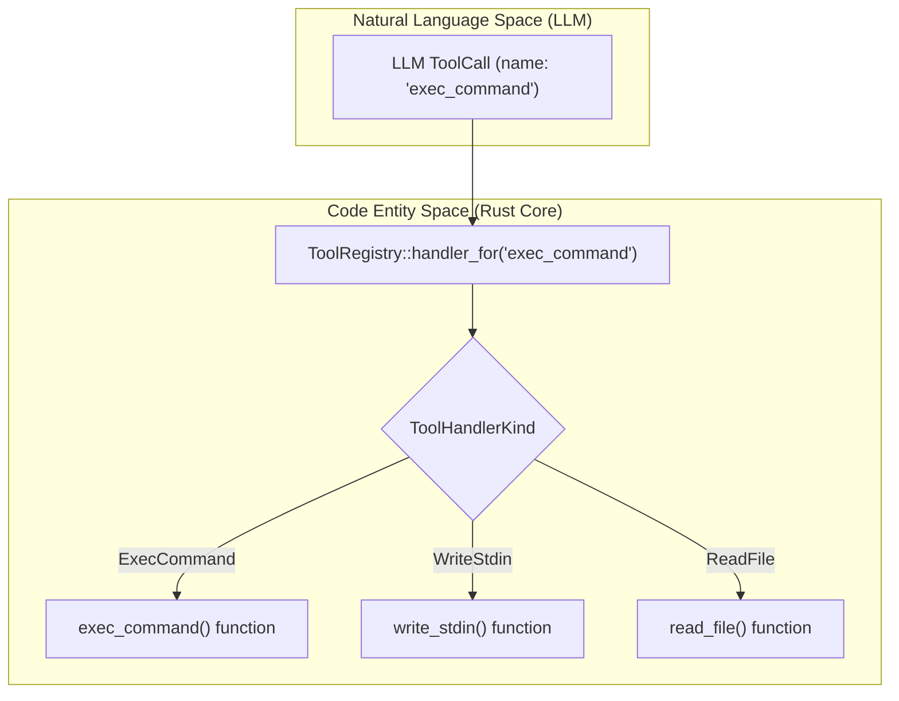
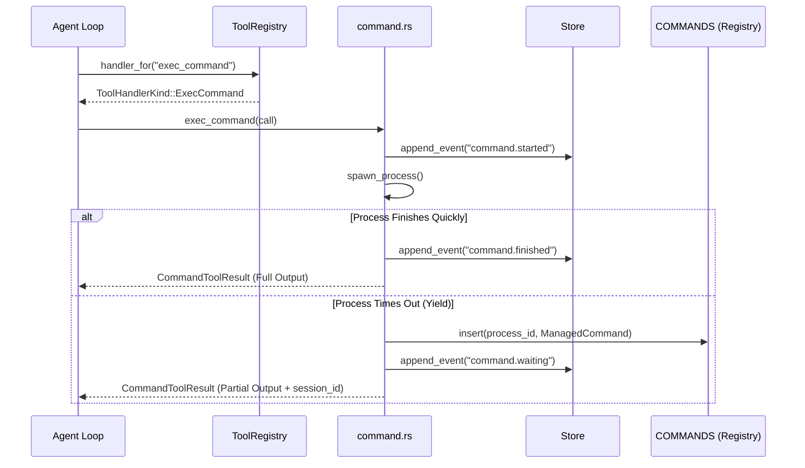

<!-- source: DeepWiki mcp.deepwiki.com · repo browser-use/terminal · page 2.2 Tool Registry and Dispatch · fetched 2026-10-30 -->

# Tool Registry and Dispatch

Relevant source files

The following files were used as context for generating this wiki page:

- [crates/browser-use-core/src/tools/command.rs](crates/browser-use-core/src/tools/command.rs)
- [crates/browser-use-core/src/tools/files.rs](crates/browser-use-core/src/tools/files.rs)
- [crates/browser-use-core/src/tools/mod.rs](crates/browser-use-core/src/tools/mod.rs)
- [datasets/real_v8.json](datasets/real_v8.json)
- [docs/terminal-ui-product-ux.md](docs/terminal-ui-product-ux.md)
- [prompts/browser-script-tool-description.md](prompts/browser-script-tool-description.md)
- [prompts/browser-tool-description.md](prompts/browser-tool-description.md)
- [prompts/interaction-skills/profile-sync.md](prompts/interaction-skills/profile-sync.md)
- [prompts/python-tool-description.md](prompts/python-tool-description.md)

The Tool Registry and Dispatch system serves as the interface between the Agent's natural language reasoning and the local/remote execution environment. It defines the capabilities available to the Agent, enforces input schemas, and manages the lifecycle of tool execution, including parallel dispatch and output truncation.

## ToolRegistry Architecture

The `ToolRegistry` is a centralized collection of `RegisteredTool` objects, each mapping a `ToolSpec` (defining the JSON schema and description for the LLM) to a `ToolHandlerKind` (an internal enum used for dispatching to Rust implementation logic) [crates/browser-use-core/src/tools/mod.rs:30-38]().

The primary registry used by the agent is initialized via `ToolRegistry::browser_agent()`, which populates the registry with the full suite of terminal, file, browser, and multi-agent tools [crates/browser-use-core/src/tools/mod.rs:41-62]().

### Dispatch Flow: From LLM to Implementation

The dispatch process involves resolving a tool name from an LLM `ToolCall` to a specific handler.

| Component | Role | Code Entity |
| :--- | :--- | :--- |
| **Registry** | Holds the mapping of names to handlers. | `ToolRegistry` [crates/browser-use-core/src/tools/mod.rs:36]() |
| **Spec** | The JSON schema sent to the LLM. | `ToolSpec` [crates/browser-use-protocol/src/lib.rs]() |
| **Handler** | Enum identifying the internal logic to run. | `ToolHandlerKind` [crates/browser-use-core/src/tools/mod.rs:7-27]() |
| **Dispatcher** | Resolves name to handler. | `ToolRegistry::handler_for` [crates/browser-use-core/src/tools/mod.rs:72-77]() |

**Tool Resolution Diagram**
This diagram bridges the gap between the `ToolCall` received from the LLM and the internal Rust entities.

Sources: [crates/browser-use-core/src/tools/mod.rs:7-27](), [crates/browser-use-core/src/tools/mod.rs:72-77](), [crates/browser-use-core/src/tools/command.rs:62]()

---

## Core Tool Categories

### 1. Browser Tools
The system distinguishes between the **Control Plane** and the **Data Plane** for browser interactions.

*   **`browser`**: Used for runtime management, including connecting to local/remote instances, profile discovery, and health checks (`browser doctor`) [prompts/browser-tool-description.md:1-21]().
*   **`browser_script`**: Executes Python code within a managed worker. It provides a rich set of pre-imported helpers like `click_at_xy`, `screenshot`, and `js` for page interaction [prompts/browser-script-tool-description.md:17-59]().

### 2. Command & Terminal Tools
Managed via the `COMMANDS` registry, these tools allow for long-running shell interactions.

*   **`exec_command`**: Spawns a process (optionally in a PTY). If the process doesn't exit within `yield_time_ms`, it returns a `session_id` for continued interaction [crates/browser-use-core/src/tools/command.rs:62-121]().
*   **`write_stdin`**: Sends input to an active `session_id` created by `exec_command` [crates/browser-use-core/src/tools/command.rs:213-231]().

### 3. Filesystem Tools
These tools provide safe, truncated access to the local workspace.

*   **`read_file`**: Reads text files with mandatory line-numbering and automatic binary detection [crates/browser-use-core/src/tools/files.rs:23-51]().
*   **`search_files`**: Performs high-performance searches using `rg` (ripgrep) if available, falling back to internal implementations [crates/browser-use-core/src/tools/files.rs:103-131]().
*   **`apply_patch`**: Applies Codex-style multi-line patches (add, delete, update, move) to local files [crates/browser-use-core/src/tools/mod.rs:154-173]().

### 4. Agent Lifecycle Tools
*   **`spawn_agent`**: Creates a sub-agent to handle a delegated sub-task [crates/browser-use-core/src/tools/mod.rs:20-21]().
*   **`done`**: Signals task completion and returns the final result to the user or parent agent [crates/browser-use-core/src/tools/mod.rs:8]() [prompts/python-tool-description.md:13]().

---

## Execution Logic and Output Management

### Parallel vs. Serial Execution
While the Agent Loop supports parallel tool execution for independent tasks (e.g., reading multiple files), certain tools enforce serial constraints. Specifically, `browser_script` interactions are considered shared mutable state; the documentation instructs models not to parallelize browser-changing actions [prompts/python-tool-description.md:5]().

### Tool Output Spilling and Truncation
To prevent context window exhaustion, the registry implements aggressive truncation:
*   **Approximation**: Uses a `TOKEN_TO_CHAR_APPROX` of 4 characters per token [crates/browser-use-core/src/tools/command.rs:21]().
*   **Read Limits**: `read_file` defaults to 400 lines or 80,000 bytes [crates/browser-use-core/src/tools/files.rs:13-14]().
*   **Command Output**: Long-running command output is truncated based on `max_output_tokens` provided in the tool call [crates/browser-use-core/src/tools/command.rs:20]().

**Command Execution Lifecycle**
This diagram tracks the flow of a command from the `exec_command` call to the persistent `COMMANDS` registry.

Sources: [crates/browser-use-core/src/tools/command.rs:62-211](), [crates/browser-use-core/src/tools/command.rs:136-151](), [crates/browser-use-core/src/tools/command.rs:197-200]()

### Event Emission
Every tool execution emits structured events to the `Store`. This includes `tool.started`, `tool.finished`, and tool-specific events like `command.output` or `file.read` [crates/browser-use-core/src/tools/command.rs:101-110](), [crates/browser-use-core/src/tools/files.rs:84-96](). These events drive the TUI transcript and the persistent session history.

Sources:
- `crates/browser-use-core/src/tools/mod.rs`
- `crates/browser-use-core/src/tools/command.rs`
- `crates/browser-use-core/src/tools/files.rs`
- `prompts/browser-tool-description.md`
- `prompts/browser-script-tool-description.md`
- `prompts/python-tool-description.md`

---

