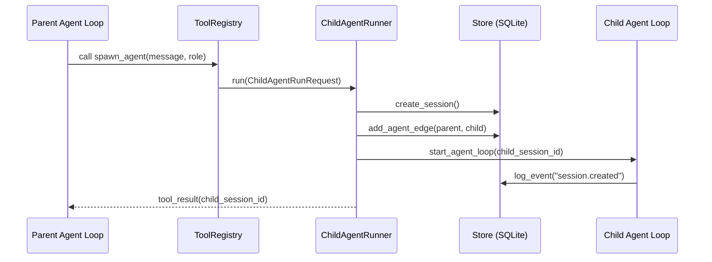
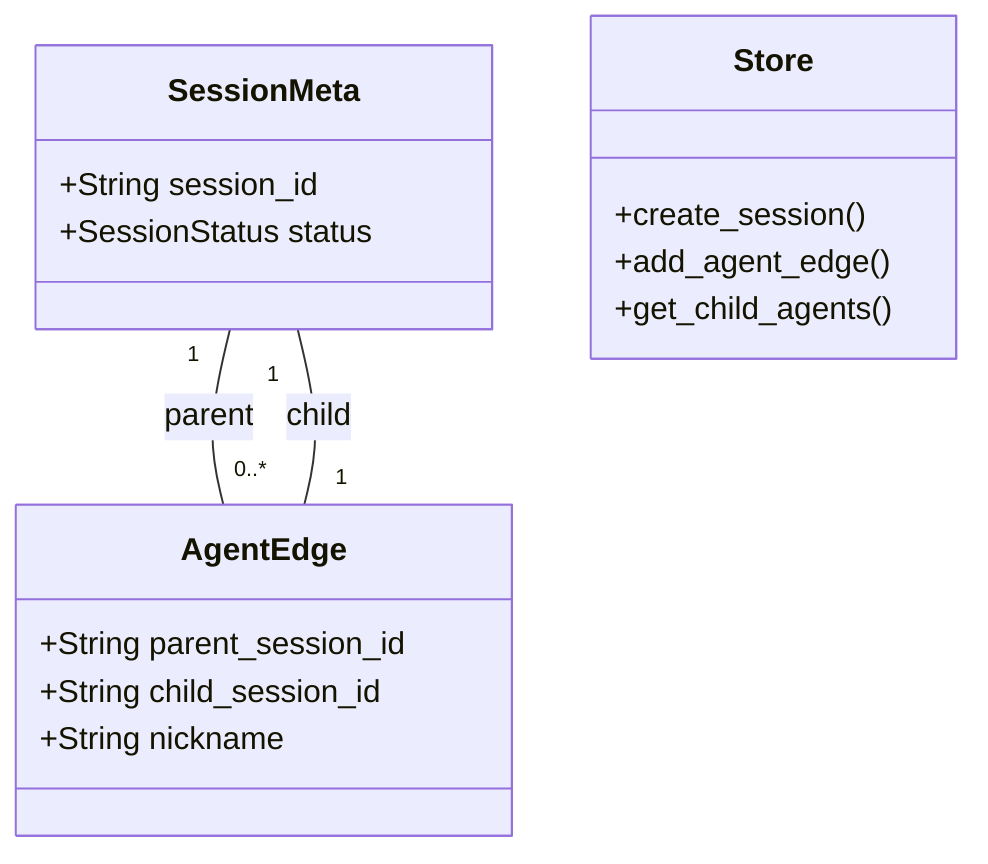

<!-- source: DeepWiki mcp.deepwiki.com · repo browser-use/terminal · page 2.3 Multi-Agent Hierarchy and Sub-agents · fetched 2026-10-30 -->

# Multi-Agent Hierarchy and Sub-agents

<details>
<summary>Relevant source files</summary>

The following files were used as context for generating this wiki page:

- [crates/browser-use-cli/src/main.rs](crates/browser-use-cli/src/main.rs)
- [crates/browser-use-core/src/lib.rs](crates/browser-use-core/src/lib.rs)
- [prompts/helper-session-identity.md](prompts/helper-session-identity.md)
- [prompts/helper-session-inherited-context.md](prompts/helper-session-inherited-context.md)

</details>


This page details the hierarchical agent architecture of Browser Use Terminal. It explains how agents can delegate complex tasks to sub-agents, manage their lifecycles, and share context across the agent tree.

## Overview

The system supports a recursive multi-agent model where a "Parent Agent" can spawn one or more "Child Agents" (or "Sub-agents") to handle specific sub-tasks. This is primarily facilitated by the `spawn_agent` tool. Sub-agents can be short-lived (e.g., to explore a specific website) or long-running (e.g., to monitor a process).

### Key Concepts
- **Parent Agent**: The agent that initiates a sub-task.
- **Child Agent**: A newly created session with its own agent loop, potentially inheriting context from the parent.
- **Context Inheritance**: The mechanism by which a child agent receives a summary or partial history of the parent's work.
- **Lifecycle Guarding**: Using the `done` tool to signal completion back to the parent.

## The Spawn Mechanism

Agents spawn sub-agents by calling the `spawn_agent` tool [crates/browser-use-core/src/lib.rs:29](). This tool is registered within the `ToolRegistry` and handled by the core engine.

### Implementation Flow
1. **Tool Call**: The parent agent issues a `spawn_agent` tool call with parameters such as `message` (the task for the child), `nickname`, and `role`.
2. **Runner Execution**: The `ChildAgentRunner` [crates/browser-use-core/src/lib.rs:101-119]() is invoked. This is a closure passed into the `AgentRunOptions` [crates/browser-use-core/src/lib.rs:128]() during initialization.
3. **Session Creation**: A new session ID is generated, and a record is created in the `agent_edges` table in the `Store` [crates/browser-use-store/src/lib.rs:25]() to track the hierarchy.
4. **Context Injection**: Depending on the configuration, the parent's context is compacted and injected into the child's initial prompt.

### Agent Spawning Sequence
The following diagram illustrates the interaction between the `AgentLoop`, `ToolRegistry`, and the `ChildAgentRunner`.


Sources: [crates/browser-use-core/src/lib.rs:95-119](), [crates/browser-use-cli/src/main.rs:151-160]()

## Context Inheritance Modes

When a sub-agent is spawned, it often needs to know what the parent has already accomplished to avoid redundant work. The system uses specific prompt templates to inject this context.

| Mode | Description | Code Reference |
| :--- | :--- | :--- |
| **Summary** | A high-level summary of the parent's progress is generated and passed to the child. | `AgentSummary` [crates/browser-use-store/src/lib.rs:25]() |
| **Sanitized Context** | System-sanitized history from the parent's event log. | `sanitized_agent_context_from_events` [crates/browser-use-protocol/src/lib.rs:16]() |
| **Prompt Injection** | Uses `helper-session-identity.md` and `helper-session-inherited-context.md` to format the child's system prompt. | [prompts/helper-session-identity.md:1-4](), [prompts/helper-session-inherited-context.md:1-4]() |

Sources: [crates/browser-use-core/src/lib.rs:15-25](), [prompts/helper-session-identity.md:1-4]()

## Inter-Agent Messaging and Lifecycle

Agents communicate asynchronously through the `Store`. The CLI and Core provide commands to manage these interactions.

### Messaging Tools
- **`send_agent_message`**: Allows an agent (or user) to send a message to another agent. If `trigger_turn` is true, it forces the target agent to run an immediate iteration [crates/browser-use-cli/src/main.rs:169-175]().
- **`wait_agent`**: Blocks the caller until the target agent reaches a terminal state (Done/Failed) [crates/browser-use-cli/src/main.rs:176-178]().

### The `done` Tool
Sub-agents are expected to use the `done` tool to signal completion. When a sub-agent calls `done`, it transitions the session status to `Done`. The parent agent, if waiting via `wait_agent`, receives the result string provided by the child.

### Hierarchy Data Model
The relationship between agents is persisted in the database, allowing for reconstruction of the agent tree even after a restart.


Sources: [crates/browser-use-store/src/lib.rs:25-30](), [crates/browser-use-protocol/src/lib.rs:15-18]()

## Implementation Details: `ChildAgentRunner`

The `ChildAgentRunner` is a critical abstraction that allows the `browser-use-core` crate to remain agnostic of how agents are actually executed (e.g., via a local thread or a remote CLI call).

In the CLI implementation, `spawn_agent` is mapped to a command that initializes a new `ProviderRunConfig` and starts a fresh agent loop [crates/browser-use-cli/src/main.rs:151-160]().

```rust
// Example of the runner structure in core
pub struct ChildAgentRunner {
    run: Arc<dyn Fn(ChildAgentRunRequest) -> Result<()> + Send + Sync>,
}
```
Sources: [crates/browser-use-core/src/lib.rs:101-104](), [crates/browser-use-cli/src/main.rs:11-16]()

---

