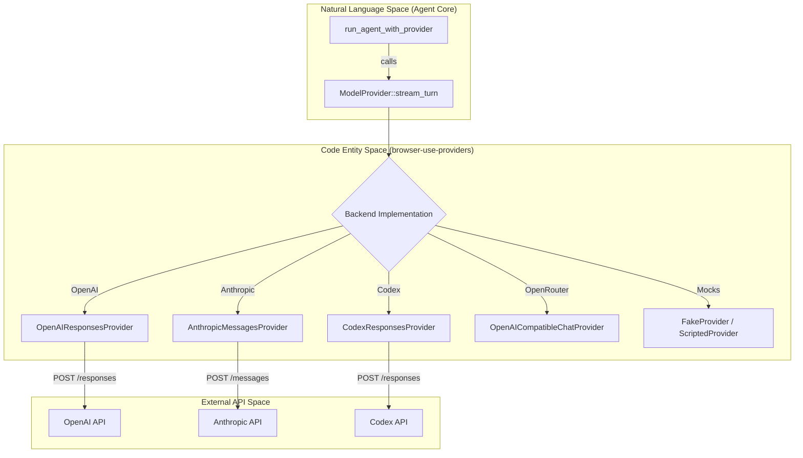
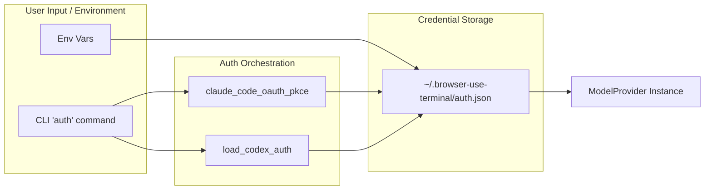

<!-- source: DeepWiki mcp.deepwiki.com · repo browser-use/terminal · page 2.4 LLM Providers · fetched 2026-10-30 -->

# LLM Providers

Relevant source files

The following files were used as context for generating this wiki page:

- [crates/browser-use-cli/src/main.rs](crates/browser-use-cli/src/main.rs)
- [crates/browser-use-core/src/lib.rs](crates/browser-use-core/src/lib.rs)
- [crates/browser-use-providers/Cargo.toml](crates/browser-use-providers/Cargo.toml)
- [crates/browser-use-providers/src/lib.rs](crates/browser-use-providers/src/lib.rs)
- [crates/browser-use-python-worker/Cargo.toml](crates/browser-use-python-worker/Cargo.toml)
- [crates/browser-use-python-worker/src/lib.rs](crates/browser-use-python-worker/src/lib.rs)
- [python/llm_browser_worker/worker.py](python/llm_browser_worker/worker.py)
- [python/tests/test_worker_package.py](python/tests/test_worker_package.py)

The `browser-use-providers` crate defines the abstraction layer for Large Language Model (LLM) interaction. It encapsulates the complexities of different vendor APIs, authentication flows, and message formats into a unified interface used by the core agent engine.

## The ModelProvider Trait

The central abstraction for LLM interaction is the `ModelProvider` trait [crates/browser-use-providers/src/lib.rs:24-45](). This trait allows the agent loop to remain agnostic of the underlying backend (e.g., Anthropic, OpenAI, or a local mock).

### Key Components
*   **`ProviderTurn`**: A structure containing the current conversation history (as JSON values) and the available `ToolSpec` objects for the current turn [crates/browser-use-providers/src/lib.rs:18-22]().
*   **`start_turn`**: The primary method that takes a `ProviderTurn` and returns a vector of `ModelEvent` objects [crates/browser-use-providers/src/lib.rs:33]().
*   **`stream_turn`**: A default implementation that facilitates streaming responses by invoking a callback for each `ModelEvent` as it arrives [crates/browser-use-providers/src/lib.rs:35-44]().

### LLM Provider Architecture
The following diagram illustrates how the `ModelProvider` trait bridges the high-level agent logic with specific vendor implementations.

**Model Provider Interface Mapping**

Sources: [crates/browser-use-providers/src/lib.rs:24-45](), [crates/browser-use-providers/src/lib.rs:120-126](), [crates/browser-use-providers/src/lib.rs:206-212]()

## Supported Backends

| Backend | Implementation Class | API Endpoint | Description |
| :--- | :--- | :--- | :--- |
| **OpenAI** | `OpenAIResponsesProvider` | `/v1/responses` | Uses the OpenAI Realtime/Responses API for structured output [crates/browser-use-providers/src/lib.rs:120-126](). |
| **Anthropic** | `AnthropicMessagesProvider` | `/v1/messages` | Standard Claude API implementation. |
| **Codex** | `CodexResponsesProvider` | `/v1/responses` | Specialized endpoint for Codex-based models. |
| **OpenRouter** | `OpenAICompatibleChatProvider` | `/api/v1/chat/completions` | Compatible with OpenRouter and other OpenAI-like proxies [crates/browser-use-providers/src/lib.rs:206-212](). |
| **Fake** | `FakeProvider` | N/A | Returns a static, pre-defined response for testing [crates/browser-use-providers/src/lib.rs:48-65](). |
| **Scripted** | `ScriptedProvider` | N/A | Returns a sequence of pre-defined turns from a queue [crates/browser-use-providers/src/lib.rs:88-98](). |

## Authentication Flows

The codebase supports several authentication mechanisms depending on the provider and the environment.

### 1. API Keys
Most providers (OpenAI, OpenRouter, Anthropic) rely on standard API keys loaded from environment variables:
*   `LLM_BROWSER_OPENAI_API_KEY` or `OPENAI_API_KEY` [crates/browser-use-providers/src/lib.rs:148-150]().
*   `LLM_BROWSER_OPENAI_COMPAT_API_KEY` or `OPENROUTER_API_KEY` [crates/browser-use-providers/src/lib.rs:234-236]().

### 2. Claude Code OAuth (PKCE)
For Claude models, the system implements an OAuth PKCE flow to authorize the terminal.
*   **Authorization**: `claude_code_oauth_authorize_url` generates the login URL [crates/browser-use-cli/src/main.rs:22]().
*   **Exchange**: `exchange_claude_code_authorization_code` converts the callback code into a `ClaudeCodeOAuthCredential`.
*   **Refresh**: `refresh_claude_code_oauth` is called automatically to maintain session validity [crates/browser-use-core/src/lib.rs:20]().

### 3. Codex Device Auth
Codex authentication involves loading a specialized credential file.
*   **Loading**: `load_codex_auth` or `load_codex_auth_file` [crates/browser-use-cli/src/main.rs:23]().
*   **Structure**: The `CodexAuth` struct holds the necessary tokens for the `CodexResponsesProvider` [crates/browser-use-core/src/lib.rs:21]().

**Authentication Data Flow**

Sources: [crates/browser-use-cli/src/main.rs:142-145](), [crates/browser-use-providers/src/lib.rs:22-27]()

## Provider Resolution Hierarchy

When an agent is started, the `ProviderBackend` enum [crates/browser-use-core/src/lib.rs:56-63]() and `ProviderRunConfig` [crates/browser-use-core/src/lib.rs:66-71]() determine which implementation is instantiated.

The resolution logic typically follows this order in the CLI:
1.  **Explicit Command**: Subcommands like `run-openai` or `run-anthropic` force a specific provider [crates/browser-use-cli/src/main.rs:56-75]().
2.  **Configuration**: If no provider is specified, the system looks for default settings in the `Store`.
3.  **Environment Fallback**: Providers check for their specific environment variables (e.g., `OPENAI_API_KEY`) during instantiation [crates/browser-use-providers/src/lib.rs:148-154]().

### Provider Initialization in Core
The core function `run_agent_with_provider` receives the resolved implementation. The mapping from the `ProviderBackend` enum to the trait implementation is handled by the factory logic in `browser-use-core` [crates/browser-use-core/src/lib.rs:20-23]().

Sources: [crates/browser-use-core/src/lib.rs:56-92](), [crates/browser-use-cli/src/main.rs:56-95](), [crates/browser-use-providers/src/lib.rs:147-154]()

---

