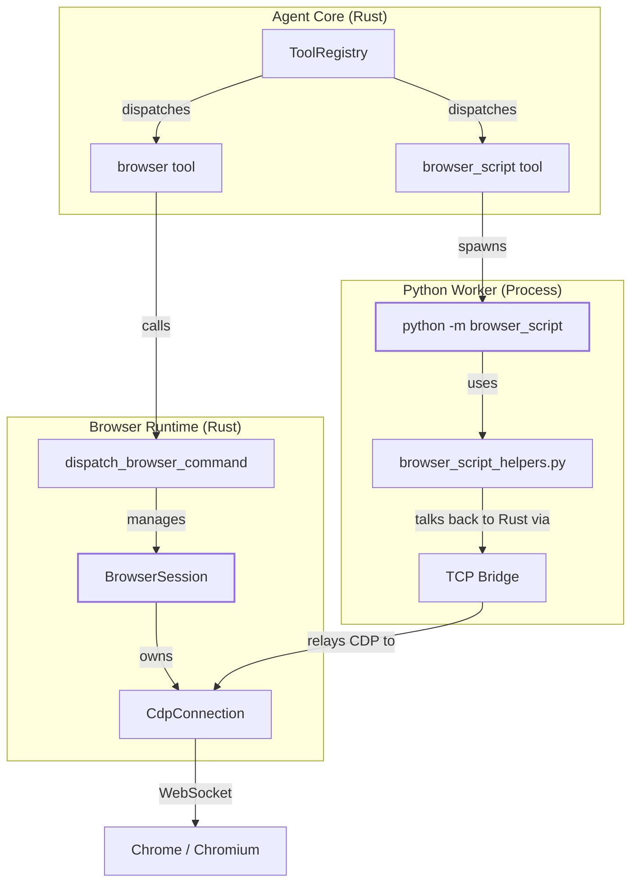

<!-- source: DeepWiki mcp.deepwiki.com · repo browser-use/terminal · page 3 Browser Runtime · fetched 2026-10-30 -->

# Browser Runtime

Relevant source files

The following files were used as context for generating this wiki page:

- [README.md](README.md)
- [crates/browser-use-browser/src/lib.rs](crates/browser-use-browser/src/lib.rs)
- [docs/public-launch-checklist.md](docs/public-launch-checklist.md)

The `browser-use-browser` crate provides the **Browser Runtime**, a Rust-owned control plane for browser automation. Unlike traditional automation frameworks that bundle logic into the browser process, this architecture maintains a persistent, durable Chrome DevTools Protocol (CDP) connection in Rust while offloading complex page interactions to a specialized Python worker.

This split ensures that the agent loop remains stable even if a specific page interaction fails or a browser tab crashes. The runtime supports multiple operating modes, ranging from local Chrome instances to managed headless sessions and remote cloud browsers [crates/browser-use-browser/src/lib.rs:57-63]().

### System Architecture Overview

The Browser Runtime acts as the bridge between the "Natural Language Space" (where the LLM decides what to do) and the "Code Entity Space" (where CDP commands are executed).

#### Logic Flow: Tool to Browser
The LLM interacts with the browser through two primary tools: `browser` (for lifecycle/tabs) and `browser_script` (for page content).

**Sources:** [crates/browser-use-browser/src/lib.rs:3-6](), [crates/browser-use-browser/src/lib.rs:194-218](), [crates/browser-use-browser/src/lib.rs:220-241]()

---

### CDP Connection and Browser Modes

The core of the runtime is the `BrowserSession` [crates/browser-use-browser/src/lib.rs:146-165](), which tracks the `BrowserMode` and `BrowserOwner`. The system can connect to existing browsers or manage its own lifecycle.

*   **Connection Management:** Rust maintains a `CdpConnection` using a WebSocket over a `MaybeTlsStream` [crates/browser-use-browser/src/lib.rs:102-105]().
*   **Modes:** Supports `Local` (existing user profile), `Managed` (temporary or specific path), `RemoteCdp` (external WebSocket), and `RemoteCloud` (Browser Use API) [crates/browser-use-browser/src/lib.rs:57-63]().
*   **Recovery:** The runtime handles connection generation tracking to ensure stale commands from previous sessions do not interfere with new ones [crates/browser-use-browser/src/lib.rs:153]().

For details, see [CDP Connection and Browser Modes](#3.1).

---

### Python Worker and `browser_script`

Page-level interaction (clicking, typing, extracting data) is handled by the `browser_script` tool. Instead of writing raw CDP in Rust, the agent writes Python code that utilizes a high-level library of helper functions.

*   **Execution Model:** Rust spawns a fresh Python process for every `browser_script` call [crates/browser-use-browser/src/lib.rs:239-241]().
*   **TCP Bridge:** The Python worker communicates back to the Rust-owned CDP connection via a local TCP bridge [crates/browser-use-browser/src/lib.rs:229-231]().
*   **Helpers:** `browser_script_helpers.py` provides an ergonomic API (e.g., `goto_url`, `screenshot`, `fill_input`) while allowing raw CDP as an escape hatch [crates/browser-use-browser/src/lib.rs:31]().

For details, see [Python Worker and browser_script](#3.2).

---

### Browser Interaction Skills

The "intelligence" of the browser runtime is augmented by a library of prompt-based playbooks known as **Interaction Skills**. These are specialized instructions and code patterns that help the agent handle complex web scenarios.

*   **Specialized Handling:** Includes logic for iframes, Shadow DOM traversal, and drag-and-drop operations.
*   **System Actions:** Playbooks for downloading files, printing to PDF, and managing multi-tab navigation.
*   **Reliability:** Standardized patterns for scrolling, viewport management, and waiting for network idle states.

For details, see [Browser Interaction Skills (Prompt Playbooks)](#3.3).

---

### Data Entities: Session State

The following table maps the internal Rust state to the browser's physical state.

| Entity | Code Reference | Description |
| :--- | :--- | :--- |
| `BrowserSession` | [crates/browser-use-browser/src/lib.rs:146]() | Root object tracking mode, owner, and active connection. |
| `ManagedBrowser` | [crates/browser-use-browser/src/lib.rs:121]() | Handle for a browser process spawned and managed by Rust. |
| `CdpConnection` | [crates/browser-use-browser/src/lib.rs:102]() | The active WebSocket connection to the Chrome DevTools Protocol. |
| `Endpoint` | [crates/browser-use-browser/src/lib.rs:95]() | Metadata about where to connect (HTTP and WS URLs). |
| `BrowserScriptOutput` | [crates/browser-use-browser/src/lib.rs:40]() | The result of a Python script execution, including captured images and logs. |

**Sources:** [crates/browser-use-browser/src/lib.rs:33-165]()

---

