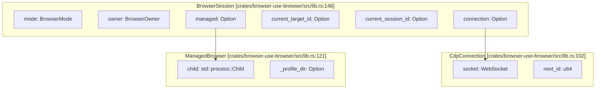
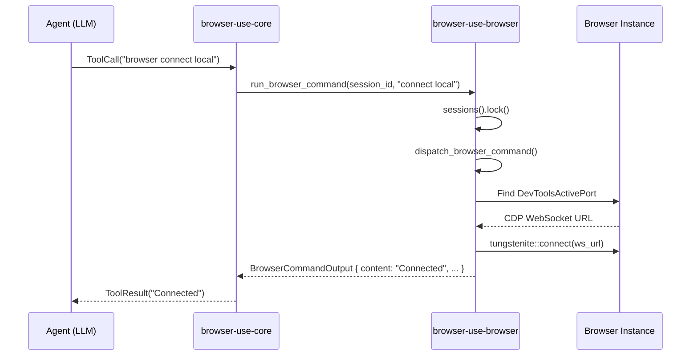

<!-- source: DeepWiki mcp.deepwiki.com · repo browser-use/terminal · page 3.1 CDP Connection and Browser Modes · fetched 2026-10-30 -->

# CDP Connection and Browser Modes

Relevant source files

The following files were used as context for generating this wiki page:

- [crates/browser-use-browser/src/lib.rs](crates/browser-use-browser/src/lib.rs)
- [docs/terminal-ui-product-ux.md](docs/terminal-ui-product-ux.md)
- [prompts/browser-tool-description.md](prompts/browser-tool-description.md)
- [prompts/interaction-skills/profile-sync.md](prompts/interaction-skills/profile-sync.md)

The `browser-use-browser` crate provides a Rust-owned browser control plane. Unlike traditional automation frameworks where the agent directly drives the browser, this system splits the responsibility: Rust maintains the persistent **Chrome DevTools Protocol (CDP)** connection and manages browser lifecycles, while a transient Python worker executes interaction scripts via a bridge to this Rust-held connection [crates/browser-use-browser/src/lib.rs:1-6]().

## Browser Modes and Ownership

The system categorizes browser instances into distinct `BrowserMode` variants to handle different connection strategies and lifecycle requirements.

| Mode | Description |
| :--- | :--- |
| `Local` | Attaches to an already-running Chromium-family browser on the local machine via `DevToolsActivePort` [crates/browser-use-browser/src/lib.rs:59](), [prompts/browser-tool-description.md:41-48](). |
| `Managed` | A Rust-owned browser process launched by the terminal with a temporary or specific profile path [crates/browser-use-browser/src/lib.rs:60](), [crates/browser-use-browser/src/lib.rs:108-113](). |
| `RemoteCdp` | Connects to an external browser via a provided HTTP or WebSocket URL [crates/browser-use-browser/src/lib.rs:61](), [prompts/browser-tool-description.md:68-69](). |
| `RemoteCloud` | Connects to a Browser Use cloud-hosted browser instance [crates/browser-use-browser/src/lib.rs:62](), [prompts/browser-tool-description.md:70-73](). |

### Browser Ownership
Tracking ownership is critical for determining whether the terminal has the authority to kill a process or close a remote session.

*   **`BrowserOwner::Rust`**: The terminal launched the process (e.g., `Managed` or `RemoteCloud`). It is responsible for cleanup [crates/browser-use-browser/src/lib.rs:81]().
*   **`BrowserOwner::External`**: The browser was already running (e.g., `Local` or `RemoteCdp`). The terminal will disconnect but not terminate the process [crates/browser-use-browser/src/lib.rs:80]().

**Sources:** [crates/browser-use-browser/src/lib.rs:56-92](), [prompts/browser-tool-description.md:25-30]()

## CDP Connection Architecture

The `BrowserSession` struct is the central registry for browser state. It holds the WebSocket connection, session IDs, and target information [crates/browser-use-browser/src/lib.rs:146-165]().

### Connection Management
The `CdpConnection` wraps a `tungstenite` WebSocket. It tracks a `next_id` to map CDP requests to responses [crates/browser-use-browser/src/lib.rs:102-105]().

### Session State Persistence
The system maintains a global registry of sessions in a `OnceLock<Mutex<HashMap<String, BrowserSession>>>` called `SESSIONS` [crates/browser-use-browser/src/lib.rs:192](). This allows the browser state to persist across multiple tool calls from the agent.

### Entity Mapping: Browser Session to Code
The following diagram maps the logical browser concepts to the internal Rust structures and state tracking.

**Browser Session Architecture**

**Sources:** [crates/browser-use-browser/src/lib.rs:102-165]()

## Browser CLI Command Interface

The `browser` tool is exposed to the LLM as a CLI-like interface. Commands are dispatched via `run_browser_command`, which parses a raw string and executes the corresponding logic [crates/browser-use-browser/src/lib.rs:194-218]().

### Key Command Categories
1.  **Connection**: `connect local`, `connect managed`, `connect remote-cdp`.
2.  **Profiles**: `local profiles`, `local profiles inspect`, `remote profiles`.
3.  **Recovery**: `recover reconnect-websocket`, `recover reattach-same-target`.
4.  **Diagnostics**: `status`, `doctor`, `runtime logs`.

### Implementation Flow
When `run_browser_command` is called:
1.  It tokenizes the command string using `shell_words` [crates/browser-use-browser/src/lib.rs:200]().
2.  It retrieves or creates a `BrowserSession` from the global `SESSIONS` map [crates/browser-use-browser/src/lib.rs:208-211]().
3.  It calls `dispatch_browser_command` to execute the specific logic [crates/browser-use-browser/src/lib.rs:213]().
4.  It returns a `BrowserCommandOutput` containing the result content and any browser-specific events [crates/browser-use-browser/src/lib.rs:214-217]().

**Sources:** [crates/browser-use-browser/src/lib.rs:194-218](), [prompts/browser-tool-description.md:88-128]()

## Connection Recovery and Health

The terminal implements a multi-tiered recovery strategy to handle transient CDP failures without losing agent progress.

### Recovery Tiers
*   **`reconnect-websocket`**: Re-establishes the WebSocket connection to the existing endpoint. It does not reload pages or change session IDs [prompts/browser-tool-description.md:82]().
*   **`reattach-same-target`**: Attaches a new CDP session to the existing browser target (tab). Useful if the specific session ID becomes invalid but the tab still exists [prompts/browser-tool-description.md:83]().
*   **`restart-runtime`**: Resets the Rust-side `BrowserSession` state and attempts a fresh connection to the same endpoint [prompts/browser-tool-description.md:84]().

### The "Doctor" Command
The `browser doctor` command performs a non-destructive audit of the connection state. It checks:
*   Local browser candidate availability [prompts/browser-tool-description.md:77]().
*   CDP WebSocket health [prompts/browser-tool-description.md:77]().
*   Current target/tab availability [prompts/browser-tool-description.md:77]().

**Sources:** [prompts/browser-tool-description.md:74-87]()

## Data Flow: Browser Command Execution

This diagram illustrates the flow of a `browser` command from the agent's tool call through the Rust control plane.

**Browser Command Data Flow**

**Sources:** [crates/browser-use-browser/src/lib.rs:194-218](), [prompts/browser-tool-description.md:103-109]()

---

