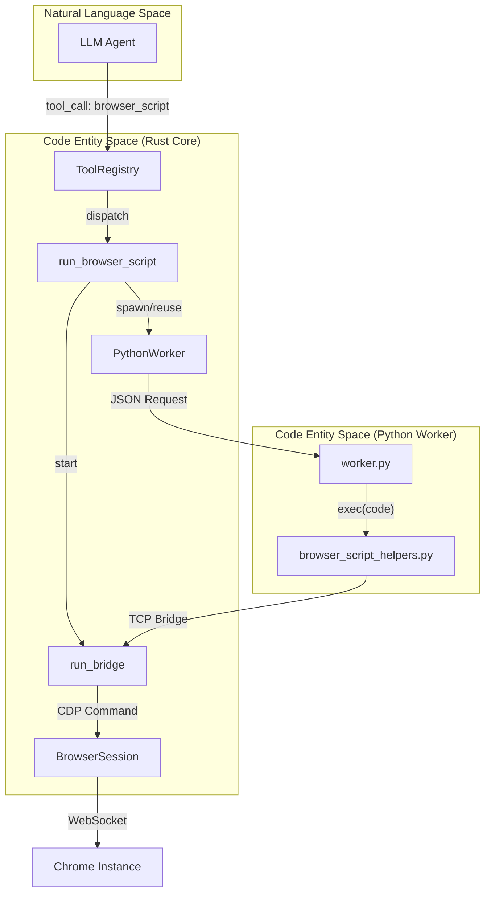
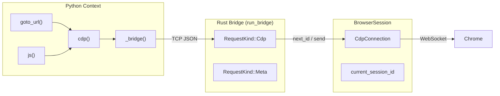

<!-- source: DeepWiki mcp.deepwiki.com · repo browser-use/terminal · page 3.2 Python Worker and browser_script · fetched 2026-10-30 -->

# Python Worker and browser_script

Relevant source files

The following files were used as context for generating this wiki page:

- [crates/browser-use-browser/src/browser_script_helpers.py](crates/browser-use-browser/src/browser_script_helpers.py)
- [crates/browser-use-browser/src/lib.rs](crates/browser-use-browser/src/lib.rs)
- [crates/browser-use-providers/src/lib.rs](crates/browser-use-providers/src/lib.rs)
- [crates/browser-use-python-worker/Cargo.toml](crates/browser-use-python-worker/Cargo.toml)
- [crates/browser-use-python-worker/src/lib.rs](crates/browser-use-python-worker/src/lib.rs)
- [crates/browser-use-tui/src/markdown.rs](crates/browser-use-tui/src/markdown.rs)
- [prompts/browser-script-tool-description.md](prompts/browser-script-tool-description.md)
- [python/llm_browser_worker/worker.py](python/llm_browser_worker/worker.py)
- [python/tests/test_worker_package.py](python/tests/test_worker_package.py)

The `browser_script` tool provides the primary interface for LLM-driven page interaction. While the Rust core maintains the persistent browser lifecycle and Chrome DevTools Protocol (CDP) connection, the actual interaction logic is executed within a transient Python worker process.

## Execution Model

The execution model is designed to provide a "clean slate" for every tool call while maintaining a persistent browser state in the background.

1.  **Stateless Python**: Each `browser_script` call spawns or utilizes a Python process where variables do not persist across different tool calls [prompts/browser-script-tool-description.md:7-10]().
2.  **Stateful Rust**: The browser instance, tabs, and CDP session state are held by the Rust `BrowserSession` [crates/browser-use-browser/src/lib.rs:146-165]().
3.  **Bridge Communication**: Python and Rust communicate via a local TCP bridge [crates/browser-use-browser/src/lib.rs:229-231](). Python sends requests (like `cdp` commands or `meta` queries) and Rust returns the CDP responses or session metadata.

### System Flow: Tool Execution
This diagram illustrates the flow from an LLM tool call to the execution within the Python worker.

Title: browser_script Execution Flow

Sources: [crates/browser-use-browser/src/lib.rs:220-243](), [crates/browser-use-python-worker/src/lib.rs:15-21](), [python/llm_browser_worker/worker.py:330-350]()

## The Python Worker (`browser-use-python-worker`)

The `PythonWorker` struct in Rust manages the lifecycle of the underlying Python process. It attempts to use `uv run` for managed dependency injection (e.g., `cdp-use`, `pillow`) before falling back to a system `python3` [crates/browser-use-python-worker/src/lib.rs:133-163]().

### Key Components:
*   **`PythonWorker::start`**: Initializes the process with the necessary `PYTHONPATH` including the workspace `src` and `python` directories [crates/browser-use-python-worker/src/lib.rs:76-126]().
*   **`RunPythonRequest`**: The JSON schema sent to Python, containing the `code`, `session_id`, and `artifact_dir` [crates/browser-use-python-worker/src/lib.rs:32-43]().
*   **`worker.py`**: The entry point in Python that handles the `_run` loop, executes the provided string, and captures `stdout/stderr` into the tool response [python/llm_browser_worker/worker.py:330-360]().

Sources: [crates/browser-use-python-worker/src/lib.rs:15-65](), [python/llm_browser_worker/worker.py:330-370]()

## browser_script Helpers

The `browser_script_helpers.py` module is injected as a prelude to every script execution [crates/browser-use-browser/src/lib.rs:31](). It provides a high-level API for the LLM to interact with the page without needing to write raw CDP or import libraries.

### Core Helper Functions

| Function | Description | Implementation Detail |
| :--- | :--- | :--- |
| `cdp(method, **params)` | The "Escape Hatch". Sends raw CDP commands to the current tab. | Calls `_bridge({"kind": "cdp", ...})` [crates/browser-use-browser/src/browser_script_helpers.py:25-27]() |
| `js(expression)` | Executes JavaScript in the page context. | Wraps expression in an IIFE if `return` is present [crates/browser-use-browser/src/browser_script_helpers.py:167-181]() |
| `goto_url(url)` | Navigates the current tab and waits for load. | Uses `Page.navigate` + `wait_for_load` [crates/browser-use-browser/src/browser_script_helpers.py:184-187]() |
| `screenshot(label)` | Captures a screenshot and registers it as an artifact. | Automatically attached to the tool result [crates/browser-use-browser/src/browser_script_helpers.py:246-253]() |
| `fill_input(sel, text)` | Clears and types into an element. | Uses `DOM.querySelector` and `Input.dispatchKeyEvent` [crates/browser-use-browser/src/browser_script_helpers.py:270-285]() |
| `click_at_xy(x, y)` | Performs a hardware-level mouse click at coordinates. | Uses `Input.dispatchMouseEvent` (press/release) [crates/browser-use-browser/src/browser_script_helpers.py:261-268]() |

### Data Flow: Helper to CDP
This diagram maps the helper functions to the internal communication protocol and the Rust-side session management.

Title: Helper to CDP Mapping

Sources: [crates/browser-use-browser/src/browser_script_helpers.py:25-30](), [crates/browser-use-browser/src/lib.rs:239-241](), [crates/browser-use-browser/src/lib.rs:102-105]()

## The CDP Escape Hatch

While helpers cover 90% of use cases, the `cdp()` function allows the LLM to access the full Chrome DevTools Protocol. This is critical for advanced interactions like:
*   **Network Emulation**: `cdp("Network.emulateNetworkConditions", ...)`
*   **Console Monitoring**: `cdp("Console.enable")`
*   **Raw Input**: Direct control over `Input.dispatchKeyEvent` for complex modifiers.

The Rust core handles the routing of these commands to the correct `targetId` and `sessionId` maintained in the `BrowserSession` [crates/browser-use-browser/src/lib.rs:150-152]().

## Artifacts and Outputs

The Python worker automatically tracks files and images generated during a script's execution.
*   **Images**: Any call to `screenshot()` or `emit_image()` adds an entry to the `images` list in `BrowserScriptOutput` [crates/browser-use-browser/src/lib.rs:51]().
*   **Files**: Files written to the `outputs_dir()` are automatically collected as artifacts [prompts/browser-script-tool-description.md:69-70]().
*   **Browser Events**: The worker can emit `browser.state` events (URL, Title, Tab count) which the TUI uses to update the browser status bar [python/tests/test_worker_package.py:53-77]().

Sources: [crates/browser-use-browser/src/lib.rs:39-54](), [python/llm_browser_worker/worker.py:360-380]()

---

