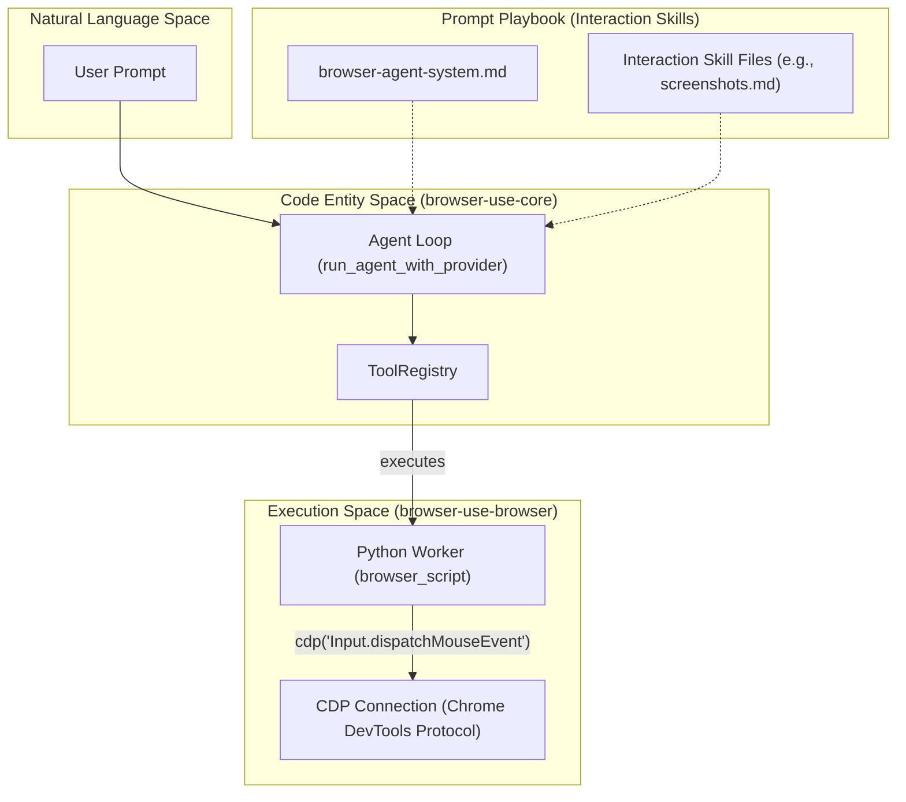
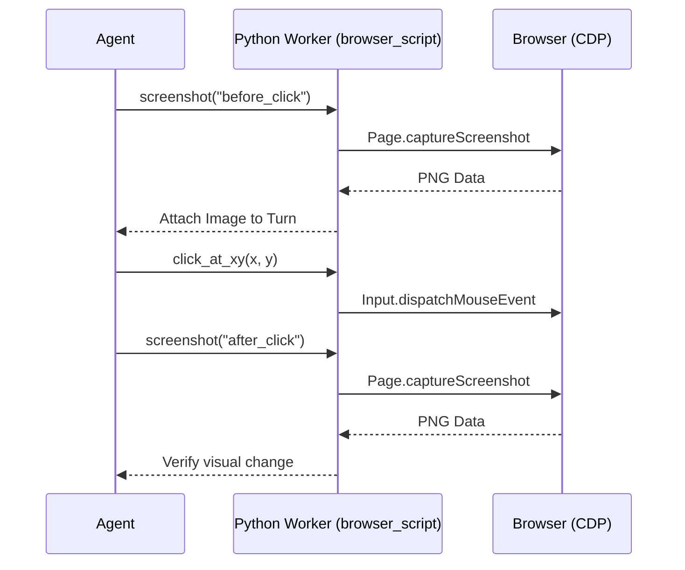

<!-- source: DeepWiki mcp.deepwiki.com · repo browser-use/terminal · page 3.3 Browser Interaction Skills (Prompt Playbooks) · fetched 2026-10-30 -->

# Browser Interaction Skills (Prompt Playbooks)

Relevant source files

The following files were used as context for generating this wiki page:

- [prompts/browser-agent-system.md](prompts/browser-agent-system.md)
- [prompts/compacted-context-system.md](prompts/compacted-context-system.md)
- [prompts/interaction-skills/connection.md](prompts/interaction-skills/connection.md)
- [prompts/interaction-skills/cookies.md](prompts/interaction-skills/cookies.md)
- [prompts/interaction-skills/cross-origin-iframes.md](prompts/interaction-skills/cross-origin-iframes.md)
- [prompts/interaction-skills/dialogs.md](prompts/interaction-skills/dialogs.md)
- [prompts/interaction-skills/downloads.md](prompts/interaction-skills/downloads.md)
- [prompts/interaction-skills/drag-and-drop.md](prompts/interaction-skills/drag-and-drop.md)
- [prompts/interaction-skills/dropdowns.md](prompts/interaction-skills/dropdowns.md)
- [prompts/interaction-skills/iframes.md](prompts/interaction-skills/iframes.md)
- [prompts/interaction-skills/network-requests.md](prompts/interaction-skills/network-requests.md)
- [prompts/interaction-skills/print-as-pdf.md](prompts/interaction-skills/print-as-pdf.md)
- [prompts/interaction-skills/screenshots.md](prompts/interaction-skills/screenshots.md)
- [prompts/interaction-skills/scrolling.md](prompts/interaction-skills/scrolling.md)
- [prompts/interaction-skills/shadow-dom.md](prompts/interaction-skills/shadow-dom.md)
- [prompts/interaction-skills/tabs.md](prompts/interaction-skills/tabs.md)
- [prompts/interaction-skills/uploads.md](prompts/interaction-skills/uploads.md)
- [prompts/interaction-skills/viewport.md](prompts/interaction-skills/viewport.md)

This page documents the specialized prompt library and interaction playbooks used by the agent to handle complex browser behaviors. Instead of relying on brittle high-level abstractions, the system provides the agent with a "bitter lesson" contract: full access to the browser action space via the Chrome DevTools Protocol (CDP), supplemented by a library of "Interaction Skills" for handling edge cases like iframes, shadow DOM, and dialogs.

## Interaction Architecture

The interaction model splits browser work into two distinct domains: **Runtime Management** (via the `browser` tool) and **Page Interaction** (via the `browser_script` tool). Interaction skills are loaded as a core contract that guides the agent on how to use these tools effectively.

### The Browser Agent Contract
The agent operates under a strict system prompt defined in `prompts/browser-agent-system.md`. It treats raw CDP as the source of truth rather than an escape hatch [prompts/browser-agent-system.md:1-4]().

| Tool | Role | Key Capabilities |
| :--- | :--- | :--- |
| `browser` | Control Plane | Connection, lifecycle, profile summaries, runtime logs, recovery [prompts/browser-agent-system.md:5-12](). |
| `browser_script` | Data Plane | Python execution, CDP calls, JS evaluation, screenshots, tab management [prompts/browser-agent-system.md:7-8](). |

### Data Flow: Natural Language to Browser Action

The following diagram illustrates how a natural language request (e.g., "Click the login button") is transformed into browser actions using the interaction skills library.

**Interaction Command Flow**

**Sources:** [prompts/browser-agent-system.md:1-15](), [prompts/interaction-skills/screenshots.md:1-10]()

---

## Core Interaction Skills

### 1. Connection & Tab Visibility
The agent must handle the "omnibox popup problem" where Chrome attaches to a 1px invisible viewport instead of a real page [prompts/interaction-skills/connection.md:3-7]().

*   **Detection**: Use `list_tabs()` to inspect all available `type: "page"` targets [prompts/interaction-skills/connection.md:14-20]().
*   **Correction**: Use `ensure_real_tab()` to force attachment to a valid `about:blank` or existing web page [prompts/interaction-skills/connection.md:22-23]().
*   **Recovery**: If a connection becomes stale, the playbook dictates using `browser recover reconnect-websocket` [prompts/interaction-skills/connection.md:13-13]().

### 2. Screenshots and Visual Verification
Screenshots are treated as labeled temporal checkpoints. The agent is instructed to capture state before and after meaningful actions [prompts/browser-agent-system.md:28-31]().

*   **Coordinate Resolution**: Screenshots are captured in **device pixels**. To click based on a screenshot, the agent must divide by `window.devicePixelRatio` to get **CSS pixels** [prompts/interaction-skills/screenshots.md:3-9]().
*   **Clipping**: To avoid LLM token limits (often > 2000px), the agent uses `screenshot_clip(x, y, width, height)` for specific regions [prompts/interaction-skills/screenshots.md:9-14]().

**Visual Action Sequence**

**Sources:** [prompts/browser-agent-system.md:28-31](), [prompts/interaction-skills/screenshots.md:1-14]()

### 3. Dialog Handling (Alerts, Confirms, Prompts)
Dialogs freeze the JavaScript thread, preventing standard `js()` execution. The interaction skills provide two strategies [prompts/interaction-skills/dialogs.md:3-4]():

*   **Reactive (CDP-level)**: Uses `Page.handleJavaScriptDialog` to accept or dismiss. This is preferred as it is undetectable by anti-bot scripts [prompts/interaction-skills/dialogs.md:9-15]().
*   **Proactive (JS Stubbing)**: Overwrites `window.alert` in advance to collect messages in an array. This is useful for high-frequency dialogs but detectable by anti-bot measures [prompts/interaction-skills/dialogs.md:28-41]().

### 4. Navigation and Iframes
*   **Navigation**: Prefer `new_tab(url)` for the first navigation to avoid mutating the initial state, then use `goto_url(url)` for subsequent steps [prompts/browser-agent-system.md:27-27]().
*   **Iframes**: The agent uses `iframe_target()` for cross-origin frames. For same-origin, it traverses via `contentDocument` [prompts/interaction-skills/iframes.md:1-4]().
*   **Coordinate Clicks**: The playbook emphasizes coordinate-based clicks (`click_at_xy`) because Chrome's hit-testing handles iframes and shadow DOM more reliably than selector-based abstractions [prompts/browser-agent-system.md:29-29]().

---

## Specialized Playbooks

### Downloads and Uploads
*   **Uploads**: Handled via the `upload_file` helper which interacts with the file input element directly via CDP [prompts/browser-agent-system.md:7-7]().
*   **Downloads**: The agent monitors for browser-triggered downloads and verifies the start of the transfer by checking the filesystem or CDP events [prompts/interaction-skills/downloads.md:1-4]().

### Network and Performance
*   **Network Requests**: When DOM changes are ambiguous (e.g., a "Submit" button that doesn't refresh the page), the agent is instructed to use `wait_for_network_idle()` or inspect `drain_events()` for XHR/Fetch completion [prompts/interaction-skills/network-requests.md:1-4]().
*   **Scrolling**: For lazy-loaded content, the agent uses the `scroll` helper to trigger viewport-based event listeners [prompts/interaction-skills/scrolling.md:1-2]().

### Context Compaction Memory
When the LLM context window is nearly full, the system performs "Context Compaction." The agent is provided with a specialized prompt (`prompts/compacted-context-system.md`) that reminds it of the active operating contract while providing a JSON summary of prior browser states [prompts/compacted-context-system.md:1-10]().

**Sources:**
- `prompts/browser-agent-system.md`
- `prompts/interaction-skills/connection.md`
- `prompts/interaction-skills/screenshots.md`
- `prompts/interaction-skills/dialogs.md`
- `prompts/interaction-skills/iframes.md`
- `prompts/compacted-context-system.md`

---

