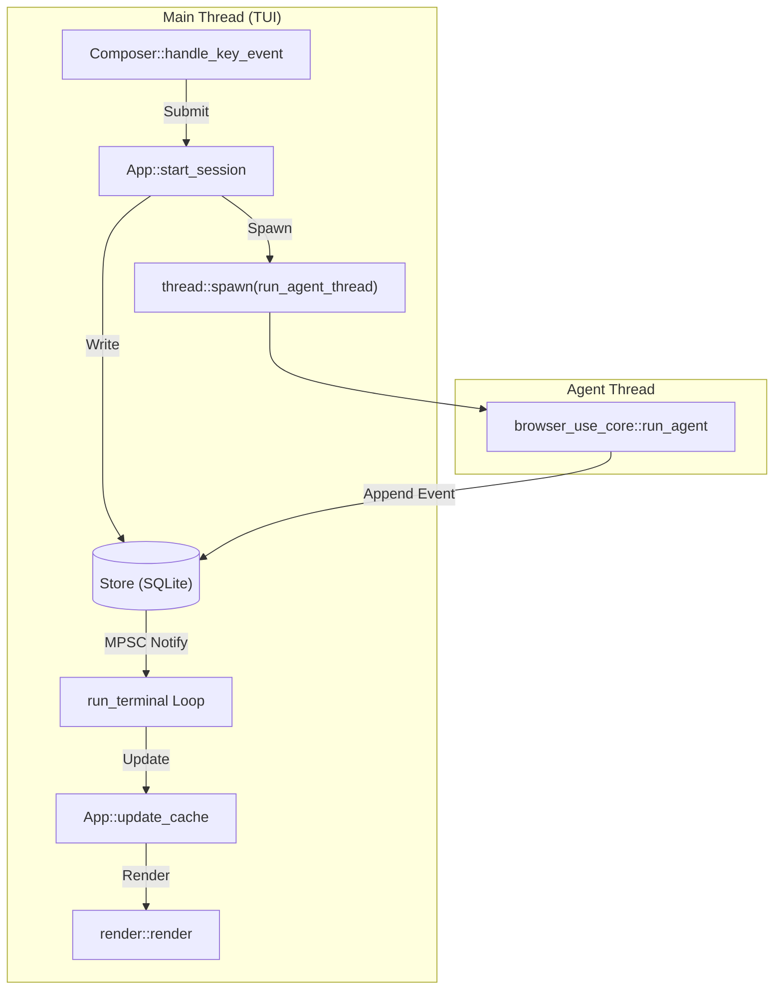

<!-- source: DeepWiki mcp.deepwiki.com · repo browser-use/terminal · page 4.1 App Orchestration and Event Loop · fetched 2026-10-30 -->

# App Orchestration and Event Loop

<details>
<summary>Relevant source files</summary>

The following files were used as context for generating this wiki page:

- [crates/browser-use-core/Cargo.toml](crates/browser-use-core/Cargo.toml)
- [crates/browser-use-tui/src/main.rs](crates/browser-use-tui/src/main.rs)
- [crates/browser-use-tui/src/runtime.rs](crates/browser-use-tui/src/runtime.rs)

</details>


The Browser Use Terminal (BUT) TUI is built on a reactive, event-driven architecture that synchronizes a persistent SQLite store with a high-performance rendering loop. The orchestration layer manages the lifecycle of agent tasks, user input via `crossterm`, and background authentication flows, ensuring the UI remains responsive even during heavy LLM or browser activity.

## Application Lifecycle and run_terminal

The entry point for the TUI is the `run_terminal` function [crates/browser-use-tui/src/main.rs:2184-2311](). It initializes the `App` state, sets up the `ratatui` terminal backend, and enters the primary event loop.

### Initialization Flow
1.  **App::new**: Initializes the `App` struct, which holds the `AppStateCache`, `Composer`, and `Store` reference [crates/browser-use-tui/src/main.rs:431-507]().
2.  **Terminal Setup**: Configures `crossterm` for raw mode, enables mouse capture, and pushes keyboard enhancement flags for the CSI-u protocol [crates/browser-use-tui/src/main.rs:2192-2212]().
3.  **TerminalDriver**: A wrapper around the `ratatui::Terminal` that manages the inline viewport [crates/browser-use-tui/src/main.rs:327-429](). It uses `Viewport::Inline` to allow the TUI to live within the user's existing terminal scrollback rather than taking over the full screen.

### The Orchestration Loop
The loop in `run_terminal` [crates/browser-use-tui/src/main.rs:2238-2309]() polls for multiple sources of reactivity:
*   **Crossterm Events**: Keyboard and mouse input [crates/browser-use-tui/src/main.rs:2243-2250]().
*   **Store Notifications**: MPSC channel messages indicating the database has changed [crates/browser-use-tui/src/main.rs:2252-2260]().
*   **Auth Channels**: Background threads providing OAuth credentials or device codes [crates/browser-use-tui/src/main.rs:2262-2283]().
*   **Tick Intervals**: Periodic updates for animations and spinners [crates/browser-use-tui/src/main.rs:2285-2292]().

### Component Interaction Diagram
This diagram shows how the `run_terminal` loop orchestrates different code entities.

```mermaid
sequenceDiagram
    participant Loop as run_terminal (Event Loop)
    participant Term as TerminalDriver
    participant App as App (State Manager)
    participant Store as Store (SQLite)
    participant Agent as run_agent_thread

    Loop->>App: handle_events()
    App->>Store: append_event() (on user input)
    Store-->>Loop: StoreNotification (via MPSC)
    Loop->>App: update_cache()
    App->>App: project_workbench()
    Loop->>Term: draw(render_fn)
    Agent-->>Store: append_event() (Agent Progress)
    Store-->>Loop: StoreNotification
    Loop->>Term: draw(render_fn)
```
Sources: [crates/browser-use-tui/src/main.rs:2238-2309](), [crates/browser-use-tui/src/main.rs:608-624](), [crates/browser-use-tui/src/main.rs:431-507]()

## State Management and Projection

The TUI does not store its primary state in memory. Instead, it uses a **projection** of the event log stored in SQLite.

### AppStateCache
The `AppStateCache` [crates/browser-use-tui/src/main.rs:271-294]() stores the `WorkbenchState`. This state is not updated directly by UI actions; instead, UI actions trigger database writes, which then trigger a cache refresh.

### Reactive Projection
When a `StoreNotification` is received, the app calls `update_cache` [crates/browser-use-tui/src/main.rs:608-624](). This function invokes `project_workbench` [crates/browser-use-protocol/src/lib.rs:10-20]() (defined in the protocol crate), which scans the `EventRecord` table for the current session and reduces them into a `WorkbenchState` object.

| Entity | Role | Source |
| :--- | :--- | :--- |
| `Store` | Persistent SQLite storage for all events. | [crates/browser-use-store/src/lib.rs:1-10]() |
| `WorkbenchState` | The "View Model" representing the current session status and history. | [crates/browser-use-protocol/src/lib.rs:1-10]() |
| `project_workbench` | Pure function: `Vec<EventRecord> -> WorkbenchState`. | [crates/browser-use-protocol/src/lib.rs:10-20]() |
| `App::update_cache` | Fetches events from `Store` and updates `AppStateCache`. | [crates/browser-use-tui/src/main.rs:608-624]() |

Sources: [crates/browser-use-tui/src/main.rs:271-294](), [crates/browser-use-tui/src/main.rs:608-624](), [crates/browser-use-protocol/src/lib.rs:10-20]()

## Task Lifecycle: From Input to Completion

When a user submits a prompt in the TUI, it follows a specific path through the orchestration layer.

### 1. Input Capture
The `Composer` widget captures multi-line input. When the user presses `Enter` (or `Alt+Enter` depending on mode), `App::handle_key_event` is triggered [crates/browser-use-tui/src/main.rs:1255-1320]().

### 2. Session Initialization
If no session is active, `App::start_session` is called [crates/browser-use-tui/src/main.rs:736-797]():
1.  A new `session_id` is generated.
2.  A `session.created` event is appended to the `Store`.
3.  The user's prompt is appended as a `command.run` event [crates/browser-use-tui/src/main.rs:777-781]().

### 3. Agent Execution
The TUI spawns a background thread via `run_agent_thread` [crates/browser-use-tui/src/runtime.rs:12-60](). This thread:
1.  Opens its own connection to the `Store`.
2.  Configures the `ProviderRunConfig` based on the TUI settings (Model, Backend, Browser Mode) [crates/browser-use-tui/src/runtime.rs:43-49]().
3.  Calls `run_existing_session_from_config` from `browser-use-core` [crates/browser-use-tui/src/runtime.rs:50]().

### 4. Progress Updates
As the agent runs, it appends events (e.g., `model.turn.start`, `tool.call`, `browser.screenshot`) to the SQLite database. The `StoreNotifier` sends signals back to the TUI's main loop [crates/browser-use-tui/src/main.rs:2252-2260](), which refreshes the `AppStateCache` and re-renders the transcript.

### 5. Completion
Once the agent reaches a terminal state (Success, Failure, or Cancelled), it appends a `session.done` or `session.failed` event. The TUI detects this in the next projection and updates the `ProductState` to `Result` or `Failed` [crates/browser-use-tui/src/main.rs:191-198]().

### Code Entity Mapping: Task Flow
The following diagram maps the logical task lifecycle to specific functions and threads in the codebase.


Sources: [crates/browser-use-tui/src/main.rs:736-797](), [crates/browser-use-tui/src/runtime.rs:12-60](), [crates/browser-use-tui/src/main.rs:2238-2309]()

## Inline Viewport Management

The `TerminalDriver` [crates/browser-use-tui/src/main.rs:327-429]() manages how the TUI interacts with the standard terminal scrollback. Unlike traditional TUI apps that use an "alternate screen" (clearing the terminal), BUT uses an inline viewport.

*   **Native Scrollback**: When the agent produces output, the TUI calculates how many lines of text were "committed" to the history. It then uses `execute!(io::stdout(), Print(text))` to print these lines directly to the terminal's native buffer [crates/browser-use-tui/src/render/mod.rs:248-270]().
*   **Dynamic Resizing**: The `TerminalDriver` listens for `Event::Resize` and adjusts the `Viewport` dimensions. It uses a debounce interval (`RESIZE_DEBOUNCE_INTERVAL`) to prevent flickering during rapid window adjustments [crates/browser-use-tui/src/main.rs:83]().
*   **Cursor Management**: Because the UI is inline, the driver must carefully track the cursor position to ensure the "active" area (where the agent is currently thinking/acting) remains at the bottom of the visible terminal area [crates/browser-use-tui/src/main.rs:360-380]().

Sources: [crates/browser-use-tui/src/main.rs:327-429](), [crates/browser-use-tui/src/main.rs:83](), [crates/browser-use-tui/src/render/mod.rs:248-270]()

---

