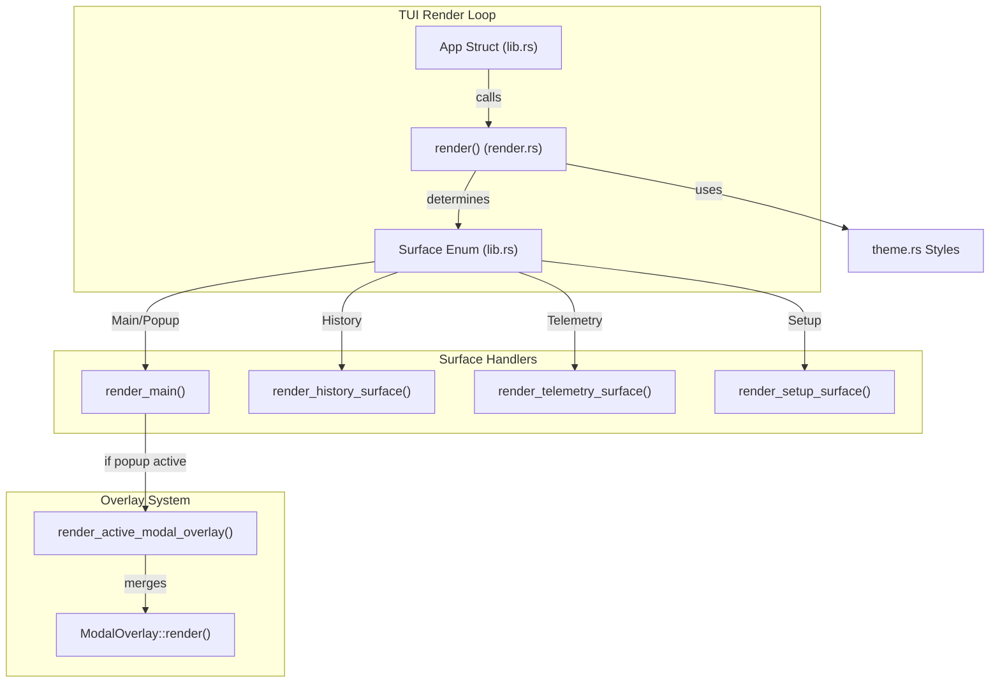
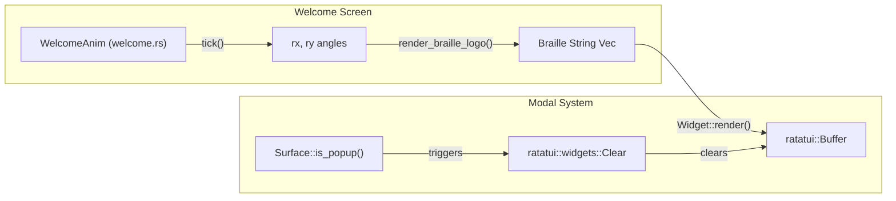

<!-- source: DeepWiki mcp.deepwiki.com · repo browser-use/terminal · page 4.2 Rendering and Surfaces · fetched 2026-10-30 -->

# Rendering and Surfaces

Relevant source files

The following files were used as context for generating this wiki page:

- [crates/browser-use-tui/src/render.rs](crates/browser-use-tui/src/render.rs)
- [crates/browser-use-tui/src/theme.rs](crates/browser-use-tui/src/theme.rs)
- [crates/browser-use-tui/src/welcome.rs](crates/browser-use-tui/src/welcome.rs)

This section details the rendering architecture of the `browser-use-terminal` TUI. It covers the core render loop, the layout management system, the hierarchy of `Surface` variants, and the advanced modal/overlay system used for interactive components.

## Render Loop and Terminal Integration

The TUI uses `ratatui` as its rendering engine. The primary entry point for rendering is the `render` function in `crates/browser-use-tui/src/render.rs`, which is called by the terminal event loop [crates/browser-use-tui/src/render.rs:93-93]().

### Rendering Flow

1.  **Area Calculation**: The frame area is adjusted by `app_surface` to apply global horizontal margins [crates/browser-use-tui/src/render.rs:95-95]().
2.  **State Projection**: The `App` state is projected into a `WorkbenchState` and a `ProductState` for the current frame [crates/browser-use-tui/src/render.rs:96-99]().
3.  **Surface Dispatch**: The engine checks if the app is in the "First Run Setup" flow. If so, it renders the setup surface [crates/browser-use-tui/src/render.rs:101-110]().
4.  **Main vs. Popup Logic**:
    *   If the current `Surface` is a **popup** (e.g., `BrowserSelect`, `ApiKey`), it first renders the `Main` view as a background, then applies a `ModalOverlay` [crates/browser-use-tui/src/render.rs:113-118]().
    *   If the surface uses the **main view** (e.g., `Main` with a slash palette), it handles the overlay merge [crates/browser-use-tui/src/render.rs:119-126]().
    *   Otherwise, it renders the specific surface (e.g., `History`, `Telemetry`) [crates/browser-use-tui/src/render.rs:127-127]().

### Code Entity Mapping: Render Entry Points

The following diagram maps the high-level rendering concepts to the specific functions and structs in the codebase.

Title: Rendering System Architecture

Sources: [crates/browser-use-tui/src/render.rs:93-129](), [crates/browser-use-tui/src/lib.rs:1-100]()

## Surface Variants

The `Surface` enum defines the high-level UI states of the application.

| Surface Variant | Purpose | Layout Logic |
| :--- | :--- | :--- |
| `Main` | The primary workbench showing the transcript and input composer. | Uses `render_main` [crates/browser-use-tui/src/render.rs:151-157](). |
| `Setup` | The onboarding wizard for first-run configuration. | Full-screen specialized layout [crates/browser-use-tui/src/render.rs:108-108](). |
| `History` | A list of previous sessions stored in the SQLite database. | Table-based layout [crates/browser-use-tui/src/render.rs:127-127](). |
| `Model` | Model selection and configuration menu. | Popup overlay [crates/browser-use-tui/src/lib.rs:1-100](). |
| `BrowserSelect` | Interface for choosing browser launch modes (Local, Managed, etc.). | Popup overlay [crates/browser-use-tui/src/lib.rs:1-100](). |
| `ApiKey` | Secure input for provider API keys. | Modal overlay [crates/browser-use-tui/src/lib.rs:1-100](). |
| `Telemetry` | Displays session performance and token usage stats. | Specialized data view [crates/browser-use-tui/src/render.rs:127-127](). |
| `Developer` | Internal debugging and state inspection tools. | Specialized view [crates/browser-use-tui/src/render.rs:127-127](). |

Sources: [crates/browser-use-tui/src/lib.rs:1-100](), [crates/browser-use-tui/src/render.rs:103-128]()

## Layout Logic and Pinning

The `render_main` function manages the complex layout of the workbench. It dynamically calculates heights for three primary zones:

1.  **Body (Transcript)**: Occupies the available space not taken by the bottom pane [crates/browser-use-tui/src/render.rs:174-178]().
2.  **Bottom Pane (Composer/Status)**: Contains the input area and activity indicators.
3.  **Footer**: Shows context-sensitive hints or status messages [crates/browser-use-tui/src/render.rs:169-173]().

### Pinning Strategy
The TUI implements a "pinning" strategy for the bottom pane. When the transcript grows, the bottom pane remains anchored to the bottom of the terminal. If a popup is active, the layout engine ensures the background `Main` view remains consistent so the user doesn't lose context [crates/browser-use-tui/src/render.rs:160-164]().

Sources: [crates/browser-use-tui/src/render.rs:151-183]()

## Modal Overlay System

The modal system uses a `ModalOverlay` buffer merge pattern. Instead of rendering directly to the main frame, modals are rendered into a separate logical layer that is then composited.

### Buffer Merge Pattern
When a popup surface is active (e.g., `Surface::is_popup()`), the following sequence occurs:
1.  `render_main` draws the standard workbench to the frame buffer [crates/browser-use-tui/src/render.rs:114-114]().
2.  `render_active_modal_overlay` is called [crates/browser-use-tui/src/render.rs:116-116]().
3.  The overlay clears the background area it will occupy using `Clear` to prevent "ghosting" from the main view [crates/browser-use-tui/src/render.rs:8-8]().
4.  The specific popup content is rendered on top.

### Visual Components: Welcome Screen
The welcome screen (`crates/browser-use-tui/src/welcome.rs`) is a specialized surface that utilizes a 3D braille-encoded logo. It uses an animation state machine `WelcomeAnim` to handle rotations and "throws" (randomized movement) [crates/browser-use-tui/src/welcome.rs:12-21]().

Title: Modal and Animation Data Flow

Sources: [crates/browser-use-tui/src/welcome.rs:12-75](), [crates/browser-use-tui/src/welcome.rs:145-152](), [crates/browser-use-tui/src/render.rs:113-118]()

## Theme and Visual Composition

Rendering relies on `crates/browser-use-tui/src/theme.rs` for semantic styling. This ensures visual consistency across all surfaces.

*   **Text & Muted**: Base styles for standard output [crates/browser-use-tui/src/theme.rs:63-73]().
*   **Status Styles**: Functions like `status_style` map session states (done, failed, running) to specific colors [crates/browser-use-tui/src/theme.rs:209-216]().
*   **Activity Indicators**: Specialized colors for tool execution types (read, run, search) [crates/browser-use-tui/src/theme.rs:169-203]().

Sources: [crates/browser-use-tui/src/theme.rs:1-217]()

---

