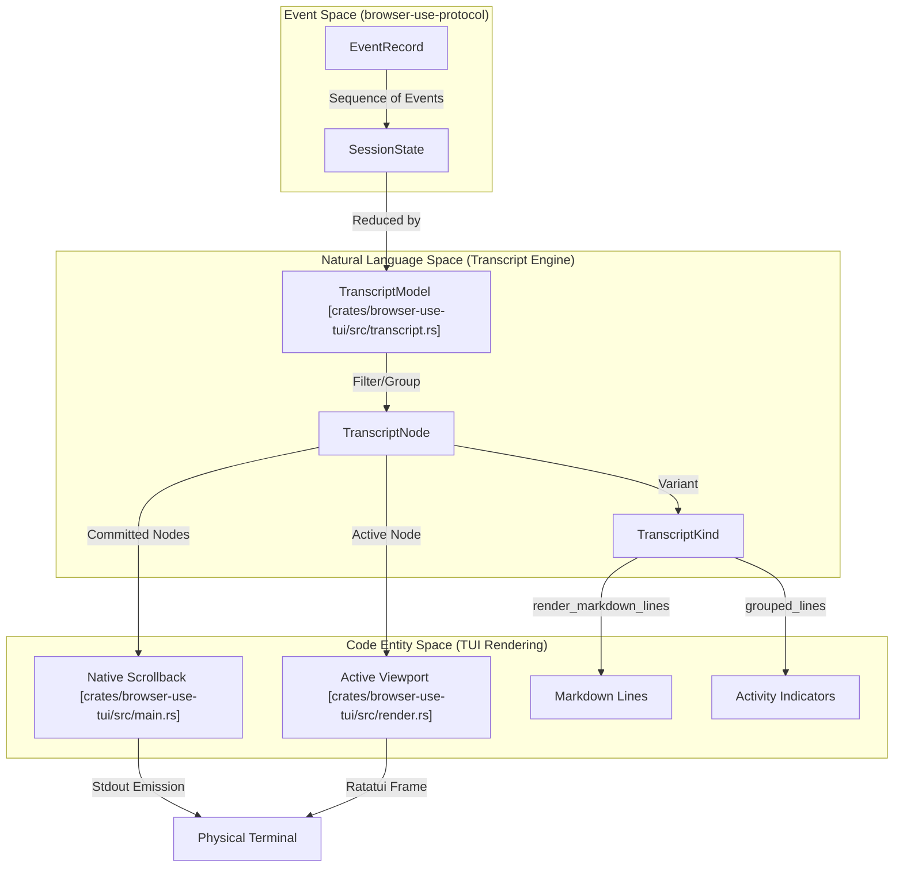
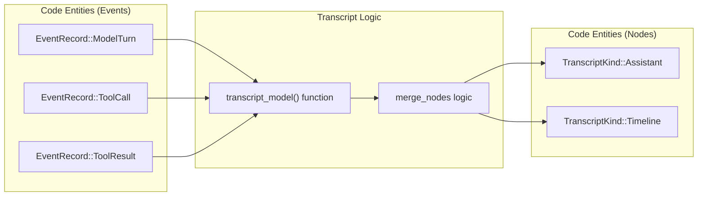

<!-- source: DeepWiki mcp.deepwiki.com · repo browser-use/terminal · page 4.3 Transcript Engine · fetched 2026-10-30 -->

# Transcript Engine

Relevant source files

The following files were used as context for generating this wiki page:

- [crates/browser-use-browser/src/browser_script_helpers.py](crates/browser-use-browser/src/browser_script_helpers.py)
- [crates/browser-use-tui/src/markdown.rs](crates/browser-use-tui/src/markdown.rs)
- [crates/browser-use-tui/src/transcript.rs](crates/browser-use-tui/src/transcript.rs)
- [docs/terminal-renderer-architecture.md](docs/terminal-renderer-architecture.md)

The **Transcript Engine** is the core projection layer that transforms raw event logs from the `browser-use-store` into a human-readable, interactive TUI display. It manages the lifecycle of "nodes" that represent user prompts, model responses, tool executions, and streaming activity.

## Overview and Data Flow

The engine operates as a reducer that projects `EventRecord` sequences into a `TranscriptModel`. This model is consumed by the `TerminalDriver` to manage native terminal scrollback and by `render.rs` to draw the live viewport.

### Natural Language to Code Entity Space: Data Flow

The following diagram illustrates how raw events are processed through the transcript system into visual components.

**Transcript Projection Pipeline**

Sources: [crates/browser-use-tui/src/transcript.rs:26-35](), [docs/terminal-renderer-architecture.md:37-63]()

## TranscriptModel and Node Lifecycle

The `TranscriptModel` maintains the state of the conversation for a specific session. It differentiates between **committed** nodes (finalized history) and the **active** node (current streaming or pending work).

### Key Structures
*   **`TranscriptModel`**: The root container for a session's transcript. It tracks `committed` nodes, the current `active` node, and a `revision` counter for reactivity. [crates/browser-use-tui/src/transcript.rs:26-35]()
*   **`TranscriptNode`**: A discrete unit of information (e.g., a single message or a tool group). [crates/browser-use-tui/src/transcript.rs:43-48]()
*   **`TranscriptKind`**: An enum defining the content type, ranging from `Prompt` and `Assistant` to `Timeline` (tool activity) and `StreamingAssistant`. [crates/browser-use-tui/src/transcript.rs:51-92]()

### Committed vs. Active Split
The engine enforces a strict "append-only" invariant for committed nodes to ensure terminal scrollback stability:
1.  **Committed Nodes**: These are nodes that will never change again. They are emitted once to the terminal's native scrollback buffer via `maybe_emit_native_transcript`. [docs/terminal-renderer-architecture.md:65-74]()
2.  **Active Node**: This represents the "live" tail of the transcript. It might be a model streaming text word-by-word or a tool showing a spinner. It is rendered inside the Ratatui viewport and is updated frequently. [docs/terminal-renderer-architecture.md:89-93]()

Sources: [crates/browser-use-tui/src/transcript.rs:26-35](), [docs/terminal-renderer-architecture.md:7-16]()

## Node Merging and Compaction

To keep the transcript readable, the engine merges related events into single nodes.

### Grouping Logic
*   **Timeline/Activity Grouping**: Sequential tool calls (like multiple `cdp` calls or file reads) are grouped into a `TranscriptKind::Timeline`. This prevents the transcript from being flooded with low-level technical logs. [crates/browser-use-tui/src/transcript.rs:76-80]()
*   **Stacking**: Multiple nodes can be wrapped in a `TranscriptKind::Stack` to be treated as a single logical unit during rendering. [crates/browser-use-tui/src/transcript.rs:52-54]()
*   **Child Agent Filtering**: Events from sub-agents are filtered or summarized into a single entry in the parent transcript to prevent "leaking" internal child steps into the main view. [docs/terminal-renderer-architecture.md:109-112]()

### Entity Mapping: Event to Transcript

Sources: [crates/browser-use-tui/src/transcript.rs:115-168](), [docs/terminal-renderer-architecture.md:13-15]()

## Visual Features

### Markdown and Syntax Highlighting
The engine uses `pulldown-cmark` for parsing and `syntect` for syntax highlighting.
*   **`render_markdown_lines`**: Converts markdown strings into styled Ratatui `Line` objects. [crates/browser-use-tui/src/markdown.rs:17-27]()
*   **`render_code_lines`**: Specifically handles code blocks, applying themes (via `two-face`) and wrapping long lines while preserving syntax spans. [crates/browser-use-tui/src/markdown.rs:29-41]()

### Shimmering and Animations
For pending states, the engine supports "shimmering" animations to indicate activity.
*   **`ShimmerMode`**: Can be `Static` or `Pulse(phase)`. The `phase` is incremented by the app's event loop to create a moving highlight effect across "pending" text. [crates/browser-use-tui/src/transcript.rs:120-122]()

### Terminal-Aware Text Wrapping
The engine implements custom wrapping logic that is aware of Unicode width and terminal constraints.
*   **`wrap_line_preserving_spans`**: Ensures that when a line is wrapped to fit the terminal width, the Ratatui `Style` (colors, bold, etc.) is correctly maintained across the break. [crates/browser-use-markdown.rs:39-40]()
*   **Path Highlighting**: Files and paths are detected and styled using `path_reference` to make them stand out in tool outputs. [crates/browser-use-tui/src/transcript.rs:10-12]()

Sources: [crates/browser-use-tui/src/markdown.rs:1-16](), [crates/browser-use-tui/src/transcript.rs:120-122]()

## Native Scrollback Emission

A key innovation of the Transcript Engine is how it interacts with the physical terminal's scrollback.

1.  **`TerminalScrollbackEmission`**: A struct containing the lines to be printed and the last event sequence number processed. [crates/browser-use-tui/src/transcript.rs:37-40]()
2.  **`maybe_emit_native_transcript`**: In `main.rs`, the `TerminalDriver` checks if new nodes have been committed. If so, it moves the cursor to the bottom of the scrollback area, prints the new lines using standard `println!` (effectively pushing them into the terminal's own history), and then resets the Ratatui viewport below them. [docs/terminal-renderer-architecture.md:23-25]()

This approach allows users to use their terminal's native scrollbar to view history while keeping the "Active Viewport" interactive and flicker-free.

Sources: [docs/terminal-renderer-architecture.md:75-96](), [crates/browser-use-tui/src/transcript.rs:37-40]()

---

