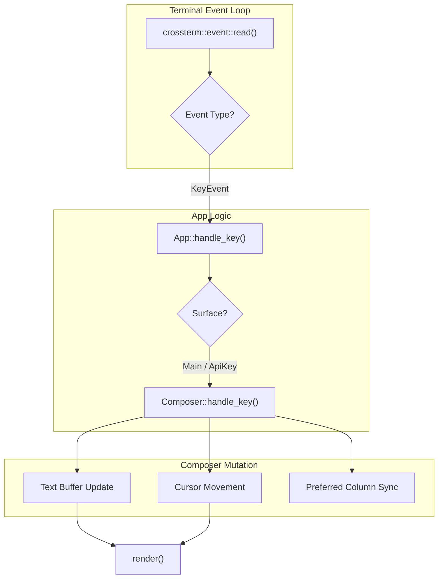
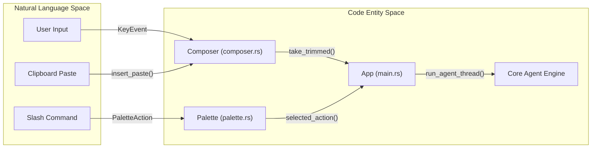

<!-- source: DeepWiki mcp.deepwiki.com · repo browser-use/terminal · page 4.4 Composer, Slash Palette, and Input Handling · fetched 2026-10-30 -->

# Composer, Slash Palette, and Input Handling

Relevant source files

The following files were used as context for generating this wiki page:

- [crates/browser-use-tui/src/composer.rs](crates/browser-use-tui/src/composer.rs)
- [crates/browser-use-tui/src/main.rs](crates/browser-use-tui/src/main.rs)
- [crates/browser-use-tui/src/palette.rs](crates/browser-use-tui/src/palette.rs)

This section details the interactive input layer of the Browser Use Terminal. It covers the multi-line `Composer` widget, the `/` command palette system, and the low-level keyboard protocol handling required for a modern terminal experience.

## The Composer Widget

The `Composer` is the primary multi-line text input widget used for drafting agent prompts and entering configuration values. Unlike standard single-line TUI inputs, the `Composer` supports internal line breaks, cursor navigation across wrapped lines, and rich text manipulation.

### Implementation and State
The `Composer` struct manages the raw text buffer and a 0-indexed character cursor [crates/browser-use-tui/src/composer.rs:7-11](). It tracks a `preferred_column` to maintain vertical alignment when navigating between lines of different lengths [crates/browser-use-tui/src/composer.rs:10]().

### Keyboard Bindings
The `Composer` implements a subset of Readline/Emacs-style bindings and macOS-style line deletions:

| Binding | Function | Code Reference |
| :--- | :--- | :--- |
| `Shift+Enter` / `Alt+Enter` | Insert newline without submitting | [crates/browser-use-tui/src/composer.rs:663-671]() |
| `Ctrl-U` | Delete to start of line / remove empty line | [crates/browser-use-tui/src/composer.rs:135-138]() |
| `Ctrl-W` | Delete backward word | [crates/browser-use-tui/src/composer.rs:140-143]() |
| `Alt-Backspace` | Delete backward token | [crates/browser-use-tui/src/composer.rs:159-162]() |
| `Cmd/Meta-Backspace` | Kill current line | [crates/browser-use-tui/src/composer.rs:149-156]() |
| `Ctrl-A` / `Home` | Move to start of line | [crates/browser-use-tui/src/composer.rs:190-193]() |
| `Ctrl-E` / `End` | Move to end of line | [crates/browser-use-tui/src/composer.rs:194-197]() |

### Input Flow Diagram
The following diagram illustrates how raw terminal events are processed by the `App` and dispatched to the `Composer`.

**Input Event Dispatch**

**Sources:** [crates/browser-use-tui/src/main.rs:1550-1580](), [crates/browser-use-tui/src/composer.rs:125-207]()

## Slash Palette

The Slash Palette provides a command-line interface for application control. It is triggered when the `Composer` buffer starts with a `/` character [crates/browser-use-tui/src/main.rs:1564-1568]().

### Palette Mapping
Commands are mapped to `PaletteAction` variants which dictate the application's transition logic.

| Command | Description | Action |
| :--- | :--- | :--- |
| `/task` | Start a new task | `NewTask` |
| `/history` | Browse previous tasks | `PreviousWork` |
| `/browser` | Change browser backend | `ChangeBrowser` |
| `/model` | Choose model and provider | `ChooseModel` |
| `/auth` | Sign in to a provider | `Authenticate` |
| `/update` | Install latest release | `Update` |

**Sources:** [crates/browser-use-tui/src/palette.rs:18-49]()

### Filtering and Selection
The palette uses fuzzy-prefix matching. As the user types after the `/`, the `items_filtered` function narrows the list [crates/browser-use-tui/src/palette.rs:55-65](). When `Enter` is pressed while the palette is active, the `selected_action` is resolved and executed [crates/browser-use-tui/src/palette.rs:67-71]().

## Enhanced Input Handling

### CSI-u Enhanced Keyboard Protocol
To support complex key combinations (like `Shift+Enter` or distinguishing `Tab` from `Ctrl-I`), the terminal attempts to enable the CSI-u enhanced keyboard protocol via `PushKeyboardEnhancementFlags` [crates/browser-use-tui/src/main.rs:307-313]().

*   **Flags enabled:** `DISAMBIGUATE_ESCAPE_CODES` and `REPORT_ALL_KEYS_AS_ESCAPE_CODES` [crates/browser-use-tui/src/main.rs:309-311]().
*   **Fallback:** If the terminal does not support CSI-u, the `Composer` uses `normalize_key` to map standard escape sequences back to expected behaviors [crates/browser-use-tui/src/composer.rs:645-661]().

### Bracketed Paste
The application enables `EnableBracketedPaste` to handle multi-line clipboard content efficiently [crates/browser-use-tui/src/main.rs:306]().
*   Pasted text is intercepted as a `TermEvent::Paste` [crates/browser-use-tui/src/main.rs:1533]().
*   The `Composer::insert_paste` method normalizes line endings (converting `\r\n` or `\r` to `\n`) before inserting into the buffer [crates/browser-use-tui/src/composer.rs:34-41](), [crates/browser-use-tui/src/composer.rs:637-643]().

### Code Entity Mapping
The following diagram bridges the user-facing input concepts to the internal code structures.

**Input System Architecture**

**Sources:** [crates/browser-use-tui/src/composer.rs:7-11](), [crates/browser-use-tui/src/palette.rs:1-9](), [crates/browser-use-tui/src/main.rs:1550-1600]()

## Data Flow: From Input to Agent
1.  **Input:** User types in `Main` surface. `App` captures `KeyEvent` [crates/browser-use-tui/src/main.rs:1550]().
2.  **Buffer:** `Composer` updates its internal `String` [crates/browser-use-tui/src/composer.rs:593-597]().
3.  **Submission:** User presses `Enter` (without modifiers). `App` calls `composer.take_trimmed()` [crates/browser-use-tui/src/main.rs:1571]().
4.  **Execution:** If it's a command, the `PaletteAction` is triggered. If it's a prompt, `App::run_agent_with_current_settings()` is invoked [crates/browser-use-tui/src/main.rs:1634]().
5.  **Thread Handover:** The prompt is sent to the `run_agent_thread`, which communicates with the `browser-use-core` [crates/browser-use-tui/src/runtime.rs:25-35]().

**Sources:** [crates/browser-use-tui/src/main.rs:1550-1650](), [crates/browser-use-tui/src/composer.rs:24-28](), [crates/browser-use-tui/src/runtime.rs:20-50]()

---

