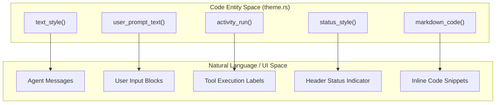
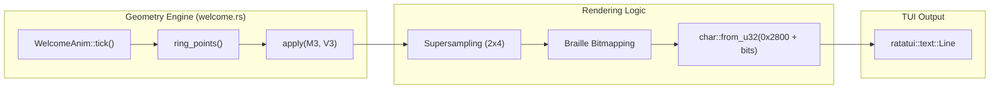

<!-- source: DeepWiki mcp.deepwiki.com · repo browser-use/terminal · page 4.5 Theme and Visual Design · fetched 2026-10-30 -->

# Theme and Visual Design

Relevant source files

The following files were used as context for generating this wiki page:

- [crates/browser-use-tui/src/theme.rs](crates/browser-use-tui/src/theme.rs)
- [crates/browser-use-tui/src/welcome.rs](crates/browser-use-tui/src/welcome.rs)

The Browser Use Terminal employs a cohesive visual identity centered around a custom color palette defined in `theme.rs`. This design system ensures semantic consistency across the TUI, providing visual cues for agent states, markdown elements, and activity indicators. The theme is built on top of the `ratatui` styling system, utilizing RGB colors and text modifiers to create a high-fidelity terminal experience.

## Theme Palette and Semantic Styles

The visual design is anchored in a Catppuccin-inspired palette [crates/browser-use-tui/src/theme.rs:4-61](). Instead of exposing raw colors directly to components, the system uses semantic style functions that return `ratatui::style::Style` objects.

### Core Color Palette
| Function | RGB Value | Semantic Purpose |
| :--- | :--- | :--- |
| `text()` | `(205, 214, 244)` | Primary foreground text [crates/browser-use-tui/src/theme.rs:4-5](). |
| `muted_color()` | `(166, 173, 200)` | Secondary/de-emphasized text [crates/browser-use-tui/src/theme.rs:8-9](). |
| `dim_color()` | `(108, 112, 134)` | Tertiary/disabled text [crates/browser-use-tui/src/theme.rs:12-13](). |
| `accent_color()` | `(137, 180, 250)` | Highlights and active elements [crates/browser-use-tui/src/theme.rs:16-17](). |
| `done_color()` | `(166, 227, 161)` | Success states and completions [crates/browser-use-tui/src/theme.rs:48-49](). |
| `failed_color()` | `(243, 139, 168)` | Errors and failures [crates/browser-use-tui/src/theme.rs:56-57](). |
| `running_color()` | `(250, 179, 135)` | Active processing and warnings [crates/browser-use-tui/src/theme.rs:52-53](). |
| `thought_color()` | `(203, 166, 247)` | Agent internal reasoning/thoughts [crates/browser-use-tui/src/theme.rs:60-61](). |

### Style Composition Logic
The system composes these colors into functional styles used by the rendering engine:

- **Text Styles**: `text_style()`, `bold()`, `muted()`, and `dim()` provide the basic typographic hierarchy [crates/browser-use-tui/src/theme.rs:63-77]().
- **User Prompts**: To distinguish user input from agent output, the `user_prompt_*` functions apply a specific background color `(49, 50, 68)` [crates/browser-use-tui/src/theme.rs:89-107]().
- **Status Mapping**: The `status_style(status: &str)` function maps session lifecycle strings to their respective semantic styles (e.g., "running" maps to `running()`) [crates/browser-use-tui/src/theme.rs:209-216]().

**Sources:**
- [crates/browser-use-tui/src/theme.rs:1-217]()

## Markdown and Activity Styling

The transcript engine renders rich text using specific styles for Markdown elements and tool activity indicators.

### Markdown Styles
The theme defines styles for common Markdown elements to ensure readability within the transcript [crates/browser-use-tui/src/theme.rs:119-151]():
- **Code**: `markdown_code()` uses a distinct background `(49, 50, 68)` and foreground `(180, 190, 254)` [crates/browser-use-tui/src/theme.rs:119-123]().
- **Headings**: `markdown_heading()` applies bold formatting and the `heading_color` [crates/browser-use-tui/src/theme.rs:147-151]().
- **Quotes**: `markdown_quote()` applies italics and a specific quote color [crates/browser-use-tui/src/theme.rs:141-145]().

### Activity Indicators
Activity styles are used to categorize tool executions visually [crates/browser-use-tui/src/theme.rs:169-203]():
- `activity_read()`: Blue/Accent for file reading.
- `activity_run()`: Peach for command execution.
- `activity_search()`: Yellow for searching.
- `activity_task()`: Lavender for agent sub-tasks.

### Entity Mapping: Semantic Styles to UI Elements
This diagram maps the code-defined style functions to the visual elements they control in the TUI.

**Visual Style Mapping**

**Sources:**
- [crates/browser-use-tui/src/theme.rs:119-216]()

## Logo and Animation Geometry

The "Welcome" screen features a 3D animated logo rendered using Braille characters. This implementation bridges complex 3D geometry with terminal-native rendering.

### 3D Braille Logo Implementation
The logo consists of two intersecting rings ("orbit-marks") that are rotated in 3D space and projected onto a 2D grid of Braille cells.

1.  **Animation State**: `WelcomeAnim` tracks rotation (`rx`, `ry`) and velocity (`vx`, `vy`), applying a decay and "spring back" effect to return the logo to a resting tilt [crates/browser-use-tui/src/welcome.rs:12-67]().
2.  **Geometry Math**: The system uses 3x3 matrix multiplication (`M3`) to handle rotations (`rot_x`, `rot_y`, `rot_z`) and project 3D points into 2D space [crates/browser-use-tui/src/welcome.rs:89-121]().
3.  **Braille Encoding**: The `render_braille_logo` function supersamples the geometry. It checks if a 3D ring point falls within a "stroke" distance of a cell's sub-pixel. These sub-pixels are then mapped to bits in a Braille character (Unicode range `0x2800` onwards) [crates/browser-use-tui/src/welcome.rs:145-205]().

### Data Flow: Geometry to Terminal

**Sources:**
- [crates/browser-use-tui/src/welcome.rs:12-205]()
- [crates/browser-use-tui/src/theme.rs:63-73]() (for styles used in welcome screen)

---

