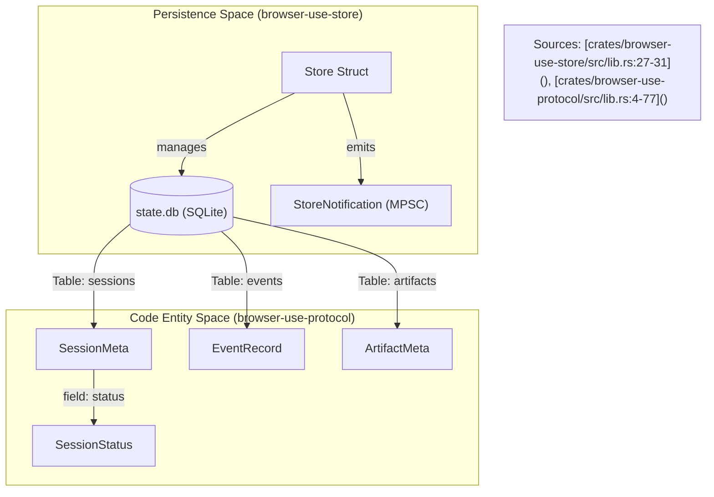

<!-- source: DeepWiki mcp.deepwiki.com · repo browser-use/terminal · page 5 Persistence Layer (Store) · fetched 2026-10-30 -->

# Persistence Layer (Store)

<details>
<summary>Relevant source files</summary>

The following files were used as context for generating this wiki page:

- [crates/browser-use-protocol/src/lib.rs](crates/browser-use-protocol/src/lib.rs)
- [crates/browser-use-store/migrations/0005_unique_agent_paths.sql](crates/browser-use-store/migrations/0005_unique_agent_paths.sql)
- [crates/browser-use-store/src/lib.rs](crates/browser-use-store/src/lib.rs)
- [tests/golden-events/artifact-image-session/events.jsonl](tests/golden-events/artifact-image-session/events.jsonl)

</details>


The persistence layer in Browser Use Terminal provides a durable, event-sourced record of all agent activity. It is primarily implemented in the `browser-use-store` crate, which manages a SQLite database, and the `browser-use-protocol` crate, which defines the shared data structures and event taxonomy used across the entire workspace.

### Core Architecture

The store is designed as an append-only event log for agent sessions. Every action—from user input and model "thinking" to tool execution and browser screenshots—is recorded as an `EventRecord`. This allows for complete session reconstruction, debugging, and TUI reactivity.

#### Persistence Components
- **SQLite Backend**: Uses `rusqlite` to manage a local database file (`state.db`) located in the `~/.browser-use-terminal` directory by default [crates/browser-use-store/src/lib.rs:129-130]().
- **Event Sourcing**: Agent state is derived from a sequence of events [crates/browser-use-protocol/src/lib.rs:202-218]().
- **Reactivity**: A `StoreNotifier` channel allows the TUI and other consumers to receive real-time updates when sessions, events, or settings change [crates/browser-use-store/src/lib.rs:63-71]().

### Code Entity Mapping

The following diagram illustrates how the logical storage concepts map to specific Rust structs and database entities.

**Storage Entity Mapping**


### Key Data Structures

The `browser-use-protocol` crate defines the "source of truth" for data exchanged between the store and the rest of the system.

| Struct | Purpose | Source |
| :--- | :--- | :--- |
| `SessionMeta` | Tracks session identity, parent/child relationships, and status. | [crates/browser-use-protocol/src/lib.rs:4-13]() |
| `EventRecord` | A single entry in the event log with a type and JSON payload. | [crates/browser-use-protocol/src/lib.rs:56-65]() |
| `ArtifactMeta` | Metadata for files or images produced during a session. | [crates/browser-use-protocol/src/lib.rs:67-77]() |
| `SessionStatus` | Enum: `Created`, `Running`, `Done`, `Failed`, `Cancelled`. | [crates/browser-use-protocol/src/lib.rs:17-23]() |

### Store Operations and Notifications

The `Store` struct handles all I/O operations. When the store is opened, it automatically runs migrations to ensure the schema is up to date [crates/browser-use-store/src/lib.rs:143-193]().

**Event Flow and Notification**
```mermaid
sequenceDiagram
    participant Agent as "Agent Engine (Core)"
    participant Store as "Store (browser-use-store)"
    participant DB as "SQLite (state.db)"
    participant TUI as "TUI (browser-use-tui)"

    Agent->>Store: create_event(session_id, type, payload)
    Store->>DB: INSERT INTO events (...)
    Store->>TUI: Send StoreNotification::EventsChanged
    TUI->>Store: get_session_events(session_id)
    Store->>DB: SELECT * FROM events...
    DB-->>Store: rows
    Store-->>TUI: Vec<EventRecord>

    Sources["Sources: [crates/browser-use-store/src/lib.rs:155-159](), [crates/browser-use-store/src/lib.rs:63-71]()"]
```

### Child Pages

Detailed documentation on the schema and protocol types can be found in the following sub-pages:

#### [Database Schema and Migrations](#5.1)
Covers the SQLite table structures for `sessions`, `events`, `artifacts`, `runs`, and `agent_edges`. Explains the migration versioning system and how `PRAGMA journal_mode = WAL` is used for concurrency.
For details, see [Database Schema and Migrations](#5.1).

#### [Protocol Types and Event Taxonomy](#5.2)
Documents the full list of event types (e.g., `session.input`, `tool.call`, `model.event`) and the `EventRecord` payload structures. Details how the TUI uses `transcript_from_events` to project the event log into a human-readable transcript.
For details, see [Protocol Types and Event Taxonomy](#5.2).

---
**Sources:**
- [crates/browser-use-store/src/lib.rs:1-221]()
- [crates/browser-use-protocol/src/lib.rs:1-200]()
- [crates/browser-use-store/migrations/0005_unique_agent_paths.sql:1-4]()

---

