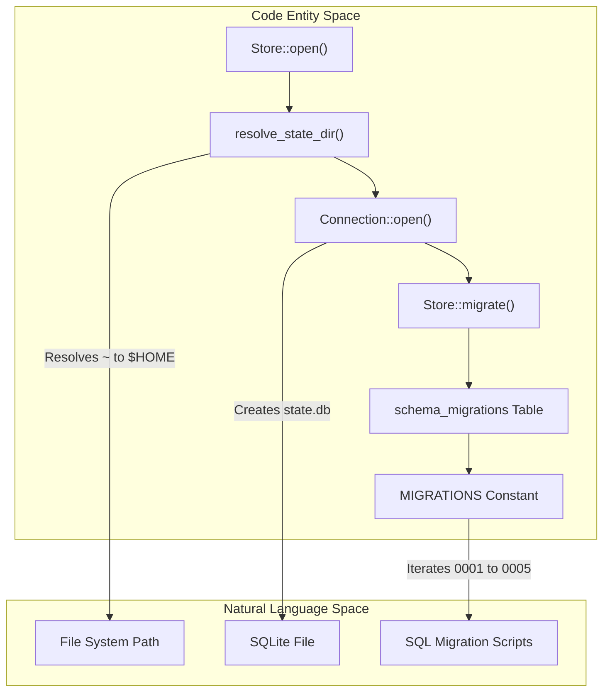
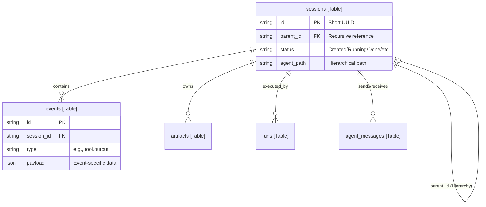
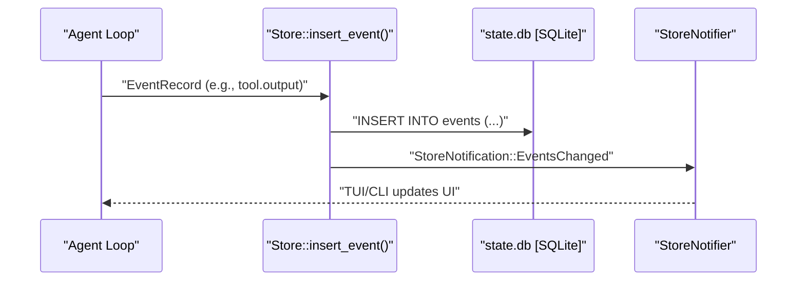

<!-- source: DeepWiki mcp.deepwiki.com · repo browser-use/terminal · page 5.1 Database Schema and Migrations · fetched 2026-10-30 -->

# Database Schema and Migrations

Relevant source files

The following files were used as context for generating this wiki page:

- [crates/browser-use-store/migrations/0005_unique_agent_paths.sql](crates/browser-use-store/migrations/0005_unique_agent_paths.sql)
- [crates/browser-use-store/src/lib.rs](crates/browser-use-store/src/lib.rs)
- [tests/golden-events/artifact-image-session/events.jsonl](tests/golden-events/artifact-image-session/events.jsonl)
- [tests/golden-events/artifact-image-session/session.json](tests/golden-events/artifact-image-session/session.json)
- [tests/golden-events/legacy-session/events.jsonl](tests/golden-events/legacy-session/events.jsonl)
- [tests/golden-events/legacy-session/session.json](tests/golden-events/legacy-session/session.json)
- [tests/golden-events/running-browser-session/events.jsonl](tests/golden-events/running-browser-session/events.jsonl)
- [tests/golden-events/subagent-followup-session/events.jsonl](tests/golden-events/subagent-followup-session/events.jsonl)

The `browser-use-terminal` persistence layer is built on a SQLite backend managed by the `browser-use-store` crate. It utilizes an event-sourced architecture where the primary state is derived from a sequential log of events, while relational tables maintain session metadata, hierarchical agent relationships, and application settings.

## Store Initialization and Migration Logic

The `Store` struct is the primary interface for database operations [crates/browser-use-store/src/lib.rs:27-31](). Upon initialization via `Store::open_with_optional_notifier`, the system performs the following bootstrap sequence:

1.  **Directory Resolution**: Resolves the state directory (defaulting to `~/.browser-use-terminal`) and ensures the existence of the `artifacts` subdirectory [crates/browser-use-store/src/lib.rs:120-128]().
2.  **Connection Setup**: Opens the SQLite connection and configures Write-Ahead Logging (`WAL`) mode and a 30-second busy timeout to handle concurrent access from the TUI and CLI [crates/browser-use-store/src/lib.rs:129-137]().
3.  **Migration Execution**: Checks the `schema_migrations` table and applies any missing SQL scripts defined in the `MIGRATIONS` constant [crates/browser-use-store/src/lib.rs:161-193]().

### Data Flow: Store Initialization
This diagram illustrates how the `Store` class transitions from a file path to a ready-to-use database.

Sources: [crates/browser-use-store/src/lib.rs:105-145](), [crates/browser-use-store/src/lib.rs:16-25]()

## Database Schema Overview

The schema is composed of several key tables that track the lifecycle of agents and their interactions.

| Table | Purpose | Key Columns |
| :--- | :--- | :--- |
| `sessions` | Metadata for agent instances. | `id`, `parent_id`, `status`, `cwd`, `agent_path` |
| `events` | The immutable log of all agent/tool actions. | `id`, `session_id`, `type`, `payload` (JSON) |
| `artifacts` | Tracks files/images produced by agents. | `id`, `session_id`, `kind`, `path`, `mime` |
| `runs` | Execution attempts for a specific session. | `id`, `session_id`, `pid`, `status` |
| `agent_messages` | Inter-agent communication (mail). | `author_session_id`, `target_session_id`, `content` |
| `app_settings` | Global TUI/CLI configuration. | `key`, `value` |

### Entity Relationship Diagram
The following diagram maps the relational structure used by `browser-use-store`.

Sources: [crates/browser-use-store/src/lib.rs:16-25](), [crates/browser-use-protocol/src/lib.rs:10-15]()

## Migration History

The database evolves through five sequential migration files [crates/browser-use-store/src/lib.rs:16-25]():

1.  **`0001_initial.sql`**: Establishes the core tables: `sessions`, `events`, `artifacts`, and `runs`. It defines the `events` table with a JSON `payload` column to support the flexible `EventRecord` protocol.
2.  **`0002_agent_session_fields.sql`**: Adds support for multi-agent hierarchies by introducing `agent_path`, `agent_nickname`, and `agent_role` to the `sessions` table.
3.  **`0003_agent_messages.sql`**: Implements the `agent_messages` table, enabling the "mail" system where agents can send structured messages to one another [crates/browser-use-store/src/lib.rs:85-92]().
4.  **`0004_app_settings.sql`**: Adds a simple key-value store for persisting application-wide settings.
5.  **`0005_unique_agent_paths.sql`**: Enforces integrity in the agent hierarchy by creating a unique index on `(parent_id, agent_path)`, preventing duplicate child agents with the same path [crates/browser-use-store/migrations/0005_unique_agent_paths.sql:1-4]().

## Event Sourcing and the `StoreNotification` System

When data is written to the `Store`, it emits a `StoreNotification` via a `mpsc` channel to notify the TUI or CLI of state changes [crates/browser-use-store/src/lib.rs:63-71]().

*   **`SessionsChanged`**: Triggered when a new session is created or a session is deleted.
*   **`SessionChanged`**: Triggered when a session's status or metadata (like `updated_ms`) is modified.
*   **`EventsChanged`**: Triggered when a new `EventRecord` is appended to the log for a specific session [crates/browser-use-store/src/lib.rs:67]().

### Data Flow: Event Insertion
This diagram shows the path of an event from the `Agent` to the SQLite file.

Sources: [crates/browser-use-store/src/lib.rs:155-159](), [crates/browser-use-store/src/lib.rs:63-71](), [tests/golden-events/artifact-image-session/events.jsonl:1-5]()

## Artifact Persistence

While metadata for artifacts is stored in the `artifacts` table, the actual file content (images, PDFs, etc.) is stored in the file system under the `artifacts/{session_id}/` directory [crates/browser-use-store/src/lib.rs:201-202]().

*   **Images**: Typically generated by the `browser_script` tool or `screenshot` skill [tests/golden-events/artifact-image-session/events.jsonl:2]().
*   **Files**: Generated by agents using tools like `python` to save data [tests/golden-events/artifact-image-session/events.jsonl:3]().

The `Store` provides methods to resolve these paths and ensure the directory structure exists before an agent attempts to write to it [crates/browser-use-store/src/lib.rs:223-225]().

Sources: [crates/browser-use-store/src/lib.rs:1-225](), [crates/browser-use-store/migrations/0005_unique_agent_paths.sql:1-4](), [tests/golden-events/artifact-image-session/events.jsonl:1-6]()

---

