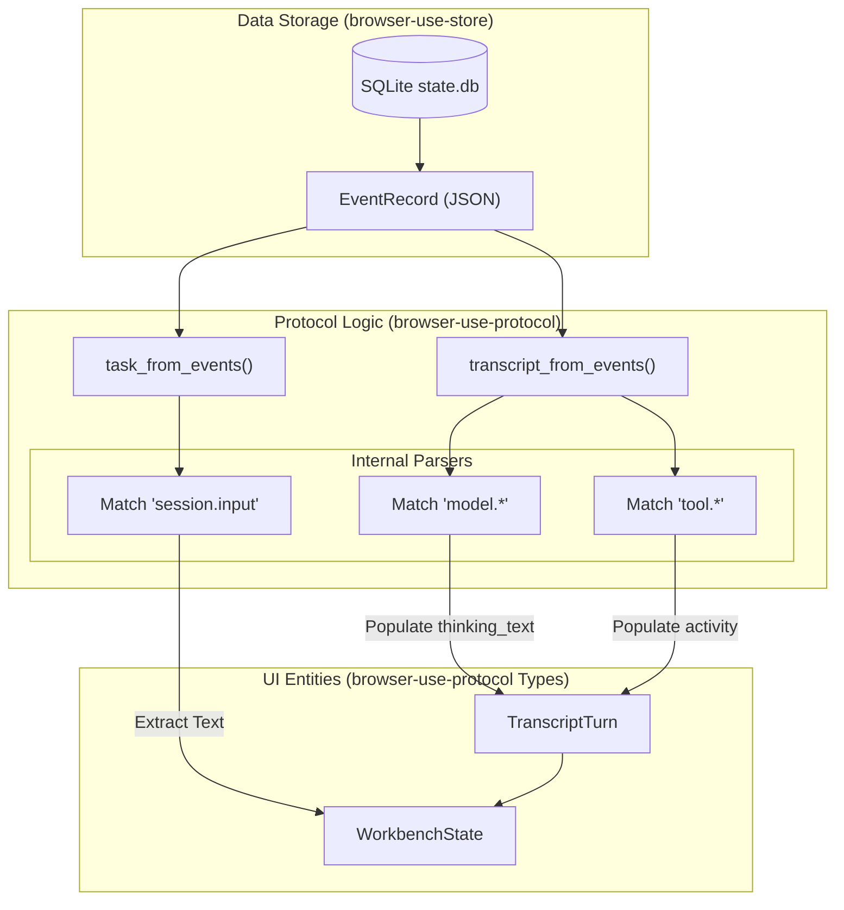
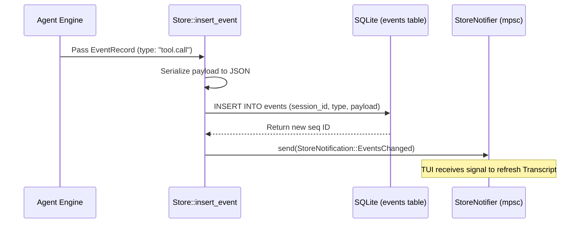

<!-- source: DeepWiki mcp.deepwiki.com · repo browser-use/terminal · page 5.2 Protocol Types and Event Taxonomy · fetched 2026-10-30 -->

# Protocol Types and Event Taxonomy

Relevant source files

The following files were used as context for generating this wiki page:

- [crates/browser-use-protocol/src/lib.rs](crates/browser-use-protocol/src/lib.rs)
- [crates/browser-use-store/src/lib.rs](crates/browser-use-store/src/lib.rs)
- [tests/golden-events/artifact-image-session/events.jsonl](tests/golden-events/artifact-image-session/events.jsonl)

The `browser-use-protocol` crate defines the shared data structures and event schemas used across the entire Browser Use Terminal ecosystem. It serves as the "source of truth" for serializing session state, model interactions, and tool executions to the SQLite store and the TUI.

## Session and Metadata Types

The protocol defines the core identity of a session and its lifecycle. Every interaction in the system is scoped to a `SessionMeta` object.

### SessionMeta and Status
`SessionMeta` tracks the organizational context of an agent run, including its working directory and where artifacts (like screenshots or downloads) are stored [crates/browser-use-protocol/src/lib.rs:5-13]().

The `SessionStatus` enum governs the lifecycle of these sessions:
| Status | Description |
| :--- | :--- |
| `Created` | Session initialized in DB but not yet active [crates/browser-use-protocol/src/lib.rs:18](). |
| `Running` | Agent loop is actively processing turns [crates/browser-use-protocol/src/lib.rs:19](). |
| `Done` | Session completed successfully via the `done` tool [crates/browser-use-protocol/src/lib.rs:20](). |
| `Failed` | Terminal error encountered in the agent loop [crates/browser-use-protocol/src/lib.rs:21](). |
| `Cancelled` | Manually terminated by the user [crates/browser-use-protocol/src/lib.rs:22](). |

### ArtifactMeta
Artifacts are files or data generated during a session (e.g., downloaded PDFs, generated reports). `ArtifactMeta` provides the link between a session event and the physical file on disk [crates/browser-use-protocol/src/lib.rs:68-77]().

**Sources:**
- [crates/browser-use-protocol/src/lib.rs:5-23]()
- [crates/browser-use-protocol/src/lib.rs:68-77]()

---

## Event Taxonomy

The system uses an append-only event log. Each `EventRecord` contains a `type` string that determines how the `payload` (a JSON value) should be interpreted [crates/browser-use-protocol/src/lib.rs:57-65]().

### Taxonomy Categories

| Category | Event Type | Description |
| :--- | :--- | :--- |
| **Session** | `session.input` | User-provided task or prompt [crates/browser-use-protocol/src/lib.rs:204](). |
| | `session.followup` | Subsequent user instructions [crates/browser-use-protocol/src/lib.rs:223](). |
| | `session.done` | Final result of the session [tests/golden-events/artifact-image-session/events.jsonl:5](). |
| **Model** | `model.text` | Streaming text chunks from the LLM. |
| | `model.thought` | Internal reasoning/chain-of-thought deltas [crates/browser-use-protocol/src/lib.rs:136-140](). |
| | `model.usage` | Token counts and cost tracking [crates/browser-use-protocol/src/lib.rs:116-128](). |
| **Tool** | `tool.call` | Request to execute a specific tool [crates/browser-use-protocol/src/lib.rs:87-91](). |
| | `tool.output` | The result (text/data) returned by a tool [crates/browser-use-protocol/src/lib.rs:107-113](). |
| | `tool.image` | Visual feedback (e.g., browser screenshots) [crates/browser-use-protocol/src/lib.rs:94-104](). |
| **Artifact** | `artifact.created` | Notification that a file was saved to the artifact root [tests/golden-events/artifact-image-session/events.jsonl:3](). |

**Sources:**
- [crates/browser-use-protocol/src/lib.rs:57-148]()
- [tests/golden-events/artifact-image-session/events.jsonl:1-6]()

---

## Model and Tool Execution Types

The protocol defines specific structures for the "Turn" mechanics of the agent.

### ModelEvent
The `ModelEvent` enum is used for streaming updates from LLM providers. It uses a `tag = "type"` serialization strategy to handle different kinds of deltas [crates/browser-use-protocol/src/lib.rs:131-148]().
- `TextDelta`: Standard response text.
- `ThinkingDelta`: Reasoning tokens (e.g., from DeepSeek or Claude).
- `ToolCall`: A request to invoke a function.
- `Usage`: Final token and cost statistics.

### Tool Structures
- **`ToolCall`**: Contains the `id`, `name`, and JSON `arguments` [crates/browser-use-protocol/src/lib.rs:87-91]().
- **`ToolResult`**: Maps back to a `tool_call_id` and includes a success boolean (`ok`), text output, and a list of `ToolImage` objects [crates/browser-use-protocol/src/lib.rs:107-113]().
- **`ToolImage`**: Encapsulates screenshot metadata, including `viewport` dimensions and `detail` level (high/low) [crates/browser-use-protocol/src/lib.rs:94-104]().

**Sources:**
- [crates/browser-use-protocol/src/lib.rs:87-148]()

---

## Data Flow: From Event to UI

The following diagram illustrates how raw `EventRecord` objects from the `Store` are transformed into high-level UI components in the `browser-use-protocol` crate.

### Event Transformation Logic
"Protocol Logic Space to UI Entity Space"

**Sources:**
- [crates/browser-use-protocol/src/lib.rs:178-200]()
- [crates/browser-use-protocol/src/lib.rs:202-216]()
- [crates/browser-use-protocol/src/lib.rs:218-253]()

---

## Store Integration and Notifications

The `browser-use-store` crate utilizes these protocol types to provide a reactive interface. When events are inserted, the store emits a `StoreNotification` [crates/browser-use-store/src/lib.rs:63-69]().

### Notification Taxonomy
- `SessionsChanged`: A new session was created or deleted.
- `SessionChanged { session_id }`: A session's status (e.g., `Running` -> `Done`) updated.
- `EventsChanged { session_id, seq }`: A new event was appended to the log at sequence `seq`.
- `SettingsChanged`: Global application settings were modified.

### Database Interaction Flow
"Code Entity Space to Persistence"

**Sources:**
- [crates/browser-use-store/src/lib.rs:63-71]()
- [crates/browser-use-store/src/lib.rs:155-159]()
- [crates/browser-use-protocol/src/lib.rs:57-65]()

---

