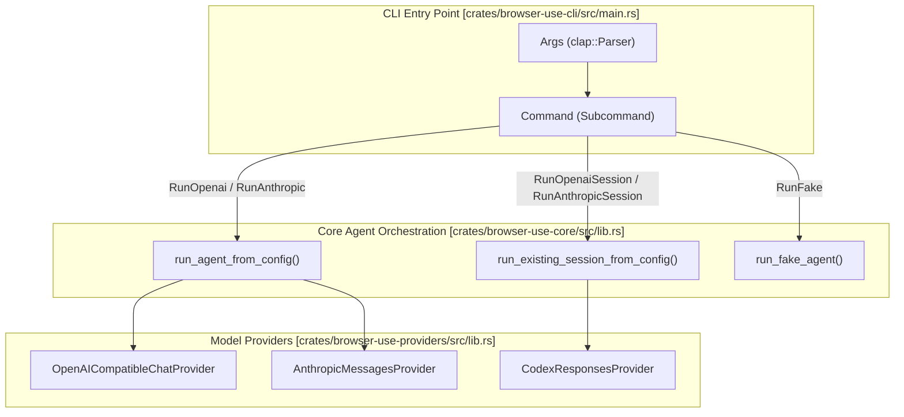
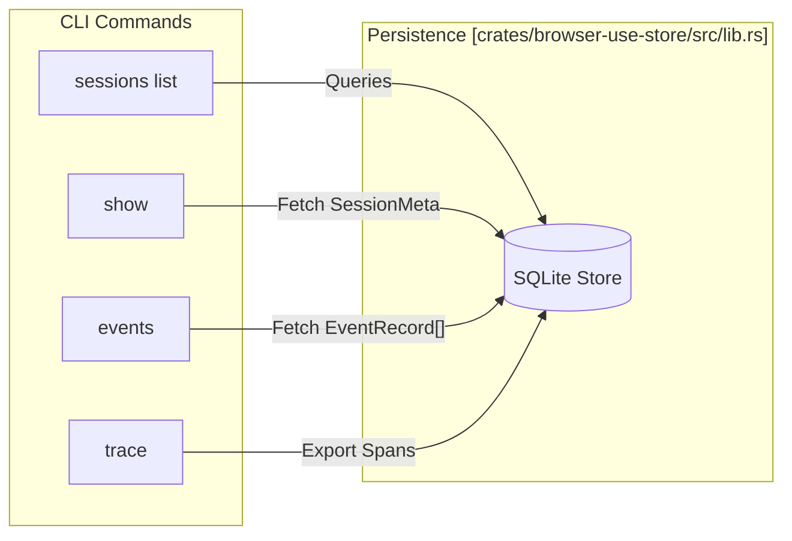

<!-- source: DeepWiki mcp.deepwiki.com · repo browser-use/terminal · page 6 CLI Interface · fetched 2026-10-30 -->

# CLI Interface

Relevant source files

The following files were used as context for generating this wiki page:

- [crates/browser-use-cli/src/main.rs](crates/browser-use-cli/src/main.rs)

The `browser-use-cli` crate provides a command-line interface for managing browser-based agent tasks, evaluating datasets, and coordinating multi-agent workflows. It serves as the primary entry point for non-interactive execution and automation, wrapping the core engine and persistence layers into a structured set of subcommands.

### Command Architecture

The CLI is built using the `clap` library and is structured into several functional categories:
*   **Agent Execution**: Commands to start and resume agent tasks using various LLM providers (OpenAI, Anthropic, Codex, etc.).
*   **Session Management**: Tools for listing, inspecting, exporting, and importing agent sessions.
*   **Multi-Agent Coordination**: Low-level commands for spawning, messaging, and waiting on sub-agents.
*   **Dataset Evaluation**: A framework for running large-scale evaluations across predefined datasets.
*   **System Utilities**: Authentication management, configuration, and diagnostics.

### Code-to-System Mapping

The following diagram illustrates how CLI commands map to internal `browser-use-core` functions and `browser-use-providers` entities.

**CLI Dispatch Logic**

Sources: [crates/browser-use-cli/src/main.rs:35-114](), [crates/browser-use-cli/src/main.rs:151-178](), [crates/browser-use-core/src/lib.rs:11-16]()

---

## Agent Execution and Session Control

The CLI allows for both starting new tasks and resuming existing ones. Every execution is tracked via a `task_id` (UUID) in the SQLite store.

| Command Category | Commands | Description |
|:---|:---|:---|
| **New Task** | `run-openai`, `run-anthropic`, `run-codex`, `run-openrouter` | Initializes a new session with the specified provider and model. |
| **Resume Task** | `run-openai-session`, `run-anthropic-session`, etc. | Continues an existing `task_id` using the specified model provider. |
| **Lifecycle** | `followup`, `cancel`, `finish`, `fail` | Manually updates the state of a session or provides additional user input. |
| **Simulation** | `run-fake` | Runs an agent with a scripted or fake provider for testing purposes. |

For a full list of flags and provider-specific options, see [Commands Reference](#6.1).

Sources: [crates/browser-use-cli/src/main.rs:47-114]()

---

## Session Management and Inspection

The CLI provides deep visibility into the persistence layer (`browser-use-store`). Users can inspect the event log of any session, which includes tool calls, model responses, and browser screenshots.

**Session State and Data Flow**

*   **`history`**: Displays a chronological list of recent tasks.
*   **`export` / `import`**: Allows moving session data (including all artifacts and events) between different machines by bundling them into a directory.
*   **`trace`**: Generates a performance and execution trace for a specific task.

Sources: [crates/browser-use-cli/src/main.rs:115-150]()

---

## Dataset Evaluation Framework

The CLI includes a specialized sub-system for batch evaluation of agents against datasets. This is used for benchmarking agent performance and regression testing.

*   **Concurrency Control**: Commands like `dataset-run-openai` support a `--concurrency` flag to run multiple tasks in parallel.
*   **Retry Logic**: Supports `max_attempts` to handle transient failures during long-running evaluations.
*   **Reporting**: The `dataset-report` command aggregates results from a run to calculate success rates and token usage.

For details on dataset formats and execution isolation, see [Dataset Evaluation Framework](#6.2).

Sources: [crates/browser-use-cli/src/main.rs:187-255]()

---

## Multi-Agent Coordination

While the TUI provides a high-level interface for sub-agents, the CLI exposes the raw primitives for inter-agent communication:

*   **`spawn-agent`**: Creates a child agent session linked to a parent.
*   **`send-agent-message`**: Routes a message from one `author_id` to a `target_id`, optionally triggering a model turn.
*   **`wait-agent`**: Blocks the current process until a target agent completes its task.

Sources: [crates/browser-use-cli/src/main.rs:151-178]()

---

## Child Pages

*   **[Commands Reference](#6.1)**: Comprehensive documentation of every CLI command, argument, and environment variable.
*   **[Dataset Evaluation Framework](#6.2)**: Technical details on the `DatasetCase` format, parallel runner, and evaluation manifest.

---

