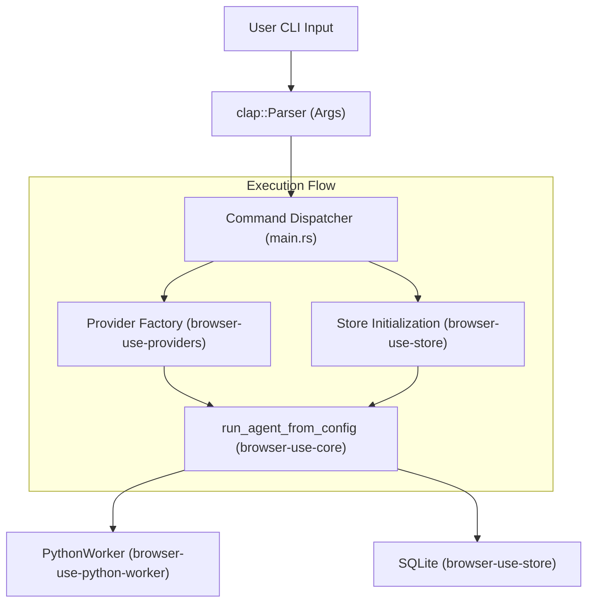
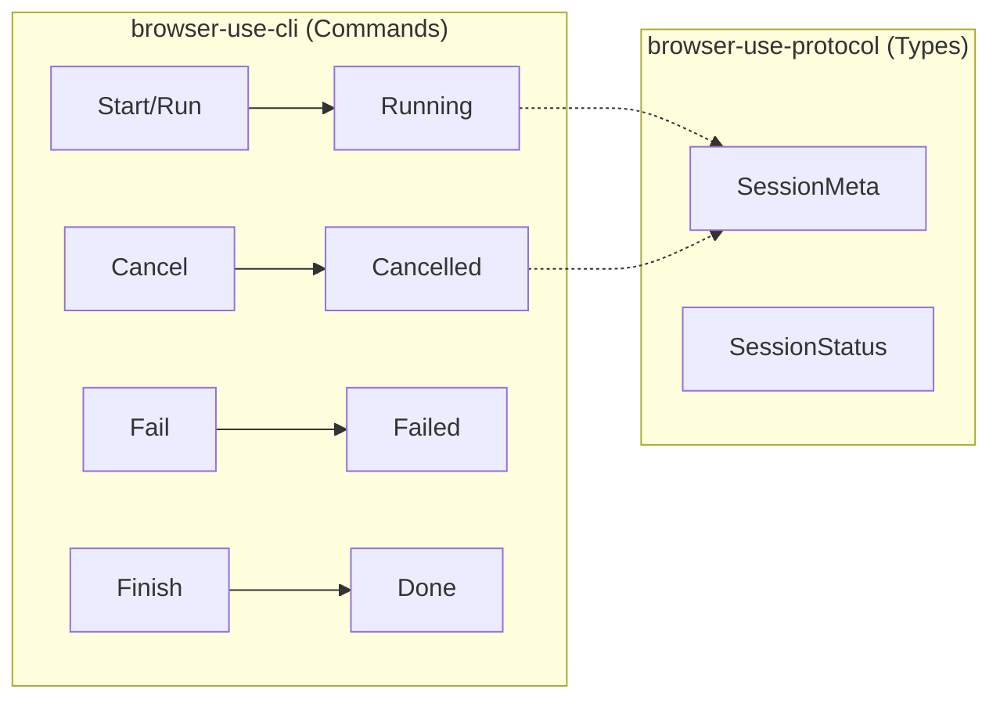

<!-- source: DeepWiki mcp.deepwiki.com · repo browser-use/terminal · page 6.1 Commands Reference · fetched 2026-10-30 -->

# Commands Reference

Relevant source files

The following files were used as context for generating this wiki page:

- [crates/browser-use-cli/Cargo.toml](crates/browser-use-cli/Cargo.toml)
- [crates/browser-use-cli/src/main.rs](crates/browser-use-cli/src/main.rs)
- [python/llm_browser_worker/rust_cli.py](python/llm_browser_worker/rust_cli.py)

The `browser-use-terminal` CLI is the primary entry point for headless agent execution, session management, and system configuration. It is implemented in the `browser-use-cli` crate and provides a comprehensive set of subcommands for interacting with the core engine without the TUI.

## Overview and Implementation

The CLI is built using the `clap` library for command-line argument parsing [crates/browser-use-cli/src/main.rs:31-44](). It acts as a thin orchestration layer that translates user commands into calls to the `browser-use-core` engine and `browser-use-store` persistence layer [crates/browser-use-cli/Cargo.toml:11-23]().

### Data Flow: CLI to Core
When a run command (e.g., `run-openai`) is invoked, the CLI initializes the requested `ModelProvider`, configures the `AgentRunOptions`, and enters the agent loop via `run_agent_from_config` [crates/browser-use-cli/src/main.rs:11-16]().

**CLI Execution Architecture**

Sources: [crates/browser-use-cli/src/main.rs:35-186](), [crates/browser-use-cli/Cargo.toml:11-17]()

---

## Agent Execution Commands

These commands initiate a new agent session or resume an existing one using specific LLM providers.

### Provider-Specific Run Commands
The CLI supports several backends, each with a `Run<Provider>` (new session) and `Run<Provider>Session` (resume existing) variant.

| Command | Provider Class | Default Model | Implementation Detail |
| :--- | :--- | :--- | :--- |
| `run-openai` | `OpenAICompatibleChatProvider` | `gpt-5.5` | Uses standard OpenAI API [crates/browser-use-cli/src/main.rs:56-60]() |
| `run-anthropic` | `AnthropicMessagesProvider` | `claude-sonnet-4-6` | Uses Anthropic Messages API [crates/browser-use-cli/src/main.rs:66-70]() |
| `run-codex` | `CodexResponsesProvider` | `gpt-5.5` | Uses Codex device auth [crates/browser-use-cli/src/main.rs:61-65]() |
| `run-openrouter` | `OpenAICompatibleChatProvider` | `openai/gpt-5.5` | Routes via OpenRouter [crates/browser-use-cli/src/main.rs:71-75]() |
| `run-fake` | `FakeProvider` | N/A | Deterministic scripted responses [crates/browser-use-cli/src/main.rs:51-55]() |

### Resuming and Follow-up
*   **`run-<provider>-session --task-id <ID>`**: Resumes an existing session using the specified provider [crates/browser-use-cli/src/main.rs:76-95]().
*   **`followup --task-id <ID> <TEXT>`**: Appends a new user message to an existing session and triggers a new agent turn [crates/browser-use-cli/src/main.rs:96-99]().

Sources: [crates/browser-use-cli/src/main.rs:47-99](), [crates/browser-use-cli/src/main.rs:11-28]()

---

## Session and History Management

The CLI provides tools to inspect and manipulate the lifecycle of agent sessions stored in the SQLite database.

### Session Control
*   **`sessions list`**: Lists all sessions in the store.
*   **`show <task_id>`**: Displays the current state and task summary for a specific session [crates/browser-use-cli/src/main.rs:121-123]().
*   **`cancel <task_id> --reason <TEXT>`**: Transitions a session to the `Cancelled` state [crates/browser-use-cli/src/main.rs:110-114]().
*   **`history`**: Displays a chronological list of recent sessions [crates/browser-use-cli/src/main.rs:120]().

### Data Portability
*   **`export <task_id> <output_dir>`**: Dumps all events, artifacts, and metadata for a session into a directory [crates/browser-use-cli/src/main.rs:131-134]().
*   **`import <input_path>`**: Ingests a previously exported session or a JSON event log back into the local store [crates/browser-use-cli/src/main.rs:135-137]().
*   **`trace <task_id>`**: Generates a performance and event trace for debugging [crates/browser-use-cli/src/main.rs:147-150]().

**Session State Logic**

Sources: [crates/browser-use-cli/src/main.rs:110-137](), [crates/browser-use-protocol/src/lib.rs:1-50]()

---

## Multi-Agent Coordination

These commands allow manual intervention in the multi-agent hierarchy, typically used for debugging the `spawn_agent` tool flow.

*   **`spawn-agent --parent-id <ID> --message <TEXT>`**: Manually creates a child agent session linked to a parent [crates/browser-use-cli/src/main.rs:151-160]().
*   **`list-agents --parent-id <ID>`**: Lists all sub-agents spawned by a specific parent [crates/browser-use-cli/src/main.rs:161-163]().
*   **`send-agent-message --author-id <ID> --target-id <ID> <TEXT>`**: Sends a message between two agents in the hierarchy [crates/browser-use-cli/src/main.rs:169-175]().
*   **`wait-agent --target-id <ID>`**: Blocks the CLI until the target agent session reaches a terminal state (`Done`, `Failed`, or `Cancelled`) [crates/browser-use-cli/src/main.rs:176-178]().

Sources: [crates/browser-use-cli/src/main.rs:151-178]()

---

## System Configuration and Auth

### Authentication
The `auth` subcommand manages credentials for various providers, including OAuth flows for Claude Code and device flows for Codex.
*   **`auth login-claude-code`**: Initiates the OAuth PKCE flow [crates/browser-use-cli/src/main.rs:142-145]().
*   **`auth login-codex`**: Handles the device code authentication for Codex [crates/browser-use-providers/src/lib.rs:23-28]().

### Configuration
*   **`config`**: Allows viewing and modifying application settings stored in the `app_settings` table of the SQLite DB [crates/browser-use-cli/src/main.rs:138-141]().
*   **`diagnostics`**: Runs a system check to verify Python worker availability, browser installation, and API connectivity [crates/browser-use-cli/src/main.rs:146]().

### Updates
*   **`update --check`**: Checks for new versions of the terminal.
*   **`update --release <VERSION>`**: Triggers the update mechanism to download and install a specific release [crates/browser-use-cli/src/main.rs:179-186]().

Sources: [crates/browser-use-cli/src/main.rs:138-146](), [crates/browser-use-cli/src/main.rs:179-186](), [crates/browser-use-providers/src/lib.rs:21-28]()

---

