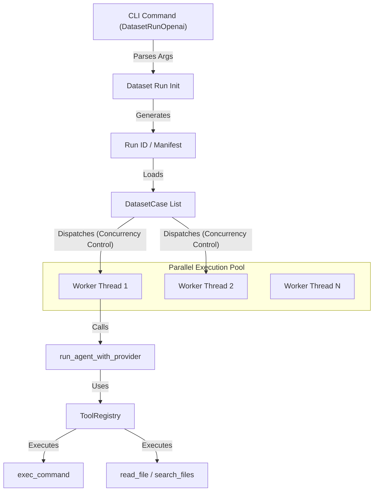
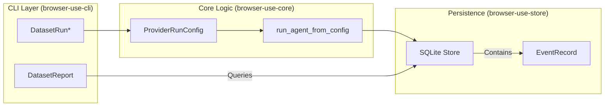

<!-- source: DeepWiki mcp.deepwiki.com · repo browser-use/terminal · page 6.2 Dataset Evaluation Framework · fetched 2026-10-30 -->

# Dataset Evaluation Framework

Relevant source files

The following files were used as context for generating this wiki page:

- [crates/browser-use-cli/src/main.rs](crates/browser-use-cli/src/main.rs)
- [crates/browser-use-core/src/tools/command.rs](crates/browser-use-core/src/tools/command.rs)
- [crates/browser-use-core/src/tools/files.rs](crates/browser-use-core/src/tools/files.rs)
- [datasets/BU_Bench_V1.json](datasets/BU_Bench_V1.json)
- [datasets/real_v14_short.json](datasets/real_v14_short.json)
- [datasets/real_v8.json](datasets/real_v8.json)
- [prompts/dataset-case-user.md](prompts/dataset-case-user.md)

The Dataset Evaluation Framework in `browser-use-terminal` is a robust sub-system designed for benchmarking agent performance across large sets of tasks. It supports parallel execution, manifest-based tracking, and sophisticated retry logic to distinguish between transient and permanent failures.

## Dataset Structure and Formats

Datasets are defined as JSON files containing a list of `DatasetCase` objects. Each case represents a single task to be executed by the agent.

### DatasetCase Format
A standard dataset case consists of a unique identifier and the natural language task description.

| Field | Type | Description |
| :--- | :--- | :--- |
| `task_id` | String | A unique identifier for the specific case [datasets/real_v8.json:3](). |
| `confirmed_task` | String | The actual prompt/instruction for the agent [datasets/real_v8.json:4](). |
| `category` | String (Optional) | Metadata for grouping tasks [datasets/BU_Bench_V1.json:4](). |

### Workspace Isolation
To ensure evaluation integrity, every task attempt is isolated. The framework enforces a filesystem contract where agents must save artifacts in the current working directory using relative paths [prompts/dataset-case-user.md:11-12]().

## Execution Engine

The evaluation engine is triggered via CLI commands such as `DatasetRunOpenai` or `DatasetRunAnthropic` [crates/browser-use-cli/src/main.rs:223-251]().

### Concurrency and Parallelism
The framework supports parallel execution via the `--concurrency` flag [crates/browser-use-cli/src/main.rs:219](). It manages a pool of worker threads, each running an independent agent session.

### Retry Logic and Failure Handling
The system distinguishes between different failure modes to optimize resource usage:
*   **Transient Failures:** Network timeouts or LLM rate limits. These are retried up to `--max-attempts` [crates/browser-use-cli/src/main.rs:217]().
*   **Permanent Failures:** Logic errors or task-specific impossibilities.
*   **Stop on Failure:** If the `--stop-on-failure` flag is set, the entire dataset run terminates immediately upon the first case failure [crates/browser-use-cli/src/main.rs:215]().

### Manifest Tracking
Every dataset run is assigned a unique `run_id` [crates/browser-use-cli/src/main.rs:209](). This allows for:
1.  **Resuming Runs:** Using the `--resume` flag to pick up where a previous run left off [crates/browser-use-cli/src/main.rs:211]().
2.  **Skipping Failures:** The `--skip-failed` flag allows a new run to ignore tasks that previously resulted in a failure status [crates/browser-use-cli/src/main.rs:213]().

**Sources:** [crates/browser-use-cli/src/main.rs:187-251](), [prompts/dataset-case-user.md:1-32]()

## Data Flow: CLI to Agent Execution

The following diagram illustrates how a dataset run request moves from the CLI command into the parallel execution loop.

### Dataset Run Initialization

**Sources:** [crates/browser-use-cli/src/main.rs:223-251](), [crates/browser-use-core/src/tools/command.rs:62-120](), [crates/browser-use-core/src/tools/files.rs:23-101]()

## Reporting and Analysis

The `DatasetReport` command provides a post-hoc analysis of a dataset run [crates/browser-use-cli/src/main.rs:197]().

### DatasetReport Metrics
The report aggregates data from the `Store` to provide:
*   **Success Rate:** Percentage of tasks that reached the `done` state.
*   **Token Usage:** Total and per-task LLM costs.
*   **Duration:** Wall-clock time per task and total run time.
*   **Artifact Manifest:** A list of all files generated by the agents during the run.

### System Entity Mapping
This diagram bridges the CLI command space to the internal core functions.

**Sources:** [crates/browser-use-cli/src/main.rs:197-222](), [crates/browser-use-core/src/main.rs:12-16](), [crates/browser-use-store/src/lib.rs:30]()

## Tooling Integration in Datasets

Agents running in dataset mode are specifically instructed via the `dataset-case-user.md` prompt to use specific tools for verification and artifact management.

| Tool | Purpose in Evaluation |
| :--- | :--- |
| `exec_command` | Running local scripts or verification checks [crates/browser-use-core/src/tools/command.rs:62](). |
| `read_file` | Inspecting local files generated by the task [crates/browser-use-core/src/tools/files.rs:23](). |
| `done` | Signalling task completion and attaching the `result_file` artifact [prompts/dataset-case-user.md:15](). |
| `audit_artifact` | (Contractual) Running explicit checks against requirements before finalizing [prompts/dataset-case-user.md:25](). |

**Sources:** [crates/browser-use-core/src/tools/command.rs:62-65](), [crates/browser-use-core/src/tools/files.rs:23-27](), [prompts/dataset-case-user.md:11-25]()

---

