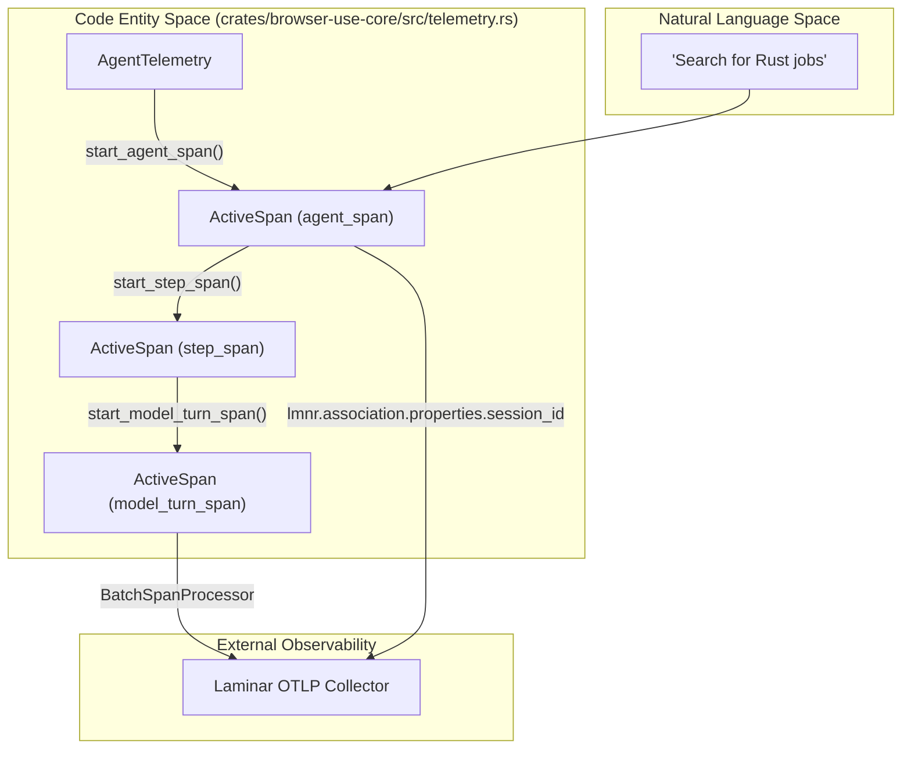
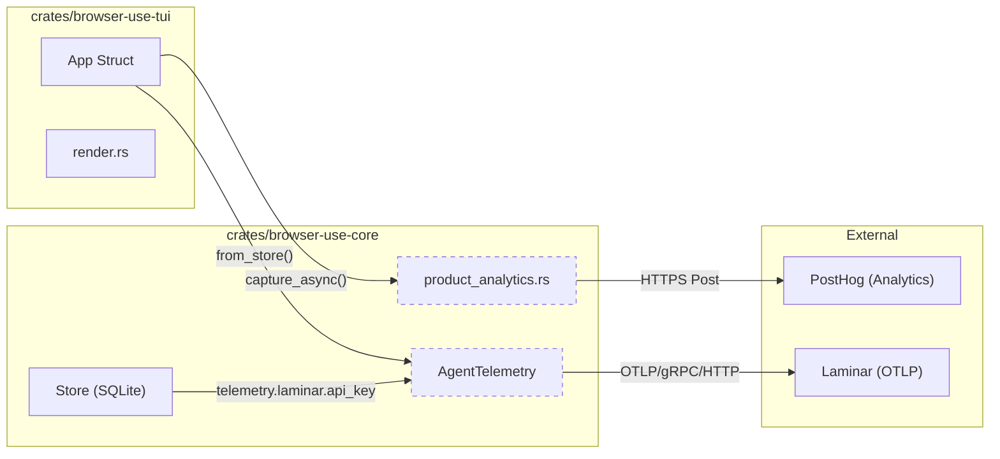

<!-- source: DeepWiki mcp.deepwiki.com · repo browser-use/terminal · page 7 Telemetry and Observability · fetched 2026-10-30 -->

# Telemetry and Observability

<details>
<summary>Relevant source files</summary>

The following files were used as context for generating this wiki page:

- [.env.example](.env.example)
- [crates/browser-use-core/src/product_analytics.rs](crates/browser-use-core/src/product_analytics.rs)
- [crates/browser-use-core/src/telemetry.rs](crates/browser-use-core/src/telemetry.rs)
- [crates/browser-use-tui/src/render.rs](crates/browser-use-tui/src/render.rs)

</details>


The Browser Use Terminal provides comprehensive observability through two distinct channels: **Agent Telemetry** for deep execution tracing (via OpenTelemetry and Laminar) and **Product Analytics** for high-level usage metrics (via PostHog). These systems allow developers to debug complex multi-agent interactions and monitor system performance while providing users with granular control over data privacy.

## Agent Telemetry (Laminar Integration)

Agent Telemetry is implemented using the OpenTelemetry (OTLP) protocol, specifically integrated with [Laminar](https://lmnr.ai/). It captures the hierarchical execution of agent tasks, model turns, and tool calls.

### Implementation and Configuration

The `AgentTelemetry` struct manages the OTLP tracer and provider [crates/browser-use-core/src/telemetry.rs:36-38](). It initializes an `SdkTracerProvider` with a `BatchSpanProcessor` to export traces to a configured endpoint [crates/browser-use-core/src/telemetry.rs:42-43]().

- **Laminar API Key**: Configured via the `LMNR_PROJECT_API_KEY` environment variable or the `telemetry.laminar.api_key` setting in the store [crates/browser-use-core/src/telemetry.rs:67-73]().
- **Endpoint**: Defaults to `https://api.lmnr.ai/v1/traces` [crates/browser-use-core/src/telemetry.rs:18]().
- **Payload Capture**: Controlled by `LLM_BROWSER_LAMINAR_CAPTURE_PAYLOADS`. When enabled, full prompt messages and tool outputs are attached to spans [crates/browser-use-core/src/telemetry.rs:137-140]().

### Span Hierarchy

The system uses a nested span architecture to represent the agent's lifecycle:

| Span Type | Entity | Description |
| :--- | :--- | :--- |
| `agent_span` | `browser_use.agent` | The root span for an agent session. Contains `session_id`, `cwd`, and the initial task [crates/browser-use-core/src/telemetry.rs:121-122](). |
| `step_span` | `browser_use.step` | Represents a single iteration of the agent loop. Tracks the turn index [crates/browser-use-core/src/telemetry.rs:248-249](). |
| `model_turn_span` | `llm.anthropic` / `llm.openai` | A specialized "LLM" type span containing model parameters, prompt messages, and usage tokens [crates/browser-use-core/src/telemetry.rs:124-136](). |
| `tool_span` | `browser_use.tool` | Tracks individual tool executions, including input arguments and result status [crates/browser-use-core/src/telemetry.rs:281-282](). |

### Data Flow: Agent Execution to Trace


**Sources:** [crates/browser-use-core/src/telemetry.rs:87-122](), [crates/browser-use-core/src/telemetry.rs:236-250](), [crates/browser-use-core/src/telemetry.rs:124-136]()

---

## Product Analytics

Product analytics focus on anonymous usage patterns to improve the TUI experience. This system is decoupled from the execution traces.

### PostHog Integration
The `product_analytics.rs` module handles event capture using the PostHog API [crates/browser-use-core/src/product_analytics.rs:10-12](). 

- **Capture Modes**: Supports `capture_async` (spawns a background thread) and `capture_blocking` [crates/browser-use-core/src/product_analytics.rs:16-35]().
- **Anonymization**: Every installation generates a unique `install_id` stored locally in the state directory [crates/browser-use-core/src/product_analytics.rs:95-111](). Personal profiles are explicitly disabled via `$process_person_profile: false` [crates/browser-use-core/src/product_analytics.rs:67]().
- **Contextual Data**: Automatically appends `app_version`, `os`, `arch`, and `analytics_env` to every event [crates/browser-use-core/src/product_analytics.rs:72-87]().

### Common Events and Bucketing
The system buckets continuous values to maintain privacy:
- **Duration Bucketing**: Task durations are grouped into categories like `<10s`, `1-5m`, or `>15m` [crates/browser-use-core/src/product_analytics.rs:170-183]().
- **Browser Normalization**: Browser modes are mapped to standard types (e.g., `local`, `cloud`, `headless`) [crates/browser-use-core/src/product_analytics.rs:185-197]().

**Sources:** [crates/browser-use-core/src/product_analytics.rs:1-111]()

---

## Privacy and Disabling Telemetry

Telemetry is enabled by default but can be completely disabled using environment variables.

### Opt-out Mechanisms
Users can disable all tracking by setting:
```bash
BUT_TELEMETRY=0
```
This flag is checked by both the `AgentTelemetry` and `product_analytics` modules [crates/browser-use-core/src/product_analytics.rs:119-121]().

| Variable | Scope | Description |
| :--- | :--- | :--- |
| `BUT_TELEMETRY` | Global | Disables both Product Analytics and Agent Telemetry. |
| `BUT_PRODUCT_ANALYTICS` | Analytics | Disables only PostHog event reporting. |
| `LMNR_PROJECT_API_KEY` | Tracing | If unset (and no store key exists), Agent Telemetry is effectively disabled [crates/browser-use-core/src/telemetry.rs:75-77](). |

**Sources:** [.env.example:23-24](), [crates/browser-use-core/src/product_analytics.rs:119-121]()

---

## System Architecture Diagram

This diagram bridges the TUI components to the Telemetry infrastructure.


**Sources:** [crates/browser-use-tui/src/render.rs:93-100](), [crates/browser-use-core/src/telemetry.rs:67-73](), [crates/browser-use-core/src/product_analytics.rs:16-28]()

---

