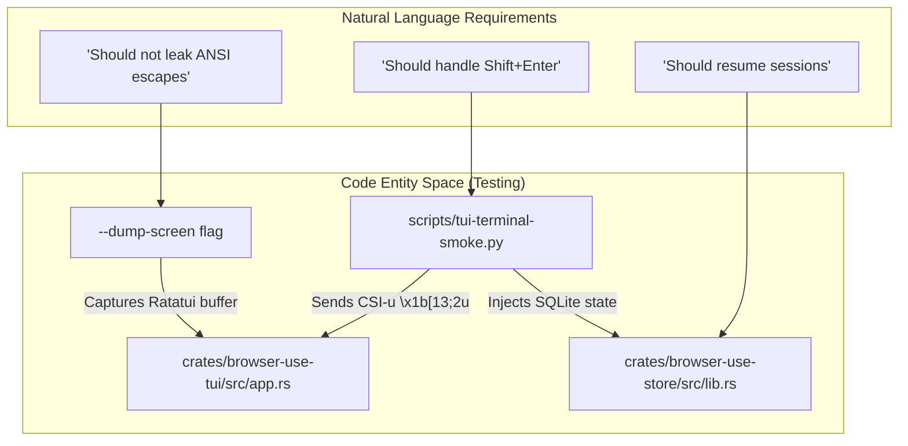
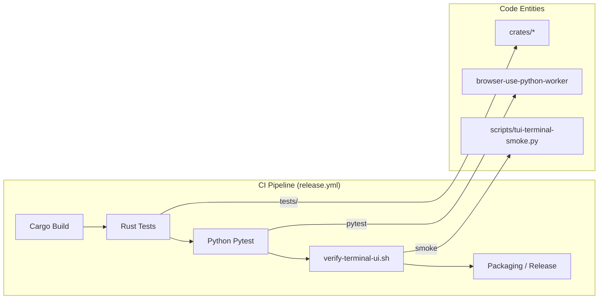

<!-- source: DeepWiki mcp.deepwiki.com · repo browser-use/terminal · page 8 Testing and CI · fetched 2026-10-30 -->

# Testing and CI

Relevant source files

The following files were used as context for generating this wiki page:

- [AGENTS.md](AGENTS.md)
- [CONTRIBUTING.md](CONTRIBUTING.md)
- [docs/terminal-ui-testing.md](docs/terminal-ui-testing.md)
- [scripts/tui-terminal-smoke.py](scripts/tui-terminal-smoke.py)

The Browser Use Terminal testing strategy ensures stability across a complex stack involving Rust binaries, Python workers, SQLite persistence, and a real-time Terminal User Interface (TUI). Because the TUI relies on terminal-specific protocols (CSI-u, bracketed paste, alternate screens), testing extends beyond unit tests into live terminal simulation via tmux.

## Verification Pipeline

The repository defines a "Definition of Done" for all changes through a unified verification script. This script orchestrates formatting checks, multi-language testing, and visual regression captures.

### `verify-terminal-ui.sh`
This script is the primary gatekeeper for the codebase [AGENTS.md:39-45](). It performs the following sequence:
1.  **Code Quality**: Runs `cargo fmt` and `cargo clippy`.
2.  **Rust Tests**: Executes `cargo test` for all workspace crates.
3.  **Python Tests**: Runs `pytest` for the browser worker and helper scripts [CONTRIBUTING.md:14-14]().
4.  **Deterministic Dumps**: Generates screen captures using `--dump-screen` for specific application states (Ready, Running, Browser Overlay) [AGENTS.md:17-22]().
5.  **Smoke Tests**: Invokes the `tui-terminal-smoke.py` harness to verify behavior in a live PTY.

**Sources:** [CONTRIBUTING.md:9-21](), [AGENTS.md:9-22](), [AGENTS.md:39-45]()

---

## Testing Strategy Overview

The testing architecture is divided into four distinct layers to catch different classes of failures.

| Layer | Tooling | Target |
| :--- | :--- | :--- |
| **Unit & Integration** | `cargo test` | Logic in `browser-use-core`, `store` migrations, and protocol serialization. |
| **Python Worker** | `pytest` | `browser_script` execution, CDP interaction, and worker-to-rust communication. |
| **Deterministic TUI** | `--dump-screen` | Visual layout, widget positioning, and theme rendering using Ratatui's `TestBackend`. |
| **Live Terminal** | `tmux` / `tui-terminal-smoke.py` | Input handling (CSI-u), scrollback artifacts, bracketed paste, and resize events. |

### Logic vs. UI Space Mapping

The following diagram illustrates how testing entities bridge the gap between abstract terminal requirements and concrete code implementations.

**Terminal Verification Mapping**

**Sources:** [scripts/tui-terminal-smoke.py:61-65](), [AGENTS.md:17-22](), [docs/terminal-ui-testing.md:11-17]()

---

## TUI Smoke Tests and tmux Integration

The most rigorous testing occurs in `scripts/tui-terminal-smoke.py`. Unlike standard unit tests, this framework launches the `browser-use-tui` binary inside a `tmux` session to ensure that the application interacts correctly with a real terminal emulator.

- **State Injection**: The script creates temporary SQLite databases to seed the TUI with specific session histories [scripts/tui-terminal-smoke.py:16-21]().
- **Input Simulation**: It sends raw escape sequences (e.g., `\x1b[13;2u` for Shift+Enter) to verify the CSI-u enhanced keyboard protocol [scripts/tui-terminal-smoke.py:61-65]().
- **Scrollback Verification**: It captures the entire tmux scrollback buffer to detect "leaked" app chrome or duplicate panels that occur during redraws [scripts/tui-terminal-smoke.py:80-84]().

For details on tmux session management and specific test scenarios, see **[TUI Smoke Tests and tmux Integration (#8.1)](#)**.

**Sources:** [scripts/tui-terminal-smoke.py:2-7](), [scripts/tui-terminal-smoke.py:53-65](), [docs/terminal-ui-testing.md:27-34]()

---

## Golden Event Fixtures and Deterministic Dumps

To avoid the non-determinism of live LLM calls, the TUI can be tested against "Golden Event" fixtures.

- **Seed Demos**: The `--seed-demo <TYPE>` flag allows the TUI to start in pre-defined states (e.g., `running`, `done`, `artifact-image`) by loading static event logs [AGENTS.md:19-21]().
- **Deterministic Dumps**: Using `--dump-screen` writes the current Ratatui buffer to a text file in `/tmp/but-design-loop/`. This is used to verify that the UI looks correct in various states without manual interaction [AGENTS.md:17-22]().
- **TestBackend**: The Rust crates use Ratatui's `TestBackend` for internal unit tests to assert on the contents of specific `Cells` in the terminal grid.

For details on the `golden-events` directory and the `TestBackend` implementation, see **[Golden Event Fixtures and Deterministic Dumps (#8.2)](#)**.

**Sources:** [AGENTS.md:17-22](), [AGENTS.md:61-66](), [docs/terminal-ui-testing.md:32-34]()

---

## CI/CD and Release Loop

The testing pipeline is integrated into the GitHub Actions workflow.

**CI/CD Entity Association**

**Sources:** [CONTRIBUTING.md:11-21](), [AGENTS.md:41-45]()

---

