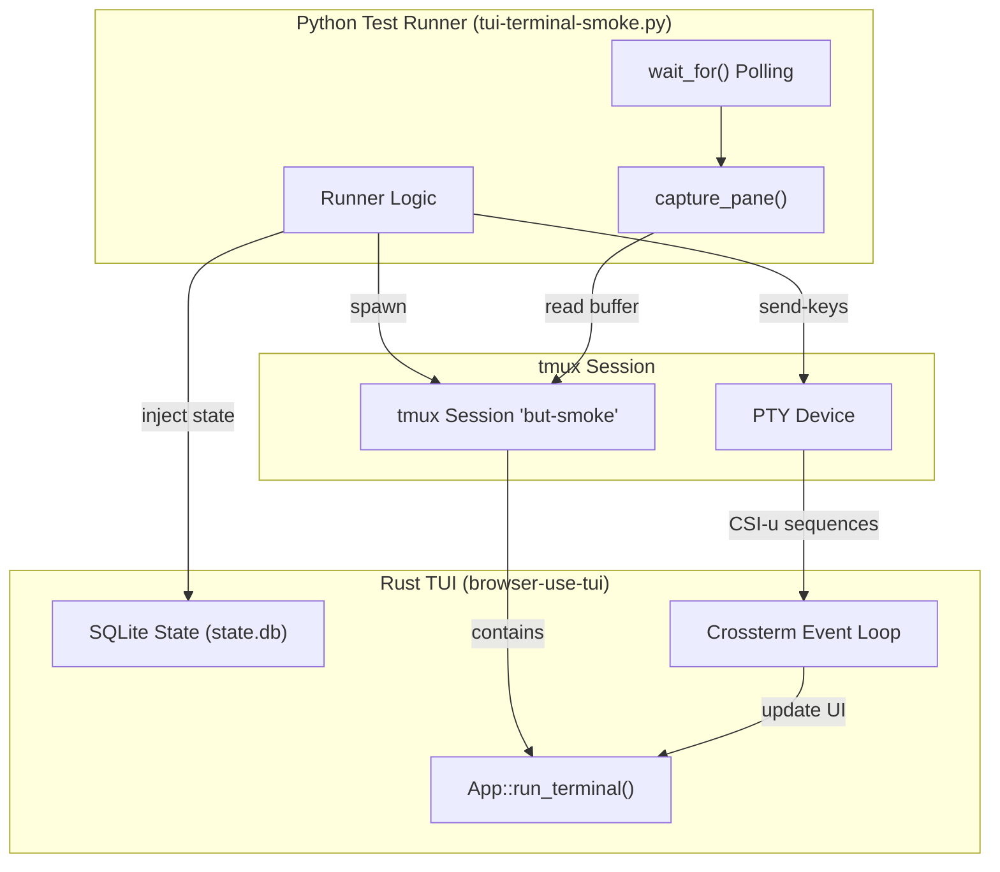

<!-- source: DeepWiki mcp.deepwiki.com · repo browser-use/terminal · page 8.1 TUI Smoke Tests and tmux Integration · fetched 2026-10-30 -->

# TUI Smoke Tests and tmux Integration

<details>
<summary>Relevant source files</summary>

The following files were used as context for generating this wiki page:

- [AGENTS.md](AGENTS.md)
- [Taskfile.yml](Taskfile.yml)
- [crates/browser-use-tui/src/settings.rs](crates/browser-use-tui/src/settings.rs)
- [docs/terminal-ui-testing.md](docs/terminal-ui-testing.md)
- [scripts/tui-terminal-smoke.py](scripts/tui-terminal-smoke.py)
- [scripts/verify-terminal-ui.sh](scripts/verify-terminal-ui.sh)

</details>


The `browser-use-terminal` codebase utilizes a specialized testing framework to verify the Terminal User Interface (TUI) beyond simple unit tests. While Ratatui provides a `TestBackend` for drawing assertions, it cannot detect issues related to real PTY behavior, such as duplicated panels in scrollback, broken bracketed paste, or stale redraws caused by terminal resizing. The smoke test suite, driven by `scripts/tui-terminal-smoke.py`, orchestrates a live `tmux` session to exercise the application in a realistic environment.

### Framework Overview

The smoke test framework focuses on "crossing the terminal boundary" by interacting with the app as a keyboard user would [docs/terminal-ui-testing.md:1-10](). It targets issues that deterministic dumps cannot see, including unconsumed arrow keys and ANSI escape leaks in plain-text output [AGENTS.md:47-51]().

#### TUI Smoke Test Architecture
This diagram shows the relationship between the Python test runner, the `tmux` session, and the Rust TUI application.


Sources: [scripts/tui-terminal-smoke.py:2-22](), [scripts/tui-terminal-smoke.py:49-65](), [scripts/tui-terminal-smoke.py:94-102]()

### tmux Session Management

The framework uses a dedicated `tmux` session named `but-smoke` to isolate the test environment [scripts/tui-terminal-smoke.py:236-240](). This allows for precise control over the terminal dimensions (defaulting to 100x30) and provides a buffer that can be queried for both visible content and scrollback [scripts/tui-terminal-smoke.py:80-91]().

Key management functions:
*   `tmux_send`: Sends symbolic keys to the session [scripts/tui-terminal-smoke.py:53-55]().
*   `tmux_send_literal`: Sends raw strings, essential for testing bracketed paste or specific escape sequences [scripts/tui-terminal-smoke.py:57-59]().
*   `capture`: Extracts the last 200 lines of the `tmux` pane buffer, including scrollback, to verify that the app is correctly using the alternate screen and not leaking frames [scripts/tui-terminal-smoke.py:80-85]().

### State Injection via SQLite

To ensure tests are deterministic and fast, the runner bypasses the TUI onboarding flow by directly manipulating the SQLite `state.db` [scripts/tui-terminal-smoke.py:207-234]().

The `prepare_state_dir` function:
1.  Creates a temporary directory for the test run [scripts/tui-terminal-smoke.py:208]().
2.  Initializes the `app_settings` table with pre-defined values like `setup.complete = 1` [scripts/tui-terminal-smoke.py:215-220]().
3.  Sets the `agent.backend` (e.g., to `fake`) and configures a mock model choice [scripts/tui-terminal-smoke.py:221-226]().

### Interaction and Verification Mechanisms

#### CSI-u Enhanced Keyboard Protocol
The TUI enables the Kitty/CSI-u keyboard protocol at startup for precise key handling. The smoke test replicates this by sending raw CSI-u sequences for complex combinations like `Shift+Enter` (`\x1b[13;2u`) and `Alt+Backspace` (`\x1b[127;3u`) [scripts/tui-terminal-smoke.py:61-78]().

#### Polling with wait_for
Because terminal rendering is asynchronous to the test runner, the `wait_for` function polls the `tmux` buffer until a specific "needle" string appears or a timeout (default 8s) is reached [scripts/tui-terminal-smoke.py:94-102]().

#### Data Flow: Input to Assertion
This diagram maps the code entities involved in sending a command and verifying the result.

```mermaid
sequenceDiagram
    participant R as Runner (tui-terminal-smoke.py)
    participant T as tmux (capture-pane)
    participant B as Rust Binary (browser-use-tui)
    participant S as SQLite (state.db)

    R->>S: prepare_state_dir() - INSERT INTO app_settings
    R->>B: spawn via tmux new-session
    B->>S: Load settings (setup.complete=1)
    R->>R: wait_for(needle="Type a message")
    R->>T: tmux_send_literal(session, "hello\x1b[13;2u")
    B->>B: AppState::handle_event(ShiftEnter)
    B->>B: Render new frame
    Note over R,T: Poll loop
    R->>T: capture(session, "result")
    T-->>R: Buffer text
    R->>R: assert_contains(text, "hello")
```
Sources: [scripts/tui-terminal-smoke.py:94-102](), [scripts/tui-terminal-smoke.py:207-234](), [scripts/tui-terminal-smoke.py:303-315]()

### Named Smoke Test Scenarios

The framework executes several distinct scenarios to cover critical TUI behaviors:

| Test Scenario | Description | Key Assertions |
| :--- | :--- | :--- |
| **Main Flow** | Standard startup and prompt submission [scripts/tui-terminal-smoke.py:246-335]() | Verifies version label, status bar, and that `Shift+Enter` triggers the agent. |
| **Burst Resize** | Rapidly changes `tmux` window dimensions [scripts/tui-terminal-smoke.py:337-362]() | Ensures the app doesn't crash or leave stale artifacts during layout recalculation. |
| **Bracketed Paste** | Sends text wrapped in `\x1b[200~` and `\x1b[201~` [scripts/tui-terminal-smoke.py:364-394]() | Confirms the TUI handles multi-line pastes without interpreting intermediate newlines as submission. |
| **History & Resume** | Navigates the history overlay [scripts/tui-terminal-smoke.py:396-444]() | Verifies `F2` opens the history and selecting a session resumes it correctly. |
| **Alt-Backspace** | Tests word-deletion in the `Composer` widget [scripts/tui-terminal-smoke.py:446-470]() | Confirms `Alt+Backspace` correctly deletes words rather than single characters. |

### Verification Pipeline

The smoke tests are integrated into the `verify-terminal-ui.sh` script, which serves as the "definition of done" for any TUI-related changes [AGENTS.md:39-45]().

Execution steps in `verify-terminal-ui.sh`:
1.  Run `cargo fmt` and `cargo test` [scripts/verify-terminal-ui.sh:11-15]().
2.  Run Python unit tests [scripts/verify-terminal-ui.sh:17-18]().
3.  Generate deterministic Ratatui dumps using the `--dump-screen` flag for various UI states (empty, setup, running, etc.) [scripts/verify-terminal-ui.sh:20-38]().
4.  Execute the `tui-terminal-smoke.py` suite [scripts/verify-terminal-ui.sh:40-41]().

Sources: [scripts/tui-terminal-smoke.py:1-470](), [scripts/verify-terminal-ui.sh:1-45](), [docs/terminal-ui-testing.md:1-34](), [AGENTS.md:26-68]()

---

