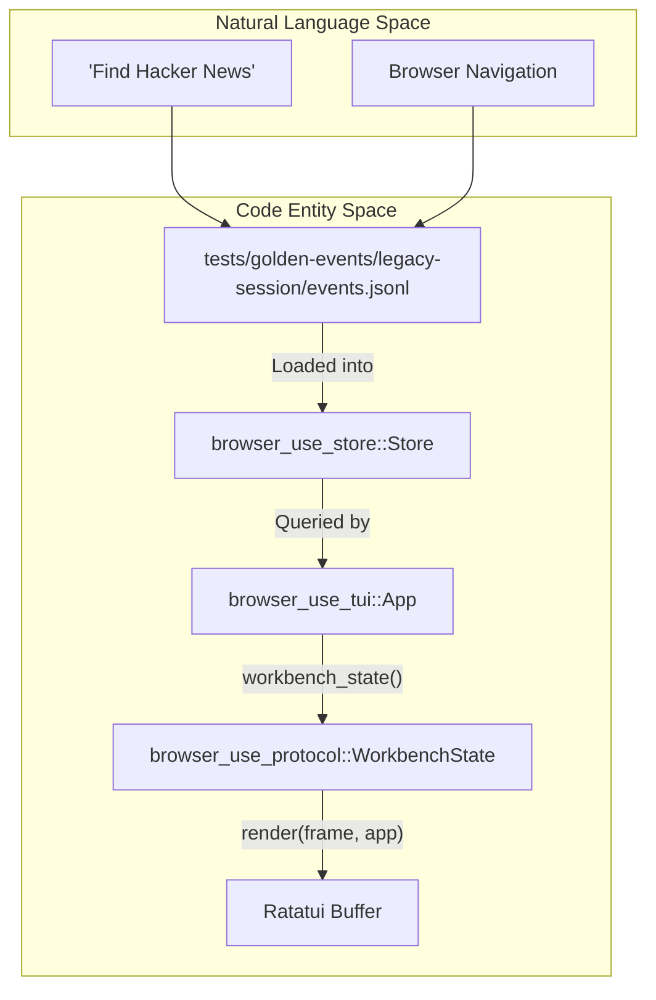
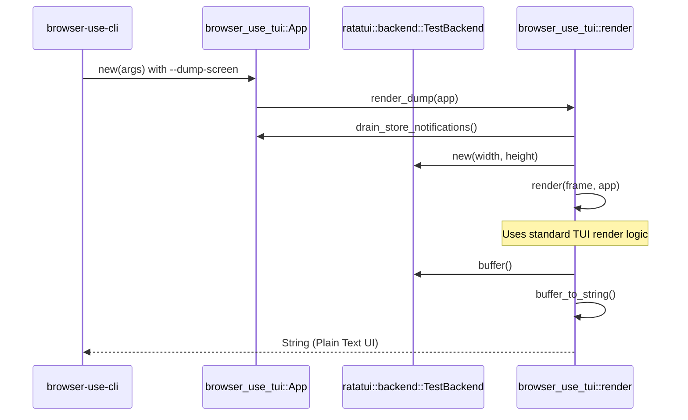

<!-- source: DeepWiki mcp.deepwiki.com · repo browser-use/terminal · page 8.2 Golden Event Fixtures and Deterministic Dumps · fetched 2026-10-30 -->

# Golden Event Fixtures and Deterministic Dumps

Relevant source files

The following files were used as context for generating this wiki page:

- [crates/browser-use-tui/src/render.rs](crates/browser-use-tui/src/render.rs)
- [tests/golden-events/artifact-image-session/session.json](tests/golden-events/artifact-image-session/session.json)
- [tests/golden-events/legacy-session/events.jsonl](tests/golden-events/legacy-session/events.jsonl)
- [tests/golden-events/legacy-session/session.json](tests/golden-events/legacy-session/session.json)
- [tests/golden-events/running-browser-session/session.json](tests/golden-events/running-browser-session/session.json)
- [tests/golden-events/subagent-followup-session/session.json](tests/golden-events/subagent-followup-session/session.json)

The `browser-use-terminal` codebase utilizes a deterministic testing strategy for its Terminal User Interface (TUI). This is achieved through "Golden Event" fixtures—static JSON/JSONL snapshots of agent sessions—and a dump mechanism that renders the TUI to a string using a headless backend. This approach ensures that UI regressions are caught without requiring a live browser or LLM provider.

## Golden Event Fixtures

Golden events are stored in `tests/golden-events/` and represent specific edge cases or complex states in the agent's lifecycle. Each fixture directory typically contains a `session.json` defining the session metadata and an `events.jsonl` containing the chronological sequence of `EventRecord` entries.

### Fixture Taxonomy

| Fixture Name | Purpose | Key File |
|:---|:---|:---|
| `legacy-session` | Verifies backward compatibility and basic event rendering (input, browser page, tool output). | [tests/golden-events/legacy-session/session.json:1-9]() |
| `artifact-image-session` | Tests the rendering of tool results containing images and multi-modal artifacts. | [tests/golden-events/artifact-image-session/session.json:1-9]() |
| `running-browser-session` | Simulates an active session where the browser is currently open and connected. | [tests/golden-events/running-browser-session/session.json:1-9]() |
| `subagent-followup-session` | Validates the multi-agent hierarchy, showing parent/child relationships and follow-up prompts. | [tests/golden-events/subagent-followup-session/session.json:1-9]() |

### Data Flow: Fixture to TUI
The following diagram illustrates how static JSON files are transformed into a live TUI state for testing.

**Fixture Loading and State Projection**

Sources: [crates/browser-use-tui/src/render.rs:93-99](), [tests/golden-events/legacy-session/events.jsonl:1-5]()

## Deterministic Dumps

The terminal supports a `--dump-screen` flag (and corresponding `render_dump` function) which captures the current state of the TUI as a plain-text string. This is critical for CI assertions.

### The TestBackend Approach
Instead of rendering to a physical terminal via `Crossterm`, the `render_dump` function initializes a `ratatui::backend::TestBackend`. This backend renders to an in-memory buffer of a fixed size defined in the application arguments.

*   **Implementation**: `render_dump` calls `app.drain_store_notifications()` to ensure all events are processed, then draws the frame to the `TestBackend` [crates/browser-use-tui/src/render.rs:26-32]().
*   **Buffer Conversion**: The `buffer_to_string` helper iterates through the `ratatui::buffer::Buffer`, extracting symbols for each coordinate and trimming trailing whitespace to create a clean text representation [crates/browser-use-tui/src/render.rs:34-46]().

### Seeding and Demos
The `--seed-demo` flag (often used in conjunction with `--dump-screen`) forces the application into a deterministic state by:
1.  Loading a specific Golden Event fixture into the SQLite store.
2.  Overriding the system clock to a fixed timestamp (to prevent "time ago" strings from breaking diffs).
3.  Disabling shimmering animations and activity indicators that would cause non-deterministic output.

## Code Entities and Responsibilities

| Entity | Role | Source |
|:---|:---|:---|
| `render_dump` | Entry point for capturing TUI state as a string. | [crates/browser-use-tui/src/render.rs:26]() |
| `TestBackend` | Ratatui backend that renders to an in-memory buffer. | [crates/browser-use-tui/src/render.rs:28]() |
| `buffer_to_string` | Converts the raw `Buffer` into a newline-delimited string. | [crates/browser-use-tui/src/render.rs:34]() |
| `native_scrollback_lines` | Generates the plain-text lines for terminal scrollback without UI chrome. | [crates/browser-use-tui/src/render.rs:48]() |
| `trim_trailing_whitespace` | Cleans up lines to ensure consistent diffing in tests. | [crates/browser-use-tui/src/render.rs:64]() |

**Rendering Pipeline for Dumps**

Sources: [crates/browser-use-tui/src/render.rs:26-46](), [crates/browser-use-tui/src/render.rs:93-129]()

## Practical Usage in Testing

The verification pipeline `verify-terminal-ui.sh` uses these dumps to compare the current TUI output against "blessed" versions. If a developer changes the `theme.rs` or the layout in `render.rs`, the dump will change, and the CI will fail until the golden dump is updated.

### Deterministic Traits
To ensure the dump is truly deterministic, the rendering logic handles several factors:
*   **Width/Height**: Fixed via `app.args.width` and `app.args.height` [crates/browser-use-tui/src/render.rs:28]().
*   **Time**: Fixtures use static `created_ms` and `updated_ms` timestamps [tests/golden-events/legacy-session/session.json:6-7]().
*   **Content Truncation**: The `trim_trailing_whitespace` function ensures that right-side padding doesn't create "invisible" diffs in text files [crates/browser-use-tui/src/render.rs:64-80]().

Sources: [crates/browser-use-tui/src/render.rs:1-92](), [tests/golden-events/legacy-session/session.json:1-9]()

---

