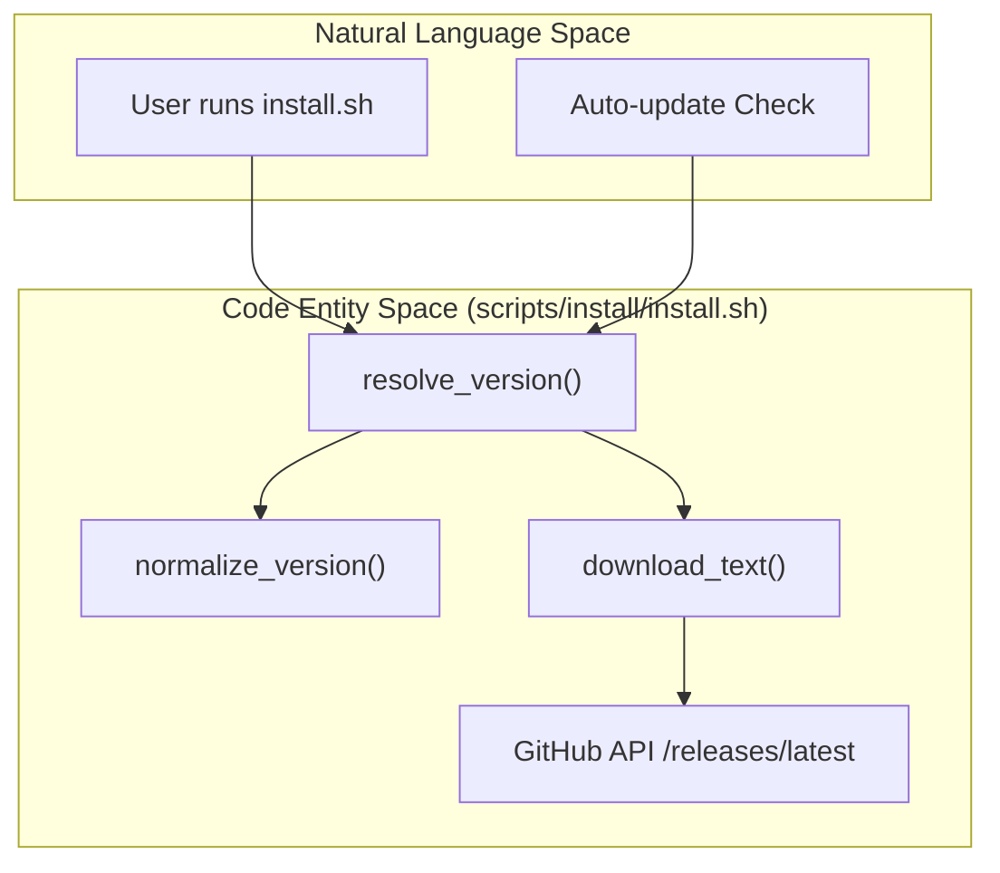
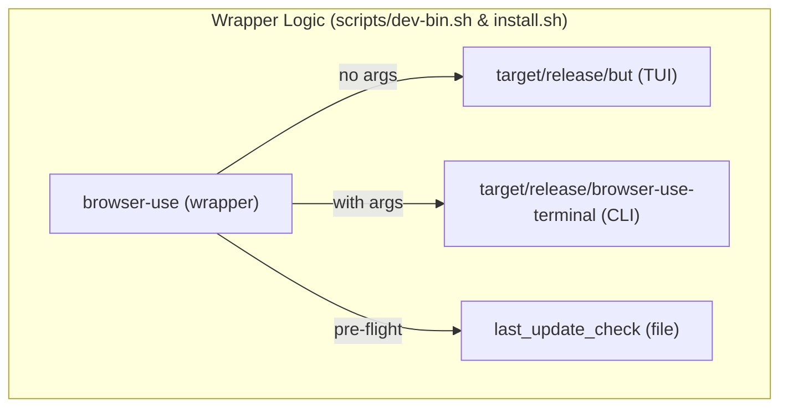

<!-- source: DeepWiki mcp.deepwiki.com · repo browser-use/terminal · page 9 Release and Distribution · fetched 2026-10-30 -->

# Release and Distribution

Relevant source files

The following files were used as context for generating this wiki page:

- [.github/workflows/release.yml](.github/workflows/release.yml)
- [.gitignore](.gitignore)
- [LICENSE](LICENSE)
- [pyproject.toml](pyproject.toml)
- [scripts/dev-bin.sh](scripts/dev-bin.sh)
- [scripts/install/install.sh](scripts/install/install.sh)
- [scripts/install/test-wrappers.sh](scripts/install/test-wrappers.sh)
- [scripts/package-release.sh](scripts/package-release.sh)
- [uv.lock](uv.lock)

The Browser Use Terminal release and distribution system is designed to provide a seamless "standalone" experience, abstracting away the complexity of managing a hybrid Rust/Python environment. It utilizes GitHub Actions for cross-platform builds and a robust shell-based installer that manages versioning, pathing, and automatic updates.

## High-Level Distribution Architecture

The distribution flow begins with a tagged release in GitHub and ends with a local installation where the Rust binaries and Python dependencies are isolated within a dedicated home directory.

### Build and Release Flow
The system uses `scripts/package-release.sh` to bundle the compiled Rust binaries (`but` and `browser-use-terminal`) along with the required Python source code into a platform-specific tarball.

### Installation Layout
The `install.sh` script establishes a structured directory layout under `~/.browser-use-terminal` (by default). This layout supports atomic version switching via symlinks and maintains a standalone environment that does not interfere with the user's global Python or Rust installations.

| Component | Path | Purpose |
| :--- | :--- | :--- |
| **Standalone Root** | `~/.browser-use-terminal/packages/standalone` | Root for all versioned releases and lock files. |
| **Releases** | `.../standalone/releases/<version>` | Extracted contents of the release archive. |
| **Current Link** | `.../standalone/current` | Symlink to the active release directory. |
| **Binaries** | `~/.local/bin` | Visible wrappers (e.g., `browser`, `but`) pointing to the current release. |

**Sources:**
- [scripts/install/install.sh:8-13]()
- [scripts/package-release.sh:47-59]()

---

## Release Process and CI/CD

The release lifecycle is triggered by pushing a version tag (e.g., `v0.1.0`) to the repository. The GitHub Actions workflow automates the cross-compilation for multiple targets, including macOS (ARM/Intel) and Linux (musl).

For a detailed breakdown of the build matrix and artifact naming, see **[CI/CD Pipeline (#9.1)](#)**.

### Release Asset Mapping
The build process generates several artifacts per platform:
- `browser-use-terminal-<target>.tar.gz`: The primary distribution archive.
- `browser-use-terminal-<target>.tar.gz.sha256`: Checksum for integrity verification during installation.

**Sources:**
- [.github/workflows/release.yml:3-6]()
- [.github/workflows/release.yml:18-24]()
- [scripts/package-release.sh:58-65]()

---

## Installation and Update Mechanism

The `install.sh` script is the primary entry point for users. It handles environment detection, archive downloading, and integrity verification using `sha256sum` or `openssl`.

For details on the lock file protocol and environment variables like `BUT_AUTO_UPDATE`, see **[Install Script and Update Mechanism (#9.2)](#)**.

### Version Normalization and Resolution
The installer includes logic to resolve "latest" to a specific GitHub tag and normalize version strings to ensure consistent directory naming.

**Sources:**
- [scripts/install/install.sh:29-44]()
- [scripts/install/install.sh:192-216]()

---

## Wrapper Scripts and Environment Management

To provide a smooth CLI experience, the system generates "visible" wrapper scripts in the user's `PATH`. These scripts handle the complexity of setting `PYTHONPATH` and managing the transition between the TUI and the management CLI.

### Wrapper Logic
The wrappers logic, tested in `scripts/install/test-wrappers.sh`, ensures that:
1.  **Direct Execution**: Running `but` launches the TUI.
2.  **Hybrid Execution**: Running `browser` or `browser-use-terminal` without arguments launches the TUI, while providing arguments routes the call to the CLI.
3.  **Auto-Update Preflight**: Before execution, wrappers check for updates if the interval has elapsed, unless `BUT_AUTO_UPDATE=0` is set.

**Sources:**
- [scripts/dev-bin.sh:24-37]()
- [scripts/install/test-wrappers.sh:87-104]()
- [scripts/install/install.sh:238-269]()

---

## Summary of Configuration Variables

The distribution behavior can be tuned via environment variables:

| Variable | Default | Description |
| :--- | :--- | :--- |
| `BUT_HOME` | `~/.browser-use-terminal` | Root for data and standalone packages. |
| `BUT_INSTALL_DIR` | `~/.local/bin` | Where visible command wrappers are installed. |
| `BUT_AUTO_UPDATE` | `1` | Enables/disables the automatic update check in wrappers. |
| `BUT_REQUIRE_LATEST` | `0` | If `1`, the application will fail to start if an update check fails. |

**Sources:**
- [scripts/install/install.sh:64-70]()
- [scripts/install/test-wrappers.sh:119-123]()

---

