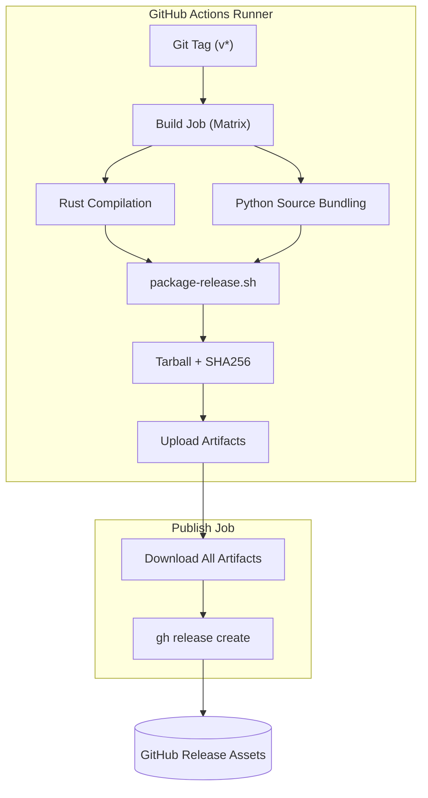
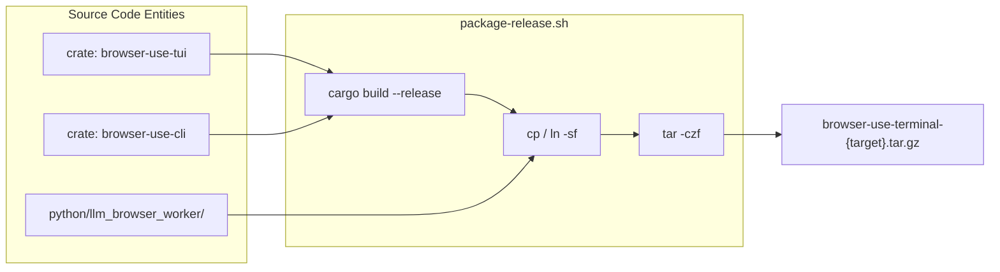

<!-- source: DeepWiki mcp.deepwiki.com · repo browser-use/terminal · page 9.1 CI/CD Pipeline · fetched 2026-10-30 -->

# CI/CD Pipeline

Relevant source files

The following files were used as context for generating this wiki page:

- [.github/workflows/release.yml](.github/workflows/release.yml)
- [.gitignore](.gitignore)
- [LICENSE](LICENSE)
- [pyproject.toml](pyproject.toml)
- [scripts/package-release.sh](scripts/package-release.sh)
- [uv.lock](uv.lock)

The Browser Use Terminal utilizes a GitHub Actions-based CI/CD pipeline to automate the building, packaging, and distribution of standalone release assets. The pipeline is triggered by version tags and produces cross-platform binaries bundled with the necessary Python worker source code.

## Workflow Overview

The release process is defined in [.github/workflows/release.yml:1-54](). It consists of a two-stage job architecture: `build` and `publish`.

### Release Trigger
The workflow is configured to run exclusively when a tag following the `v*` pattern (e.g., `v0.1.0`) is pushed to the repository [.github/workflows/release.yml:3-6]().

### High-Level Data Flow

The following diagram illustrates the flow from a code push to the final GitHub Release.

**Release Pipeline Data Flow**

Sources: [.github/workflows/release.yml:11-54](), [scripts/package-release.sh:1-68]()

## Build Matrix and Environment

The `build` job utilizes a strategy matrix to target major operating systems and architectures [.github/workflows/release.yml:15-24]().

| Target Triple | OS Runner | Tooling Requirements |
| :--- | :--- | :--- |
| `aarch64-apple-darwin` | `macos-14` | Apple Silicon Rust target |
| `x86_64-apple-darwin` | `macos-15-intel` | Intel Mac Rust target |
| `x86_64-unknown-linux-musl` | `ubuntu-latest` | `musl-tools` for static linking |

For Linux builds, the pipeline installs `musl-tools` to ensure the resulting binary is statically linked and portable across different Linux distributions [.github/workflows/release.yml:30-32]().

## Packaging Implementation

The core packaging logic resides in `scripts/package-release.sh`. This script orchestrates the compilation of Rust crates and the organization of the filesystem structure for the distribution archive.

### Archive Structure
The script creates a standardized directory layout within the tarball [.scripts/package-release.sh:47-52]():
*   `bin/`: Contains the compiled Rust binaries (`but` and `browser-use-terminal`).
*   `bin/browser`: Symbolic link to `but`.
*   `bin/browser-use`: Symbolic link to `but`.
*   `python/llm_browser_worker/`: Contains the Python source code required for the browser worker.

### Compilation Strategy
The script builds two primary crates from the workspace: `browser-use-tui` and `browser-use-cli` [.scripts/package-release.sh:37-40](). If a `TARGET_TRIPLE` is provided (as in CI), it uses the `--target` flag; otherwise, it defaults to the host architecture.

**Packaging Logic Mapping**

Sources: [scripts/package-release.sh:37-59]()

## Python Environment Configuration

The Python components of the release rely on `pyproject.toml` and `uv.lock` to define the runtime environment for the worker scripts.

### Dependency Management
The `pyproject.toml` file defines the core dependencies required for browser interaction and data processing, including `beautifulsoup4`, `curl-cffi`, and `pandas` [pyproject.toml:11-21]().

### Version Locking
The `uv.lock` file ensures deterministic installs by locking specific versions and hashes for every dependency across different Python versions (3.9 to 3.14) and platforms [uv.lock:1-13](). It handles platform-specific variations, such as different versions of `curl-cffi` or `pandas` depending on the `python_full_version` [uv.lock:34-45]().

### Cleanup during Packaging
To minimize archive size and avoid environment contamination, the packaging script explicitly removes `__pycache__` directories and `.pyc` files from the bundled Python source [scripts/package-release.sh:53-54]().

## Release Assets and Naming Conventions

Once the build matrix completes, the `publish` job aggregates all artifacts and creates a GitHub Release [.github/workflows/release.yml:40-54]().

### Naming Convention
Assets are named following the pattern:
`browser-use-terminal-{TARGET_TRIPLE}.tar.gz` [.scripts/package-release.sh:58]()

### Checksums
For every archive, a SHA256 checksum is generated and included as a sibling asset [.scripts/package-release.sh:61-65]():
`browser-use-terminal-{TARGET_TRIPLE}.tar.gz.sha256`

### Final Publication
The workflow uses the `gh release create` command to upload all files in the `dist/` directory, automatically generating release notes based on commit history [.github/workflows/release.yml:53]().

Sources: [.github/workflows/release.yml:40-54](), [scripts/package-release.sh:58-65](), [pyproject.toml:1-21](), [uv.lock:1-47]()

---

