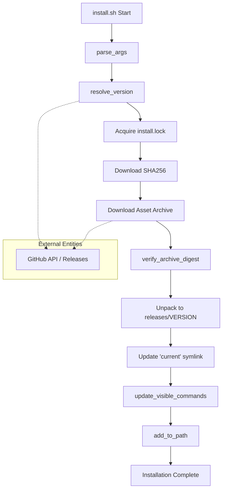
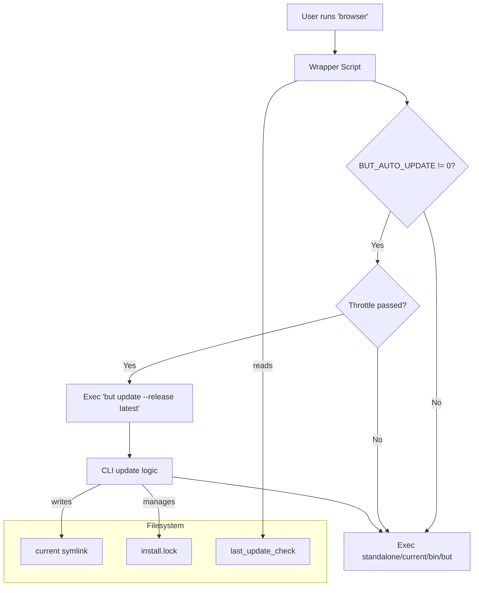

<!-- source: DeepWiki mcp.deepwiki.com · repo browser-use/terminal · page 9.2 Install Script and Update Mechanism · fetched 2026-10-30 -->

# Install Script and Update Mechanism

<details>
<summary>Relevant source files</summary>

The following files were used as context for generating this wiki page:

- [README.md](README.md)
- [docs/public-launch-checklist.md](docs/public-launch-checklist.md)
- [scripts/install/install.sh](scripts/install/install.sh)
- [scripts/install/test-wrappers.sh](scripts/install/test-wrappers.sh)

</details>


The Browser Use Terminal is distributed as a standalone package via a POSIX-compliant shell script. This mechanism manages the installation lifecycle, including directory layout, version resolution, PATH configuration, and automated update checks.

## Overview and Purpose

The installation system is designed to provide a "zero-dependency" experience (requiring only standard Unix tools like `curl`, `tar`, and `sh`). It installs the application into a isolated home directory and creates symlinks for easy CLI access.

### Key Environment Variables
The script and resulting wrappers respect several environment variables to control behavior:

| Variable | Description | Default |
| :--- | :--- | :--- |
| `BUT_RELEASE_REPO` | GitHub repository for releases | `browser-use/terminal` |
| `BUT_INSTALL_DIR` | Directory for visible command symlinks | `$HOME/.local/bin` |
| `BUT_HOME` | Root directory for state and packages | `$HOME/.browser-use-terminal` |
| `BUT_AUTO_UPDATE` | Set to `0` to disable automatic update checks | `1` |
| `BUT_REQUIRE_LATEST` | Set to `1` to block startup if update check fails | `0` |

Sources: `[scripts/install/install.sh:6-15]()`, `[scripts/install/install.sh:64-70]()`

## Directory Layout

The installer organizes files within the `BUT_HOME` directory (defaulting to `~/.browser-use-terminal`). It uses a "standalone" package strategy where multiple versions can coexist, with a symlink pointing to the active version.

### Structure of `~/.browser-use-terminal/`
*   `packages/standalone/`
    *   `releases/`: Contains versioned subdirectories (e.g., `v0.1.0/`) with the full application bundle.
    *   `current`: A symbolic link pointing to the currently active release directory.
    *   `install.lock`: A lock file used to prevent concurrent installation/update processes.
    *   `last_update_check`: A timestamp file used to throttle update checks.
*   `bin/`: Local binaries and scripts.

Sources: `[scripts/install/install.sh:8-13]()`, `[docs/public-launch-checklist.md:94-98]()`

## Installation Protocol

The `install.sh` script follows a structured sequence to resolve versions, verify integrity, and configure the user's environment.

### Version Resolution and Download
The script resolves the "latest" version by querying the GitHub API or inspecting redirect headers if `curl` is available.

1.  **Resolve Version**: Uses `resolve_version` to find the latest tag if one isn't provided via `--release`. `[scripts/install/install.sh:192-216]()`
2.  **Download Asset**: Fetches the platform-specific archive and its corresponding `.sha256` digest. `[scripts/install/install.sh:122-131]()`
3.  **Integrity Check**: Verifies the downloaded file using `sha256sum`, `shasum`, or `openssl`. `[scripts/install/install.sh:150-183]()`

### Path Configuration
The script attempts to add `BUT_INSTALL_DIR` to the user's `PATH` by modifying shell profiles (`.zprofile`, `.bash_profile`, `.zshrc`, `.bashrc`, or `.profile`). It uses marker comments to ensure the block is idempotent.

```bash
# >>> browser-use terminal installer >>>
export PATH="$HOME/.local/bin:$PATH"
# <<< browser-use terminal installer <<<
```
Sources: `[scripts/install/install.sh:218-282]()`

### Installation Flow Diagram

The following diagram illustrates the `install.sh` logic flow and the entities involved.

**Install Logic Flow**

Sources: `[scripts/install/install.sh:46-282]()`

## Update Mechanism

The system supports both manual and automatic updates. Updates are performed by the CLI but triggered by the shell wrappers created during installation.

### Wrapper Scripts and Throttling
The installer creates wrappers in `BUT_INSTALL_DIR` (e.g., `browser`, `browser-use`, `but`) that point to the actual binary in `standalone/current/bin/but`. These wrappers execute a pre-flight update check.

1.  **Throttling**: To avoid slowing down every startup, the check is throttled via `last_update_check`. By default, it checks once per interval (controlled by `BUT_AUTO_UPDATE_INTERVAL_SECS`). `[scripts/install/test-wrappers.sh:112-116]()`
2.  **Auto-Update**: If the interval has passed and `BUT_AUTO_UPDATE` is not `0`, the wrapper calls `browser-use-terminal update --release latest`. `[scripts/install/test-wrappers.sh:87-99]()`
3.  **Failure Handling**: 
    *   By default, update failures are logged but ignored ("fail-open").
    *   If `BUT_REQUIRE_LATEST=1` is set, the wrapper will exit if the update check fails ("fail-closed"). `[scripts/install/test-wrappers.sh:118-124]()`

### Lock File Protocol
To prevent race conditions where multiple terminal instances try to update the standalone package simultaneously, the system uses a lock file protocol:
*   **File**: `~/.browser-use-terminal/packages/standalone/install.lock`
*   **Stale Timeout**: Locks are considered stale after 600 seconds (`LOCK_STALE_AFTER_SECS`) to allow recovery from crashed processes. `[scripts/install/install.sh:12-14]()`

### Update Logic Diagram

This diagram maps the interaction between the shell wrappers and the CLI update command.

**Wrapper and CLI Interaction**

Sources: `[scripts/install/install.sh:8-14]()`, `[scripts/install/test-wrappers.sh:87-124]()`

## Release Verification

The integrity of the installation and update mechanism is verified by `scripts/install/test-wrappers.sh`. This test suite mocks the filesystem and binary behavior to ensure:
*   Launch aliases (`browser`, `browser-use`, `but`) correctly trigger updates. `[docs/public-launch-checklist.md:20-21]()`
*   Throttling prevents redundant network calls. `[scripts/install/test-wrappers.sh:112-116]()`
*   Environment variables like `BUT_AUTO_UPDATE=0` are respected. `[scripts/install/test-wrappers.sh:107-109]()`
*   `BUT_REQUIRE_LATEST` correctly forces a failure on update errors. `[scripts/install/test-wrappers.sh:118-124]()`

Sources: `[scripts/install/test-wrappers.sh:1-126]()`, `[docs/public-launch-checklist.md:137-142]()`

---

