# Page: Overview

# Overview

<details>
<summary>Relevant source files</summary>

The following files were used as context for generating this wiki page:

- [Cargo.lock](Cargo.lock)
- [Cargo.toml](Cargo.toml)
- [README.md](README.md)
- [docs/public-launch-checklist.md](docs/public-launch-checklist.md)
- [static/terminal-preview.png](static/terminal-preview.png)

</details>


Browser Use Terminal is a high-performance, browser-first LLM harness and interactive terminal user interface (TUI) written in Rust [README.md:9-10](). It provides a direct control plane for Large Language Models to interact with web browsers via the Chrome DevTools Protocol (CDP) [README.md:31-32]().

The system is designed to be "steerable," allowing users to watch agent progress in real-time, stop execution, provide manual feedback, and resume tasks [README.md:25](). It supports multiple browser modes, including local Chrome instances (preserving user login state), headless Chromium, and remote cloud browsers [README.md:23-24]().

## System Architecture

The architecture bridges a high-level Rust agent loop with a low-level browser runtime. Rust manages the durable state (SQLite), LLM orchestration, and the TUI, while a specialized Python worker handles complex browser interactions [README.md:33-42]().

### Conceptual Bridge: Natural Language to Code Entities

The following diagram maps high-level system concepts to their specific implementations within the codebase.

**Diagram: System Entity Mapping**
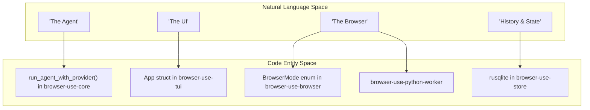
Sources: [README.md:39-42](), [Cargo.lock:173-292](), [Cargo.toml:1-11]()

## Key Components

The project is organized as a Cargo workspace with several specialized crates [Cargo.toml:1-11]():

| Component | Crate / Entity | Responsibility |
| :--- | :--- | :--- |
| **Orchestrator** | `browser-use-core` | Manages the `AgentLoop`, tool dispatch, and LLM provider abstraction [Cargo.lock:204-224](). |
| **Interface** | `browser-use-tui` | A `ratatui`-based interface for real-time steering and transcript visualization [Cargo.lock:274-292](). |
| **Browser** | `browser-use-browser` | Manages CDP connections and browser lifecycle [Cargo.lock:173-184](). |
| **Interaction** | `browser-use-python-worker` | Executes `browser_script` commands via a Python sub-process [Cargo.lock:250-258](). |
| **Persistence** | `browser-use-store` | Durable event logging and session management using SQLite [Cargo.lock:261-271](). |
| **CLI** | `browser-use-cli` | Command-line interface for headless runs and configuration [Cargo.lock:187-201](). |

For a detailed breakdown of the internal dependencies and folder structure, see **[Workspace Structure and Crate Layout](#1.2)**.

## Execution Flow

When a user submits a prompt, the system initiates a session that coordinates between the LLM, the local store, and the browser runtime.

**Diagram: Request Execution Lifecycle**
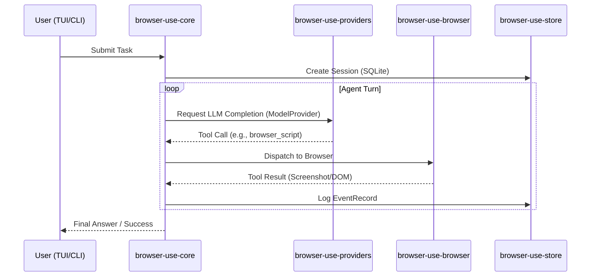
Sources: [README.md:33-46](), [Cargo.lock:204-224](), [Cargo.lock:235-247]()

## Getting Started

To install Browser Use Terminal, use the official installation script:

```bash
curl -fsSL https://browser-use.com/terminal/install.sh | sh
```

### Initial Setup
1. **Launch**: Run `browser` to start the TUI [README.md:13]().
2. **Authentication**: Use the `/auth` slash command to configure LLM providers (OpenAI, Anthropic, etc.) [README.md:76]().
3. **Configuration**: Use `/browser` to select between local Chrome or cloud-based browser instances [README.md:78]().

For detailed installation instructions, environment variable references, and first-run troubleshooting, see **[Getting Started](#1.1)**.

## Telemetry and Observability
The system includes anonymous telemetry for product analytics, which can be completely disabled by setting the environment variable `BUT_TELEMETRY=0` [README.md:101-103](). Detailed tracing is managed via OpenTelemetry integration in the core crate [Cargo.lock:215-217]().

Sources: [README.md:101-103](), [Cargo.lock:215-217]()

---

# Page: Getting Started

# Getting Started

<details>
<summary>Relevant source files</summary>

The following files were used as context for generating this wiki page:

- [.env.example](.env.example)
- [README.md](README.md)
- [Taskfile.yml](Taskfile.yml)
- [crates/browser-use-core/src/product_analytics.rs](crates/browser-use-core/src/product_analytics.rs)
- [crates/browser-use-tui/src/settings.rs](crates/browser-use-tui/src/settings.rs)
- [docs/public-launch-checklist.md](docs/public-launch-checklist.md)
- [scripts/install/install.sh](scripts/install/install.sh)
- [scripts/install/test-wrappers.sh](scripts/install/test-wrappers.sh)
- [scripts/verify-terminal-ui.sh](scripts/verify-terminal-ui.sh)

</details>


Browser Use Terminal is a browser-first LLM harness providing raw CDP control to agents via a high-performance Rust core and a Ratatui-based Terminal User Interface (TUI) [README.md:31-32]().

## Installation

The primary installation method is a standalone shell script that manages binaries, dependencies, and shell integration.

```bash
curl -fsSL https://browser-use.com/terminal/install.sh | sh
```

### Install Script Logic (`install.sh`)
The `install.sh` script performs the following technical steps:
1.  **Environment Setup**: Defines `$BUT_HOME` (default: `~/.browser-use-terminal`) and `$BUT_INSTALL_DIR` (default: `~/.local/bin`) [scripts/install/install.sh:7-9]().
2.  **Version Resolution**: Fetches the latest release tag from the GitHub API or follows redirects to `latest` [scripts/install/install.sh:192-216]().
3.  **Standalone Layout**: Downloads the platform-specific archive into `~/.browser-use-terminal/packages/standalone/releases/<version>` and symlinks it to `current` [scripts/install/install.sh:9-11]().
4.  **Verification**: Validates the download using SHA-256 checksums fetched from the release assets [scripts/install/install.sh:133-148]().
5.  **Shell Integration**: Appends an export to `$PATH` in the user's profile (e.g., `.zshrc`, `.bashrc`) inside a marked block [scripts/install/install.sh:238-282]().

### Deployment Flow
The following diagram illustrates the data flow from the install script to the local filesystem.

**Installation Data Flow**
```mermaid
graph TD
    subgraph "Remote (GitHub)"
        "ReleaseAssets"["Release Binaries + Python Worker"]
        "Checksums"["SHA-256 Metadata"]
    end

    subgraph "Local Installer (install.sh)"
        "resolve_version"["resolve_version()"]
        "download_file"["download_file()"]
        "verify_archive_digest"["verify_archive_digest()"]
        "add_to_path"["add_to_path()"]
    end

    subgraph "Local Filesystem (~/.browser-use-terminal)"
        "STANDALONE_ROOT"["/packages/standalone/"]
        "CURRENT_LINK"["/current (Symlink)"]
        "BIN_DIR"["~/.local/bin/browser (Wrapper)"]
    end

    "resolve_version" --> "ReleaseAssets"
    "download_file" --> "ReleaseAssets"
    "verify_archive_digest" --> "Checksums"
    "download_file" --> "STANDALONE_ROOT"
    "STANDALONE_ROOT" --> "CURRENT_LINK"
    "add_to_path" --> "BIN_DIR"
```
**Sources:** [scripts/install/install.sh:1-282]()

---

## First-Run Setup & Onboarding

When the application is launched for the first time via the `browser` command, it enters an onboarding flow. This flow is governed by the `setup.complete` setting in the SQLite store.

### The Onboarding Wizard
The TUI displays a `Setup` surface that guides the user through:
1.  **Provider Selection**: Choosing between OpenAI, Anthropic, Codex, or OpenRouter [crates/browser-use-tui/src/settings.rs:89-144]().
2.  **Authentication**: Entering API keys or performing OAuth flows (for Codex/Claude Code).
3.  **Browser Configuration**: Selecting "Local Chrome", "Headless Chromium", or "Browser Use Cloud" [crates/browser-use-tui/src/settings.rs:78-79]().

### Implementation Details
*   **State Check**: The application checks `app_settings` for `setup.complete`. If `0`, the TUI forces the Setup overlay [Taskfile.yml:18-35]().
*   **Resetting Onboarding**: Developers can force a re-run of onboarding using `cargo run -p browser-use-cli -- config set setup.complete 0` [Taskfile.yml:29]().

**Sources:** [crates/browser-use-tui/src/settings.rs:1-155](), [Taskfile.yml:18-35]()

---

## Configuration

### Environment Variables
The application reads from a `.env` file in the state directory or from the system environment.

| Variable | Purpose | Default |
| :--- | :--- | :--- |
| `BUT_TELEMETRY` | Enables/Disables anonymous product analytics [README.md:103]() | `1` (Enabled) |
| `OPENAI_API_KEY` | API key for OpenAI backend | - |
| `ANTHROPIC_API_KEY` | API key for Anthropic backend | - |
| `BROWSER_USE_API_KEY` | Key for Browser Use Cloud | - |
| `BUT_HOME` | Root directory for state and packages | `~/.browser-use-terminal` |

**Sources:** [.env.example:1-28](), [crates/browser-use-core/src/product_analytics.rs:119-121]()

### CLI Flags
The `browser-use-tui` and `browser-use-cli` crates support various flags for debugging and state management.

*   `--state-dir <PATH>`: Overrides the default `~/.browser-use-terminal` location [Taskfile.yml:28]().
*   `--dump-screen`: (Dev only) Captures the current TUI state to stdout and exits immediately. Used for deterministic UI testing [scripts/verify-terminal-ui.sh:20-27]().
*   `--seed-demo <SCENARIO>`: Injects specific session states (e.g., `running`, `done`, `cancelled`) into the temporary store for testing [scripts/verify-terminal-ui.sh:33-38]().

---

## Telemetry and Analytics

The system includes anonymous product analytics via PostHog to track usage patterns and errors.

*   **Implementation**: Events are captured asynchronously via `capture_async` to avoid blocking the UI thread [crates/browser-use-core/src/product_analytics.rs:16-28]().
*   **Anonymization**: The `install_id` is a randomly generated UUID stored locally at `product_analytics/install_id` [crates/browser-use-core/src/product_analytics.rs:95-111]().
*   **Opt-out**: Setting `BUT_TELEMETRY=0` or `BUT_PRODUCT_ANALYTICS=0` completely disables the tracking logic [crates/browser-use-core/src/product_analytics.rs:119-121]().

**Sources:** [crates/browser-use-core/src/product_analytics.rs:1-183]()

---

## Development & Verification

To ensure UI stability, the project uses a verification pipeline that combines Rust unit tests and TUI snapshots.

### Verification Pipeline (`scripts/verify-terminal-ui.sh`)
This script executes the following:
1.  **Linting**: Runs `cargo fmt --check` [scripts/verify-terminal-ui.sh:12]().
2.  **Unit Tests**: Runs `cargo test` and `pytest` for the Python worker [scripts/verify-terminal-ui.sh:15-18]().
3.  **Deterministic Dumps**: Launches the TUI with `--dump-screen` across multiple overlays (setup, account, browser, etc.) to verify rendering [scripts/verify-terminal-ui.sh:29-38]().
4.  **Smoke Test**: Executes `scripts/tui-terminal-smoke.py` which uses `tmux` to simulate real user interaction [scripts/verify-terminal-ui.sh:41]().

**Entity Mapping: Setup to Code**
```mermaid
graph LR
    subgraph "User Interface (TUI)"
        "App"["App::new()"]
        "SetupSurface"["Surface::Setup"]
    end

    subgraph "Persistence (Store)"
        "SQLite"["state.db"]
        "AppSettings"["app_settings table"]
    end

    subgraph "CLI/Task"
        "ResetCmd"["reset:onboarding"]
    end

    "App" -- "reads" --> "AppSettings"
    "SetupSurface" -- "writes setup.complete=1" --> "AppSettings"
    "ResetCmd" -- "writes setup.complete=0" --> "AppSettings"
    "AppSettings" -- "contained in" --> "SQLite"
```
**Sources:** [scripts/verify-terminal-ui.sh:1-45](), [Taskfile.yml:18-35]()

---

# Page: Workspace Structure and Crate Layout

# Workspace Structure and Crate Layout

<details>
<summary>Relevant source files</summary>

The following files were used as context for generating this wiki page:

- [Cargo.lock](Cargo.lock)
- [Cargo.toml](Cargo.toml)
- [crates/browser-use-browser/Cargo.toml](crates/browser-use-browser/Cargo.toml)
- [crates/browser-use-cli/Cargo.toml](crates/browser-use-cli/Cargo.toml)
- [crates/browser-use-core/Cargo.toml](crates/browser-use-core/Cargo.toml)
- [crates/browser-use-providers/Cargo.toml](crates/browser-use-providers/Cargo.toml)
- [crates/browser-use-tui/Cargo.toml](crates/browser-use-tui/Cargo.toml)
- [crates/browser-use-tui/src/runtime.rs](crates/browser-use-tui/src/runtime.rs)
- [python/llm_browser_worker/rust_cli.py](python/llm_browser_worker/rust_cli.py)

</details>


This page describes the organization of the `browser-use-terminal` Cargo workspace. The project is structured as a multi-crate Rust workspace to enforce clear boundaries between the core agent logic, the terminal UI, the browser control plane, and the persistence layer.

## Cargo Workspace Overview

The project uses a Cargo workspace defined in the root `Cargo.toml` [Cargo.toml:1-11](). It centralizes dependency management using workspace inheritance [Cargo.toml:19-44](), ensuring all crates use consistent versions of shared libraries like `ratatui`, `anyhow`, and `serde`.

### Dependency Graph

The following diagram illustrates the internal dependency relationships between the crates in the workspace.

**Crate Dependency Flow**
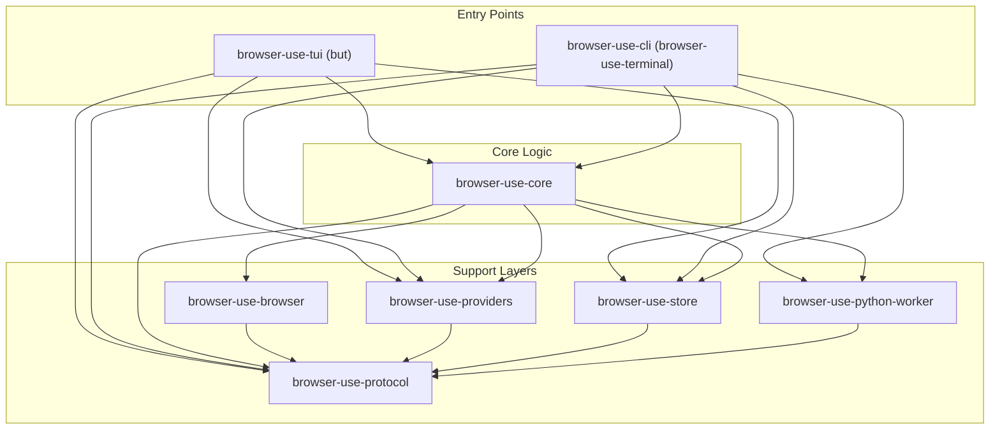
**Sources:** [crates/browser-use-tui/Cargo.toml:11-25](), [crates/browser-use-cli/Cargo.toml:11-22](), [crates/browser-use-core/Cargo.toml:7-24](), [crates/browser-use-providers/Cargo.toml:7-15](), [crates/browser-use-store/Cargo.toml:261-271]().

---

## Crate Responsibilities

### `browser-use-tui`
The primary interactive interface. It implements the `ratatui` application loop and orchestrates the agent's execution within a terminal environment.
- **Binary Name:** `but` [crates/browser-use-tui/Cargo.toml:8]().
- **Key Function:** Spawns the agent thread using `run_agent_thread` [crates/browser-use-tui/src/runtime.rs:12-19]().
- **Responsibilities:** Rendering the transcript, handling keyboard input, and managing local settings/API keys [crates/browser-use-tui/src/runtime.rs:21-42]().

### `browser-use-cli`
A non-interactive command-line interface for session management, evaluation, and automation.
- **Binary Name:** `browser-use-terminal` [crates/browser-use-cli/Cargo.toml:8]().
- **Responsibilities:** Exporting/importing sessions, running dataset evaluations, and providing direct access to agent providers via CLI flags.

### `browser-use-core`
The "brain" of the system. It contains the main agent loop and tool dispatch logic.
- **Key Function:** `run_existing_session_from_config` [crates/browser-use-core/Cargo.toml:4-4]() (referenced in [crates/browser-use-tui/src/runtime.rs:50]()).
- **Responsibilities:** Managing the `AgentLoop`, coordinating between LLM providers and the browser, and handling multi-agent hierarchies.

### `browser-use-browser`
The Rust-side control plane for browser interactions.
- **Responsibilities:** Managing the CDP (Chrome DevTools Protocol) connection [crates/browser-use-browser/Cargo.toml:15](), handling different `BrowserMode` variants (Managed, Local, Cloud), and providing the high-level browser tool interface.

### `browser-use-providers`
Abstracts different Large Language Model (LLM) backends.
- **Responsibilities:** Implementing the `ModelProvider` trait for OpenAI, Anthropic, and other backends. It handles authentication and request/response normalization [crates/browser-use-providers/Cargo.toml:7-15]().

### `browser-use-store`
The persistence layer.
- **Responsibilities:** Managing the SQLite database, handling migrations, and providing the `Store` and `StoreNotifier` for event logging [crates/browser-use-store/Cargo.toml:261-271]().

### `browser-use-protocol`
Contains shared data types and schemas used across all crates.
- **Responsibilities:** Defining `EventRecord`, `SessionMeta`, and tool call/result structures to ensure type safety during serialization [crates/browser-use-protocol/Cargo.toml:227-232]().

### `browser-use-python-worker`
A bridge to the Python-based `browser-use` library.
- **Responsibilities:** Spawning and communicating with the Python subprocess that executes complex page-level interactions (via Playwright/CDP) [crates/browser-use-python-worker/Cargo.toml:250-258]().

---

## Data Flow: Code Entity Space

The following diagram maps high-level system operations to specific code entities and crate boundaries.

**Agent Initialization Data Flow**
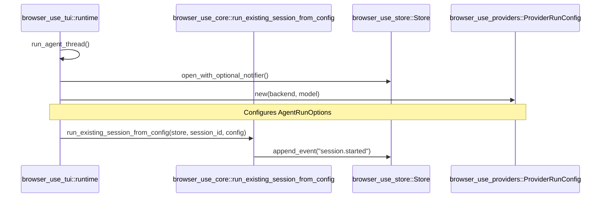
**Sources:** [crates/browser-use-tui/src/runtime.rs:12-20](), [crates/browser-use-tui/src/runtime.rs:43-50](), [crates/browser-use-tui/src/runtime.rs:51-57]().

---

## Workspace Integration with Python

While the core logic resides in Rust, the project maintains a Python footprint for specific interactions. The `python/` directory contains helper scripts that can invoke the Rust binaries.

| Python Entry Point | Target Rust Binary | Function |
| :--- | :--- | :--- |
| `rust_cli.main()` | `browser-use-terminal` | Executes the CLI [python/llm_browser_worker/rust_cli.py:9-10]() |
| `rust_cli.tui_main()` | `but` | Executes the TUI [python/llm_browser_worker/rust_cli.py:13-14]() |

The `_exec_rust_binary` function [python/llm_browser_worker/rust_cli.py:17-25]() handles locating the compiled artifacts in `target/debug/` or running them via `cargo run` if the source code is present.

**Sources:** [python/llm_browser_worker/rust_cli.py:1-26]()

---

# Page: Core Agent Engine

# Core Agent Engine

<details>
<summary>Relevant source files</summary>

The following files were used as context for generating this wiki page:

- [crates/browser-use-core/src/lib.rs](crates/browser-use-core/src/lib.rs)

</details>


The Core Agent Engine, implemented in the `browser-use-core` crate, is the central orchestrator of the Browser Use Terminal. It manages the lifecycle of an agent session, coordinates communication between LLM providers and the local environment, and handles the execution of complex tool chains.

The engine is designed to be provider-agnostic, supporting multiple LLM backends while maintaining a consistent execution environment for tools ranging from local shell commands to remote browser automation.

### System Architecture Overview

The engine operates as a stateful loop that bridges natural language intent with concrete system actions. It manages the transition from user prompts to model-generated tool calls, executes those calls via a `ToolRegistry`, and feeds the results back into the model context.

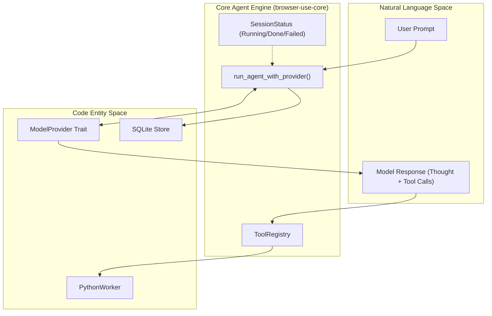
**Sources:** [crates/browser-use-core/src/lib.rs:207-213](), [crates/browser-use-core/src/lib.rs:29-30]()

---

### Key Components

#### 1. Agent Loop and Session Lifecycle
The execution entry point is `run_agent_with_provider`. This function manages the "Turn" logic, where each turn consists of sending the current context to an LLM, receiving tool calls, and executing them. It handles session persistence via the `Store` and manages state transitions from `Created` to `Running`, and finally to terminal states like `Done` or `Failed`.
*   **For details, see [Agent Loop and Session Lifecycle](#2.1)**

#### 2. Tool Registry and Dispatch
The `ToolRegistry` defines the capabilities of the agent. It maps model-requested tool names (e.g., `exec_command`, `browser_script`) to internal Rust handlers or external Python processes. The engine supports parallel tool execution and manages "spilling" large tool outputs to disk to keep the LLM context window manageable.
*   **For details, see [Tool Registry and Dispatch](#2.2)**

#### 3. Multi-Agent Hierarchy
The engine supports recursion through the `spawn_agent` tool. A parent agent can delegate sub-tasks to child agents, which operate in their own isolated session contexts. The `ChildAgentRunner` handles the instantiation of these sub-agents, allowing for complex hierarchical problem-solving.
*   **For details, see [Multi-Agent Hierarchy and Sub-agents](#2.3)**

#### 4. LLM Providers
The `ModelProvider` trait abstracts away the differences between various LLM APIs. Whether using Anthropic, OpenAI, or local Codex instances, the engine interacts with a unified interface for message normalization and response parsing.
*   **For details, see [LLM Providers](#2.4)**

---

### Data Flow and Entity Mapping

The following diagram maps the high-level conceptual flow to the specific Rust structs and traits used in the `browser-use-core` crate.

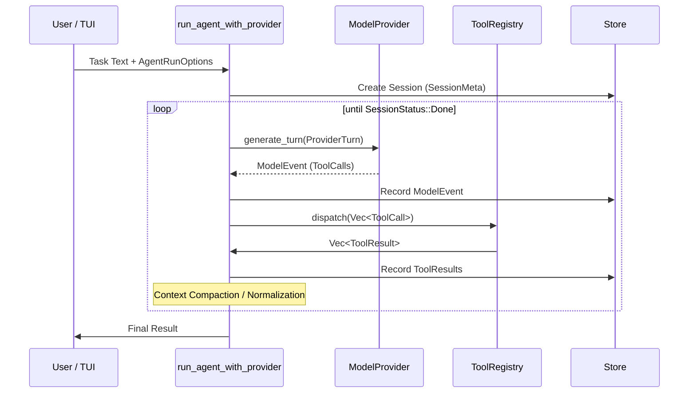
**Sources:** [crates/browser-use-core/src/lib.rs:122-148](), [crates/browser-use-core/src/lib.rs:15-23]()

### Core Configuration
The engine is configured via `AgentRunOptions`, which controls:
*   `max_turns`: Prevents infinite loops [crates/browser-use-core/src/lib.rs:137]().
*   `max_context_chars`: Threshold for triggering context compaction [crates/browser-use-core/src/lib.rs:138]().
*   `browser_mode`: Determines the browser environment (Local, Managed, Cloud) [crates/browser-use-core/src/lib.rs:177-205]().
*   `child_agent_runner`: The hook for spawning sub-agents [crates/browser-use-core/src/lib.rs:166-169]().

**Sources:**
- `crates/browser-use-core/src/lib.rs`
- `crates/browser-use-protocol/src/lib.rs`
- `crates/browser-use-providers/src/lib.rs`

---

# Page: Agent Loop and Session Lifecycle

# Agent Loop and Session Lifecycle

<details>
<summary>Relevant source files</summary>

The following files were used as context for generating this wiki page:

- [crates/browser-use-core/src/lib.rs](crates/browser-use-core/src/lib.rs)
- [crates/browser-use-protocol/src/lib.rs](crates/browser-use-protocol/src/lib.rs)
- [crates/browser-use-store/src/lib.rs](crates/browser-use-store/src/lib.rs)
- [tests/golden-events/artifact-image-session/events.jsonl](tests/golden-events/artifact-image-session/events.jsonl)

</details>


The agent loop is the central execution engine of Browser Use Terminal. It orchestrates the interaction between the LLM provider, the tool registry, and the browser runtime. This page details the implementation of the main loop, how session states transition, and the mechanisms for context management and retry logic.

## 1. The Core Agent Loop: `run_agent_with_provider`

The primary entry point for executing an agent is the `run_agent_with_provider` function [crates/browser-use-core/src/lib.rs:275-275](). This function manages a single session's execution until it reaches a terminal state (Done, Failed, or Cancelled).

### Execution Flow
1.  **Initialization**: The session status is updated to `Running` in the `Store` [crates/browser-use-core/src/lib.rs:296-298]().
2.  **Turn Management**: The agent enters a loop that continues until `max_turns` is reached or a terminal condition is met [crates/browser-use-core/src/lib.rs:328-330]().
3.  **Context Construction**: In each turn, the agent fetches the session history and normalizes it into a provider-specific format (e.g., `ProviderTurn`) [crates/browser-use-core/src/lib.rs:335-341]().
4.  **LLM Call**: The `ModelProvider` is invoked to generate a response, which may include text deltas, thinking blocks, or tool calls [crates/browser-use-core/src/lib.rs:360-362]().
5.  **Tool Execution**: If the LLM requests tool usage, the `ToolRegistry` dispatches these calls [crates/browser-use-core/src/lib.rs:400-410]().
6.  **Persistence**: Every event (model usage, tool results, text) is persisted to the SQLite `Store` [crates/browser-use-core/src/lib.rs:388-392]().

### Natural Language to Code Entity Space: Agent Execution
The following diagram maps high-level agent concepts to specific code entities and functions.

Title: Agent Execution Mapping
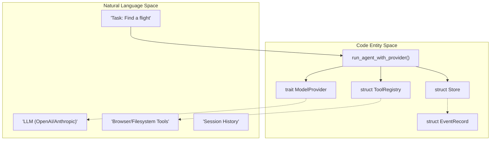
Sources: [crates/browser-use-core/src/lib.rs:275-275](), [crates/browser-use-providers/src/lib.rs:24-24](), [crates/browser-use-core/src/tools/mod.rs:43-43](), [crates/browser-use-store/src/lib.rs:27-27](), [crates/browser-use-protocol/src/lib.rs:57-57]()

## 2. Session Lifecycle and State Machine

A session moves through a strictly defined set of states defined in the `SessionStatus` enum [crates/browser-use-protocol/src/lib.rs:17-23]().

| State | Description | Transitions To |
| :--- | :--- | :--- |
| `Created` | Session metadata exists in DB but execution hasn't started. | `Running` |
| `Running` | The agent loop is actively processing turns. | `Done`, `Failed`, `Cancelled` |
| `Done` | The agent successfully called the `done` tool. | (Terminal) |
| `Failed` | An unrecoverable error occurred or `max_turns` was exceeded. | (Terminal) |
| `Cancelled` | The user manually stopped the session. | (Terminal) |

### State Machine Diagram
Title: Session State Machine
```mermaid
stateDiagram-v2
    [*] --> Created: "Store::create_session()"
    Created --> Running: "run_agent_with_provider()"
    Running --> Done: "Tool: done"
    Running --> Failed: "Error / Max Turns"
    Running --> Cancelled: "SIGINT / CLI cancel"
    Done --> [*]
    Failed --> [*]
    Cancelled --> [*]
```
Sources: [crates/browser-use-protocol/src/lib.rs:17-23](), [crates/browser-use-core/src/lib.rs:296-298](), [crates/browser-use-core/src/lib.rs:445-447]()

## 3. Context Management and Compaction

To prevent token limit exhaustion, the agent employs several context management strategies:

*   **Message Normalization**: The agent converts raw `EventRecord` objects from the database into `ProviderTurn` objects [crates/browser-use-core/src/lib.rs:335-341](). This involves filtering out internal metadata and formatting tool results.
*   **Token Budgeting**: Tool outputs are truncated if they exceed `MAX_TOOL_OUTPUT_TEXT_TOKENS` (default 4,000) [crates/browser-use-core/src/lib.rs:32-32]().
*   **Context Compaction**: If the total context exceeds `max_context_chars`, the agent summarizes older turns to fit within the budget [crates/browser-use-core/src/lib.rs:124-124]().
*   **Image Budgeting**: Images are budgeted separately at `IMAGE_CONTEXT_BUDGET_TOKENS` (default 2,000) to ensure visual history doesn't displace critical text instructions [crates/browser-use-core/src/lib.rs:33-33]().

## 4. Turn Management and Retry Logic

Each iteration of the loop is considered a "turn." The agent handles various turn-level scenarios:

### Parallel Tool Execution
When the LLM returns multiple tool calls in a single response, the agent attempts to execute them in parallel if they are marked as thread-safe [crates/browser-use-core/src/lib.rs:400-410]().

### Error Handling and Retries
*   **Transient Provider Errors**: If the LLM provider fails (e.g., rate limit or 500 error), the agent implements a basic retry mechanism before failing the session [crates/browser-use-core/src/lib.rs:360-365]().
*   **Tool Errors**: If a tool fails, the error is returned to the LLM as a `ToolResult` where `ok: false` [crates/browser-use-protocol/src/lib.rs:109-109](). This allows the agent to "see" the error and attempt a correction in the next turn.
*   **Max Turns**: If the agent reaches `max_turns` (default 80) without calling the `done` tool, the session is transitioned to `Failed` to prevent infinite loops [crates/browser-use-core/src/lib.rs:137-137]().

### Data Flow: Turn Lifecycle
Title: Single Turn Data Flow
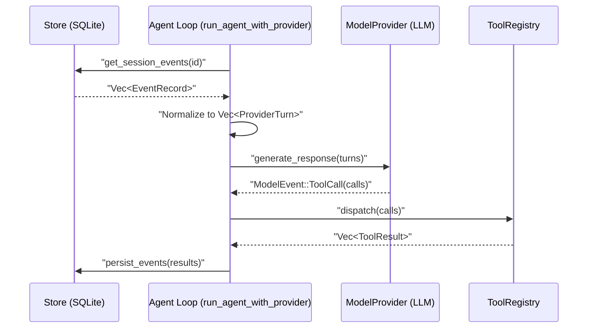
Sources: [crates/browser-use-core/src/lib.rs:335-341](), [crates/browser-use-core/src/lib.rs:360-362](), [crates/browser-use-core/src/lib.rs:400-410](), [crates/browser-use-core/src/lib.rs:388-392]()

## 5. Key Functions and Data Structures

### `AgentRunOptions`
This struct configures the behavior of the loop, including limits and environment settings [crates/browser-use-core/src/lib.rs:121-132]().
*   `max_turns`: Hard limit on the number of LLM interactions.
*   `max_context_chars`: Threshold for context window management.
*   `python_tool_timeout_seconds`: Timeout for the `browser_script` and `python` tools.

### `ProviderTurn`
A normalized representation of a conversation turn used to interface with different LLM backends [crates/browser-use-providers/src/lib.rs:22-22](). It encapsulates:
*   User prompts or tool results.
*   Assistant text, thinking, or tool calls.

Sources: [crates/browser-use-core/src/lib.rs:121-132](), [crates/browser-use-core/src/lib.rs:275-275](), [crates/browser-use-protocol/src/lib.rs:17-23](), [crates/browser-use-store/src/lib.rs:195-203]()

---

# Page: Tool Registry and Dispatch

# Tool Registry and Dispatch

<details>
<summary>Relevant source files</summary>

The following files were used as context for generating this wiki page:

- [crates/browser-use-core/src/tools/command.rs](crates/browser-use-core/src/tools/command.rs)
- [crates/browser-use-core/src/tools/files.rs](crates/browser-use-core/src/tools/files.rs)
- [crates/browser-use-core/src/tools/mod.rs](crates/browser-use-core/src/tools/mod.rs)
- [datasets/real_v8.json](datasets/real_v8.json)
- [docs/terminal-ui-product-ux.md](docs/terminal-ui-product-ux.md)
- [prompts/browser-script-tool-description.md](prompts/browser-script-tool-description.md)
- [prompts/browser-tool-description.md](prompts/browser-tool-description.md)
- [prompts/interaction-skills/profile-sync.md](prompts/interaction-skills/profile-sync.md)
- [prompts/python-tool-description.md](prompts/python-tool-description.md)

</details>


The Tool Registry and Dispatch system serves as the interface between the Agent's natural language reasoning and the local/remote execution environment. It defines the capabilities available to the Agent, enforces input schemas, and manages the lifecycle of tool execution, including parallel dispatch and output truncation.

## ToolRegistry Architecture

The `ToolRegistry` is a centralized collection of `RegisteredTool` objects, each mapping a `ToolSpec` (defining the JSON schema and description for the LLM) to a `ToolHandlerKind` (an internal enum used for dispatching to Rust implementation logic) [crates/browser-use-core/src/tools/mod.rs:30-38]().

The primary registry used by the agent is initialized via `ToolRegistry::browser_agent()`, which populates the registry with the full suite of terminal, file, browser, and multi-agent tools [crates/browser-use-core/src/tools/mod.rs:41-62]().

### Dispatch Flow: From LLM to Implementation

The dispatch process involves resolving a tool name from an LLM `ToolCall` to a specific handler.

| Component | Role | Code Entity |
| :--- | :--- | :--- |
| **Registry** | Holds the mapping of names to handlers. | `ToolRegistry` [crates/browser-use-core/src/tools/mod.rs:36]() |
| **Spec** | The JSON schema sent to the LLM. | `ToolSpec` [crates/browser-use-protocol/src/lib.rs]() |
| **Handler** | Enum identifying the internal logic to run. | `ToolHandlerKind` [crates/browser-use-core/src/tools/mod.rs:7-27]() |
| **Dispatcher** | Resolves name to handler. | `ToolRegistry::handler_for` [crates/browser-use-core/src/tools/mod.rs:72-77]() |

**Tool Resolution Diagram**
This diagram bridges the gap between the `ToolCall` received from the LLM and the internal Rust entities.

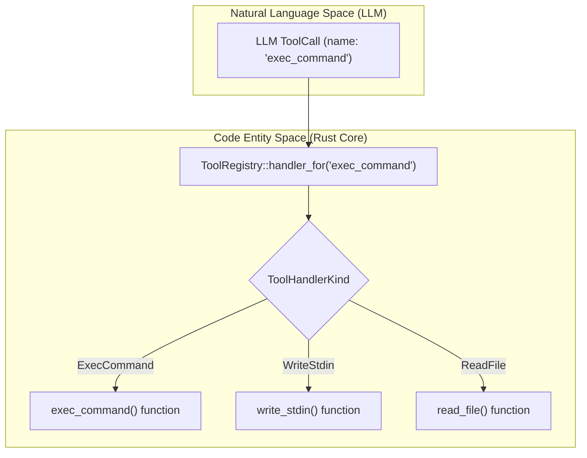
Sources: [crates/browser-use-core/src/tools/mod.rs:7-27](), [crates/browser-use-core/src/tools/mod.rs:72-77](), [crates/browser-use-core/src/tools/command.rs:62]()

---

## Core Tool Categories

### 1. Browser Tools
The system distinguishes between the **Control Plane** and the **Data Plane** for browser interactions.

*   **`browser`**: Used for runtime management, including connecting to local/remote instances, profile discovery, and health checks (`browser doctor`) [prompts/browser-tool-description.md:1-21]().
*   **`browser_script`**: Executes Python code within a managed worker. It provides a rich set of pre-imported helpers like `click_at_xy`, `screenshot`, and `js` for page interaction [prompts/browser-script-tool-description.md:17-59]().

### 2. Command & Terminal Tools
Managed via the `COMMANDS` registry, these tools allow for long-running shell interactions.

*   **`exec_command`**: Spawns a process (optionally in a PTY). If the process doesn't exit within `yield_time_ms`, it returns a `session_id` for continued interaction [crates/browser-use-core/src/tools/command.rs:62-121]().
*   **`write_stdin`**: Sends input to an active `session_id` created by `exec_command` [crates/browser-use-core/src/tools/command.rs:213-231]().

### 3. Filesystem Tools
These tools provide safe, truncated access to the local workspace.

*   **`read_file`**: Reads text files with mandatory line-numbering and automatic binary detection [crates/browser-use-core/src/tools/files.rs:23-51]().
*   **`search_files`**: Performs high-performance searches using `rg` (ripgrep) if available, falling back to internal implementations [crates/browser-use-core/src/tools/files.rs:103-131]().
*   **`apply_patch`**: Applies Codex-style multi-line patches (add, delete, update, move) to local files [crates/browser-use-core/src/tools/mod.rs:154-173]().

### 4. Agent Lifecycle Tools
*   **`spawn_agent`**: Creates a sub-agent to handle a delegated sub-task [crates/browser-use-core/src/tools/mod.rs:20-21]().
*   **`done`**: Signals task completion and returns the final result to the user or parent agent [crates/browser-use-core/src/tools/mod.rs:8]() [prompts/python-tool-description.md:13]().

---

## Execution Logic and Output Management

### Parallel vs. Serial Execution
While the Agent Loop supports parallel tool execution for independent tasks (e.g., reading multiple files), certain tools enforce serial constraints. Specifically, `browser_script` interactions are considered shared mutable state; the documentation instructs models not to parallelize browser-changing actions [prompts/python-tool-description.md:5]().

### Tool Output Spilling and Truncation
To prevent context window exhaustion, the registry implements aggressive truncation:
*   **Approximation**: Uses a `TOKEN_TO_CHAR_APPROX` of 4 characters per token [crates/browser-use-core/src/tools/command.rs:21]().
*   **Read Limits**: `read_file` defaults to 400 lines or 80,000 bytes [crates/browser-use-core/src/tools/files.rs:13-14]().
*   **Command Output**: Long-running command output is truncated based on `max_output_tokens` provided in the tool call [crates/browser-use-core/src/tools/command.rs:20]().

**Command Execution Lifecycle**
This diagram tracks the flow of a command from the `exec_command` call to the persistent `COMMANDS` registry.

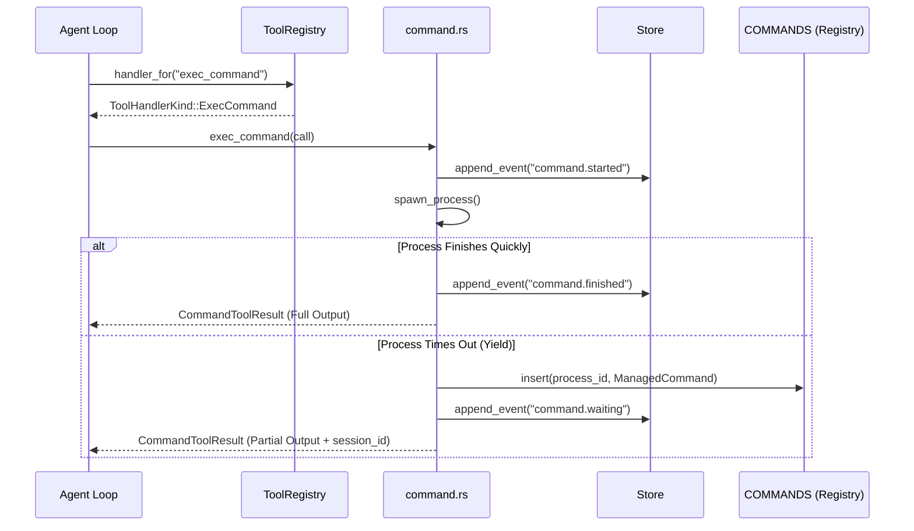
Sources: [crates/browser-use-core/src/tools/command.rs:62-211](), [crates/browser-use-core/src/tools/command.rs:136-151](), [crates/browser-use-core/src/tools/command.rs:197-200]()

### Event Emission
Every tool execution emits structured events to the `Store`. This includes `tool.started`, `tool.finished`, and tool-specific events like `command.output` or `file.read` [crates/browser-use-core/src/tools/command.rs:101-110](), [crates/browser-use-core/src/tools/files.rs:84-96](). These events drive the TUI transcript and the persistent session history.

Sources:
- `crates/browser-use-core/src/tools/mod.rs`
- `crates/browser-use-core/src/tools/command.rs`
- `crates/browser-use-core/src/tools/files.rs`
- `prompts/browser-tool-description.md`
- `prompts/browser-script-tool-description.md`
- `prompts/python-tool-description.md`

---

# Page: Multi-Agent Hierarchy and Sub-agents

# Multi-Agent Hierarchy and Sub-agents

<details>
<summary>Relevant source files</summary>

The following files were used as context for generating this wiki page:

- [crates/browser-use-cli/src/main.rs](crates/browser-use-cli/src/main.rs)
- [crates/browser-use-core/src/lib.rs](crates/browser-use-core/src/lib.rs)
- [prompts/helper-session-identity.md](prompts/helper-session-identity.md)
- [prompts/helper-session-inherited-context.md](prompts/helper-session-inherited-context.md)

</details>


This page details the hierarchical agent architecture of Browser Use Terminal. It explains how agents can delegate complex tasks to sub-agents, manage their lifecycles, and share context across the agent tree.

## Overview

The system supports a recursive multi-agent model where a "Parent Agent" can spawn one or more "Child Agents" (or "Sub-agents") to handle specific sub-tasks. This is primarily facilitated by the `spawn_agent` tool. Sub-agents can be short-lived (e.g., to explore a specific website) or long-running (e.g., to monitor a process).

### Key Concepts
- **Parent Agent**: The agent that initiates a sub-task.
- **Child Agent**: A newly created session with its own agent loop, potentially inheriting context from the parent.
- **Context Inheritance**: The mechanism by which a child agent receives a summary or partial history of the parent's work.
- **Lifecycle Guarding**: Using the `done` tool to signal completion back to the parent.

## The Spawn Mechanism

Agents spawn sub-agents by calling the `spawn_agent` tool [crates/browser-use-core/src/lib.rs:29](). This tool is registered within the `ToolRegistry` and handled by the core engine.

### Implementation Flow
1. **Tool Call**: The parent agent issues a `spawn_agent` tool call with parameters such as `message` (the task for the child), `nickname`, and `role`.
2. **Runner Execution**: The `ChildAgentRunner` [crates/browser-use-core/src/lib.rs:101-119]() is invoked. This is a closure passed into the `AgentRunOptions` [crates/browser-use-core/src/lib.rs:128]() during initialization.
3. **Session Creation**: A new session ID is generated, and a record is created in the `agent_edges` table in the `Store` [crates/browser-use-store/src/lib.rs:25]() to track the hierarchy.
4. **Context Injection**: Depending on the configuration, the parent's context is compacted and injected into the child's initial prompt.

### Agent Spawning Sequence
The following diagram illustrates the interaction between the `AgentLoop`, `ToolRegistry`, and the `ChildAgentRunner`.

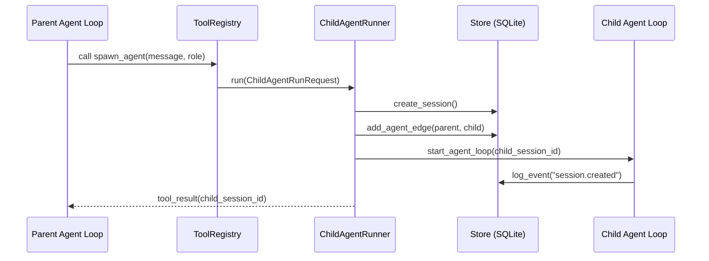
Sources: [crates/browser-use-core/src/lib.rs:95-119](), [crates/browser-use-cli/src/main.rs:151-160]()

## Context Inheritance Modes

When a sub-agent is spawned, it often needs to know what the parent has already accomplished to avoid redundant work. The system uses specific prompt templates to inject this context.

| Mode | Description | Code Reference |
| :--- | :--- | :--- |
| **Summary** | A high-level summary of the parent's progress is generated and passed to the child. | `AgentSummary` [crates/browser-use-store/src/lib.rs:25]() |
| **Sanitized Context** | System-sanitized history from the parent's event log. | `sanitized_agent_context_from_events` [crates/browser-use-protocol/src/lib.rs:16]() |
| **Prompt Injection** | Uses `helper-session-identity.md` and `helper-session-inherited-context.md` to format the child's system prompt. | [prompts/helper-session-identity.md:1-4](), [prompts/helper-session-inherited-context.md:1-4]() |

Sources: [crates/browser-use-core/src/lib.rs:15-25](), [prompts/helper-session-identity.md:1-4]()

## Inter-Agent Messaging and Lifecycle

Agents communicate asynchronously through the `Store`. The CLI and Core provide commands to manage these interactions.

### Messaging Tools
- **`send_agent_message`**: Allows an agent (or user) to send a message to another agent. If `trigger_turn` is true, it forces the target agent to run an immediate iteration [crates/browser-use-cli/src/main.rs:169-175]().
- **`wait_agent`**: Blocks the caller until the target agent reaches a terminal state (Done/Failed) [crates/browser-use-cli/src/main.rs:176-178]().

### The `done` Tool
Sub-agents are expected to use the `done` tool to signal completion. When a sub-agent calls `done`, it transitions the session status to `Done`. The parent agent, if waiting via `wait_agent`, receives the result string provided by the child.

### Hierarchy Data Model
The relationship between agents is persisted in the database, allowing for reconstruction of the agent tree even after a restart.

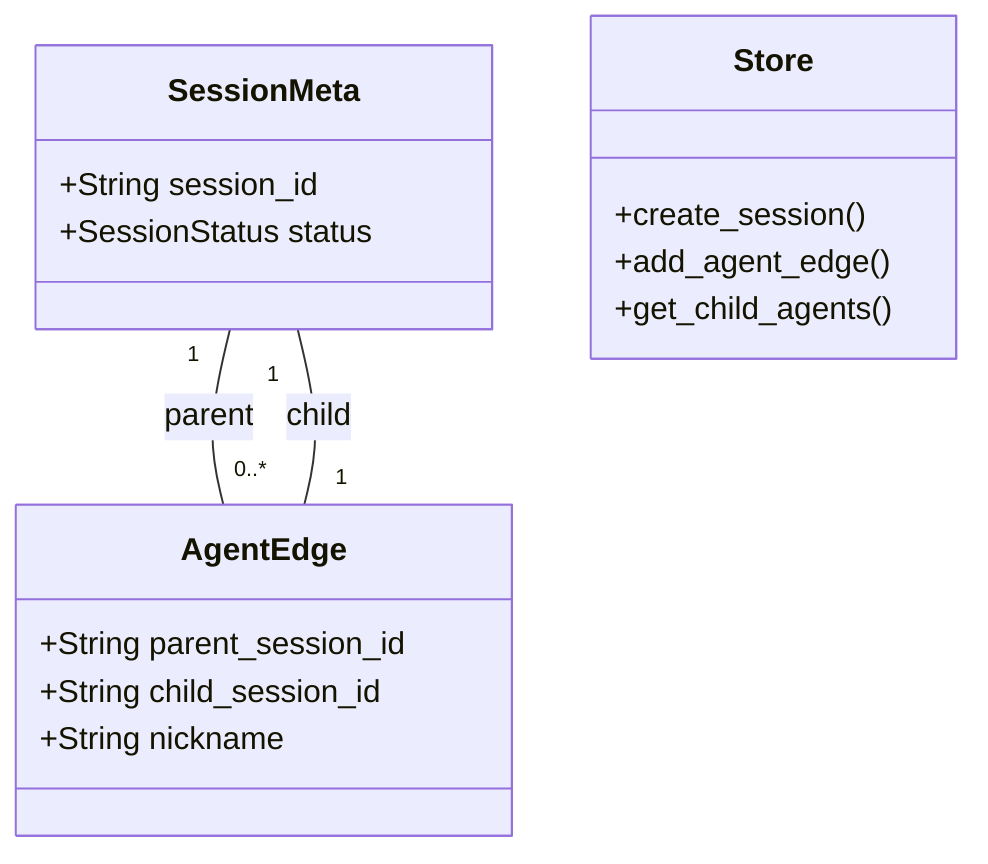
Sources: [crates/browser-use-store/src/lib.rs:25-30](), [crates/browser-use-protocol/src/lib.rs:15-18]()

## Implementation Details: `ChildAgentRunner`

The `ChildAgentRunner` is a critical abstraction that allows the `browser-use-core` crate to remain agnostic of how agents are actually executed (e.g., via a local thread or a remote CLI call).

In the CLI implementation, `spawn_agent` is mapped to a command that initializes a new `ProviderRunConfig` and starts a fresh agent loop [crates/browser-use-cli/src/main.rs:151-160]().

```rust
// Example of the runner structure in core
pub struct ChildAgentRunner {
    run: Arc<dyn Fn(ChildAgentRunRequest) -> Result<()> + Send + Sync>,
}
```
Sources: [crates/browser-use-core/src/lib.rs:101-104](), [crates/browser-use-cli/src/main.rs:11-16]()

---

# Page: LLM Providers

# LLM Providers

<details>
<summary>Relevant source files</summary>

The following files were used as context for generating this wiki page:

- [crates/browser-use-cli/src/main.rs](crates/browser-use-cli/src/main.rs)
- [crates/browser-use-core/src/lib.rs](crates/browser-use-core/src/lib.rs)
- [crates/browser-use-providers/Cargo.toml](crates/browser-use-providers/Cargo.toml)
- [crates/browser-use-providers/src/lib.rs](crates/browser-use-providers/src/lib.rs)
- [crates/browser-use-python-worker/Cargo.toml](crates/browser-use-python-worker/Cargo.toml)
- [crates/browser-use-python-worker/src/lib.rs](crates/browser-use-python-worker/src/lib.rs)
- [python/llm_browser_worker/worker.py](python/llm_browser_worker/worker.py)
- [python/tests/test_worker_package.py](python/tests/test_worker_package.py)

</details>


The `browser-use-providers` crate defines the abstraction layer for Large Language Model (LLM) interaction. It encapsulates the complexities of different vendor APIs, authentication flows, and message formats into a unified interface used by the core agent engine.

## The ModelProvider Trait

The central abstraction for LLM interaction is the `ModelProvider` trait [crates/browser-use-providers/src/lib.rs:24-45](). This trait allows the agent loop to remain agnostic of the underlying backend (e.g., Anthropic, OpenAI, or a local mock).

### Key Components
*   **`ProviderTurn`**: A structure containing the current conversation history (as JSON values) and the available `ToolSpec` objects for the current turn [crates/browser-use-providers/src/lib.rs:18-22]().
*   **`start_turn`**: The primary method that takes a `ProviderTurn` and returns a vector of `ModelEvent` objects [crates/browser-use-providers/src/lib.rs:33]().
*   **`stream_turn`**: A default implementation that facilitates streaming responses by invoking a callback for each `ModelEvent` as it arrives [crates/browser-use-providers/src/lib.rs:35-44]().

### LLM Provider Architecture
The following diagram illustrates how the `ModelProvider` trait bridges the high-level agent logic with specific vendor implementations.

**Model Provider Interface Mapping**
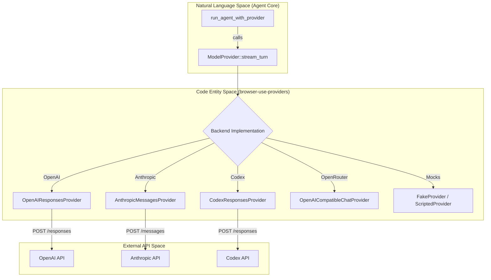
Sources: [crates/browser-use-providers/src/lib.rs:24-45](), [crates/browser-use-providers/src/lib.rs:120-126](), [crates/browser-use-providers/src/lib.rs:206-212]()

## Supported Backends

| Backend | Implementation Class | API Endpoint | Description |
| :--- | :--- | :--- | :--- |
| **OpenAI** | `OpenAIResponsesProvider` | `/v1/responses` | Uses the OpenAI Realtime/Responses API for structured output [crates/browser-use-providers/src/lib.rs:120-126](). |
| **Anthropic** | `AnthropicMessagesProvider` | `/v1/messages` | Standard Claude API implementation. |
| **Codex** | `CodexResponsesProvider` | `/v1/responses` | Specialized endpoint for Codex-based models. |
| **OpenRouter** | `OpenAICompatibleChatProvider` | `/api/v1/chat/completions` | Compatible with OpenRouter and other OpenAI-like proxies [crates/browser-use-providers/src/lib.rs:206-212](). |
| **Fake** | `FakeProvider` | N/A | Returns a static, pre-defined response for testing [crates/browser-use-providers/src/lib.rs:48-65](). |
| **Scripted** | `ScriptedProvider` | N/A | Returns a sequence of pre-defined turns from a queue [crates/browser-use-providers/src/lib.rs:88-98](). |

## Authentication Flows

The codebase supports several authentication mechanisms depending on the provider and the environment.

### 1. API Keys
Most providers (OpenAI, OpenRouter, Anthropic) rely on standard API keys loaded from environment variables:
*   `LLM_BROWSER_OPENAI_API_KEY` or `OPENAI_API_KEY` [crates/browser-use-providers/src/lib.rs:148-150]().
*   `LLM_BROWSER_OPENAI_COMPAT_API_KEY` or `OPENROUTER_API_KEY` [crates/browser-use-providers/src/lib.rs:234-236]().

### 2. Claude Code OAuth (PKCE)
For Claude models, the system implements an OAuth PKCE flow to authorize the terminal.
*   **Authorization**: `claude_code_oauth_authorize_url` generates the login URL [crates/browser-use-cli/src/main.rs:22]().
*   **Exchange**: `exchange_claude_code_authorization_code` converts the callback code into a `ClaudeCodeOAuthCredential`.
*   **Refresh**: `refresh_claude_code_oauth` is called automatically to maintain session validity [crates/browser-use-core/src/lib.rs:20]().

### 3. Codex Device Auth
Codex authentication involves loading a specialized credential file.
*   **Loading**: `load_codex_auth` or `load_codex_auth_file` [crates/browser-use-cli/src/main.rs:23]().
*   **Structure**: The `CodexAuth` struct holds the necessary tokens for the `CodexResponsesProvider` [crates/browser-use-core/src/lib.rs:21]().

**Authentication Data Flow**
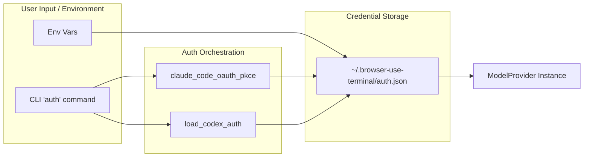
Sources: [crates/browser-use-cli/src/main.rs:142-145](), [crates/browser-use-providers/src/lib.rs:22-27]()

## Provider Resolution Hierarchy

When an agent is started, the `ProviderBackend` enum [crates/browser-use-core/src/lib.rs:56-63]() and `ProviderRunConfig` [crates/browser-use-core/src/lib.rs:66-71]() determine which implementation is instantiated.

The resolution logic typically follows this order in the CLI:
1.  **Explicit Command**: Subcommands like `run-openai` or `run-anthropic` force a specific provider [crates/browser-use-cli/src/main.rs:56-75]().
2.  **Configuration**: If no provider is specified, the system looks for default settings in the `Store`.
3.  **Environment Fallback**: Providers check for their specific environment variables (e.g., `OPENAI_API_KEY`) during instantiation [crates/browser-use-providers/src/lib.rs:148-154]().

### Provider Initialization in Core
The core function `run_agent_with_provider` receives the resolved implementation. The mapping from the `ProviderBackend` enum to the trait implementation is handled by the factory logic in `browser-use-core` [crates/browser-use-core/src/lib.rs:20-23]().

Sources: [crates/browser-use-core/src/lib.rs:56-92](), [crates/browser-use-cli/src/main.rs:56-95](), [crates/browser-use-providers/src/lib.rs:147-154]()

---

# Page: Browser Runtime

# Browser Runtime

<details>
<summary>Relevant source files</summary>

The following files were used as context for generating this wiki page:

- [README.md](README.md)
- [crates/browser-use-browser/src/lib.rs](crates/browser-use-browser/src/lib.rs)
- [docs/public-launch-checklist.md](docs/public-launch-checklist.md)

</details>


The `browser-use-browser` crate provides the **Browser Runtime**, a Rust-owned control plane for browser automation. Unlike traditional automation frameworks that bundle logic into the browser process, this architecture maintains a persistent, durable Chrome DevTools Protocol (CDP) connection in Rust while offloading complex page interactions to a specialized Python worker.

This split ensures that the agent loop remains stable even if a specific page interaction fails or a browser tab crashes. The runtime supports multiple operating modes, ranging from local Chrome instances to managed headless sessions and remote cloud browsers [crates/browser-use-browser/src/lib.rs:57-63]().

### System Architecture Overview

The Browser Runtime acts as the bridge between the "Natural Language Space" (where the LLM decides what to do) and the "Code Entity Space" (where CDP commands are executed).

#### Logic Flow: Tool to Browser
The LLM interacts with the browser through two primary tools: `browser` (for lifecycle/tabs) and `browser_script` (for page content).

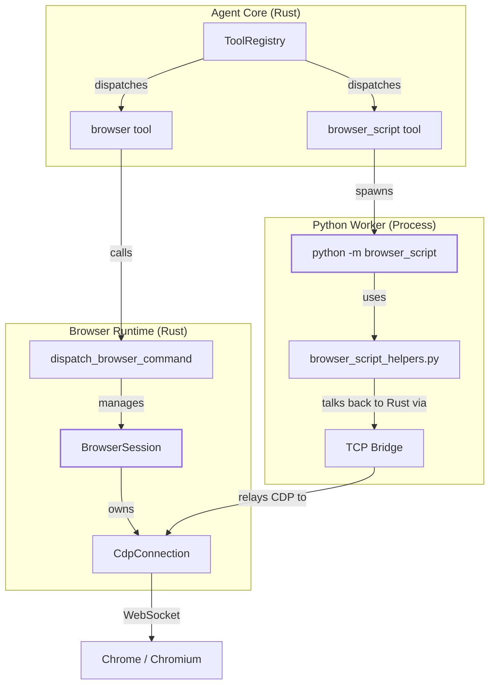
**Sources:** [crates/browser-use-browser/src/lib.rs:3-6](), [crates/browser-use-browser/src/lib.rs:194-218](), [crates/browser-use-browser/src/lib.rs:220-241]()

---

### CDP Connection and Browser Modes

The core of the runtime is the `BrowserSession` [crates/browser-use-browser/src/lib.rs:146-165](), which tracks the `BrowserMode` and `BrowserOwner`. The system can connect to existing browsers or manage its own lifecycle.

*   **Connection Management:** Rust maintains a `CdpConnection` using a WebSocket over a `MaybeTlsStream` [crates/browser-use-browser/src/lib.rs:102-105]().
*   **Modes:** Supports `Local` (existing user profile), `Managed` (temporary or specific path), `RemoteCdp` (external WebSocket), and `RemoteCloud` (Browser Use API) [crates/browser-use-browser/src/lib.rs:57-63]().
*   **Recovery:** The runtime handles connection generation tracking to ensure stale commands from previous sessions do not interfere with new ones [crates/browser-use-browser/src/lib.rs:153]().

For details, see [CDP Connection and Browser Modes](#3.1).

---

### Python Worker and `browser_script`

Page-level interaction (clicking, typing, extracting data) is handled by the `browser_script` tool. Instead of writing raw CDP in Rust, the agent writes Python code that utilizes a high-level library of helper functions.

*   **Execution Model:** Rust spawns a fresh Python process for every `browser_script` call [crates/browser-use-browser/src/lib.rs:239-241]().
*   **TCP Bridge:** The Python worker communicates back to the Rust-owned CDP connection via a local TCP bridge [crates/browser-use-browser/src/lib.rs:229-231]().
*   **Helpers:** `browser_script_helpers.py` provides an ergonomic API (e.g., `goto_url`, `screenshot`, `fill_input`) while allowing raw CDP as an escape hatch [crates/browser-use-browser/src/lib.rs:31]().

For details, see [Python Worker and browser_script](#3.2).

---

### Browser Interaction Skills

The "intelligence" of the browser runtime is augmented by a library of prompt-based playbooks known as **Interaction Skills**. These are specialized instructions and code patterns that help the agent handle complex web scenarios.

*   **Specialized Handling:** Includes logic for iframes, Shadow DOM traversal, and drag-and-drop operations.
*   **System Actions:** Playbooks for downloading files, printing to PDF, and managing multi-tab navigation.
*   **Reliability:** Standardized patterns for scrolling, viewport management, and waiting for network idle states.

For details, see [Browser Interaction Skills (Prompt Playbooks)](#3.3).

---

### Data Entities: Session State

The following table maps the internal Rust state to the browser's physical state.

| Entity | Code Reference | Description |
| :--- | :--- | :--- |
| `BrowserSession` | [crates/browser-use-browser/src/lib.rs:146]() | Root object tracking mode, owner, and active connection. |
| `ManagedBrowser` | [crates/browser-use-browser/src/lib.rs:121]() | Handle for a browser process spawned and managed by Rust. |
| `CdpConnection` | [crates/browser-use-browser/src/lib.rs:102]() | The active WebSocket connection to the Chrome DevTools Protocol. |
| `Endpoint` | [crates/browser-use-browser/src/lib.rs:95]() | Metadata about where to connect (HTTP and WS URLs). |
| `BrowserScriptOutput` | [crates/browser-use-browser/src/lib.rs:40]() | The result of a Python script execution, including captured images and logs. |

**Sources:** [crates/browser-use-browser/src/lib.rs:33-165]()

---

# Page: CDP Connection and Browser Modes

# CDP Connection and Browser Modes

<details>
<summary>Relevant source files</summary>

The following files were used as context for generating this wiki page:

- [crates/browser-use-browser/src/lib.rs](crates/browser-use-browser/src/lib.rs)
- [docs/terminal-ui-product-ux.md](docs/terminal-ui-product-ux.md)
- [prompts/browser-tool-description.md](prompts/browser-tool-description.md)
- [prompts/interaction-skills/profile-sync.md](prompts/interaction-skills/profile-sync.md)

</details>


The `browser-use-browser` crate provides a Rust-owned browser control plane. Unlike traditional automation frameworks where the agent directly drives the browser, this system splits the responsibility: Rust maintains the persistent **Chrome DevTools Protocol (CDP)** connection and manages browser lifecycles, while a transient Python worker executes interaction scripts via a bridge to this Rust-held connection [crates/browser-use-browser/src/lib.rs:1-6]().

## Browser Modes and Ownership

The system categorizes browser instances into distinct `BrowserMode` variants to handle different connection strategies and lifecycle requirements.

| Mode | Description |
| :--- | :--- |
| `Local` | Attaches to an already-running Chromium-family browser on the local machine via `DevToolsActivePort` [crates/browser-use-browser/src/lib.rs:59](), [prompts/browser-tool-description.md:41-48](). |
| `Managed` | A Rust-owned browser process launched by the terminal with a temporary or specific profile path [crates/browser-use-browser/src/lib.rs:60](), [crates/browser-use-browser/src/lib.rs:108-113](). |
| `RemoteCdp` | Connects to an external browser via a provided HTTP or WebSocket URL [crates/browser-use-browser/src/lib.rs:61](), [prompts/browser-tool-description.md:68-69](). |
| `RemoteCloud` | Connects to a Browser Use cloud-hosted browser instance [crates/browser-use-browser/src/lib.rs:62](), [prompts/browser-tool-description.md:70-73](). |

### Browser Ownership
Tracking ownership is critical for determining whether the terminal has the authority to kill a process or close a remote session.

*   **`BrowserOwner::Rust`**: The terminal launched the process (e.g., `Managed` or `RemoteCloud`). It is responsible for cleanup [crates/browser-use-browser/src/lib.rs:81]().
*   **`BrowserOwner::External`**: The browser was already running (e.g., `Local` or `RemoteCdp`). The terminal will disconnect but not terminate the process [crates/browser-use-browser/src/lib.rs:80]().

**Sources:** [crates/browser-use-browser/src/lib.rs:56-92](), [prompts/browser-tool-description.md:25-30]()

## CDP Connection Architecture

The `BrowserSession` struct is the central registry for browser state. It holds the WebSocket connection, session IDs, and target information [crates/browser-use-browser/src/lib.rs:146-165]().

### Connection Management
The `CdpConnection` wraps a `tungstenite` WebSocket. It tracks a `next_id` to map CDP requests to responses [crates/browser-use-browser/src/lib.rs:102-105]().

### Session State Persistence
The system maintains a global registry of sessions in a `OnceLock<Mutex<HashMap<String, BrowserSession>>>` called `SESSIONS` [crates/browser-use-browser/src/lib.rs:192](). This allows the browser state to persist across multiple tool calls from the agent.

### Entity Mapping: Browser Session to Code
The following diagram maps the logical browser concepts to the internal Rust structures and state tracking.

**Browser Session Architecture**
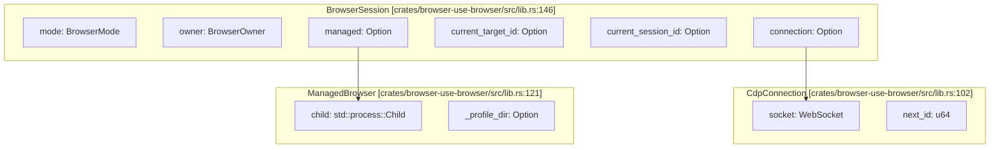
**Sources:** [crates/browser-use-browser/src/lib.rs:102-165]()

## Browser CLI Command Interface

The `browser` tool is exposed to the LLM as a CLI-like interface. Commands are dispatched via `run_browser_command`, which parses a raw string and executes the corresponding logic [crates/browser-use-browser/src/lib.rs:194-218]().

### Key Command Categories
1.  **Connection**: `connect local`, `connect managed`, `connect remote-cdp`.
2.  **Profiles**: `local profiles`, `local profiles inspect`, `remote profiles`.
3.  **Recovery**: `recover reconnect-websocket`, `recover reattach-same-target`.
4.  **Diagnostics**: `status`, `doctor`, `runtime logs`.

### Implementation Flow
When `run_browser_command` is called:
1.  It tokenizes the command string using `shell_words` [crates/browser-use-browser/src/lib.rs:200]().
2.  It retrieves or creates a `BrowserSession` from the global `SESSIONS` map [crates/browser-use-browser/src/lib.rs:208-211]().
3.  It calls `dispatch_browser_command` to execute the specific logic [crates/browser-use-browser/src/lib.rs:213]().
4.  It returns a `BrowserCommandOutput` containing the result content and any browser-specific events [crates/browser-use-browser/src/lib.rs:214-217]().

**Sources:** [crates/browser-use-browser/src/lib.rs:194-218](), [prompts/browser-tool-description.md:88-128]()

## Connection Recovery and Health

The terminal implements a multi-tiered recovery strategy to handle transient CDP failures without losing agent progress.

### Recovery Tiers
*   **`reconnect-websocket`**: Re-establishes the WebSocket connection to the existing endpoint. It does not reload pages or change session IDs [prompts/browser-tool-description.md:82]().
*   **`reattach-same-target`**: Attaches a new CDP session to the existing browser target (tab). Useful if the specific session ID becomes invalid but the tab still exists [prompts/browser-tool-description.md:83]().
*   **`restart-runtime`**: Resets the Rust-side `BrowserSession` state and attempts a fresh connection to the same endpoint [prompts/browser-tool-description.md:84]().

### The "Doctor" Command
The `browser doctor` command performs a non-destructive audit of the connection state. It checks:
*   Local browser candidate availability [prompts/browser-tool-description.md:77]().
*   CDP WebSocket health [prompts/browser-tool-description.md:77]().
*   Current target/tab availability [prompts/browser-tool-description.md:77]().

**Sources:** [prompts/browser-tool-description.md:74-87]()

## Data Flow: Browser Command Execution

This diagram illustrates the flow of a `browser` command from the agent's tool call through the Rust control plane.

**Browser Command Data Flow**
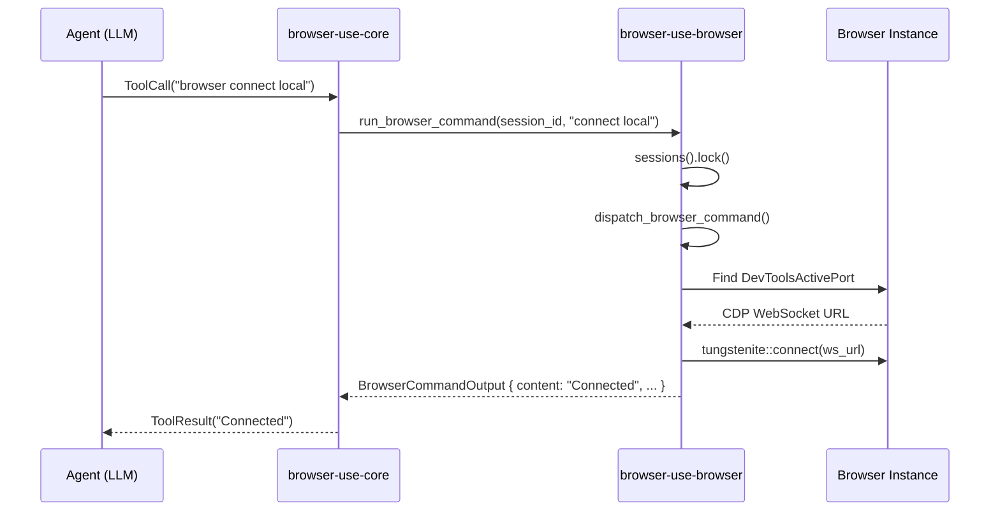
**Sources:** [crates/browser-use-browser/src/lib.rs:194-218](), [prompts/browser-tool-description.md:103-109]()

---

# Page: Python Worker and browser_script

# Python Worker and browser_script

<details>
<summary>Relevant source files</summary>

The following files were used as context for generating this wiki page:

- [crates/browser-use-browser/src/browser_script_helpers.py](crates/browser-use-browser/src/browser_script_helpers.py)
- [crates/browser-use-browser/src/lib.rs](crates/browser-use-browser/src/lib.rs)
- [crates/browser-use-providers/src/lib.rs](crates/browser-use-providers/src/lib.rs)
- [crates/browser-use-python-worker/Cargo.toml](crates/browser-use-python-worker/Cargo.toml)
- [crates/browser-use-python-worker/src/lib.rs](crates/browser-use-python-worker/src/lib.rs)
- [crates/browser-use-tui/src/markdown.rs](crates/browser-use-tui/src/markdown.rs)
- [prompts/browser-script-tool-description.md](prompts/browser-script-tool-description.md)
- [python/llm_browser_worker/worker.py](python/llm_browser_worker/worker.py)
- [python/tests/test_worker_package.py](python/tests/test_worker_package.py)

</details>


The `browser_script` tool provides the primary interface for LLM-driven page interaction. While the Rust core maintains the persistent browser lifecycle and Chrome DevTools Protocol (CDP) connection, the actual interaction logic is executed within a transient Python worker process.

## Execution Model

The execution model is designed to provide a "clean slate" for every tool call while maintaining a persistent browser state in the background.

1.  **Stateless Python**: Each `browser_script` call spawns or utilizes a Python process where variables do not persist across different tool calls [prompts/browser-script-tool-description.md:7-10]().
2.  **Stateful Rust**: The browser instance, tabs, and CDP session state are held by the Rust `BrowserSession` [crates/browser-use-browser/src/lib.rs:146-165]().
3.  **Bridge Communication**: Python and Rust communicate via a local TCP bridge [crates/browser-use-browser/src/lib.rs:229-231](). Python sends requests (like `cdp` commands or `meta` queries) and Rust returns the CDP responses or session metadata.

### System Flow: Tool Execution
This diagram illustrates the flow from an LLM tool call to the execution within the Python worker.

Title: browser_script Execution Flow
```mermaid
graph TD
    subgraph "Natural Language Space"
        LLM["LLM Agent"]
    end

    subgraph "Code Entity Space (Rust Core)"
        TR["ToolRegistry"]
        RBC["run_browser_script"]
        PW["PythonWorker"]
        BCS["BrowserSession"]
        RB["run_bridge"]
    end

    subgraph "Code Entity Space (Python Worker)"
        W["worker.py"]
        BH["browser_script_helpers.py"]
    end

    LLM -- "tool_call: browser_script" --> TR
    TR -- "dispatch" --> RBC
    RBC -- "spawn/reuse" --> PW
    RBC -- "start" --> RB
    PW -- "JSON Request" --> W
    W -- "exec(code)" --> BH
    BH -- "TCP Bridge" --> RB
    RB -- "CDP Command" --> BCS
    BCS -- "WebSocket" --> Chrome["Chrome Instance"]
```
Sources: [crates/browser-use-browser/src/lib.rs:220-243](), [crates/browser-use-python-worker/src/lib.rs:15-21](), [python/llm_browser_worker/worker.py:330-350]()

## The Python Worker (`browser-use-python-worker`)

The `PythonWorker` struct in Rust manages the lifecycle of the underlying Python process. It attempts to use `uv run` for managed dependency injection (e.g., `cdp-use`, `pillow`) before falling back to a system `python3` [crates/browser-use-python-worker/src/lib.rs:133-163]().

### Key Components:
*   **`PythonWorker::start`**: Initializes the process with the necessary `PYTHONPATH` including the workspace `src` and `python` directories [crates/browser-use-python-worker/src/lib.rs:76-126]().
*   **`RunPythonRequest`**: The JSON schema sent to Python, containing the `code`, `session_id`, and `artifact_dir` [crates/browser-use-python-worker/src/lib.rs:32-43]().
*   **`worker.py`**: The entry point in Python that handles the `_run` loop, executes the provided string, and captures `stdout/stderr` into the tool response [python/llm_browser_worker/worker.py:330-360]().

Sources: [crates/browser-use-python-worker/src/lib.rs:15-65](), [python/llm_browser_worker/worker.py:330-370]()

## browser_script Helpers

The `browser_script_helpers.py` module is injected as a prelude to every script execution [crates/browser-use-browser/src/lib.rs:31](). It provides a high-level API for the LLM to interact with the page without needing to write raw CDP or import libraries.

### Core Helper Functions

| Function | Description | Implementation Detail |
| :--- | :--- | :--- |
| `cdp(method, **params)` | The "Escape Hatch". Sends raw CDP commands to the current tab. | Calls `_bridge({"kind": "cdp", ...})` [crates/browser-use-browser/src/browser_script_helpers.py:25-27]() |
| `js(expression)` | Executes JavaScript in the page context. | Wraps expression in an IIFE if `return` is present [crates/browser-use-browser/src/browser_script_helpers.py:167-181]() |
| `goto_url(url)` | Navigates the current tab and waits for load. | Uses `Page.navigate` + `wait_for_load` [crates/browser-use-browser/src/browser_script_helpers.py:184-187]() |
| `screenshot(label)` | Captures a screenshot and registers it as an artifact. | Automatically attached to the tool result [crates/browser-use-browser/src/browser_script_helpers.py:246-253]() |
| `fill_input(sel, text)` | Clears and types into an element. | Uses `DOM.querySelector` and `Input.dispatchKeyEvent` [crates/browser-use-browser/src/browser_script_helpers.py:270-285]() |
| `click_at_xy(x, y)` | Performs a hardware-level mouse click at coordinates. | Uses `Input.dispatchMouseEvent` (press/release) [crates/browser-use-browser/src/browser_script_helpers.py:261-268]() |

### Data Flow: Helper to CDP
This diagram maps the helper functions to the internal communication protocol and the Rust-side session management.

Title: Helper to CDP Mapping
```mermaid
graph LR
    subgraph "Python Context"
        H_GOTO["goto_url()"]
        H_JS["js()"]
        H_CDP["cdp()"]
        BRIDGE_CALL["_bridge()"]
    end

    subgraph "Rust Bridge (run_bridge)"
        REQ_CDP["RequestKind::Cdp"]
        REQ_META["RequestKind::Meta"]
    end

    subgraph "BrowserSession"
        CDP_CONN["CdpConnection"]
        SESS_ATTR["current_session_id"]
    end

    H_GOTO --> H_CDP
    H_JS --> H_CDP
    H_CDP --> BRIDGE_CALL
    BRIDGE_CALL -- "TCP JSON" --> REQ_CDP
    REQ_CDP -- "next_id / send" --> CDP_CONN
    CDP_CONN -- "WebSocket" --> Chrome["Chrome"]
```
Sources: [crates/browser-use-browser/src/browser_script_helpers.py:25-30](), [crates/browser-use-browser/src/lib.rs:239-241](), [crates/browser-use-browser/src/lib.rs:102-105]()

## The CDP Escape Hatch

While helpers cover 90% of use cases, the `cdp()` function allows the LLM to access the full Chrome DevTools Protocol. This is critical for advanced interactions like:
*   **Network Emulation**: `cdp("Network.emulateNetworkConditions", ...)`
*   **Console Monitoring**: `cdp("Console.enable")`
*   **Raw Input**: Direct control over `Input.dispatchKeyEvent` for complex modifiers.

The Rust core handles the routing of these commands to the correct `targetId` and `sessionId` maintained in the `BrowserSession` [crates/browser-use-browser/src/lib.rs:150-152]().

## Artifacts and Outputs

The Python worker automatically tracks files and images generated during a script's execution.
*   **Images**: Any call to `screenshot()` or `emit_image()` adds an entry to the `images` list in `BrowserScriptOutput` [crates/browser-use-browser/src/lib.rs:51]().
*   **Files**: Files written to the `outputs_dir()` are automatically collected as artifacts [prompts/browser-script-tool-description.md:69-70]().
*   **Browser Events**: The worker can emit `browser.state` events (URL, Title, Tab count) which the TUI uses to update the browser status bar [python/tests/test_worker_package.py:53-77]().

Sources: [crates/browser-use-browser/src/lib.rs:39-54](), [python/llm_browser_worker/worker.py:360-380]()

---

# Page: Browser Interaction Skills (Prompt Playbooks)

# Browser Interaction Skills (Prompt Playbooks)

<details>
<summary>Relevant source files</summary>

The following files were used as context for generating this wiki page:

- [prompts/browser-agent-system.md](prompts/browser-agent-system.md)
- [prompts/compacted-context-system.md](prompts/compacted-context-system.md)
- [prompts/interaction-skills/connection.md](prompts/interaction-skills/connection.md)
- [prompts/interaction-skills/cookies.md](prompts/interaction-skills/cookies.md)
- [prompts/interaction-skills/cross-origin-iframes.md](prompts/interaction-skills/cross-origin-iframes.md)
- [prompts/interaction-skills/dialogs.md](prompts/interaction-skills/dialogs.md)
- [prompts/interaction-skills/downloads.md](prompts/interaction-skills/downloads.md)
- [prompts/interaction-skills/drag-and-drop.md](prompts/interaction-skills/drag-and-drop.md)
- [prompts/interaction-skills/dropdowns.md](prompts/interaction-skills/dropdowns.md)
- [prompts/interaction-skills/iframes.md](prompts/interaction-skills/iframes.md)
- [prompts/interaction-skills/network-requests.md](prompts/interaction-skills/network-requests.md)
- [prompts/interaction-skills/print-as-pdf.md](prompts/interaction-skills/print-as-pdf.md)
- [prompts/interaction-skills/screenshots.md](prompts/interaction-skills/screenshots.md)
- [prompts/interaction-skills/scrolling.md](prompts/interaction-skills/scrolling.md)
- [prompts/interaction-skills/shadow-dom.md](prompts/interaction-skills/shadow-dom.md)
- [prompts/interaction-skills/tabs.md](prompts/interaction-skills/tabs.md)
- [prompts/interaction-skills/uploads.md](prompts/interaction-skills/uploads.md)
- [prompts/interaction-skills/viewport.md](prompts/interaction-skills/viewport.md)

</details>


This page documents the specialized prompt library and interaction playbooks used by the agent to handle complex browser behaviors. Instead of relying on brittle high-level abstractions, the system provides the agent with a "bitter lesson" contract: full access to the browser action space via the Chrome DevTools Protocol (CDP), supplemented by a library of "Interaction Skills" for handling edge cases like iframes, shadow DOM, and dialogs.

## Interaction Architecture

The interaction model splits browser work into two distinct domains: **Runtime Management** (via the `browser` tool) and **Page Interaction** (via the `browser_script` tool). Interaction skills are loaded as a core contract that guides the agent on how to use these tools effectively.

### The Browser Agent Contract
The agent operates under a strict system prompt defined in `prompts/browser-agent-system.md`. It treats raw CDP as the source of truth rather than an escape hatch [prompts/browser-agent-system.md:1-4]().

| Tool | Role | Key Capabilities |
| :--- | :--- | :--- |
| `browser` | Control Plane | Connection, lifecycle, profile summaries, runtime logs, recovery [prompts/browser-agent-system.md:5-12](). |
| `browser_script` | Data Plane | Python execution, CDP calls, JS evaluation, screenshots, tab management [prompts/browser-agent-system.md:7-8](). |

### Data Flow: Natural Language to Browser Action

The following diagram illustrates how a natural language request (e.g., "Click the login button") is transformed into browser actions using the interaction skills library.

**Interaction Command Flow**
```mermaid
graph TD
    subgraph "Natural Language Space"
        UserPrompt["User Prompt"]
    end

    subgraph "Prompt Playbook (Interaction Skills)"
        Contract["browser-agent-system.md"]
        Skills["Interaction Skill Files (e.g., screenshots.md)"]
    end

    subgraph "Code Entity Space (browser-use-core)"
        Agent["Agent Loop (run_agent_with_provider)"]
        ToolRegistry["ToolRegistry"]
    end

    subgraph "Execution Space (browser-use-browser)"
        PythonWorker["Python Worker (browser_script)"]
        CDP["CDP Connection (Chrome DevTools Protocol)"]
    end

    UserPrompt --> Agent
    Contract -.-> Agent
    Skills -.-> Agent
    Agent --> ToolRegistry
    ToolRegistry -- "executes" --> PythonWorker
    PythonWorker -- "cdp('Input.dispatchMouseEvent')" --> CDP
```
**Sources:** [prompts/browser-agent-system.md:1-15](), [prompts/interaction-skills/screenshots.md:1-10]()

---

## Core Interaction Skills

### 1. Connection & Tab Visibility
The agent must handle the "omnibox popup problem" where Chrome attaches to a 1px invisible viewport instead of a real page [prompts/interaction-skills/connection.md:3-7]().

*   **Detection**: Use `list_tabs()` to inspect all available `type: "page"` targets [prompts/interaction-skills/connection.md:14-20]().
*   **Correction**: Use `ensure_real_tab()` to force attachment to a valid `about:blank` or existing web page [prompts/interaction-skills/connection.md:22-23]().
*   **Recovery**: If a connection becomes stale, the playbook dictates using `browser recover reconnect-websocket` [prompts/interaction-skills/connection.md:13-13]().

### 2. Screenshots and Visual Verification
Screenshots are treated as labeled temporal checkpoints. The agent is instructed to capture state before and after meaningful actions [prompts/browser-agent-system.md:28-31]().

*   **Coordinate Resolution**: Screenshots are captured in **device pixels**. To click based on a screenshot, the agent must divide by `window.devicePixelRatio` to get **CSS pixels** [prompts/interaction-skills/screenshots.md:3-9]().
*   **Clipping**: To avoid LLM token limits (often > 2000px), the agent uses `screenshot_clip(x, y, width, height)` for specific regions [prompts/interaction-skills/screenshots.md:9-14]().

**Visual Action Sequence**
```mermaid
sequenceDiagram
    participant A as Agent
    participant P as Python Worker (browser_script)
    participant B as Browser (CDP)

    A->>P: screenshot("before_click")
    P->>B: Page.captureScreenshot
    B-->>P: PNG Data
    P-->>A: Attach Image to Turn
    A->>P: click_at_xy(x, y)
    P->>B: Input.dispatchMouseEvent
    A->>P: screenshot("after_click")
    P->>B: Page.captureScreenshot
    B-->>P: PNG Data
    P-->>A: Verify visual change
```
**Sources:** [prompts/browser-agent-system.md:28-31](), [prompts/interaction-skills/screenshots.md:1-14]()

### 3. Dialog Handling (Alerts, Confirms, Prompts)
Dialogs freeze the JavaScript thread, preventing standard `js()` execution. The interaction skills provide two strategies [prompts/interaction-skills/dialogs.md:3-4]():

*   **Reactive (CDP-level)**: Uses `Page.handleJavaScriptDialog` to accept or dismiss. This is preferred as it is undetectable by anti-bot scripts [prompts/interaction-skills/dialogs.md:9-15]().
*   **Proactive (JS Stubbing)**: Overwrites `window.alert` in advance to collect messages in an array. This is useful for high-frequency dialogs but detectable by anti-bot measures [prompts/interaction-skills/dialogs.md:28-41]().

### 4. Navigation and Iframes
*   **Navigation**: Prefer `new_tab(url)` for the first navigation to avoid mutating the initial state, then use `goto_url(url)` for subsequent steps [prompts/browser-agent-system.md:27-27]().
*   **Iframes**: The agent uses `iframe_target()` for cross-origin frames. For same-origin, it traverses via `contentDocument` [prompts/interaction-skills/iframes.md:1-4]().
*   **Coordinate Clicks**: The playbook emphasizes coordinate-based clicks (`click_at_xy`) because Chrome's hit-testing handles iframes and shadow DOM more reliably than selector-based abstractions [prompts/browser-agent-system.md:29-29]().

---

## Specialized Playbooks

### Downloads and Uploads
*   **Uploads**: Handled via the `upload_file` helper which interacts with the file input element directly via CDP [prompts/browser-agent-system.md:7-7]().
*   **Downloads**: The agent monitors for browser-triggered downloads and verifies the start of the transfer by checking the filesystem or CDP events [prompts/interaction-skills/downloads.md:1-4]().

### Network and Performance
*   **Network Requests**: When DOM changes are ambiguous (e.g., a "Submit" button that doesn't refresh the page), the agent is instructed to use `wait_for_network_idle()` or inspect `drain_events()` for XHR/Fetch completion [prompts/interaction-skills/network-requests.md:1-4]().
*   **Scrolling**: For lazy-loaded content, the agent uses the `scroll` helper to trigger viewport-based event listeners [prompts/interaction-skills/scrolling.md:1-2]().

### Context Compaction Memory
When the LLM context window is nearly full, the system performs "Context Compaction." The agent is provided with a specialized prompt (`prompts/compacted-context-system.md`) that reminds it of the active operating contract while providing a JSON summary of prior browser states [prompts/compacted-context-system.md:1-10]().

**Sources:**
- `prompts/browser-agent-system.md`
- `prompts/interaction-skills/connection.md`
- `prompts/interaction-skills/screenshots.md`
- `prompts/interaction-skills/dialogs.md`
- `prompts/interaction-skills/iframes.md`
- `prompts/compacted-context-system.md`

---

# Page: Terminal User Interface (TUI)

# Terminal User Interface (TUI)

<details>
<summary>Relevant source files</summary>

The following files were used as context for generating this wiki page:

- [crates/browser-use-tui/src/main.rs](crates/browser-use-tui/src/main.rs)
- [docs/terminal-renderer-architecture.md](docs/terminal-renderer-architecture.md)

</details>


The `browser-use-tui` crate provides a high-performance, interactive terminal workbench built on [ratatui](https://ratatui.rs/). It serves as the primary human-in-the-loop interface for the Browser Use agent, offering real-time streaming of agent thoughts, tool executions, and multi-agent coordination.

The TUI is designed with a hybrid rendering model that combines native terminal scrollback (for persistence) with an "active viewport" for live updates [docs/terminal-renderer-architecture.md:65-73]().

### System Architecture Overview

The TUI architecture separates the concerns of event projection, state management, and visual rendering. It operates on a reactive loop that listens for updates from the `Store` and user input via `crossterm`.

#### High-Level Data Flow
The following diagram illustrates how raw events from the SQLite store are projected through the transcript engine into the final rendered UI.

**TUI Projection Pipeline**
```mermaid
graph TD
    subgraph "Natural Language Space"
        User["User Prompt"]
        Agent["Agent Response"]
        Status["Activity Status"]
    end

    subgraph "Code Entity Space"
        Store["browser_use_store::Store"]
        Cache["AppStateCache (main.rs)"]
        Model["transcript::TranscriptModel"]
        Driver["TerminalDriver (main.rs)"]
        Render["render::render()"]

        Store -- "StoreNotification" --> Cache
        Cache -- "project_workbench()" --> Model
        Model -- "committed nodes" --> Driver
        Model -- "active node" --> Render
        Driver -- "crossterm::Print" --> Scrollback["Native Scrollback"]
        Render -- "ratatui::Frame" --> Viewport["Active Viewport"]
    end

    User -.-> Store
    Agent -.-> Store
    Scrollback -.-> User
    Viewport -.-> Agent
    Viewport -.-> Status
```
Sources: [docs/terminal-renderer-architecture.md:37-63](), [crates/browser-use-tui/src/main.rs:18-20](), [crates/browser-use-tui/src/main.rs:2553-2570]()

---

### [App Orchestration and Event Loop](#4.1)

The TUI lifecycle is managed by the `App` struct and the `run_terminal` entry point [crates/browser-use-tui/src/main.rs:2528-2540](). It orchestrates:
- **Reactivity**: Responding to `StoreNotification` events when the agent writes to the database [crates/browser-use-tui/src/main.rs:2604-2615]().
- **State Projection**: Using `project_workbench` to transform raw event logs into a `WorkbenchState` suitable for rendering [crates/browser-use-tui/src/main.rs:2553-2565]().
- **Terminal Management**: The `TerminalDriver` handles raw mode, bracketed paste, and CSI-u keyboard enhancement [crates/browser-use-tui/src/main.rs:34-45]().

For details, see [App Orchestration and Event Loop](#4.1).

### [Rendering and Surfaces](#4.2)

The TUI is composed of multiple `Surface` variants [crates/browser-use-tui/src/main.rs:117-130](). The rendering engine in `render.rs` manages a complex layout of:
- **Main View**: The primary transcript and active task area.
- **Modals/Overlays**: Centered popups for settings, model selection, and API key entry [crates/browser-use-tui/src/main.rs:149-152]().
- **Bottom Panes**: Non-blocking surfaces like the "Developer" or "History" views [crates/browser-use-tui/src/main.rs:133-145]().

For details, see [Rendering and Surfaces](#4.2).

### [Transcript Engine](#4.3)

The `TranscriptModel` is the "brain" of the UI. It reduces a sequence of `EventRecord` objects into a list of `TranscriptNode`s [crates/browser-use-tui/src/transcript.rs:326-335]().
- **Node Merging**: Compacting multiple tool calls or thoughts into a single visual block.
- **Streaming**: Handling the transition from "active" (live-updating) to "committed" (finalized) nodes [docs/terminal-renderer-architecture.md:108-110]().
- **Syntax Highlighting**: Using specialized themes for code blocks and file paths.

For details, see [Transcript Engine](#4.3).

### [Composer, Slash Palette, and Input Handling](#4.4)

User interaction is centered around the `Composer`, a multi-line text input widget [crates/browser-use-tui/src/composer.rs:23-45]().
- **Slash Palette**: A command menu (triggered by `/`) for switching models, browsers, or accounts [crates/browser-use-tui/src/palette.rs:25-40]().
- **Rich Input**: Support for Shift+Enter for new lines, bracketed paste for large text blocks, and history navigation.

For details, see [Composer, Slash Palette, and Input Handling](#4.4).

### [Theme and Visual Design](#4.5)

The visual identity of the TUI is defined in `theme.rs`. It provides a semantic styling layer that abstracts terminal colors into functional roles [crates/browser-use-tui/src/theme.rs:135-150]():
- **Activity Indicators**: Shimmering animations for waiting states.
- **Markdown Styles**: Bold, italic, and code block rendering for agent responses.
- **Status Styles**: Color-coded indicators for success, failure, and warning states.

For details, see [Theme and Visual Design](#4.5).

---

### Component Interaction Diagram

This diagram maps the high-level TUI components to their specific implementation files and primary responsibilities.

**TUI Component Map**
```mermaid
graph LR
    subgraph "Input Layer"
        C["composer.rs (Composer)"]
        P["palette.rs (SlashPalette)"]
    end

    subgraph "Logic Layer"
        M["main.rs (App)"]
        T["transcript.rs (TranscriptModel)"]
    end

    subgraph "Output Layer"
        R["render.rs (render_frame)"]
        Th["theme.rs (Styles)"]
    end

    C -- "input strings" --> M
    P -- "PaletteAction" --> M
    M -- "AppStateCache" --> T
    T -- "TranscriptNodes" --> R
    Th -- "Color/Style" --> R
    R -- "Terminal::draw" --> Screen["Physical Terminal"]
```
Sources: [crates/browser-use-tui/src/main.rs:56-64](), [docs/terminal-renderer-architecture.md:9-35]()

---

# Page: App Orchestration and Event Loop

# App Orchestration and Event Loop

<details>
<summary>Relevant source files</summary>

The following files were used as context for generating this wiki page:

- [crates/browser-use-core/Cargo.toml](crates/browser-use-core/Cargo.toml)
- [crates/browser-use-tui/src/main.rs](crates/browser-use-tui/src/main.rs)
- [crates/browser-use-tui/src/runtime.rs](crates/browser-use-tui/src/runtime.rs)

</details>


The Browser Use Terminal (BUT) TUI is built on a reactive, event-driven architecture that synchronizes a persistent SQLite store with a high-performance rendering loop. The orchestration layer manages the lifecycle of agent tasks, user input via `crossterm`, and background authentication flows, ensuring the UI remains responsive even during heavy LLM or browser activity.

## Application Lifecycle and run_terminal

The entry point for the TUI is the `run_terminal` function [crates/browser-use-tui/src/main.rs:2184-2311](). It initializes the `App` state, sets up the `ratatui` terminal backend, and enters the primary event loop.

### Initialization Flow
1.  **App::new**: Initializes the `App` struct, which holds the `AppStateCache`, `Composer`, and `Store` reference [crates/browser-use-tui/src/main.rs:431-507]().
2.  **Terminal Setup**: Configures `crossterm` for raw mode, enables mouse capture, and pushes keyboard enhancement flags for the CSI-u protocol [crates/browser-use-tui/src/main.rs:2192-2212]().
3.  **TerminalDriver**: A wrapper around the `ratatui::Terminal` that manages the inline viewport [crates/browser-use-tui/src/main.rs:327-429](). It uses `Viewport::Inline` to allow the TUI to live within the user's existing terminal scrollback rather than taking over the full screen.

### The Orchestration Loop
The loop in `run_terminal` [crates/browser-use-tui/src/main.rs:2238-2309]() polls for multiple sources of reactivity:
*   **Crossterm Events**: Keyboard and mouse input [crates/browser-use-tui/src/main.rs:2243-2250]().
*   **Store Notifications**: MPSC channel messages indicating the database has changed [crates/browser-use-tui/src/main.rs:2252-2260]().
*   **Auth Channels**: Background threads providing OAuth credentials or device codes [crates/browser-use-tui/src/main.rs:2262-2283]().
*   **Tick Intervals**: Periodic updates for animations and spinners [crates/browser-use-tui/src/main.rs:2285-2292]().

### Component Interaction Diagram
This diagram shows how the `run_terminal` loop orchestrates different code entities.

```mermaid
sequenceDiagram
    participant Loop as run_terminal (Event Loop)
    participant Term as TerminalDriver
    participant App as App (State Manager)
    participant Store as Store (SQLite)
    participant Agent as run_agent_thread

    Loop->>App: handle_events()
    App->>Store: append_event() (on user input)
    Store-->>Loop: StoreNotification (via MPSC)
    Loop->>App: update_cache()
    App->>App: project_workbench()
    Loop->>Term: draw(render_fn)
    Agent-->>Store: append_event() (Agent Progress)
    Store-->>Loop: StoreNotification
    Loop->>Term: draw(render_fn)
```
Sources: [crates/browser-use-tui/src/main.rs:2238-2309](), [crates/browser-use-tui/src/main.rs:608-624](), [crates/browser-use-tui/src/main.rs:431-507]()

## State Management and Projection

The TUI does not store its primary state in memory. Instead, it uses a **projection** of the event log stored in SQLite.

### AppStateCache
The `AppStateCache` [crates/browser-use-tui/src/main.rs:271-294]() stores the `WorkbenchState`. This state is not updated directly by UI actions; instead, UI actions trigger database writes, which then trigger a cache refresh.

### Reactive Projection
When a `StoreNotification` is received, the app calls `update_cache` [crates/browser-use-tui/src/main.rs:608-624](). This function invokes `project_workbench` [crates/browser-use-protocol/src/lib.rs:10-20]() (defined in the protocol crate), which scans the `EventRecord` table for the current session and reduces them into a `WorkbenchState` object.

| Entity | Role | Source |
| :--- | :--- | :--- |
| `Store` | Persistent SQLite storage for all events. | [crates/browser-use-store/src/lib.rs:1-10]() |
| `WorkbenchState` | The "View Model" representing the current session status and history. | [crates/browser-use-protocol/src/lib.rs:1-10]() |
| `project_workbench` | Pure function: `Vec<EventRecord> -> WorkbenchState`. | [crates/browser-use-protocol/src/lib.rs:10-20]() |
| `App::update_cache` | Fetches events from `Store` and updates `AppStateCache`. | [crates/browser-use-tui/src/main.rs:608-624]() |

Sources: [crates/browser-use-tui/src/main.rs:271-294](), [crates/browser-use-tui/src/main.rs:608-624](), [crates/browser-use-protocol/src/lib.rs:10-20]()

## Task Lifecycle: From Input to Completion

When a user submits a prompt in the TUI, it follows a specific path through the orchestration layer.

### 1. Input Capture
The `Composer` widget captures multi-line input. When the user presses `Enter` (or `Alt+Enter` depending on mode), `App::handle_key_event` is triggered [crates/browser-use-tui/src/main.rs:1255-1320]().

### 2. Session Initialization
If no session is active, `App::start_session` is called [crates/browser-use-tui/src/main.rs:736-797]():
1.  A new `session_id` is generated.
2.  A `session.created` event is appended to the `Store`.
3.  The user's prompt is appended as a `command.run` event [crates/browser-use-tui/src/main.rs:777-781]().

### 3. Agent Execution
The TUI spawns a background thread via `run_agent_thread` [crates/browser-use-tui/src/runtime.rs:12-60](). This thread:
1.  Opens its own connection to the `Store`.
2.  Configures the `ProviderRunConfig` based on the TUI settings (Model, Backend, Browser Mode) [crates/browser-use-tui/src/runtime.rs:43-49]().
3.  Calls `run_existing_session_from_config` from `browser-use-core` [crates/browser-use-tui/src/runtime.rs:50]().

### 4. Progress Updates
As the agent runs, it appends events (e.g., `model.turn.start`, `tool.call`, `browser.screenshot`) to the SQLite database. The `StoreNotifier` sends signals back to the TUI's main loop [crates/browser-use-tui/src/main.rs:2252-2260](), which refreshes the `AppStateCache` and re-renders the transcript.

### 5. Completion
Once the agent reaches a terminal state (Success, Failure, or Cancelled), it appends a `session.done` or `session.failed` event. The TUI detects this in the next projection and updates the `ProductState` to `Result` or `Failed` [crates/browser-use-tui/src/main.rs:191-198]().

### Code Entity Mapping: Task Flow
The following diagram maps the logical task lifecycle to specific functions and threads in the codebase.

```mermaid
graph TD
    subgraph "Main Thread (TUI)"
        A["Composer::handle_key_event"] -->|Submit| B["App::start_session"]
        B -->|Write| C[("Store (SQLite)")]
        B -->|Spawn| D["thread::spawn(run_agent_thread)"]
        C -->|MPSC Notify| E["run_terminal Loop"]
        E -->|Update| F["App::update_cache"]
        F -->|Render| G["render::render"]
    end

    subgraph "Agent Thread"
        D --> H["browser_use_core::run_agent"]
        H -->|Append Event| C
    end
```
Sources: [crates/browser-use-tui/src/main.rs:736-797](), [crates/browser-use-tui/src/runtime.rs:12-60](), [crates/browser-use-tui/src/main.rs:2238-2309]()

## Inline Viewport Management

The `TerminalDriver` [crates/browser-use-tui/src/main.rs:327-429]() manages how the TUI interacts with the standard terminal scrollback. Unlike traditional TUI apps that use an "alternate screen" (clearing the terminal), BUT uses an inline viewport.

*   **Native Scrollback**: When the agent produces output, the TUI calculates how many lines of text were "committed" to the history. It then uses `execute!(io::stdout(), Print(text))` to print these lines directly to the terminal's native buffer [crates/browser-use-tui/src/render/mod.rs:248-270]().
*   **Dynamic Resizing**: The `TerminalDriver` listens for `Event::Resize` and adjusts the `Viewport` dimensions. It uses a debounce interval (`RESIZE_DEBOUNCE_INTERVAL`) to prevent flickering during rapid window adjustments [crates/browser-use-tui/src/main.rs:83]().
*   **Cursor Management**: Because the UI is inline, the driver must carefully track the cursor position to ensure the "active" area (where the agent is currently thinking/acting) remains at the bottom of the visible terminal area [crates/browser-use-tui/src/main.rs:360-380]().

Sources: [crates/browser-use-tui/src/main.rs:327-429](), [crates/browser-use-tui/src/main.rs:83](), [crates/browser-use-tui/src/render/mod.rs:248-270]()

---

# Page: Rendering and Surfaces

# Rendering and Surfaces

<details>
<summary>Relevant source files</summary>

The following files were used as context for generating this wiki page:

- [crates/browser-use-tui/src/render.rs](crates/browser-use-tui/src/render.rs)
- [crates/browser-use-tui/src/theme.rs](crates/browser-use-tui/src/theme.rs)
- [crates/browser-use-tui/src/welcome.rs](crates/browser-use-tui/src/welcome.rs)

</details>


This section details the rendering architecture of the `browser-use-terminal` TUI. It covers the core render loop, the layout management system, the hierarchy of `Surface` variants, and the advanced modal/overlay system used for interactive components.

## Render Loop and Terminal Integration

The TUI uses `ratatui` as its rendering engine. The primary entry point for rendering is the `render` function in `crates/browser-use-tui/src/render.rs`, which is called by the terminal event loop [crates/browser-use-tui/src/render.rs:93-93]().

### Rendering Flow

1.  **Area Calculation**: The frame area is adjusted by `app_surface` to apply global horizontal margins [crates/browser-use-tui/src/render.rs:95-95]().
2.  **State Projection**: The `App` state is projected into a `WorkbenchState` and a `ProductState` for the current frame [crates/browser-use-tui/src/render.rs:96-99]().
3.  **Surface Dispatch**: The engine checks if the app is in the "First Run Setup" flow. If so, it renders the setup surface [crates/browser-use-tui/src/render.rs:101-110]().
4.  **Main vs. Popup Logic**:
    *   If the current `Surface` is a **popup** (e.g., `BrowserSelect`, `ApiKey`), it first renders the `Main` view as a background, then applies a `ModalOverlay` [crates/browser-use-tui/src/render.rs:113-118]().
    *   If the surface uses the **main view** (e.g., `Main` with a slash palette), it handles the overlay merge [crates/browser-use-tui/src/render.rs:119-126]().
    *   Otherwise, it renders the specific surface (e.g., `History`, `Telemetry`) [crates/browser-use-tui/src/render.rs:127-127]().

### Code Entity Mapping: Render Entry Points

The following diagram maps the high-level rendering concepts to the specific functions and structs in the codebase.

Title: Rendering System Architecture
```mermaid
graph TD
    subgraph "TUI Render Loop"
        App["App Struct (lib.rs)"] -- "calls" --> RenderFn["render() (render.rs)"]
        RenderFn -- "determines" --> SurfaceEnum["Surface Enum (lib.rs)"]
    end

    subgraph "Surface Handlers"
        SurfaceEnum -- "Main/Popup" --> RenderMain["render_main()"]
        SurfaceEnum -- "History" --> RenderHistory["render_history_surface()"]
        SurfaceEnum -- "Telemetry" --> RenderTelemetry["render_telemetry_surface()"]
        SurfaceEnum -- "Setup" --> RenderSetup["render_setup_surface()"]
    end

    subgraph "Overlay System"
        RenderMain -- "if popup active" --> RenderOverlay["render_active_modal_overlay()"]
        RenderOverlay -- "merges" --> BufferMerge["ModalOverlay::render()"]
    end

    RenderFn -- "uses" --> Theme["theme.rs Styles"]
```
Sources: [crates/browser-use-tui/src/render.rs:93-129](), [crates/browser-use-tui/src/lib.rs:1-100]()

## Surface Variants

The `Surface` enum defines the high-level UI states of the application.

| Surface Variant | Purpose | Layout Logic |
| :--- | :--- | :--- |
| `Main` | The primary workbench showing the transcript and input composer. | Uses `render_main` [crates/browser-use-tui/src/render.rs:151-157](). |
| `Setup` | The onboarding wizard for first-run configuration. | Full-screen specialized layout [crates/browser-use-tui/src/render.rs:108-108](). |
| `History` | A list of previous sessions stored in the SQLite database. | Table-based layout [crates/browser-use-tui/src/render.rs:127-127](). |
| `Model` | Model selection and configuration menu. | Popup overlay [crates/browser-use-tui/src/lib.rs:1-100](). |
| `BrowserSelect` | Interface for choosing browser launch modes (Local, Managed, etc.). | Popup overlay [crates/browser-use-tui/src/lib.rs:1-100](). |
| `ApiKey` | Secure input for provider API keys. | Modal overlay [crates/browser-use-tui/src/lib.rs:1-100](). |
| `Telemetry` | Displays session performance and token usage stats. | Specialized data view [crates/browser-use-tui/src/render.rs:127-127](). |
| `Developer` | Internal debugging and state inspection tools. | Specialized view [crates/browser-use-tui/src/render.rs:127-127](). |

Sources: [crates/browser-use-tui/src/lib.rs:1-100](), [crates/browser-use-tui/src/render.rs:103-128]()

## Layout Logic and Pinning

The `render_main` function manages the complex layout of the workbench. It dynamically calculates heights for three primary zones:

1.  **Body (Transcript)**: Occupies the available space not taken by the bottom pane [crates/browser-use-tui/src/render.rs:174-178]().
2.  **Bottom Pane (Composer/Status)**: Contains the input area and activity indicators.
3.  **Footer**: Shows context-sensitive hints or status messages [crates/browser-use-tui/src/render.rs:169-173]().

### Pinning Strategy
The TUI implements a "pinning" strategy for the bottom pane. When the transcript grows, the bottom pane remains anchored to the bottom of the terminal. If a popup is active, the layout engine ensures the background `Main` view remains consistent so the user doesn't lose context [crates/browser-use-tui/src/render.rs:160-164]().

Sources: [crates/browser-use-tui/src/render.rs:151-183]()

## Modal Overlay System

The modal system uses a `ModalOverlay` buffer merge pattern. Instead of rendering directly to the main frame, modals are rendered into a separate logical layer that is then composited.

### Buffer Merge Pattern
When a popup surface is active (e.g., `Surface::is_popup()`), the following sequence occurs:
1.  `render_main` draws the standard workbench to the frame buffer [crates/browser-use-tui/src/render.rs:114-114]().
2.  `render_active_modal_overlay` is called [crates/browser-use-tui/src/render.rs:116-116]().
3.  The overlay clears the background area it will occupy using `Clear` to prevent "ghosting" from the main view [crates/browser-use-tui/src/render.rs:8-8]().
4.  The specific popup content is rendered on top.

### Visual Components: Welcome Screen
The welcome screen (`crates/browser-use-tui/src/welcome.rs`) is a specialized surface that utilizes a 3D braille-encoded logo. It uses an animation state machine `WelcomeAnim` to handle rotations and "throws" (randomized movement) [crates/browser-use-tui/src/welcome.rs:12-21]().

Title: Modal and Animation Data Flow
```mermaid
graph LR
    subgraph "Welcome Screen"
        Anim["WelcomeAnim (welcome.rs)"] -- "tick()" --> Rotation["rx, ry angles"]
        Rotation -- "render_braille_logo()" --> BrailleStr["Braille String Vec"]
    end

    subgraph "Modal System"
        BrailleStr -- "Widget::render()" --> MainBuffer["ratatui::Buffer"]
        SurfacePopup["Surface::is_popup()"] -- "triggers" --> ClearCmd["ratatui::widgets::Clear"]
        ClearCmd -- "clears" --> MainBuffer
    end
```
Sources: [crates/browser-use-tui/src/welcome.rs:12-75](), [crates/browser-use-tui/src/welcome.rs:145-152](), [crates/browser-use-tui/src/render.rs:113-118]()

## Theme and Visual Composition

Rendering relies on `crates/browser-use-tui/src/theme.rs` for semantic styling. This ensures visual consistency across all surfaces.

*   **Text & Muted**: Base styles for standard output [crates/browser-use-tui/src/theme.rs:63-73]().
*   **Status Styles**: Functions like `status_style` map session states (done, failed, running) to specific colors [crates/browser-use-tui/src/theme.rs:209-216]().
*   **Activity Indicators**: Specialized colors for tool execution types (read, run, search) [crates/browser-use-tui/src/theme.rs:169-203]().

Sources: [crates/browser-use-tui/src/theme.rs:1-217]()

---

# Page: Transcript Engine

# Transcript Engine

<details>
<summary>Relevant source files</summary>

The following files were used as context for generating this wiki page:

- [crates/browser-use-browser/src/browser_script_helpers.py](crates/browser-use-browser/src/browser_script_helpers.py)
- [crates/browser-use-tui/src/markdown.rs](crates/browser-use-tui/src/markdown.rs)
- [crates/browser-use-tui/src/transcript.rs](crates/browser-use-tui/src/transcript.rs)
- [docs/terminal-renderer-architecture.md](docs/terminal-renderer-architecture.md)

</details>


The **Transcript Engine** is the core projection layer that transforms raw event logs from the `browser-use-store` into a human-readable, interactive TUI display. It manages the lifecycle of "nodes" that represent user prompts, model responses, tool executions, and streaming activity.

## Overview and Data Flow

The engine operates as a reducer that projects `EventRecord` sequences into a `TranscriptModel`. This model is consumed by the `TerminalDriver` to manage native terminal scrollback and by `render.rs` to draw the live viewport.

### Natural Language to Code Entity Space: Data Flow

The following diagram illustrates how raw events are processed through the transcript system into visual components.

**Transcript Projection Pipeline**
```mermaid
graph TD
    subgraph "Event Space (browser-use-protocol)"
        E[EventRecord] --> |"Sequence of Events"| S[SessionState]
    end

    subgraph "Natural Language Space (Transcript Engine)"
        S --> |"Reduced by"| TM["TranscriptModel [crates/browser-use-tui/src/transcript.rs]"]
        TM --> |"Filter/Group"| TN["TranscriptNode"]
        TN --> |"Variant"| TK["TranscriptKind"]
    end

    subgraph "Code Entity Space (TUI Rendering)"
        TN --> |"Committed Nodes"| NT["Native Scrollback [crates/browser-use-tui/src/main.rs]"]
        TN --> |"Active Node"| AV["Active Viewport [crates/browser-use-tui/src/render.rs]"]
        TK --> |"render_markdown_lines"| ML["Markdown Lines"]
        TK --> |"grouped_lines"| GL["Activity Indicators"]
    end

    NT --> |"Stdout Emission"| TERM[Physical Terminal]
    AV --> |"Ratatui Frame"| TERM
```

Sources: [crates/browser-use-tui/src/transcript.rs:26-35](), [docs/terminal-renderer-architecture.md:37-63]()

## TranscriptModel and Node Lifecycle

The `TranscriptModel` maintains the state of the conversation for a specific session. It differentiates between **committed** nodes (finalized history) and the **active** node (current streaming or pending work).

### Key Structures
*   **`TranscriptModel`**: The root container for a session's transcript. It tracks `committed` nodes, the current `active` node, and a `revision` counter for reactivity. [crates/browser-use-tui/src/transcript.rs:26-35]()
*   **`TranscriptNode`**: A discrete unit of information (e.g., a single message or a tool group). [crates/browser-use-tui/src/transcript.rs:43-48]()
*   **`TranscriptKind`**: An enum defining the content type, ranging from `Prompt` and `Assistant` to `Timeline` (tool activity) and `StreamingAssistant`. [crates/browser-use-tui/src/transcript.rs:51-92]()

### Committed vs. Active Split
The engine enforces a strict "append-only" invariant for committed nodes to ensure terminal scrollback stability:
1.  **Committed Nodes**: These are nodes that will never change again. They are emitted once to the terminal's native scrollback buffer via `maybe_emit_native_transcript`. [docs/terminal-renderer-architecture.md:65-74]()
2.  **Active Node**: This represents the "live" tail of the transcript. It might be a model streaming text word-by-word or a tool showing a spinner. It is rendered inside the Ratatui viewport and is updated frequently. [docs/terminal-renderer-architecture.md:89-93]()

Sources: [crates/browser-use-tui/src/transcript.rs:26-35](), [docs/terminal-renderer-architecture.md:7-16]()

## Node Merging and Compaction

To keep the transcript readable, the engine merges related events into single nodes.

### Grouping Logic
*   **Timeline/Activity Grouping**: Sequential tool calls (like multiple `cdp` calls or file reads) are grouped into a `TranscriptKind::Timeline`. This prevents the transcript from being flooded with low-level technical logs. [crates/browser-use-tui/src/transcript.rs:76-80]()
*   **Stacking**: Multiple nodes can be wrapped in a `TranscriptKind::Stack` to be treated as a single logical unit during rendering. [crates/browser-use-tui/src/transcript.rs:52-54]()
*   **Child Agent Filtering**: Events from sub-agents are filtered or summarized into a single entry in the parent transcript to prevent "leaking" internal child steps into the main view. [docs/terminal-renderer-architecture.md:109-112]()

### Entity Mapping: Event to Transcript
```mermaid
graph LR
    subgraph "Code Entities (Events)"
        E1["EventRecord::ModelTurn"]
        E2["EventRecord::ToolCall"]
        E3["EventRecord::ToolResult"]
    end

    subgraph "Transcript Logic"
        P["transcript_model() function"]
        M["merge_nodes logic"]
    end

    subgraph "Code Entities (Nodes)"
        N1["TranscriptKind::Assistant"]
        N2["TranscriptKind::Timeline"]
    end

    E1 --> P
    E2 --> P
    E3 --> P
    P --> M
    M --> N1
    M --> N2
```

Sources: [crates/browser-use-tui/src/transcript.rs:115-168](), [docs/terminal-renderer-architecture.md:13-15]()

## Visual Features

### Markdown and Syntax Highlighting
The engine uses `pulldown-cmark` for parsing and `syntect` for syntax highlighting.
*   **`render_markdown_lines`**: Converts markdown strings into styled Ratatui `Line` objects. [crates/browser-use-tui/src/markdown.rs:17-27]()
*   **`render_code_lines`**: Specifically handles code blocks, applying themes (via `two-face`) and wrapping long lines while preserving syntax spans. [crates/browser-use-tui/src/markdown.rs:29-41]()

### Shimmering and Animations
For pending states, the engine supports "shimmering" animations to indicate activity.
*   **`ShimmerMode`**: Can be `Static` or `Pulse(phase)`. The `phase` is incremented by the app's event loop to create a moving highlight effect across "pending" text. [crates/browser-use-tui/src/transcript.rs:120-122]()

### Terminal-Aware Text Wrapping
The engine implements custom wrapping logic that is aware of Unicode width and terminal constraints.
*   **`wrap_line_preserving_spans`**: Ensures that when a line is wrapped to fit the terminal width, the Ratatui `Style` (colors, bold, etc.) is correctly maintained across the break. [crates/browser-use-markdown.rs:39-40]()
*   **Path Highlighting**: Files and paths are detected and styled using `path_reference` to make them stand out in tool outputs. [crates/browser-use-tui/src/transcript.rs:10-12]()

Sources: [crates/browser-use-tui/src/markdown.rs:1-16](), [crates/browser-use-tui/src/transcript.rs:120-122]()

## Native Scrollback Emission

A key innovation of the Transcript Engine is how it interacts with the physical terminal's scrollback.

1.  **`TerminalScrollbackEmission`**: A struct containing the lines to be printed and the last event sequence number processed. [crates/browser-use-tui/src/transcript.rs:37-40]()
2.  **`maybe_emit_native_transcript`**: In `main.rs`, the `TerminalDriver` checks if new nodes have been committed. If so, it moves the cursor to the bottom of the scrollback area, prints the new lines using standard `println!` (effectively pushing them into the terminal's own history), and then resets the Ratatui viewport below them. [docs/terminal-renderer-architecture.md:23-25]()

This approach allows users to use their terminal's native scrollbar to view history while keeping the "Active Viewport" interactive and flicker-free.

Sources: [docs/terminal-renderer-architecture.md:75-96](), [crates/browser-use-tui/src/transcript.rs:37-40]()

---

# Page: Composer, Slash Palette, and Input Handling

# Composer, Slash Palette, and Input Handling

<details>
<summary>Relevant source files</summary>

The following files were used as context for generating this wiki page:

- [crates/browser-use-tui/src/composer.rs](crates/browser-use-tui/src/composer.rs)
- [crates/browser-use-tui/src/main.rs](crates/browser-use-tui/src/main.rs)
- [crates/browser-use-tui/src/palette.rs](crates/browser-use-tui/src/palette.rs)

</details>


This section details the interactive input layer of the Browser Use Terminal. It covers the multi-line `Composer` widget, the `/` command palette system, and the low-level keyboard protocol handling required for a modern terminal experience.

## The Composer Widget

The `Composer` is the primary multi-line text input widget used for drafting agent prompts and entering configuration values. Unlike standard single-line TUI inputs, the `Composer` supports internal line breaks, cursor navigation across wrapped lines, and rich text manipulation.

### Implementation and State
The `Composer` struct manages the raw text buffer and a 0-indexed character cursor [crates/browser-use-tui/src/composer.rs:7-11](). It tracks a `preferred_column` to maintain vertical alignment when navigating between lines of different lengths [crates/browser-use-tui/src/composer.rs:10]().

### Keyboard Bindings
The `Composer` implements a subset of Readline/Emacs-style bindings and macOS-style line deletions:

| Binding | Function | Code Reference |
| :--- | :--- | :--- |
| `Shift+Enter` / `Alt+Enter` | Insert newline without submitting | [crates/browser-use-tui/src/composer.rs:663-671]() |
| `Ctrl-U` | Delete to start of line / remove empty line | [crates/browser-use-tui/src/composer.rs:135-138]() |
| `Ctrl-W` | Delete backward word | [crates/browser-use-tui/src/composer.rs:140-143]() |
| `Alt-Backspace` | Delete backward token | [crates/browser-use-tui/src/composer.rs:159-162]() |
| `Cmd/Meta-Backspace` | Kill current line | [crates/browser-use-tui/src/composer.rs:149-156]() |
| `Ctrl-A` / `Home` | Move to start of line | [crates/browser-use-tui/src/composer.rs:190-193]() |
| `Ctrl-E` / `End` | Move to end of line | [crates/browser-use-tui/src/composer.rs:194-197]() |

### Input Flow Diagram
The following diagram illustrates how raw terminal events are processed by the `App` and dispatched to the `Composer`.

**Input Event Dispatch**
```mermaid
graph TD
    subgraph "Terminal Event Loop"
        A["crossterm::event::read()"] --> B{"Event Type?"}
    end

    subgraph "App Logic"
        B -- "KeyEvent" --> C["App::handle_key()"]
        C --> D{"Surface?"}
        D -- "Main / ApiKey" --> E["Composer::handle_key()"]
    end

    subgraph "Composer Mutation"
        E --> F["Text Buffer Update"]
        E --> G["Cursor Movement"]
        E --> H["Preferred Column Sync"]
    end

    F --> I["render()"]
    G --> I
```
**Sources:** [crates/browser-use-tui/src/main.rs:1550-1580](), [crates/browser-use-tui/src/composer.rs:125-207]()

## Slash Palette

The Slash Palette provides a command-line interface for application control. It is triggered when the `Composer` buffer starts with a `/` character [crates/browser-use-tui/src/main.rs:1564-1568]().

### Palette Mapping
Commands are mapped to `PaletteAction` variants which dictate the application's transition logic.

| Command | Description | Action |
| :--- | :--- | :--- |
| `/task` | Start a new task | `NewTask` |
| `/history` | Browse previous tasks | `PreviousWork` |
| `/browser` | Change browser backend | `ChangeBrowser` |
| `/model` | Choose model and provider | `ChooseModel` |
| `/auth` | Sign in to a provider | `Authenticate` |
| `/update` | Install latest release | `Update` |

**Sources:** [crates/browser-use-tui/src/palette.rs:18-49]()

### Filtering and Selection
The palette uses fuzzy-prefix matching. As the user types after the `/`, the `items_filtered` function narrows the list [crates/browser-use-tui/src/palette.rs:55-65](). When `Enter` is pressed while the palette is active, the `selected_action` is resolved and executed [crates/browser-use-tui/src/palette.rs:67-71]().

## Enhanced Input Handling

### CSI-u Enhanced Keyboard Protocol
To support complex key combinations (like `Shift+Enter` or distinguishing `Tab` from `Ctrl-I`), the terminal attempts to enable the CSI-u enhanced keyboard protocol via `PushKeyboardEnhancementFlags` [crates/browser-use-tui/src/main.rs:307-313]().

*   **Flags enabled:** `DISAMBIGUATE_ESCAPE_CODES` and `REPORT_ALL_KEYS_AS_ESCAPE_CODES` [crates/browser-use-tui/src/main.rs:309-311]().
*   **Fallback:** If the terminal does not support CSI-u, the `Composer` uses `normalize_key` to map standard escape sequences back to expected behaviors [crates/browser-use-tui/src/composer.rs:645-661]().

### Bracketed Paste
The application enables `EnableBracketedPaste` to handle multi-line clipboard content efficiently [crates/browser-use-tui/src/main.rs:306]().
*   Pasted text is intercepted as a `TermEvent::Paste` [crates/browser-use-tui/src/main.rs:1533]().
*   The `Composer::insert_paste` method normalizes line endings (converting `\r\n` or `\r` to `\n`) before inserting into the buffer [crates/browser-use-tui/src/composer.rs:34-41](), [crates/browser-use-tui/src/composer.rs:637-643]().

### Code Entity Mapping
The following diagram bridges the user-facing input concepts to the internal code structures.

**Input System Architecture**
```mermaid
graph LR
    subgraph "Natural Language Space"
        User["User Input"]
        Cmd["Slash Command"]
        Paste["Clipboard Paste"]
    end

    subgraph "Code Entity Space"
        User -->|"KeyEvent"| COMP["Composer (composer.rs)"]
        Cmd -->|"PaletteAction"| PALE["Palette (palette.rs)"]
        Paste -->|"insert_paste()"| COMP
        
        COMP -->|"take_trimmed()"| APP["App (main.rs)"]
        PALE -->|"selected_action()"| APP
        
        APP -->|"run_agent_thread()"| CORE["Core Agent Engine"]
    end
```
**Sources:** [crates/browser-use-tui/src/composer.rs:7-11](), [crates/browser-use-tui/src/palette.rs:1-9](), [crates/browser-use-tui/src/main.rs:1550-1600]()

## Data Flow: From Input to Agent
1.  **Input:** User types in `Main` surface. `App` captures `KeyEvent` [crates/browser-use-tui/src/main.rs:1550]().
2.  **Buffer:** `Composer` updates its internal `String` [crates/browser-use-tui/src/composer.rs:593-597]().
3.  **Submission:** User presses `Enter` (without modifiers). `App` calls `composer.take_trimmed()` [crates/browser-use-tui/src/main.rs:1571]().
4.  **Execution:** If it's a command, the `PaletteAction` is triggered. If it's a prompt, `App::run_agent_with_current_settings()` is invoked [crates/browser-use-tui/src/main.rs:1634]().
5.  **Thread Handover:** The prompt is sent to the `run_agent_thread`, which communicates with the `browser-use-core` [crates/browser-use-tui/src/runtime.rs:25-35]().

**Sources:** [crates/browser-use-tui/src/main.rs:1550-1650](), [crates/browser-use-tui/src/composer.rs:24-28](), [crates/browser-use-tui/src/runtime.rs:20-50]()

---

# Page: Theme and Visual Design

# Theme and Visual Design

<details>
<summary>Relevant source files</summary>

The following files were used as context for generating this wiki page:

- [crates/browser-use-tui/src/theme.rs](crates/browser-use-tui/src/theme.rs)
- [crates/browser-use-tui/src/welcome.rs](crates/browser-use-tui/src/welcome.rs)

</details>


The Browser Use Terminal employs a cohesive visual identity centered around a custom color palette defined in `theme.rs`. This design system ensures semantic consistency across the TUI, providing visual cues for agent states, markdown elements, and activity indicators. The theme is built on top of the `ratatui` styling system, utilizing RGB colors and text modifiers to create a high-fidelity terminal experience.

## Theme Palette and Semantic Styles

The visual design is anchored in a Catppuccin-inspired palette [crates/browser-use-tui/src/theme.rs:4-61](). Instead of exposing raw colors directly to components, the system uses semantic style functions that return `ratatui::style::Style` objects.

### Core Color Palette
| Function | RGB Value | Semantic Purpose |
| :--- | :--- | :--- |
| `text()` | `(205, 214, 244)` | Primary foreground text [crates/browser-use-tui/src/theme.rs:4-5](). |
| `muted_color()` | `(166, 173, 200)` | Secondary/de-emphasized text [crates/browser-use-tui/src/theme.rs:8-9](). |
| `dim_color()` | `(108, 112, 134)` | Tertiary/disabled text [crates/browser-use-tui/src/theme.rs:12-13](). |
| `accent_color()` | `(137, 180, 250)` | Highlights and active elements [crates/browser-use-tui/src/theme.rs:16-17](). |
| `done_color()` | `(166, 227, 161)` | Success states and completions [crates/browser-use-tui/src/theme.rs:48-49](). |
| `failed_color()` | `(243, 139, 168)` | Errors and failures [crates/browser-use-tui/src/theme.rs:56-57](). |
| `running_color()` | `(250, 179, 135)` | Active processing and warnings [crates/browser-use-tui/src/theme.rs:52-53](). |
| `thought_color()` | `(203, 166, 247)` | Agent internal reasoning/thoughts [crates/browser-use-tui/src/theme.rs:60-61](). |

### Style Composition Logic
The system composes these colors into functional styles used by the rendering engine:

- **Text Styles**: `text_style()`, `bold()`, `muted()`, and `dim()` provide the basic typographic hierarchy [crates/browser-use-tui/src/theme.rs:63-77]().
- **User Prompts**: To distinguish user input from agent output, the `user_prompt_*` functions apply a specific background color `(49, 50, 68)` [crates/browser-use-tui/src/theme.rs:89-107]().
- **Status Mapping**: The `status_style(status: &str)` function maps session lifecycle strings to their respective semantic styles (e.g., "running" maps to `running()`) [crates/browser-use-tui/src/theme.rs:209-216]().

**Sources:**
- [crates/browser-use-tui/src/theme.rs:1-217]()

## Markdown and Activity Styling

The transcript engine renders rich text using specific styles for Markdown elements and tool activity indicators.

### Markdown Styles
The theme defines styles for common Markdown elements to ensure readability within the transcript [crates/browser-use-tui/src/theme.rs:119-151]():
- **Code**: `markdown_code()` uses a distinct background `(49, 50, 68)` and foreground `(180, 190, 254)` [crates/browser-use-tui/src/theme.rs:119-123]().
- **Headings**: `markdown_heading()` applies bold formatting and the `heading_color` [crates/browser-use-tui/src/theme.rs:147-151]().
- **Quotes**: `markdown_quote()` applies italics and a specific quote color [crates/browser-use-tui/src/theme.rs:141-145]().

### Activity Indicators
Activity styles are used to categorize tool executions visually [crates/browser-use-tui/src/theme.rs:169-203]():
- `activity_read()`: Blue/Accent for file reading.
- `activity_run()`: Peach for command execution.
- `activity_search()`: Yellow for searching.
- `activity_task()`: Lavender for agent sub-tasks.

### Entity Mapping: Semantic Styles to UI Elements
This diagram maps the code-defined style functions to the visual elements they control in the TUI.

**Visual Style Mapping**
```mermaid
graph TD
    subgraph "Code Entity Space (theme.rs)"
        TS["text_style()"]
        UP["user_prompt_text()"]
        AS["activity_run()"]
        SS["status_style()"]
        MC["markdown_code()"]
    end

    subgraph "Natural Language / UI Space"
        Transcript["Agent Messages"]
        UserBubble["User Input Blocks"]
        ToolStatus["Tool Execution Labels"]
        SessionStatus["Header Status Indicator"]
        CodeBlock["Inline Code Snippets"]
    end

    TS --> Transcript
    UP --> UserBubble
    AS --> ToolStatus
    SS --> SessionStatus
    MC --> CodeBlock
```

**Sources:**
- [crates/browser-use-tui/src/theme.rs:119-216]()

## Logo and Animation Geometry

The "Welcome" screen features a 3D animated logo rendered using Braille characters. This implementation bridges complex 3D geometry with terminal-native rendering.

### 3D Braille Logo Implementation
The logo consists of two intersecting rings ("orbit-marks") that are rotated in 3D space and projected onto a 2D grid of Braille cells.

1.  **Animation State**: `WelcomeAnim` tracks rotation (`rx`, `ry`) and velocity (`vx`, `vy`), applying a decay and "spring back" effect to return the logo to a resting tilt [crates/browser-use-tui/src/welcome.rs:12-67]().
2.  **Geometry Math**: The system uses 3x3 matrix multiplication (`M3`) to handle rotations (`rot_x`, `rot_y`, `rot_z`) and project 3D points into 2D space [crates/browser-use-tui/src/welcome.rs:89-121]().
3.  **Braille Encoding**: The `render_braille_logo` function supersamples the geometry. It checks if a 3D ring point falls within a "stroke" distance of a cell's sub-pixel. These sub-pixels are then mapped to bits in a Braille character (Unicode range `0x2800` onwards) [crates/browser-use-tui/src/welcome.rs:145-205]().

### Data Flow: Geometry to Terminal
```mermaid
graph LR
    subgraph "Geometry Engine (welcome.rs)"
        Anim["WelcomeAnim::tick()"]
        Points["ring_points()"]
        Project["apply(M3, V3)"]
    end

    subgraph "Rendering Logic"
        Sample["Supersampling (2x4)"]
        Encode["Braille Bitmapping"]
        Char["char::from_u32(0x2800 + bits)"]
    end

    subgraph "TUI Output"
        Line["ratatui::text::Line"]
    end

    Anim --> Points
    Points --> Project
    Project --> Sample
    Sample --> Encode
    Encode --> Char
    Char --> Line
```

**Sources:**
- [crates/browser-use-tui/src/welcome.rs:12-205]()
- [crates/browser-use-tui/src/theme.rs:63-73]() (for styles used in welcome screen)

---

# Page: Persistence Layer (Store)

# Persistence Layer (Store)

<details>
<summary>Relevant source files</summary>

The following files were used as context for generating this wiki page:

- [crates/browser-use-protocol/src/lib.rs](crates/browser-use-protocol/src/lib.rs)
- [crates/browser-use-store/migrations/0005_unique_agent_paths.sql](crates/browser-use-store/migrations/0005_unique_agent_paths.sql)
- [crates/browser-use-store/src/lib.rs](crates/browser-use-store/src/lib.rs)
- [tests/golden-events/artifact-image-session/events.jsonl](tests/golden-events/artifact-image-session/events.jsonl)

</details>


The persistence layer in Browser Use Terminal provides a durable, event-sourced record of all agent activity. It is primarily implemented in the `browser-use-store` crate, which manages a SQLite database, and the `browser-use-protocol` crate, which defines the shared data structures and event taxonomy used across the entire workspace.

### Core Architecture

The store is designed as an append-only event log for agent sessions. Every action—from user input and model "thinking" to tool execution and browser screenshots—is recorded as an `EventRecord`. This allows for complete session reconstruction, debugging, and TUI reactivity.

#### Persistence Components
- **SQLite Backend**: Uses `rusqlite` to manage a local database file (`state.db`) located in the `~/.browser-use-terminal` directory by default [crates/browser-use-store/src/lib.rs:129-130]().
- **Event Sourcing**: Agent state is derived from a sequence of events [crates/browser-use-protocol/src/lib.rs:202-218]().
- **Reactivity**: A `StoreNotifier` channel allows the TUI and other consumers to receive real-time updates when sessions, events, or settings change [crates/browser-use-store/src/lib.rs:63-71]().

### Code Entity Mapping

The following diagram illustrates how the logical storage concepts map to specific Rust structs and database entities.

**Storage Entity Mapping**
```mermaid
graph TD
    subgraph "Code Entity Space (browser-use-protocol)"
        S_META["SessionMeta"]
        E_REC["EventRecord"]
        A_META["ArtifactMeta"]
        S_STATUS["SessionStatus"]
    end

    subgraph "Persistence Space (browser-use-store)"
        DB[("state.db (SQLite)")]
        STORE["Store Struct"]
        NOTIFY["StoreNotification (MPSC)"]
    end

    STORE -- "manages" --> DB
    STORE -- "emits" --> NOTIFY
    
    DB -- "Table: sessions" --> S_META
    DB -- "Table: events" --> E_REC
    DB -- "Table: artifacts" --> A_META
    S_META -- "field: status" --> S_STATUS

    Sources["Sources: [crates/browser-use-store/src/lib.rs:27-31](), [crates/browser-use-protocol/src/lib.rs:4-77]()"]
```

### Key Data Structures

The `browser-use-protocol` crate defines the "source of truth" for data exchanged between the store and the rest of the system.

| Struct | Purpose | Source |
| :--- | :--- | :--- |
| `SessionMeta` | Tracks session identity, parent/child relationships, and status. | [crates/browser-use-protocol/src/lib.rs:4-13]() |
| `EventRecord` | A single entry in the event log with a type and JSON payload. | [crates/browser-use-protocol/src/lib.rs:56-65]() |
| `ArtifactMeta` | Metadata for files or images produced during a session. | [crates/browser-use-protocol/src/lib.rs:67-77]() |
| `SessionStatus` | Enum: `Created`, `Running`, `Done`, `Failed`, `Cancelled`. | [crates/browser-use-protocol/src/lib.rs:17-23]() |

### Store Operations and Notifications

The `Store` struct handles all I/O operations. When the store is opened, it automatically runs migrations to ensure the schema is up to date [crates/browser-use-store/src/lib.rs:143-193]().

**Event Flow and Notification**
```mermaid
sequenceDiagram
    participant Agent as "Agent Engine (Core)"
    participant Store as "Store (browser-use-store)"
    participant DB as "SQLite (state.db)"
    participant TUI as "TUI (browser-use-tui)"

    Agent->>Store: create_event(session_id, type, payload)
    Store->>DB: INSERT INTO events (...)
    Store->>TUI: Send StoreNotification::EventsChanged
    TUI->>Store: get_session_events(session_id)
    Store->>DB: SELECT * FROM events...
    DB-->>Store: rows
    Store-->>TUI: Vec<EventRecord>

    Sources["Sources: [crates/browser-use-store/src/lib.rs:155-159](), [crates/browser-use-store/src/lib.rs:63-71]()"]
```

### Child Pages

Detailed documentation on the schema and protocol types can be found in the following sub-pages:

#### [Database Schema and Migrations](#5.1)
Covers the SQLite table structures for `sessions`, `events`, `artifacts`, `runs`, and `agent_edges`. Explains the migration versioning system and how `PRAGMA journal_mode = WAL` is used for concurrency.
For details, see [Database Schema and Migrations](#5.1).

#### [Protocol Types and Event Taxonomy](#5.2)
Documents the full list of event types (e.g., `session.input`, `tool.call`, `model.event`) and the `EventRecord` payload structures. Details how the TUI uses `transcript_from_events` to project the event log into a human-readable transcript.
For details, see [Protocol Types and Event Taxonomy](#5.2).

---
**Sources:**
- [crates/browser-use-store/src/lib.rs:1-221]()
- [crates/browser-use-protocol/src/lib.rs:1-200]()
- [crates/browser-use-store/migrations/0005_unique_agent_paths.sql:1-4]()

---

# Page: Database Schema and Migrations

# Database Schema and Migrations

<details>
<summary>Relevant source files</summary>

The following files were used as context for generating this wiki page:

- [crates/browser-use-store/migrations/0005_unique_agent_paths.sql](crates/browser-use-store/migrations/0005_unique_agent_paths.sql)
- [crates/browser-use-store/src/lib.rs](crates/browser-use-store/src/lib.rs)
- [tests/golden-events/artifact-image-session/events.jsonl](tests/golden-events/artifact-image-session/events.jsonl)
- [tests/golden-events/artifact-image-session/session.json](tests/golden-events/artifact-image-session/session.json)
- [tests/golden-events/legacy-session/events.jsonl](tests/golden-events/legacy-session/events.jsonl)
- [tests/golden-events/legacy-session/session.json](tests/golden-events/legacy-session/session.json)
- [tests/golden-events/running-browser-session/events.jsonl](tests/golden-events/running-browser-session/events.jsonl)
- [tests/golden-events/subagent-followup-session/events.jsonl](tests/golden-events/subagent-followup-session/events.jsonl)

</details>


The `browser-use-terminal` persistence layer is built on a SQLite backend managed by the `browser-use-store` crate. It utilizes an event-sourced architecture where the primary state is derived from a sequential log of events, while relational tables maintain session metadata, hierarchical agent relationships, and application settings.

## Store Initialization and Migration Logic

The `Store` struct is the primary interface for database operations [crates/browser-use-store/src/lib.rs:27-31](). Upon initialization via `Store::open_with_optional_notifier`, the system performs the following bootstrap sequence:

1.  **Directory Resolution**: Resolves the state directory (defaulting to `~/.browser-use-terminal`) and ensures the existence of the `artifacts` subdirectory [crates/browser-use-store/src/lib.rs:120-128]().
2.  **Connection Setup**: Opens the SQLite connection and configures Write-Ahead Logging (`WAL`) mode and a 30-second busy timeout to handle concurrent access from the TUI and CLI [crates/browser-use-store/src/lib.rs:129-137]().
3.  **Migration Execution**: Checks the `schema_migrations` table and applies any missing SQL scripts defined in the `MIGRATIONS` constant [crates/browser-use-store/src/lib.rs:161-193]().

### Data Flow: Store Initialization
This diagram illustrates how the `Store` class transitions from a file path to a ready-to-use database.

```mermaid
graph TD
    subgraph "Code Entity Space"
        A["Store::open()"] --> B["resolve_state_dir()"]
        B --> C["Connection::open()"]
        C --> D["Store::migrate()"]
        D --> E["schema_migrations Table"]
        E --> F["MIGRATIONS Constant"]
    end

    subgraph "Natural Language Space"
        B -- "Resolves ~ to $HOME" --> G["File System Path"]
        C -- "Creates state.db" --> H["SQLite File"]
        F -- "Iterates 0001 to 0005" --> I["SQL Migration Scripts"]
    end
```
Sources: [crates/browser-use-store/src/lib.rs:105-145](), [crates/browser-use-store/src/lib.rs:16-25]()

## Database Schema Overview

The schema is composed of several key tables that track the lifecycle of agents and their interactions.

| Table | Purpose | Key Columns |
| :--- | :--- | :--- |
| `sessions` | Metadata for agent instances. | `id`, `parent_id`, `status`, `cwd`, `agent_path` |
| `events` | The immutable log of all agent/tool actions. | `id`, `session_id`, `type`, `payload` (JSON) |
| `artifacts` | Tracks files/images produced by agents. | `id`, `session_id`, `kind`, `path`, `mime` |
| `runs` | Execution attempts for a specific session. | `id`, `session_id`, `pid`, `status` |
| `agent_messages` | Inter-agent communication (mail). | `author_session_id`, `target_session_id`, `content` |
| `app_settings` | Global TUI/CLI configuration. | `key`, `value` |

### Entity Relationship Diagram
The following diagram maps the relational structure used by `browser-use-store`.

```mermaid
erDiagram
    "sessions [Table]" ||--o{ "events [Table]" : "contains"
    "sessions [Table]" ||--o{ "artifacts [Table]" : "owns"
    "sessions [Table]" ||--o{ "runs [Table]" : "executed_by"
    "sessions [Table]" ||--o{ "agent_messages [Table]" : "sends/receives"
    "sessions [Table]" ||--o| "sessions [Table]" : "parent_id (Hierarchy)"

    "sessions [Table]" {
        string id PK "Short UUID"
        string parent_id FK "Recursive reference"
        string status "Created/Running/Done/etc"
        string agent_path "Hierarchical path"
    }
    "events [Table]" {
        string id PK
        string session_id FK
        string type "e.g., tool.output"
        json payload "Event-specific data"
    }
```
Sources: [crates/browser-use-store/src/lib.rs:16-25](), [crates/browser-use-protocol/src/lib.rs:10-15]()

## Migration History

The database evolves through five sequential migration files [crates/browser-use-store/src/lib.rs:16-25]():

1.  **`0001_initial.sql`**: Establishes the core tables: `sessions`, `events`, `artifacts`, and `runs`. It defines the `events` table with a JSON `payload` column to support the flexible `EventRecord` protocol.
2.  **`0002_agent_session_fields.sql`**: Adds support for multi-agent hierarchies by introducing `agent_path`, `agent_nickname`, and `agent_role` to the `sessions` table.
3.  **`0003_agent_messages.sql`**: Implements the `agent_messages` table, enabling the "mail" system where agents can send structured messages to one another [crates/browser-use-store/src/lib.rs:85-92]().
4.  **`0004_app_settings.sql`**: Adds a simple key-value store for persisting application-wide settings.
5.  **`0005_unique_agent_paths.sql`**: Enforces integrity in the agent hierarchy by creating a unique index on `(parent_id, agent_path)`, preventing duplicate child agents with the same path [crates/browser-use-store/migrations/0005_unique_agent_paths.sql:1-4]().

## Event Sourcing and the `StoreNotification` System

When data is written to the `Store`, it emits a `StoreNotification` via a `mpsc` channel to notify the TUI or CLI of state changes [crates/browser-use-store/src/lib.rs:63-71]().

*   **`SessionsChanged`**: Triggered when a new session is created or a session is deleted.
*   **`SessionChanged`**: Triggered when a session's status or metadata (like `updated_ms`) is modified.
*   **`EventsChanged`**: Triggered when a new `EventRecord` is appended to the log for a specific session [crates/browser-use-store/src/lib.rs:67]().

### Data Flow: Event Insertion
This diagram shows the path of an event from the `Agent` to the SQLite file.

```mermaid
sequenceDiagram
    participant A as "Agent Loop"
    participant S as "Store::insert_event()"
    participant DB as "state.db [SQLite]"
    participant N as "StoreNotifier"

    A->>S: "EventRecord (e.g., tool.output)"
    S->>DB: "INSERT INTO events (...)"
    S->>N: "StoreNotification::EventsChanged"
    N-->>A: "TUI/CLI updates UI"
```
Sources: [crates/browser-use-store/src/lib.rs:155-159](), [crates/browser-use-store/src/lib.rs:63-71](), [tests/golden-events/artifact-image-session/events.jsonl:1-5]()

## Artifact Persistence

While metadata for artifacts is stored in the `artifacts` table, the actual file content (images, PDFs, etc.) is stored in the file system under the `artifacts/{session_id}/` directory [crates/browser-use-store/src/lib.rs:201-202]().

*   **Images**: Typically generated by the `browser_script` tool or `screenshot` skill [tests/golden-events/artifact-image-session/events.jsonl:2]().
*   **Files**: Generated by agents using tools like `python` to save data [tests/golden-events/artifact-image-session/events.jsonl:3]().

The `Store` provides methods to resolve these paths and ensure the directory structure exists before an agent attempts to write to it [crates/browser-use-store/src/lib.rs:223-225]().

Sources: [crates/browser-use-store/src/lib.rs:1-225](), [crates/browser-use-store/migrations/0005_unique_agent_paths.sql:1-4](), [tests/golden-events/artifact-image-session/events.jsonl:1-6]()

---

# Page: Protocol Types and Event Taxonomy

# Protocol Types and Event Taxonomy

<details>
<summary>Relevant source files</summary>

The following files were used as context for generating this wiki page:

- [crates/browser-use-protocol/src/lib.rs](crates/browser-use-protocol/src/lib.rs)
- [crates/browser-use-store/src/lib.rs](crates/browser-use-store/src/lib.rs)
- [tests/golden-events/artifact-image-session/events.jsonl](tests/golden-events/artifact-image-session/events.jsonl)

</details>


The `browser-use-protocol` crate defines the shared data structures and event schemas used across the entire Browser Use Terminal ecosystem. It serves as the "source of truth" for serializing session state, model interactions, and tool executions to the SQLite store and the TUI.

## Session and Metadata Types

The protocol defines the core identity of a session and its lifecycle. Every interaction in the system is scoped to a `SessionMeta` object.

### SessionMeta and Status
`SessionMeta` tracks the organizational context of an agent run, including its working directory and where artifacts (like screenshots or downloads) are stored [crates/browser-use-protocol/src/lib.rs:5-13]().

The `SessionStatus` enum governs the lifecycle of these sessions:
| Status | Description |
| :--- | :--- |
| `Created` | Session initialized in DB but not yet active [crates/browser-use-protocol/src/lib.rs:18](). |
| `Running` | Agent loop is actively processing turns [crates/browser-use-protocol/src/lib.rs:19](). |
| `Done` | Session completed successfully via the `done` tool [crates/browser-use-protocol/src/lib.rs:20](). |
| `Failed` | Terminal error encountered in the agent loop [crates/browser-use-protocol/src/lib.rs:21](). |
| `Cancelled` | Manually terminated by the user [crates/browser-use-protocol/src/lib.rs:22](). |

### ArtifactMeta
Artifacts are files or data generated during a session (e.g., downloaded PDFs, generated reports). `ArtifactMeta` provides the link between a session event and the physical file on disk [crates/browser-use-protocol/src/lib.rs:68-77]().

**Sources:**
- [crates/browser-use-protocol/src/lib.rs:5-23]()
- [crates/browser-use-protocol/src/lib.rs:68-77]()

---

## Event Taxonomy

The system uses an append-only event log. Each `EventRecord` contains a `type` string that determines how the `payload` (a JSON value) should be interpreted [crates/browser-use-protocol/src/lib.rs:57-65]().

### Taxonomy Categories

| Category | Event Type | Description |
| :--- | :--- | :--- |
| **Session** | `session.input` | User-provided task or prompt [crates/browser-use-protocol/src/lib.rs:204](). |
| | `session.followup` | Subsequent user instructions [crates/browser-use-protocol/src/lib.rs:223](). |
| | `session.done` | Final result of the session [tests/golden-events/artifact-image-session/events.jsonl:5](). |
| **Model** | `model.text` | Streaming text chunks from the LLM. |
| | `model.thought` | Internal reasoning/chain-of-thought deltas [crates/browser-use-protocol/src/lib.rs:136-140](). |
| | `model.usage` | Token counts and cost tracking [crates/browser-use-protocol/src/lib.rs:116-128](). |
| **Tool** | `tool.call` | Request to execute a specific tool [crates/browser-use-protocol/src/lib.rs:87-91](). |
| | `tool.output` | The result (text/data) returned by a tool [crates/browser-use-protocol/src/lib.rs:107-113](). |
| | `tool.image` | Visual feedback (e.g., browser screenshots) [crates/browser-use-protocol/src/lib.rs:94-104](). |
| **Artifact** | `artifact.created` | Notification that a file was saved to the artifact root [tests/golden-events/artifact-image-session/events.jsonl:3](). |

**Sources:**
- [crates/browser-use-protocol/src/lib.rs:57-148]()
- [tests/golden-events/artifact-image-session/events.jsonl:1-6]()

---

## Model and Tool Execution Types

The protocol defines specific structures for the "Turn" mechanics of the agent.

### ModelEvent
The `ModelEvent` enum is used for streaming updates from LLM providers. It uses a `tag = "type"` serialization strategy to handle different kinds of deltas [crates/browser-use-protocol/src/lib.rs:131-148]().
- `TextDelta`: Standard response text.
- `ThinkingDelta`: Reasoning tokens (e.g., from DeepSeek or Claude).
- `ToolCall`: A request to invoke a function.
- `Usage`: Final token and cost statistics.

### Tool Structures
- **`ToolCall`**: Contains the `id`, `name`, and JSON `arguments` [crates/browser-use-protocol/src/lib.rs:87-91]().
- **`ToolResult`**: Maps back to a `tool_call_id` and includes a success boolean (`ok`), text output, and a list of `ToolImage` objects [crates/browser-use-protocol/src/lib.rs:107-113]().
- **`ToolImage`**: Encapsulates screenshot metadata, including `viewport` dimensions and `detail` level (high/low) [crates/browser-use-protocol/src/lib.rs:94-104]().

**Sources:**
- [crates/browser-use-protocol/src/lib.rs:87-148]()

---

## Data Flow: From Event to UI

The following diagram illustrates how raw `EventRecord` objects from the `Store` are transformed into high-level UI components in the `browser-use-protocol` crate.

### Event Transformation Logic
"Protocol Logic Space to UI Entity Space"
```mermaid
graph TD
    subgraph "Data Storage (browser-use-store)"
        DB[("SQLite state.db")]
        ER["EventRecord (JSON)"]
    end

    subgraph "Protocol Logic (browser-use-protocol)"
        TFE["task_from_events()"]
        TFEV["transcript_from_events()"]
        
        subgraph "Internal Parsers"
            SI["Match 'session.input'"]
            MD["Match 'model.*'"]
            TC["Match 'tool.*'"]
        end
    end

    subgraph "UI Entities (browser-use-protocol Types)"
        TT["TranscriptTurn"]
        WS["WorkbenchState"]
    end

    DB --> ER
    ER --> TFE
    ER --> TFEV
    
    TFE --> SI
    TFEV --> MD
    TFEV --> TC
    
    SI -->|Extract Text| WS
    MD -->|Populate thinking_text| TT
    TC -->|Populate activity| TT
    TT --> WS
```
**Sources:**
- [crates/browser-use-protocol/src/lib.rs:178-200]()
- [crates/browser-use-protocol/src/lib.rs:202-216]()
- [crates/browser-use-protocol/src/lib.rs:218-253]()

---

## Store Integration and Notifications

The `browser-use-store` crate utilizes these protocol types to provide a reactive interface. When events are inserted, the store emits a `StoreNotification` [crates/browser-use-store/src/lib.rs:63-69]().

### Notification Taxonomy
- `SessionsChanged`: A new session was created or deleted.
- `SessionChanged { session_id }`: A session's status (e.g., `Running` -> `Done`) updated.
- `EventsChanged { session_id, seq }`: A new event was appended to the log at sequence `seq`.
- `SettingsChanged`: Global application settings were modified.

### Database Interaction Flow
"Code Entity Space to Persistence"
```mermaid
sequenceDiagram
    participant A as Agent Engine
    participant S as Store::insert_event
    participant DB as SQLite (events table)
    participant N as StoreNotifier (mpsc)

    A->>S: Pass EventRecord (type: "tool.call")
    S->>S: Serialize payload to JSON
    S->>DB: INSERT INTO events (session_id, type, payload)
    DB-->>S: Return new seq ID
    S->>N: send(StoreNotification::EventsChanged)
    Note over N: TUI receives signal to refresh Transcript
```

**Sources:**
- [crates/browser-use-store/src/lib.rs:63-71]()
- [crates/browser-use-store/src/lib.rs:155-159]()
- [crates/browser-use-protocol/src/lib.rs:57-65]()

---

# Page: CLI Interface

# CLI Interface

<details>
<summary>Relevant source files</summary>

The following files were used as context for generating this wiki page:

- [crates/browser-use-cli/src/main.rs](crates/browser-use-cli/src/main.rs)

</details>


The `browser-use-cli` crate provides a command-line interface for managing browser-based agent tasks, evaluating datasets, and coordinating multi-agent workflows. It serves as the primary entry point for non-interactive execution and automation, wrapping the core engine and persistence layers into a structured set of subcommands.

### Command Architecture

The CLI is built using the `clap` library and is structured into several functional categories:
*   **Agent Execution**: Commands to start and resume agent tasks using various LLM providers (OpenAI, Anthropic, Codex, etc.).
*   **Session Management**: Tools for listing, inspecting, exporting, and importing agent sessions.
*   **Multi-Agent Coordination**: Low-level commands for spawning, messaging, and waiting on sub-agents.
*   **Dataset Evaluation**: A framework for running large-scale evaluations across predefined datasets.
*   **System Utilities**: Authentication management, configuration, and diagnostics.

### Code-to-System Mapping

The following diagram illustrates how CLI commands map to internal `browser-use-core` functions and `browser-use-providers` entities.

**CLI Dispatch Logic**
```mermaid
graph TD
    subgraph "CLI Entry Point [crates/browser-use-cli/src/main.rs]"
        ARGS["Args (clap::Parser)"] --> CMD["Command (Subcommand)"]
    end

    subgraph "Core Agent Orchestration [crates/browser-use-core/src/lib.rs]"
        RUN_AGENT["run_agent_from_config()"]
        RUN_EXISTING["run_existing_session_from_config()"]
        RUN_FAKE["run_fake_agent()"]
    end

    subgraph "Model Providers [crates/browser-use-providers/src/lib.rs]"
        OAI["OpenAICompatibleChatProvider"]
        ANT["AnthropicMessagesProvider"]
        CDX["CodexResponsesProvider"]
    end

    CMD -- "RunOpenai / RunAnthropic" --> RUN_AGENT
    CMD -- "RunOpenaiSession / RunAnthropicSession" --> RUN_EXISTING
    CMD -- "RunFake" --> RUN_FAKE
    
    RUN_AGENT --> OAI
    RUN_AGENT --> ANT
    RUN_EXISTING --> CDX
```
Sources: [crates/browser-use-cli/src/main.rs:35-114](), [crates/browser-use-cli/src/main.rs:151-178](), [crates/browser-use-core/src/lib.rs:11-16]()

---

## Agent Execution and Session Control

The CLI allows for both starting new tasks and resuming existing ones. Every execution is tracked via a `task_id` (UUID) in the SQLite store.

| Command Category | Commands | Description |
|:---|:---|:---|
| **New Task** | `run-openai`, `run-anthropic`, `run-codex`, `run-openrouter` | Initializes a new session with the specified provider and model. |
| **Resume Task** | `run-openai-session`, `run-anthropic-session`, etc. | Continues an existing `task_id` using the specified model provider. |
| **Lifecycle** | `followup`, `cancel`, `finish`, `fail` | Manually updates the state of a session or provides additional user input. |
| **Simulation** | `run-fake` | Runs an agent with a scripted or fake provider for testing purposes. |

For a full list of flags and provider-specific options, see [Commands Reference](#6.1).

Sources: [crates/browser-use-cli/src/main.rs:47-114]()

---

## Session Management and Inspection

The CLI provides deep visibility into the persistence layer (`browser-use-store`). Users can inspect the event log of any session, which includes tool calls, model responses, and browser screenshots.

**Session State and Data Flow**
```mermaid
graph LR
    subgraph "Persistence [crates/browser-use-store/src/lib.rs]"
        DB[("SQLite Store")]
    end

    subgraph "CLI Commands"
        S_LIST["sessions list"]
        S_SHOW["show <task_id>"]
        S_EVENTS["events <task_id>"]
        S_TRACE["trace <task_id>"]
    end

    S_LIST -- "Queries" --> DB
    S_SHOW -- "Fetch SessionMeta" --> DB
    S_EVENTS -- "Fetch EventRecord[]" --> DB
    S_TRACE -- "Export Spans" --> DB
```

*   **`history`**: Displays a chronological list of recent tasks.
*   **`export` / `import`**: Allows moving session data (including all artifacts and events) between different machines by bundling them into a directory.
*   **`trace`**: Generates a performance and execution trace for a specific task.

Sources: [crates/browser-use-cli/src/main.rs:115-150]()

---

## Dataset Evaluation Framework

The CLI includes a specialized sub-system for batch evaluation of agents against datasets. This is used for benchmarking agent performance and regression testing.

*   **Concurrency Control**: Commands like `dataset-run-openai` support a `--concurrency` flag to run multiple tasks in parallel.
*   **Retry Logic**: Supports `max_attempts` to handle transient failures during long-running evaluations.
*   **Reporting**: The `dataset-report` command aggregates results from a run to calculate success rates and token usage.

For details on dataset formats and execution isolation, see [Dataset Evaluation Framework](#6.2).

Sources: [crates/browser-use-cli/src/main.rs:187-255]()

---

## Multi-Agent Coordination

While the TUI provides a high-level interface for sub-agents, the CLI exposes the raw primitives for inter-agent communication:

*   **`spawn-agent`**: Creates a child agent session linked to a parent.
*   **`send-agent-message`**: Routes a message from one `author_id` to a `target_id`, optionally triggering a model turn.
*   **`wait-agent`**: Blocks the current process until a target agent completes its task.

Sources: [crates/browser-use-cli/src/main.rs:151-178]()

---

## Child Pages

*   **[Commands Reference](#6.1)**: Comprehensive documentation of every CLI command, argument, and environment variable.
*   **[Dataset Evaluation Framework](#6.2)**: Technical details on the `DatasetCase` format, parallel runner, and evaluation manifest.

---

# Page: Commands Reference

# Commands Reference

<details>
<summary>Relevant source files</summary>

The following files were used as context for generating this wiki page:

- [crates/browser-use-cli/Cargo.toml](crates/browser-use-cli/Cargo.toml)
- [crates/browser-use-cli/src/main.rs](crates/browser-use-cli/src/main.rs)
- [python/llm_browser_worker/rust_cli.py](python/llm_browser_worker/rust_cli.py)

</details>


The `browser-use-terminal` CLI is the primary entry point for headless agent execution, session management, and system configuration. It is implemented in the `browser-use-cli` crate and provides a comprehensive set of subcommands for interacting with the core engine without the TUI.

## Overview and Implementation

The CLI is built using the `clap` library for command-line argument parsing [crates/browser-use-cli/src/main.rs:31-44](). It acts as a thin orchestration layer that translates user commands into calls to the `browser-use-core` engine and `browser-use-store` persistence layer [crates/browser-use-cli/Cargo.toml:11-23]().

### Data Flow: CLI to Core
When a run command (e.g., `run-openai`) is invoked, the CLI initializes the requested `ModelProvider`, configures the `AgentRunOptions`, and enters the agent loop via `run_agent_from_config` [crates/browser-use-cli/src/main.rs:11-16]().

**CLI Execution Architecture**
```mermaid
graph TD
    User["User CLI Input"] --> Parser["clap::Parser (Args)"]
    Parser --> Dispatcher["Command Dispatcher (main.rs)"]
    
    subgraph "Execution Flow"
        Dispatcher --> ProviderInit["Provider Factory (browser-use-providers)"]
        Dispatcher --> StoreInit["Store Initialization (browser-use-store)"]
        ProviderInit --> CoreLoop["run_agent_from_config (browser-use-core)"]
        StoreInit --> CoreLoop
    end
    
    CoreLoop --> PythonWorker["PythonWorker (browser-use-python-worker)"]
    CoreLoop --> SQLite["SQLite (browser-use-store)"]
```
Sources: [crates/browser-use-cli/src/main.rs:35-186](), [crates/browser-use-cli/Cargo.toml:11-17]()

---

## Agent Execution Commands

These commands initiate a new agent session or resume an existing one using specific LLM providers.

### Provider-Specific Run Commands
The CLI supports several backends, each with a `Run<Provider>` (new session) and `Run<Provider>Session` (resume existing) variant.

| Command | Provider Class | Default Model | Implementation Detail |
| :--- | :--- | :--- | :--- |
| `run-openai` | `OpenAICompatibleChatProvider` | `gpt-5.5` | Uses standard OpenAI API [crates/browser-use-cli/src/main.rs:56-60]() |
| `run-anthropic` | `AnthropicMessagesProvider` | `claude-sonnet-4-6` | Uses Anthropic Messages API [crates/browser-use-cli/src/main.rs:66-70]() |
| `run-codex` | `CodexResponsesProvider` | `gpt-5.5` | Uses Codex device auth [crates/browser-use-cli/src/main.rs:61-65]() |
| `run-openrouter` | `OpenAICompatibleChatProvider` | `openai/gpt-5.5` | Routes via OpenRouter [crates/browser-use-cli/src/main.rs:71-75]() |
| `run-fake` | `FakeProvider` | N/A | Deterministic scripted responses [crates/browser-use-cli/src/main.rs:51-55]() |

### Resuming and Follow-up
*   **`run-<provider>-session --task-id <ID>`**: Resumes an existing session using the specified provider [crates/browser-use-cli/src/main.rs:76-95]().
*   **`followup --task-id <ID> <TEXT>`**: Appends a new user message to an existing session and triggers a new agent turn [crates/browser-use-cli/src/main.rs:96-99]().

Sources: [crates/browser-use-cli/src/main.rs:47-99](), [crates/browser-use-cli/src/main.rs:11-28]()

---

## Session and History Management

The CLI provides tools to inspect and manipulate the lifecycle of agent sessions stored in the SQLite database.

### Session Control
*   **`sessions list`**: Lists all sessions in the store.
*   **`show <task_id>`**: Displays the current state and task summary for a specific session [crates/browser-use-cli/src/main.rs:121-123]().
*   **`cancel <task_id> --reason <TEXT>`**: Transitions a session to the `Cancelled` state [crates/browser-use-cli/src/main.rs:110-114]().
*   **`history`**: Displays a chronological list of recent sessions [crates/browser-use-cli/src/main.rs:120]().

### Data Portability
*   **`export <task_id> <output_dir>`**: Dumps all events, artifacts, and metadata for a session into a directory [crates/browser-use-cli/src/main.rs:131-134]().
*   **`import <input_path>`**: Ingests a previously exported session or a JSON event log back into the local store [crates/browser-use-cli/src/main.rs:135-137]().
*   **`trace <task_id>`**: Generates a performance and event trace for debugging [crates/browser-use-cli/src/main.rs:147-150]().

**Session State Logic**
```mermaid
graph LR
    subgraph "browser-use-protocol (Types)"
        S_META["SessionMeta"]
        S_STATUS["SessionStatus"]
    end
    
    subgraph "browser-use-cli (Commands)"
        CMD_START["Start/Run"] --> S_STATUS_RUN["Running"]
        CMD_CANCEL["Cancel"] --> S_STATUS_CAN["Cancelled"]
        CMD_FAIL["Fail"] --> S_STATUS_FAIL["Failed"]
        CMD_FINISH["Finish"] --> S_STATUS_DONE["Done"]
    end
    
    S_STATUS_RUN -.-> S_META
    S_STATUS_CAN -.-> S_META
```
Sources: [crates/browser-use-cli/src/main.rs:110-137](), [crates/browser-use-protocol/src/lib.rs:1-50]()

---

## Multi-Agent Coordination

These commands allow manual intervention in the multi-agent hierarchy, typically used for debugging the `spawn_agent` tool flow.

*   **`spawn-agent --parent-id <ID> --message <TEXT>`**: Manually creates a child agent session linked to a parent [crates/browser-use-cli/src/main.rs:151-160]().
*   **`list-agents --parent-id <ID>`**: Lists all sub-agents spawned by a specific parent [crates/browser-use-cli/src/main.rs:161-163]().
*   **`send-agent-message --author-id <ID> --target-id <ID> <TEXT>`**: Sends a message between two agents in the hierarchy [crates/browser-use-cli/src/main.rs:169-175]().
*   **`wait-agent --target-id <ID>`**: Blocks the CLI until the target agent session reaches a terminal state (`Done`, `Failed`, or `Cancelled`) [crates/browser-use-cli/src/main.rs:176-178]().

Sources: [crates/browser-use-cli/src/main.rs:151-178]()

---

## System Configuration and Auth

### Authentication
The `auth` subcommand manages credentials for various providers, including OAuth flows for Claude Code and device flows for Codex.
*   **`auth login-claude-code`**: Initiates the OAuth PKCE flow [crates/browser-use-cli/src/main.rs:142-145]().
*   **`auth login-codex`**: Handles the device code authentication for Codex [crates/browser-use-providers/src/lib.rs:23-28]().

### Configuration
*   **`config`**: Allows viewing and modifying application settings stored in the `app_settings` table of the SQLite DB [crates/browser-use-cli/src/main.rs:138-141]().
*   **`diagnostics`**: Runs a system check to verify Python worker availability, browser installation, and API connectivity [crates/browser-use-cli/src/main.rs:146]().

### Updates
*   **`update --check`**: Checks for new versions of the terminal.
*   **`update --release <VERSION>`**: Triggers the update mechanism to download and install a specific release [crates/browser-use-cli/src/main.rs:179-186]().

Sources: [crates/browser-use-cli/src/main.rs:138-146](), [crates/browser-use-cli/src/main.rs:179-186](), [crates/browser-use-providers/src/lib.rs:21-28]()

---

# Page: Dataset Evaluation Framework

# Dataset Evaluation Framework

<details>
<summary>Relevant source files</summary>

The following files were used as context for generating this wiki page:

- [crates/browser-use-cli/src/main.rs](crates/browser-use-cli/src/main.rs)
- [crates/browser-use-core/src/tools/command.rs](crates/browser-use-core/src/tools/command.rs)
- [crates/browser-use-core/src/tools/files.rs](crates/browser-use-core/src/tools/files.rs)
- [datasets/BU_Bench_V1.json](datasets/BU_Bench_V1.json)
- [datasets/real_v14_short.json](datasets/real_v14_short.json)
- [datasets/real_v8.json](datasets/real_v8.json)
- [prompts/dataset-case-user.md](prompts/dataset-case-user.md)

</details>


The Dataset Evaluation Framework in `browser-use-terminal` is a robust sub-system designed for benchmarking agent performance across large sets of tasks. It supports parallel execution, manifest-based tracking, and sophisticated retry logic to distinguish between transient and permanent failures.

## Dataset Structure and Formats

Datasets are defined as JSON files containing a list of `DatasetCase` objects. Each case represents a single task to be executed by the agent.

### DatasetCase Format
A standard dataset case consists of a unique identifier and the natural language task description.

| Field | Type | Description |
| :--- | :--- | :--- |
| `task_id` | String | A unique identifier for the specific case [datasets/real_v8.json:3](). |
| `confirmed_task` | String | The actual prompt/instruction for the agent [datasets/real_v8.json:4](). |
| `category` | String (Optional) | Metadata for grouping tasks [datasets/BU_Bench_V1.json:4](). |

### Workspace Isolation
To ensure evaluation integrity, every task attempt is isolated. The framework enforces a filesystem contract where agents must save artifacts in the current working directory using relative paths [prompts/dataset-case-user.md:11-12]().

## Execution Engine

The evaluation engine is triggered via CLI commands such as `DatasetRunOpenai` or `DatasetRunAnthropic` [crates/browser-use-cli/src/main.rs:223-251]().

### Concurrency and Parallelism
The framework supports parallel execution via the `--concurrency` flag [crates/browser-use-cli/src/main.rs:219](). It manages a pool of worker threads, each running an independent agent session.

### Retry Logic and Failure Handling
The system distinguishes between different failure modes to optimize resource usage:
*   **Transient Failures:** Network timeouts or LLM rate limits. These are retried up to `--max-attempts` [crates/browser-use-cli/src/main.rs:217]().
*   **Permanent Failures:** Logic errors or task-specific impossibilities.
*   **Stop on Failure:** If the `--stop-on-failure` flag is set, the entire dataset run terminates immediately upon the first case failure [crates/browser-use-cli/src/main.rs:215]().

### Manifest Tracking
Every dataset run is assigned a unique `run_id` [crates/browser-use-cli/src/main.rs:209](). This allows for:
1.  **Resuming Runs:** Using the `--resume` flag to pick up where a previous run left off [crates/browser-use-cli/src/main.rs:211]().
2.  **Skipping Failures:** The `--skip-failed` flag allows a new run to ignore tasks that previously resulted in a failure status [crates/browser-use-cli/src/main.rs:213]().

**Sources:** [crates/browser-use-cli/src/main.rs:187-251](), [prompts/dataset-case-user.md:1-32]()

## Data Flow: CLI to Agent Execution

The following diagram illustrates how a dataset run request moves from the CLI command into the parallel execution loop.

### Dataset Run Initialization
```mermaid
graph TD
    CLI["CLI Command (DatasetRunOpenai)"] -- "Parses Args" --> Init["Dataset Run Init"]
    Init -- "Generates" --> RunID["Run ID / Manifest"]
    RunID -- "Loads" --> Cases["DatasetCase List"]
    
    subgraph "Parallel Execution Pool"
        Worker1["Worker Thread 1"]
        Worker2["Worker Thread 2"]
        WorkerN["Worker Thread N"]
    end
    
    Cases -- "Dispatches (Concurrency Control)" --> Worker1
    Cases -- "Dispatches (Concurrency Control)" --> Worker2
    
    Worker1 -- "Calls" --> CoreAgent["run_agent_with_provider"]
    CoreAgent -- "Uses" --> ToolReg["ToolRegistry"]
    ToolReg -- "Executes" --> ExecCmd["exec_command"]
    ToolReg -- "Executes" --> FileTool["read_file / search_files"]
```
**Sources:** [crates/browser-use-cli/src/main.rs:223-251](), [crates/browser-use-core/src/tools/command.rs:62-120](), [crates/browser-use-core/src/tools/files.rs:23-101]()

## Reporting and Analysis

The `DatasetReport` command provides a post-hoc analysis of a dataset run [crates/browser-use-cli/src/main.rs:197]().

### DatasetReport Metrics
The report aggregates data from the `Store` to provide:
*   **Success Rate:** Percentage of tasks that reached the `done` state.
*   **Token Usage:** Total and per-task LLM costs.
*   **Duration:** Wall-clock time per task and total run time.
*   **Artifact Manifest:** A list of all files generated by the agents during the run.

### System Entity Mapping
This diagram bridges the CLI command space to the internal core functions.

```mermaid
graph LR
    subgraph "CLI Layer (browser-use-cli)"
        CMD_REPORT["DatasetReport"]
        CMD_RUN["DatasetRun*"]
    end

    subgraph "Core Logic (browser-use-core)"
        RUN_CFG["ProviderRunConfig"]
        AGENT_LOOP["run_agent_from_config"]
    end

    subgraph "Persistence (browser-use-store)"
        SQLITE["SQLite Store"]
        EVT_LOG["EventRecord"]
    end

    CMD_RUN --> RUN_CFG
    RUN_CFG --> AGENT_LOOP
    AGENT_LOOP --> SQLITE
    CMD_REPORT -- "Queries" --> SQLITE
    SQLITE -- "Contains" --> EVT_LOG
```
**Sources:** [crates/browser-use-cli/src/main.rs:197-222](), [crates/browser-use-core/src/main.rs:12-16](), [crates/browser-use-store/src/lib.rs:30]()

## Tooling Integration in Datasets

Agents running in dataset mode are specifically instructed via the `dataset-case-user.md` prompt to use specific tools for verification and artifact management.

| Tool | Purpose in Evaluation |
| :--- | :--- |
| `exec_command` | Running local scripts or verification checks [crates/browser-use-core/src/tools/command.rs:62](). |
| `read_file` | Inspecting local files generated by the task [crates/browser-use-core/src/tools/files.rs:23](). |
| `done` | Signalling task completion and attaching the `result_file` artifact [prompts/dataset-case-user.md:15](). |
| `audit_artifact` | (Contractual) Running explicit checks against requirements before finalizing [prompts/dataset-case-user.md:25](). |

**Sources:** [crates/browser-use-core/src/tools/command.rs:62-65](), [crates/browser-use-core/src/tools/files.rs:23-27](), [prompts/dataset-case-user.md:11-25]()

---

# Page: Telemetry and Observability

# Telemetry and Observability

<details>
<summary>Relevant source files</summary>

The following files were used as context for generating this wiki page:

- [.env.example](.env.example)
- [crates/browser-use-core/src/product_analytics.rs](crates/browser-use-core/src/product_analytics.rs)
- [crates/browser-use-core/src/telemetry.rs](crates/browser-use-core/src/telemetry.rs)
- [crates/browser-use-tui/src/render.rs](crates/browser-use-tui/src/render.rs)

</details>


The Browser Use Terminal provides comprehensive observability through two distinct channels: **Agent Telemetry** for deep execution tracing (via OpenTelemetry and Laminar) and **Product Analytics** for high-level usage metrics (via PostHog). These systems allow developers to debug complex multi-agent interactions and monitor system performance while providing users with granular control over data privacy.

## Agent Telemetry (Laminar Integration)

Agent Telemetry is implemented using the OpenTelemetry (OTLP) protocol, specifically integrated with [Laminar](https://lmnr.ai/). It captures the hierarchical execution of agent tasks, model turns, and tool calls.

### Implementation and Configuration

The `AgentTelemetry` struct manages the OTLP tracer and provider [crates/browser-use-core/src/telemetry.rs:36-38](). It initializes an `SdkTracerProvider` with a `BatchSpanProcessor` to export traces to a configured endpoint [crates/browser-use-core/src/telemetry.rs:42-43]().

- **Laminar API Key**: Configured via the `LMNR_PROJECT_API_KEY` environment variable or the `telemetry.laminar.api_key` setting in the store [crates/browser-use-core/src/telemetry.rs:67-73]().
- **Endpoint**: Defaults to `https://api.lmnr.ai/v1/traces` [crates/browser-use-core/src/telemetry.rs:18]().
- **Payload Capture**: Controlled by `LLM_BROWSER_LAMINAR_CAPTURE_PAYLOADS`. When enabled, full prompt messages and tool outputs are attached to spans [crates/browser-use-core/src/telemetry.rs:137-140]().

### Span Hierarchy

The system uses a nested span architecture to represent the agent's lifecycle:

| Span Type | Entity | Description |
| :--- | :--- | :--- |
| `agent_span` | `browser_use.agent` | The root span for an agent session. Contains `session_id`, `cwd`, and the initial task [crates/browser-use-core/src/telemetry.rs:121-122](). |
| `step_span` | `browser_use.step` | Represents a single iteration of the agent loop. Tracks the turn index [crates/browser-use-core/src/telemetry.rs:248-249](). |
| `model_turn_span` | `llm.anthropic` / `llm.openai` | A specialized "LLM" type span containing model parameters, prompt messages, and usage tokens [crates/browser-use-core/src/telemetry.rs:124-136](). |
| `tool_span` | `browser_use.tool` | Tracks individual tool executions, including input arguments and result status [crates/browser-use-core/src/telemetry.rs:281-282](). |

### Data Flow: Agent Execution to Trace

```mermaid
graph TD
    subgraph "Natural Language Space"
        UserTask["'Search for Rust jobs'"]
    end

    subgraph "Code Entity Space (crates/browser-use-core/src/telemetry.rs)"
        AT["AgentTelemetry"]
        AS["ActiveSpan (agent_span)"]
        SS["ActiveSpan (step_span)"]
        MS["ActiveSpan (model_turn_span)"]
        
        AT -- "start_agent_span()" --> AS
        AS -- "start_step_span()" --> SS
        SS -- "start_model_turn_span()" --> MS
    end

    subgraph "External Observability"
        Laminar["Laminar OTLP Collector"]
    end

    UserTask --> AS
    MS -- "BatchSpanProcessor" --> Laminar
    AS -- "lmnr.association.properties.session_id" --> Laminar
```
**Sources:** [crates/browser-use-core/src/telemetry.rs:87-122](), [crates/browser-use-core/src/telemetry.rs:236-250](), [crates/browser-use-core/src/telemetry.rs:124-136]()

---

## Product Analytics

Product analytics focus on anonymous usage patterns to improve the TUI experience. This system is decoupled from the execution traces.

### PostHog Integration
The `product_analytics.rs` module handles event capture using the PostHog API [crates/browser-use-core/src/product_analytics.rs:10-12](). 

- **Capture Modes**: Supports `capture_async` (spawns a background thread) and `capture_blocking` [crates/browser-use-core/src/product_analytics.rs:16-35]().
- **Anonymization**: Every installation generates a unique `install_id` stored locally in the state directory [crates/browser-use-core/src/product_analytics.rs:95-111](). Personal profiles are explicitly disabled via `$process_person_profile: false` [crates/browser-use-core/src/product_analytics.rs:67]().
- **Contextual Data**: Automatically appends `app_version`, `os`, `arch`, and `analytics_env` to every event [crates/browser-use-core/src/product_analytics.rs:72-87]().

### Common Events and Bucketing
The system buckets continuous values to maintain privacy:
- **Duration Bucketing**: Task durations are grouped into categories like `<10s`, `1-5m`, or `>15m` [crates/browser-use-core/src/product_analytics.rs:170-183]().
- **Browser Normalization**: Browser modes are mapped to standard types (e.g., `local`, `cloud`, `headless`) [crates/browser-use-core/src/product_analytics.rs:185-197]().

**Sources:** [crates/browser-use-core/src/product_analytics.rs:1-111]()

---

## Privacy and Disabling Telemetry

Telemetry is enabled by default but can be completely disabled using environment variables.

### Opt-out Mechanisms
Users can disable all tracking by setting:
```bash
BUT_TELEMETRY=0
```
This flag is checked by both the `AgentTelemetry` and `product_analytics` modules [crates/browser-use-core/src/product_analytics.rs:119-121]().

| Variable | Scope | Description |
| :--- | :--- | :--- |
| `BUT_TELEMETRY` | Global | Disables both Product Analytics and Agent Telemetry. |
| `BUT_PRODUCT_ANALYTICS` | Analytics | Disables only PostHog event reporting. |
| `LMNR_PROJECT_API_KEY` | Tracing | If unset (and no store key exists), Agent Telemetry is effectively disabled [crates/browser-use-core/src/telemetry.rs:75-77](). |

**Sources:** [.env.example:23-24](), [crates/browser-use-core/src/product_analytics.rs:119-121]()

---

## System Architecture Diagram

This diagram bridges the TUI components to the Telemetry infrastructure.

```mermaid
graph LR
    subgraph "crates/browser-use-tui"
        App["App Struct"]
        Render["render.rs"]
    end

    subgraph "crates/browser-use-core"
        Store["Store (SQLite)"]
        Telemetry["AgentTelemetry"]
        Analytics["product_analytics.rs"]
    end

    subgraph "External"
        PostHog["PostHog (Analytics)"]
        Laminar["Laminar (OTLP)"]
    end

    App -- "capture_async()" --> Analytics
    App -- "from_store()" --> Telemetry
    Store -- "telemetry.laminar.api_key" --> Telemetry
    Analytics -- "HTTPS Post" --> PostHog
    Telemetry -- "OTLP/gRPC/HTTP" --> Laminar
    
    style Telemetry stroke-dasharray: 5 5
    style Analytics stroke-dasharray: 5 5
```
**Sources:** [crates/browser-use-tui/src/render.rs:93-100](), [crates/browser-use-core/src/telemetry.rs:67-73](), [crates/browser-use-core/src/product_analytics.rs:16-28]()

---

# Page: Testing and CI

# Testing and CI

<details>
<summary>Relevant source files</summary>

The following files were used as context for generating this wiki page:

- [AGENTS.md](AGENTS.md)
- [CONTRIBUTING.md](CONTRIBUTING.md)
- [docs/terminal-ui-testing.md](docs/terminal-ui-testing.md)
- [scripts/tui-terminal-smoke.py](scripts/tui-terminal-smoke.py)

</details>


The Browser Use Terminal testing strategy ensures stability across a complex stack involving Rust binaries, Python workers, SQLite persistence, and a real-time Terminal User Interface (TUI). Because the TUI relies on terminal-specific protocols (CSI-u, bracketed paste, alternate screens), testing extends beyond unit tests into live terminal simulation via tmux.

## Verification Pipeline

The repository defines a "Definition of Done" for all changes through a unified verification script. This script orchestrates formatting checks, multi-language testing, and visual regression captures.

### `verify-terminal-ui.sh`
This script is the primary gatekeeper for the codebase [AGENTS.md:39-45](). It performs the following sequence:
1.  **Code Quality**: Runs `cargo fmt` and `cargo clippy`.
2.  **Rust Tests**: Executes `cargo test` for all workspace crates.
3.  **Python Tests**: Runs `pytest` for the browser worker and helper scripts [CONTRIBUTING.md:14-14]().
4.  **Deterministic Dumps**: Generates screen captures using `--dump-screen` for specific application states (Ready, Running, Browser Overlay) [AGENTS.md:17-22]().
5.  **Smoke Tests**: Invokes the `tui-terminal-smoke.py` harness to verify behavior in a live PTY.

**Sources:** [CONTRIBUTING.md:9-21](), [AGENTS.md:9-22](), [AGENTS.md:39-45]()

---

## Testing Strategy Overview

The testing architecture is divided into four distinct layers to catch different classes of failures.

| Layer | Tooling | Target |
| :--- | :--- | :--- |
| **Unit & Integration** | `cargo test` | Logic in `browser-use-core`, `store` migrations, and protocol serialization. |
| **Python Worker** | `pytest` | `browser_script` execution, CDP interaction, and worker-to-rust communication. |
| **Deterministic TUI** | `--dump-screen` | Visual layout, widget positioning, and theme rendering using Ratatui's `TestBackend`. |
| **Live Terminal** | `tmux` / `tui-terminal-smoke.py` | Input handling (CSI-u), scrollback artifacts, bracketed paste, and resize events. |

### Logic vs. UI Space Mapping

The following diagram illustrates how testing entities bridge the gap between abstract terminal requirements and concrete code implementations.

**Terminal Verification Mapping**
```mermaid
graph TD
    subgraph "Natural Language Requirements"
        R1["'Should handle Shift+Enter'"]
        R2["'Should not leak ANSI escapes'"]
        R3["'Should resume sessions'"]
    end

    subgraph "Code Entity Space (Testing)"
        T1["scripts/tui-terminal-smoke.py"]
        T2["crates/browser-use-tui/src/app.rs"]
        T3["crates/browser-use-store/src/lib.rs"]
        T4["--dump-screen flag"]
    end

    R1 --> T1
    T1 -- "Sends CSI-u \x1b[13;2u" --> T2
    R2 --> T4
    T4 -- "Captures Ratatui buffer" --> T2
    R3 --> T3
    T1 -- "Injects SQLite state" --> T3
```
**Sources:** [scripts/tui-terminal-smoke.py:61-65](), [AGENTS.md:17-22](), [docs/terminal-ui-testing.md:11-17]()

---

## TUI Smoke Tests and tmux Integration

The most rigorous testing occurs in `scripts/tui-terminal-smoke.py`. Unlike standard unit tests, this framework launches the `browser-use-tui` binary inside a `tmux` session to ensure that the application interacts correctly with a real terminal emulator.

- **State Injection**: The script creates temporary SQLite databases to seed the TUI with specific session histories [scripts/tui-terminal-smoke.py:16-21]().
- **Input Simulation**: It sends raw escape sequences (e.g., `\x1b[13;2u` for Shift+Enter) to verify the CSI-u enhanced keyboard protocol [scripts/tui-terminal-smoke.py:61-65]().
- **Scrollback Verification**: It captures the entire tmux scrollback buffer to detect "leaked" app chrome or duplicate panels that occur during redraws [scripts/tui-terminal-smoke.py:80-84]().

For details on tmux session management and specific test scenarios, see **[TUI Smoke Tests and tmux Integration (#8.1)](#)**.

**Sources:** [scripts/tui-terminal-smoke.py:2-7](), [scripts/tui-terminal-smoke.py:53-65](), [docs/terminal-ui-testing.md:27-34]()

---

## Golden Event Fixtures and Deterministic Dumps

To avoid the non-determinism of live LLM calls, the TUI can be tested against "Golden Event" fixtures.

- **Seed Demos**: The `--seed-demo <TYPE>` flag allows the TUI to start in pre-defined states (e.g., `running`, `done`, `artifact-image`) by loading static event logs [AGENTS.md:19-21]().
- **Deterministic Dumps**: Using `--dump-screen` writes the current Ratatui buffer to a text file in `/tmp/but-design-loop/`. This is used to verify that the UI looks correct in various states without manual interaction [AGENTS.md:17-22]().
- **TestBackend**: The Rust crates use Ratatui's `TestBackend` for internal unit tests to assert on the contents of specific `Cells` in the terminal grid.

For details on the `golden-events` directory and the `TestBackend` implementation, see **[Golden Event Fixtures and Deterministic Dumps (#8.2)](#)**.

**Sources:** [AGENTS.md:17-22](), [AGENTS.md:61-66](), [docs/terminal-ui-testing.md:32-34]()

---

## CI/CD and Release Loop

The testing pipeline is integrated into the GitHub Actions workflow.

**CI/CD Entity Association**
```mermaid
graph LR
    subgraph "CI Pipeline (release.yml)"
        A["Cargo Build"] --> B["Rust Tests"]
        B --> C["Python Pytest"]
        C --> D["verify-terminal-ui.sh"]
        D --> E["Packaging / Release"]
    end

    subgraph "Code Entities"
        B -- "tests/" --> CR["crates/*"]
        C -- "pytest" --> PW["browser-use-python-worker"]
        D -- "smoke" --> TS["scripts/tui-terminal-smoke.py"]
    end
```
**Sources:** [CONTRIBUTING.md:11-21](), [AGENTS.md:41-45]()

---

# Page: TUI Smoke Tests and tmux Integration

# TUI Smoke Tests and tmux Integration

<details>
<summary>Relevant source files</summary>

The following files were used as context for generating this wiki page:

- [AGENTS.md](AGENTS.md)
- [Taskfile.yml](Taskfile.yml)
- [crates/browser-use-tui/src/settings.rs](crates/browser-use-tui/src/settings.rs)
- [docs/terminal-ui-testing.md](docs/terminal-ui-testing.md)
- [scripts/tui-terminal-smoke.py](scripts/tui-terminal-smoke.py)
- [scripts/verify-terminal-ui.sh](scripts/verify-terminal-ui.sh)

</details>


The `browser-use-terminal` codebase utilizes a specialized testing framework to verify the Terminal User Interface (TUI) beyond simple unit tests. While Ratatui provides a `TestBackend` for drawing assertions, it cannot detect issues related to real PTY behavior, such as duplicated panels in scrollback, broken bracketed paste, or stale redraws caused by terminal resizing. The smoke test suite, driven by `scripts/tui-terminal-smoke.py`, orchestrates a live `tmux` session to exercise the application in a realistic environment.

### Framework Overview

The smoke test framework focuses on "crossing the terminal boundary" by interacting with the app as a keyboard user would [docs/terminal-ui-testing.md:1-10](). It targets issues that deterministic dumps cannot see, including unconsumed arrow keys and ANSI escape leaks in plain-text output [AGENTS.md:47-51]().

#### TUI Smoke Test Architecture
This diagram shows the relationship between the Python test runner, the `tmux` session, and the Rust TUI application.

```mermaid
graph TD
    subgraph "Python Test Runner (tui-terminal-smoke.py)"
        Runner["Runner Logic"]
        Wait["wait_for() Polling"]
        Capturer["capture_pane()"]
    end

    subgraph "tmux Session"
        Session["tmux Session 'but-smoke'"]
        PTY["PTY Device"]
    end

    subgraph "Rust TUI (browser-use-tui)"
        App["App::run_terminal()"]
        Store["SQLite State (state.db)"]
        Crossterm["Crossterm Event Loop"]
    end

    Runner -->|"spawn"| Session
    Session -->|"contains"| App
    Runner -->|"inject state"| Store
    Runner -->|"send-keys"| PTY
    PTY -->|"CSI-u sequences"| Crossterm
    Crossterm -->|"update UI"| App
    Capturer -->|"read buffer"| Session
    Wait --> Capturer
```
Sources: [scripts/tui-terminal-smoke.py:2-22](), [scripts/tui-terminal-smoke.py:49-65](), [scripts/tui-terminal-smoke.py:94-102]()

### tmux Session Management

The framework uses a dedicated `tmux` session named `but-smoke` to isolate the test environment [scripts/tui-terminal-smoke.py:236-240](). This allows for precise control over the terminal dimensions (defaulting to 100x30) and provides a buffer that can be queried for both visible content and scrollback [scripts/tui-terminal-smoke.py:80-91]().

Key management functions:
*   `tmux_send`: Sends symbolic keys to the session [scripts/tui-terminal-smoke.py:53-55]().
*   `tmux_send_literal`: Sends raw strings, essential for testing bracketed paste or specific escape sequences [scripts/tui-terminal-smoke.py:57-59]().
*   `capture`: Extracts the last 200 lines of the `tmux` pane buffer, including scrollback, to verify that the app is correctly using the alternate screen and not leaking frames [scripts/tui-terminal-smoke.py:80-85]().

### State Injection via SQLite

To ensure tests are deterministic and fast, the runner bypasses the TUI onboarding flow by directly manipulating the SQLite `state.db` [scripts/tui-terminal-smoke.py:207-234]().

The `prepare_state_dir` function:
1.  Creates a temporary directory for the test run [scripts/tui-terminal-smoke.py:208]().
2.  Initializes the `app_settings` table with pre-defined values like `setup.complete = 1` [scripts/tui-terminal-smoke.py:215-220]().
3.  Sets the `agent.backend` (e.g., to `fake`) and configures a mock model choice [scripts/tui-terminal-smoke.py:221-226]().

### Interaction and Verification Mechanisms

#### CSI-u Enhanced Keyboard Protocol
The TUI enables the Kitty/CSI-u keyboard protocol at startup for precise key handling. The smoke test replicates this by sending raw CSI-u sequences for complex combinations like `Shift+Enter` (`\x1b[13;2u`) and `Alt+Backspace` (`\x1b[127;3u`) [scripts/tui-terminal-smoke.py:61-78]().

#### Polling with wait_for
Because terminal rendering is asynchronous to the test runner, the `wait_for` function polls the `tmux` buffer until a specific "needle" string appears or a timeout (default 8s) is reached [scripts/tui-terminal-smoke.py:94-102]().

#### Data Flow: Input to Assertion
This diagram maps the code entities involved in sending a command and verifying the result.

```mermaid
sequenceDiagram
    participant R as Runner (tui-terminal-smoke.py)
    participant T as tmux (capture-pane)
    participant B as Rust Binary (browser-use-tui)
    participant S as SQLite (state.db)

    R->>S: prepare_state_dir() - INSERT INTO app_settings
    R->>B: spawn via tmux new-session
    B->>S: Load settings (setup.complete=1)
    R->>R: wait_for(needle="Type a message")
    R->>T: tmux_send_literal(session, "hello\x1b[13;2u")
    B->>B: AppState::handle_event(ShiftEnter)
    B->>B: Render new frame
    Note over R,T: Poll loop
    R->>T: capture(session, "result")
    T-->>R: Buffer text
    R->>R: assert_contains(text, "hello")
```
Sources: [scripts/tui-terminal-smoke.py:94-102](), [scripts/tui-terminal-smoke.py:207-234](), [scripts/tui-terminal-smoke.py:303-315]()

### Named Smoke Test Scenarios

The framework executes several distinct scenarios to cover critical TUI behaviors:

| Test Scenario | Description | Key Assertions |
| :--- | :--- | :--- |
| **Main Flow** | Standard startup and prompt submission [scripts/tui-terminal-smoke.py:246-335]() | Verifies version label, status bar, and that `Shift+Enter` triggers the agent. |
| **Burst Resize** | Rapidly changes `tmux` window dimensions [scripts/tui-terminal-smoke.py:337-362]() | Ensures the app doesn't crash or leave stale artifacts during layout recalculation. |
| **Bracketed Paste** | Sends text wrapped in `\x1b[200~` and `\x1b[201~` [scripts/tui-terminal-smoke.py:364-394]() | Confirms the TUI handles multi-line pastes without interpreting intermediate newlines as submission. |
| **History & Resume** | Navigates the history overlay [scripts/tui-terminal-smoke.py:396-444]() | Verifies `F2` opens the history and selecting a session resumes it correctly. |
| **Alt-Backspace** | Tests word-deletion in the `Composer` widget [scripts/tui-terminal-smoke.py:446-470]() | Confirms `Alt+Backspace` correctly deletes words rather than single characters. |

### Verification Pipeline

The smoke tests are integrated into the `verify-terminal-ui.sh` script, which serves as the "definition of done" for any TUI-related changes [AGENTS.md:39-45]().

Execution steps in `verify-terminal-ui.sh`:
1.  Run `cargo fmt` and `cargo test` [scripts/verify-terminal-ui.sh:11-15]().
2.  Run Python unit tests [scripts/verify-terminal-ui.sh:17-18]().
3.  Generate deterministic Ratatui dumps using the `--dump-screen` flag for various UI states (empty, setup, running, etc.) [scripts/verify-terminal-ui.sh:20-38]().
4.  Execute the `tui-terminal-smoke.py` suite [scripts/verify-terminal-ui.sh:40-41]().

Sources: [scripts/tui-terminal-smoke.py:1-470](), [scripts/verify-terminal-ui.sh:1-45](), [docs/terminal-ui-testing.md:1-34](), [AGENTS.md:26-68]()

---

# Page: Golden Event Fixtures and Deterministic Dumps

# Golden Event Fixtures and Deterministic Dumps

<details>
<summary>Relevant source files</summary>

The following files were used as context for generating this wiki page:

- [crates/browser-use-tui/src/render.rs](crates/browser-use-tui/src/render.rs)
- [tests/golden-events/artifact-image-session/session.json](tests/golden-events/artifact-image-session/session.json)
- [tests/golden-events/legacy-session/events.jsonl](tests/golden-events/legacy-session/events.jsonl)
- [tests/golden-events/legacy-session/session.json](tests/golden-events/legacy-session/session.json)
- [tests/golden-events/running-browser-session/session.json](tests/golden-events/running-browser-session/session.json)
- [tests/golden-events/subagent-followup-session/session.json](tests/golden-events/subagent-followup-session/session.json)

</details>


The `browser-use-terminal` codebase utilizes a deterministic testing strategy for its Terminal User Interface (TUI). This is achieved through "Golden Event" fixtures—static JSON/JSONL snapshots of agent sessions—and a dump mechanism that renders the TUI to a string using a headless backend. This approach ensures that UI regressions are caught without requiring a live browser or LLM provider.

## Golden Event Fixtures

Golden events are stored in `tests/golden-events/` and represent specific edge cases or complex states in the agent's lifecycle. Each fixture directory typically contains a `session.json` defining the session metadata and an `events.jsonl` containing the chronological sequence of `EventRecord` entries.

### Fixture Taxonomy

| Fixture Name | Purpose | Key File |
|:---|:---|:---|
| `legacy-session` | Verifies backward compatibility and basic event rendering (input, browser page, tool output). | [tests/golden-events/legacy-session/session.json:1-9]() |
| `artifact-image-session` | Tests the rendering of tool results containing images and multi-modal artifacts. | [tests/golden-events/artifact-image-session/session.json:1-9]() |
| `running-browser-session` | Simulates an active session where the browser is currently open and connected. | [tests/golden-events/running-browser-session/session.json:1-9]() |
| `subagent-followup-session` | Validates the multi-agent hierarchy, showing parent/child relationships and follow-up prompts. | [tests/golden-events/subagent-followup-session/session.json:1-9]() |

### Data Flow: Fixture to TUI
The following diagram illustrates how static JSON files are transformed into a live TUI state for testing.

**Fixture Loading and State Projection**
```mermaid
graph TD
    subgraph "Natural Language Space"
        UserPrompt["'Find Hacker News'"]
        AgentAction["Browser Navigation"]
    end

    subgraph "Code Entity Space"
        JSON["tests/golden-events/legacy-session/events.jsonl"]
        Store["browser_use_store::Store"]
        App["browser_use_tui::App"]
        Workbench["browser_use_protocol::WorkbenchState"]
        
        JSON -- "Loaded into" --> Store
        Store -- "Queried by" --> App
        App -- "workbench_state()" --> Workbench
        Workbench -- "render(frame, app)" --> TUI["Ratatui Buffer"]
    end

    UserPrompt --> JSON
    AgentAction --> JSON
```
Sources: [crates/browser-use-tui/src/render.rs:93-99](), [tests/golden-events/legacy-session/events.jsonl:1-5]()

## Deterministic Dumps

The terminal supports a `--dump-screen` flag (and corresponding `render_dump` function) which captures the current state of the TUI as a plain-text string. This is critical for CI assertions.

### The TestBackend Approach
Instead of rendering to a physical terminal via `Crossterm`, the `render_dump` function initializes a `ratatui::backend::TestBackend`. This backend renders to an in-memory buffer of a fixed size defined in the application arguments.

*   **Implementation**: `render_dump` calls `app.drain_store_notifications()` to ensure all events are processed, then draws the frame to the `TestBackend` [crates/browser-use-tui/src/render.rs:26-32]().
*   **Buffer Conversion**: The `buffer_to_string` helper iterates through the `ratatui::buffer::Buffer`, extracting symbols for each coordinate and trimming trailing whitespace to create a clean text representation [crates/browser-use-tui/src/render.rs:34-46]().

### Seeding and Demos
The `--seed-demo` flag (often used in conjunction with `--dump-screen`) forces the application into a deterministic state by:
1.  Loading a specific Golden Event fixture into the SQLite store.
2.  Overriding the system clock to a fixed timestamp (to prevent "time ago" strings from breaking diffs).
3.  Disabling shimmering animations and activity indicators that would cause non-deterministic output.

## Code Entities and Responsibilities

| Entity | Role | Source |
|:---|:---|:---|
| `render_dump` | Entry point for capturing TUI state as a string. | [crates/browser-use-tui/src/render.rs:26]() |
| `TestBackend` | Ratatui backend that renders to an in-memory buffer. | [crates/browser-use-tui/src/render.rs:28]() |
| `buffer_to_string` | Converts the raw `Buffer` into a newline-delimited string. | [crates/browser-use-tui/src/render.rs:34]() |
| `native_scrollback_lines` | Generates the plain-text lines for terminal scrollback without UI chrome. | [crates/browser-use-tui/src/render.rs:48]() |
| `trim_trailing_whitespace` | Cleans up lines to ensure consistent diffing in tests. | [crates/browser-use-tui/src/render.rs:64]() |

**Rendering Pipeline for Dumps**
```mermaid
sequenceDiagram
    participant CLI as browser-use-cli
    participant App as browser_use_tui::App
    participant TB as ratatui::backend::TestBackend
    participant Render as browser_use_tui::render

    CLI->>App: new(args) with --dump-screen
    App->>Render: render_dump(app)
    Render->>App: drain_store_notifications()
    Render->>TB: new(width, height)
    Render->>Render: render(frame, app)
    Note over Render: Uses standard TUI render logic
    Render->>TB: buffer()
    Render->>Render: buffer_to_string()
    Render-->>CLI: String (Plain Text UI)
```
Sources: [crates/browser-use-tui/src/render.rs:26-46](), [crates/browser-use-tui/src/render.rs:93-129]()

## Practical Usage in Testing

The verification pipeline `verify-terminal-ui.sh` uses these dumps to compare the current TUI output against "blessed" versions. If a developer changes the `theme.rs` or the layout in `render.rs`, the dump will change, and the CI will fail until the golden dump is updated.

### Deterministic Traits
To ensure the dump is truly deterministic, the rendering logic handles several factors:
*   **Width/Height**: Fixed via `app.args.width` and `app.args.height` [crates/browser-use-tui/src/render.rs:28]().
*   **Time**: Fixtures use static `created_ms` and `updated_ms` timestamps [tests/golden-events/legacy-session/session.json:6-7]().
*   **Content Truncation**: The `trim_trailing_whitespace` function ensures that right-side padding doesn't create "invisible" diffs in text files [crates/browser-use-tui/src/render.rs:64-80]().

Sources: [crates/browser-use-tui/src/render.rs:1-92](), [tests/golden-events/legacy-session/session.json:1-9]()

---

# Page: Release and Distribution

# Release and Distribution

<details>
<summary>Relevant source files</summary>

The following files were used as context for generating this wiki page:

- [.github/workflows/release.yml](.github/workflows/release.yml)
- [.gitignore](.gitignore)
- [LICENSE](LICENSE)
- [pyproject.toml](pyproject.toml)
- [scripts/dev-bin.sh](scripts/dev-bin.sh)
- [scripts/install/install.sh](scripts/install/install.sh)
- [scripts/install/test-wrappers.sh](scripts/install/test-wrappers.sh)
- [scripts/package-release.sh](scripts/package-release.sh)
- [uv.lock](uv.lock)

</details>


The Browser Use Terminal release and distribution system is designed to provide a seamless "standalone" experience, abstracting away the complexity of managing a hybrid Rust/Python environment. It utilizes GitHub Actions for cross-platform builds and a robust shell-based installer that manages versioning, pathing, and automatic updates.

## High-Level Distribution Architecture

The distribution flow begins with a tagged release in GitHub and ends with a local installation where the Rust binaries and Python dependencies are isolated within a dedicated home directory.

### Build and Release Flow
The system uses `scripts/package-release.sh` to bundle the compiled Rust binaries (`but` and `browser-use-terminal`) along with the required Python source code into a platform-specific tarball.

### Installation Layout
The `install.sh` script establishes a structured directory layout under `~/.browser-use-terminal` (by default). This layout supports atomic version switching via symlinks and maintains a standalone environment that does not interfere with the user's global Python or Rust installations.

| Component | Path | Purpose |
| :--- | :--- | :--- |
| **Standalone Root** | `~/.browser-use-terminal/packages/standalone` | Root for all versioned releases and lock files. |
| **Releases** | `.../standalone/releases/<version>` | Extracted contents of the release archive. |
| **Current Link** | `.../standalone/current` | Symlink to the active release directory. |
| **Binaries** | `~/.local/bin` | Visible wrappers (e.g., `browser`, `but`) pointing to the current release. |

**Sources:**
- [scripts/install/install.sh:8-13]()
- [scripts/package-release.sh:47-59]()

---

## Release Process and CI/CD

The release lifecycle is triggered by pushing a version tag (e.g., `v0.1.0`) to the repository. The GitHub Actions workflow automates the cross-compilation for multiple targets, including macOS (ARM/Intel) and Linux (musl).

For a detailed breakdown of the build matrix and artifact naming, see **[CI/CD Pipeline (#9.1)](#)**.

### Release Asset Mapping
The build process generates several artifacts per platform:
- `browser-use-terminal-<target>.tar.gz`: The primary distribution archive.
- `browser-use-terminal-<target>.tar.gz.sha256`: Checksum for integrity verification during installation.

**Sources:**
- [.github/workflows/release.yml:3-6]()
- [.github/workflows/release.yml:18-24]()
- [scripts/package-release.sh:58-65]()

---

## Installation and Update Mechanism

The `install.sh` script is the primary entry point for users. It handles environment detection, archive downloading, and integrity verification using `sha256sum` or `openssl`.

For details on the lock file protocol and environment variables like `BUT_AUTO_UPDATE`, see **[Install Script and Update Mechanism (#9.2)](#)**.

### Version Normalization and Resolution
The installer includes logic to resolve "latest" to a specific GitHub tag and normalize version strings to ensure consistent directory naming.

```mermaid
graph TD
    subgraph "Natural Language Space"
        User["User runs install.sh"]
        Update["Auto-update Check"]
    end

    subgraph "Code Entity Space (scripts/install/install.sh)"
        resolve_version["resolve_version()"]
        normalize_version["normalize_version()"]
        download_text["download_text()"]
        GH_API["GitHub API /releases/latest"]

        resolve_version --> download_text
        download_text --> GH_API
        resolve_version --> normalize_version
    end

    User --> resolve_version
    Update --> resolve_version
```

**Sources:**
- [scripts/install/install.sh:29-44]()
- [scripts/install/install.sh:192-216]()

---

## Wrapper Scripts and Environment Management

To provide a smooth CLI experience, the system generates "visible" wrapper scripts in the user's `PATH`. These scripts handle the complexity of setting `PYTHONPATH` and managing the transition between the TUI and the management CLI.

### Wrapper Logic
The wrappers logic, tested in `scripts/install/test-wrappers.sh`, ensures that:
1.  **Direct Execution**: Running `but` launches the TUI.
2.  **Hybrid Execution**: Running `browser` or `browser-use-terminal` without arguments launches the TUI, while providing arguments routes the call to the CLI.
3.  **Auto-Update Preflight**: Before execution, wrappers check for updates if the interval has elapsed, unless `BUT_AUTO_UPDATE=0` is set.

```mermaid
graph TD
    subgraph "Wrapper Logic (scripts/dev-bin.sh & install.sh)"
        B_USE["browser-use (wrapper)"]
        BUT_BIN["target/release/but (TUI)"]
        CLI_BIN["target/release/browser-use-terminal (CLI)"]
        UPDATE_LOG["last_update_check (file)"]

        B_USE -- "no args" --> BUT_BIN
        B_USE -- "with args" --> CLI_BIN
        B_USE -- "pre-flight" --> UPDATE_LOG
    end
```

**Sources:**
- [scripts/dev-bin.sh:24-37]()
- [scripts/install/test-wrappers.sh:87-104]()
- [scripts/install/install.sh:238-269]()

---

## Summary of Configuration Variables

The distribution behavior can be tuned via environment variables:

| Variable | Default | Description |
| :--- | :--- | :--- |
| `BUT_HOME` | `~/.browser-use-terminal` | Root for data and standalone packages. |
| `BUT_INSTALL_DIR` | `~/.local/bin` | Where visible command wrappers are installed. |
| `BUT_AUTO_UPDATE` | `1` | Enables/disables the automatic update check in wrappers. |
| `BUT_REQUIRE_LATEST` | `0` | If `1`, the application will fail to start if an update check fails. |

**Sources:**
- [scripts/install/install.sh:64-70]()
- [scripts/install/test-wrappers.sh:119-123]()

---

# Page: CI/CD Pipeline

# CI/CD Pipeline

<details>
<summary>Relevant source files</summary>

The following files were used as context for generating this wiki page:

- [.github/workflows/release.yml](.github/workflows/release.yml)
- [.gitignore](.gitignore)
- [LICENSE](LICENSE)
- [pyproject.toml](pyproject.toml)
- [scripts/package-release.sh](scripts/package-release.sh)
- [uv.lock](uv.lock)

</details>


The Browser Use Terminal utilizes a GitHub Actions-based CI/CD pipeline to automate the building, packaging, and distribution of standalone release assets. The pipeline is triggered by version tags and produces cross-platform binaries bundled with the necessary Python worker source code.

## Workflow Overview

The release process is defined in [.github/workflows/release.yml:1-54](). It consists of a two-stage job architecture: `build` and `publish`.

### Release Trigger
The workflow is configured to run exclusively when a tag following the `v*` pattern (e.g., `v0.1.0`) is pushed to the repository [.github/workflows/release.yml:3-6]().

### High-Level Data Flow

The following diagram illustrates the flow from a code push to the final GitHub Release.

**Release Pipeline Data Flow**
```mermaid
graph TD
    subgraph "GitHub Actions Runner"
        A["Git Tag (v*)"] --> B["Build Job (Matrix)"]
        B --> B1["Rust Compilation"]
        B --> B2["Python Source Bundling"]
        B1 --> C["package-release.sh"]
        B2 --> C
        C --> D["Tarball + SHA256"]
        D --> E["Upload Artifacts"]
    end
    
    subgraph "Publish Job"
        E --> F["Download All Artifacts"]
        F --> G["gh release create"]
    end

    G --> H[("GitHub Release Assets")]
```
Sources: [.github/workflows/release.yml:11-54](), [scripts/package-release.sh:1-68]()

## Build Matrix and Environment

The `build` job utilizes a strategy matrix to target major operating systems and architectures [.github/workflows/release.yml:15-24]().

| Target Triple | OS Runner | Tooling Requirements |
| :--- | :--- | :--- |
| `aarch64-apple-darwin` | `macos-14` | Apple Silicon Rust target |
| `x86_64-apple-darwin` | `macos-15-intel` | Intel Mac Rust target |
| `x86_64-unknown-linux-musl` | `ubuntu-latest` | `musl-tools` for static linking |

For Linux builds, the pipeline installs `musl-tools` to ensure the resulting binary is statically linked and portable across different Linux distributions [.github/workflows/release.yml:30-32]().

## Packaging Implementation

The core packaging logic resides in `scripts/package-release.sh`. This script orchestrates the compilation of Rust crates and the organization of the filesystem structure for the distribution archive.

### Archive Structure
The script creates a standardized directory layout within the tarball [.scripts/package-release.sh:47-52]():
*   `bin/`: Contains the compiled Rust binaries (`but` and `browser-use-terminal`).
*   `bin/browser`: Symbolic link to `but`.
*   `bin/browser-use`: Symbolic link to `but`.
*   `python/llm_browser_worker/`: Contains the Python source code required for the browser worker.

### Compilation Strategy
The script builds two primary crates from the workspace: `browser-use-tui` and `browser-use-cli` [.scripts/package-release.sh:37-40](). If a `TARGET_TRIPLE` is provided (as in CI), it uses the `--target` flag; otherwise, it defaults to the host architecture.

**Packaging Logic Mapping**
```mermaid
graph LR
    subgraph "Source Code Entities"
        TUI["crate: browser-use-tui"]
        CLI["crate: browser-use-cli"]
        PY["python/llm_browser_worker/"]
    end

    subgraph "package-release.sh"
        direction TB
        BUILD["cargo build --release"]
        CP["cp / ln -sf"]
        TAR["tar -czf"]
    end

    TUI --> BUILD
    CLI --> BUILD
    BUILD --> CP
    PY --> CP
    CP --> TAR
    TAR --> ASSET["browser-use-terminal-{target}.tar.gz"]
```
Sources: [scripts/package-release.sh:37-59]()

## Python Environment Configuration

The Python components of the release rely on `pyproject.toml` and `uv.lock` to define the runtime environment for the worker scripts.

### Dependency Management
The `pyproject.toml` file defines the core dependencies required for browser interaction and data processing, including `beautifulsoup4`, `curl-cffi`, and `pandas` [pyproject.toml:11-21]().

### Version Locking
The `uv.lock` file ensures deterministic installs by locking specific versions and hashes for every dependency across different Python versions (3.9 to 3.14) and platforms [uv.lock:1-13](). It handles platform-specific variations, such as different versions of `curl-cffi` or `pandas` depending on the `python_full_version` [uv.lock:34-45]().

### Cleanup during Packaging
To minimize archive size and avoid environment contamination, the packaging script explicitly removes `__pycache__` directories and `.pyc` files from the bundled Python source [scripts/package-release.sh:53-54]().

## Release Assets and Naming Conventions

Once the build matrix completes, the `publish` job aggregates all artifacts and creates a GitHub Release [.github/workflows/release.yml:40-54]().

### Naming Convention
Assets are named following the pattern:
`browser-use-terminal-{TARGET_TRIPLE}.tar.gz` [.scripts/package-release.sh:58]()

### Checksums
For every archive, a SHA256 checksum is generated and included as a sibling asset [.scripts/package-release.sh:61-65]():
`browser-use-terminal-{TARGET_TRIPLE}.tar.gz.sha256`

### Final Publication
The workflow uses the `gh release create` command to upload all files in the `dist/` directory, automatically generating release notes based on commit history [.github/workflows/release.yml:53]().

Sources: [.github/workflows/release.yml:40-54](), [scripts/package-release.sh:58-65](), [pyproject.toml:1-21](), [uv.lock:1-47]()

---

# Page: Install Script and Update Mechanism

# Install Script and Update Mechanism

<details>
<summary>Relevant source files</summary>

The following files were used as context for generating this wiki page:

- [README.md](README.md)
- [docs/public-launch-checklist.md](docs/public-launch-checklist.md)
- [scripts/install/install.sh](scripts/install/install.sh)
- [scripts/install/test-wrappers.sh](scripts/install/test-wrappers.sh)

</details>


The Browser Use Terminal is distributed as a standalone package via a POSIX-compliant shell script. This mechanism manages the installation lifecycle, including directory layout, version resolution, PATH configuration, and automated update checks.

## Overview and Purpose

The installation system is designed to provide a "zero-dependency" experience (requiring only standard Unix tools like `curl`, `tar`, and `sh`). It installs the application into a isolated home directory and creates symlinks for easy CLI access.

### Key Environment Variables
The script and resulting wrappers respect several environment variables to control behavior:

| Variable | Description | Default |
| :--- | :--- | :--- |
| `BUT_RELEASE_REPO` | GitHub repository for releases | `browser-use/terminal` |
| `BUT_INSTALL_DIR` | Directory for visible command symlinks | `$HOME/.local/bin` |
| `BUT_HOME` | Root directory for state and packages | `$HOME/.browser-use-terminal` |
| `BUT_AUTO_UPDATE` | Set to `0` to disable automatic update checks | `1` |
| `BUT_REQUIRE_LATEST` | Set to `1` to block startup if update check fails | `0` |

Sources: `[scripts/install/install.sh:6-15]()`, `[scripts/install/install.sh:64-70]()`

## Directory Layout

The installer organizes files within the `BUT_HOME` directory (defaulting to `~/.browser-use-terminal`). It uses a "standalone" package strategy where multiple versions can coexist, with a symlink pointing to the active version.

### Structure of `~/.browser-use-terminal/`
*   `packages/standalone/`
    *   `releases/`: Contains versioned subdirectories (e.g., `v0.1.0/`) with the full application bundle.
    *   `current`: A symbolic link pointing to the currently active release directory.
    *   `install.lock`: A lock file used to prevent concurrent installation/update processes.
    *   `last_update_check`: A timestamp file used to throttle update checks.
*   `bin/`: Local binaries and scripts.

Sources: `[scripts/install/install.sh:8-13]()`, `[docs/public-launch-checklist.md:94-98]()`

## Installation Protocol

The `install.sh` script follows a structured sequence to resolve versions, verify integrity, and configure the user's environment.

### Version Resolution and Download
The script resolves the "latest" version by querying the GitHub API or inspecting redirect headers if `curl` is available.

1.  **Resolve Version**: Uses `resolve_version` to find the latest tag if one isn't provided via `--release`. `[scripts/install/install.sh:192-216]()`
2.  **Download Asset**: Fetches the platform-specific archive and its corresponding `.sha256` digest. `[scripts/install/install.sh:122-131]()`
3.  **Integrity Check**: Verifies the downloaded file using `sha256sum`, `shasum`, or `openssl`. `[scripts/install/install.sh:150-183]()`

### Path Configuration
The script attempts to add `BUT_INSTALL_DIR` to the user's `PATH` by modifying shell profiles (`.zprofile`, `.bash_profile`, `.zshrc`, `.bashrc`, or `.profile`). It uses marker comments to ensure the block is idempotent.

```bash
# >>> browser-use terminal installer >>>
export PATH="$HOME/.local/bin:$PATH"
# <<< browser-use terminal installer <<<
```
Sources: `[scripts/install/install.sh:218-282]()`

### Installation Flow Diagram

The following diagram illustrates the `install.sh` logic flow and the entities involved.

**Install Logic Flow**
```mermaid
graph TD
    START["install.sh Start"] --> PARSE["parse_args"]
    PARSE --> RESOLVE["resolve_version"]
    RESOLVE --> LOCK["Acquire install.lock"]
    LOCK --> DL_META["Download SHA256"]
    DL_META --> DL_BIN["Download Asset Archive"]
    DL_BIN --> VERIFY["verify_archive_digest"]
    VERIFY --> UNPACK["Unpack to releases/VERSION"]
    UNPACK --> LINK["Update 'current' symlink"]
    LINK --> WRAPPERS["update_visible_commands"]
    WRAPPERS --> PATH_CONF["add_to_path"]
    PATH_CONF --> END["Installation Complete"]

    subgraph "External Entities"
        GH_API["GitHub API / Releases"]
    end

    RESOLVE -.-> GH_API
    DL_BIN -.-> GH_API
```
Sources: `[scripts/install/install.sh:46-282]()`

## Update Mechanism

The system supports both manual and automatic updates. Updates are performed by the CLI but triggered by the shell wrappers created during installation.

### Wrapper Scripts and Throttling
The installer creates wrappers in `BUT_INSTALL_DIR` (e.g., `browser`, `browser-use`, `but`) that point to the actual binary in `standalone/current/bin/but`. These wrappers execute a pre-flight update check.

1.  **Throttling**: To avoid slowing down every startup, the check is throttled via `last_update_check`. By default, it checks once per interval (controlled by `BUT_AUTO_UPDATE_INTERVAL_SECS`). `[scripts/install/test-wrappers.sh:112-116]()`
2.  **Auto-Update**: If the interval has passed and `BUT_AUTO_UPDATE` is not `0`, the wrapper calls `browser-use-terminal update --release latest`. `[scripts/install/test-wrappers.sh:87-99]()`
3.  **Failure Handling**: 
    *   By default, update failures are logged but ignored ("fail-open").
    *   If `BUT_REQUIRE_LATEST=1` is set, the wrapper will exit if the update check fails ("fail-closed"). `[scripts/install/test-wrappers.sh:118-124]()`

### Lock File Protocol
To prevent race conditions where multiple terminal instances try to update the standalone package simultaneously, the system uses a lock file protocol:
*   **File**: `~/.browser-use-terminal/packages/standalone/install.lock`
*   **Stale Timeout**: Locks are considered stale after 600 seconds (`LOCK_STALE_AFTER_SECS`) to allow recovery from crashed processes. `[scripts/install/install.sh:12-14]()`

### Update Logic Diagram

This diagram maps the interaction between the shell wrappers and the CLI update command.

**Wrapper and CLI Interaction**
```mermaid
graph TD
    USER["User runs 'browser'"] --> WRAPPER["Wrapper Script"]
    WRAPPER --> CHECK_VAR{"BUT_AUTO_UPDATE != 0?"}
    
    CHECK_VAR -- "Yes" --> THROTTLE{"Throttle passed?"}
    CHECK_VAR -- "No" --> EXEC_BIN["Exec standalone/current/bin/but"]
    
    THROTTLE -- "Yes" --> CALL_UPDATE["Exec 'but update --release latest'"]
    THROTTLE -- "No" --> EXEC_BIN
    
    CALL_UPDATE --> UPDATE_LOGIC["CLI update logic"]
    UPDATE_LOGIC --> EXEC_BIN
    
    subgraph "Filesystem"
        CURRENT["current symlink"]
        LOCK["install.lock"]
        TIMESTAMP["last_update_check"]
    end
    
    WRAPPER -- "reads" --> TIMESTAMP
    UPDATE_LOGIC -- "writes" --> CURRENT
    UPDATE_LOGIC -- "manages" --> LOCK
```
Sources: `[scripts/install/install.sh:8-14]()`, `[scripts/install/test-wrappers.sh:87-124]()`

## Release Verification

The integrity of the installation and update mechanism is verified by `scripts/install/test-wrappers.sh`. This test suite mocks the filesystem and binary behavior to ensure:
*   Launch aliases (`browser`, `browser-use`, `but`) correctly trigger updates. `[docs/public-launch-checklist.md:20-21]()`
*   Throttling prevents redundant network calls. `[scripts/install/test-wrappers.sh:112-116]()`
*   Environment variables like `BUT_AUTO_UPDATE=0` are respected. `[scripts/install/test-wrappers.sh:107-109]()`
*   `BUT_REQUIRE_LATEST` correctly forces a failure on update errors. `[scripts/install/test-wrappers.sh:118-124]()`

Sources: `[scripts/install/test-wrappers.sh:1-126]()`, `[docs/public-launch-checklist.md:137-142]()`

---

# Page: Glossary

# Glossary

<details>
<summary>Relevant source files</summary>

The following files were used as context for generating this wiki page:

- [README.md](README.md)
- [crates/browser-use-browser/src/lib.rs](crates/browser-use-browser/src/lib.rs)
- [crates/browser-use-core/src/lib.rs](crates/browser-use-core/src/lib.rs)
- [crates/browser-use-core/src/telemetry.rs](crates/browser-use-core/src/telemetry.rs)
- [crates/browser-use-protocol/src/lib.rs](crates/browser-use-protocol/src/lib.rs)
- [crates/browser-use-store/src/lib.rs](crates/browser-use-store/src/lib.rs)
- [crates/browser-use-tui/src/main.rs](crates/browser-use-tui/src/main.rs)
- [crates/browser-use-tui/src/render.rs](crates/browser-use-tui/src/render.rs)
- [crates/browser-use-tui/src/theme.rs](crates/browser-use-tui/src/theme.rs)
- [crates/browser-use-tui/src/transcript.rs](crates/browser-use-tui/src/transcript.rs)
- [docs/public-launch-checklist.md](docs/public-launch-checklist.md)
- [scripts/tui-terminal-smoke.py](scripts/tui-terminal-smoke.py)
- [tests/golden-events/artifact-image-session/events.jsonl](tests/golden-events/artifact-image-session/events.jsonl)

</details>


This glossary defines technical terms, abbreviations, and domain-specific concepts used within the Browser Use Terminal codebase.

## System Architecture Overview

The system is structured as a Rust workspace where the core logic (agent loop, browser control, and storage) is decoupled from the user interfaces (TUI and CLI).

### Core Components Diagram

```mermaid
graph TD
    subgraph "Interface Layer"
        TUI["browser-use-tui"]
        CLI["browser-use-cli"]
    end

    subgraph "Engine Layer"
        Core["browser-use-core"]
        Browser["browser-use-browser"]
        Providers["browser-use-providers"]
    end

    subgraph "Data & Protocol"
        Store["browser-use-store"]
        Protocol["browser-use-protocol"]
    end

    TUI --> Core
    CLI --> Core
    Core --> Browser
    Core --> Providers
    Core --> Store
    Core --> Protocol
    Browser --> PythonWorker["browser-use-python-worker"]
```
Sources: [crates/browser-use-tui/src/main.rs:16-31](), [crates/browser-use-core/src/lib.rs:15-25]()

---

## Domain Terms & Definitions

### Agent & Execution

| Term | Definition | Code Pointer |
|:---|:---|:---|
| **Agent Loop** | The main execution cycle that takes a task, fetches LLM completions, and executes tools until completion. | `run_agent_with_provider` in [crates/browser-use-core/src/lib.rs:241-241]() |
| **Turn** | A single iteration of the Agent Loop, consisting of one model request and the execution of the resulting tool calls. | `AgentRunOptions::max_turns` in [crates/browser-use-core/src/lib.rs:123-123]() |
| **Tool Registry** | A central manifest of all capabilities (functions) available to the LLM. | `ToolRegistry` in [crates/browser-use-core/src/lib.rs:29-29]() |
| **Context Compaction** | The process of pruning or summarizing history to fit within LLM token limits. | `sanitized_agent_context_from_events` in [crates/browser-use-protocol/src/lib.rs:16-16]() |
| **Sub-agent** | A child agent spawned by a parent agent to handle a specific sub-task. | `ChildAgentRunner` in [crates/browser-use-core/src/lib.rs:101-101]() |

### Browser Runtime

| Term | Definition | Code Pointer |
|:---|:---|:---|
| **CDP** | Chrome DevTools Protocol. The underlying websocket protocol used to control the browser. | `CdpConnection` in [crates/browser-use-browser/src/lib.rs:102-102]() |
| **Browser Mode** | Specifies the environment where the browser runs (Local, Managed, Cloud). | `BrowserMode` in [crates/browser-use-browser/src/lib.rs:57-63]() |
| **Python Worker** | A sidecar process that executes Python scripts for complex page interactions. | `PythonWorker` in [crates/browser-use-core/src/lib.rs:24-24]() |
| **Bridge** | A TCP-based communication channel between the Rust core and the Python worker. | `run_bridge` in [crates/browser-use-browser/src/lib.rs:239-241]() |

### Persistence & Protocol

| Term | Definition | Code Pointer |
|:---|:---|:---|
| **Session** | A unique execution instance of a task, identified by a 12-character ID. | `SessionMeta` in [crates/browser-use-protocol/src/lib.rs:5-13]() |
| **Event Record** | The atomic unit of history in the system, stored in SQLite. | `EventRecord` in [crates/browser-use-protocol/src/lib.rs:57-65]() |
| **Artifact** | A file generated during execution (e.g., screenshots, downloads). | `ArtifactMeta` in [crates/browser-use-protocol/src/lib.rs:68-77]() |
| **Store** | The SQLite-backed persistence layer managing sessions and events. | `Store` in [crates/browser-use-store/src/lib.rs:27-31]() |

---

## TUI Entities & Rendering

The TUI is built using `ratatui` and follows a state-projection pattern where the database state is projected into a `WorkbenchState` for rendering.

### TUI Architecture Diagram

```mermaid
graph LR
    subgraph "Code Entity Space"
        App["App (main.rs)"]
        Store["Store (store/lib.rs)"]
        WState["WorkbenchState (protocol/lib.rs)"]
        TModel["TranscriptModel (transcript.rs)"]
        Render["render() (render.rs)"]
    end

    Store -- "StoreNotification" --> App
    App -- "project_workbench()" --> WState
    WState -- "transcript_model()" --> TModel
    TModel -- "render()" --> Render
```
Sources: [crates/browser-use-tui/src/main.rs:191-212](), [crates/browser-use-tui/src/render.rs:93-129](), [crates/browser-use-tui/src/transcript.rs:27-35]()

### Key UI Components

*   **Surface**: An enum representing different UI screens or overlays (e.g., `Main`, `Setup`, `History`). [crates/browser-use-tui/src/main.rs:117-130]()
*   **Composer**: The multi-line text input widget for user prompts. [crates/browser-use-tui/src/main.rs:66-66]()
*   **Transcript Node**: A single renderable unit in the chat history (e.g., a prompt, assistant reply, or tool status). [crates/browser-use-tui/src/transcript.rs:43-48]()
*   **Slash Palette**: The command menu triggered by `/`. [crates/browser-use-tui/src/main.rs:67-67]()

---

## Telemetry & Observability

The system uses **Laminar** (an OpenTelemetry-compatible backend) for tracing agent execution.

*   **Agent Span**: The root span covering the entire session. [crates/browser-use-core/src/telemetry.rs:87-93]()
*   **Model Turn Span**: A span representing a single LLM request and its response. [crates/browser-use-core/src/telemetry.rs:124-124]()
*   **BUT_TELEMETRY**: An environment variable to toggle anonymous product analytics. [README.md:103-103]()

---

## Testing & Verification

*   **Golden Events**: JSONL fixtures representing "perfect" sessions used for regression testing the TUI rendering. [crates/browser-use-tui/src/render.rs:26-32]()
*   **Smoke Test**: A Python script that controls the TUI via `tmux` to verify real-world terminal behavior. [scripts/tui-terminal-smoke.py:1-7]()
*   **Deterministic Dump**: The ability to render the TUI to a plain-text string for automated comparison. [crates/browser-use-tui/src/render.rs:26-32]()

Sources: [crates/browser-use-tui/src/main.rs](), [crates/browser-use-core/src/lib.rs](), [crates/browser-use-browser/src/lib.rs](), [crates/browser-use-protocol/src/lib.rs](), [crates/browser-use-store/src/lib.rs](), [crates/browser-use-tui/src/transcript.rs](), [crates/browser-use-tui/src/render.rs](), [crates/browser-use-core/src/telemetry.rs]()