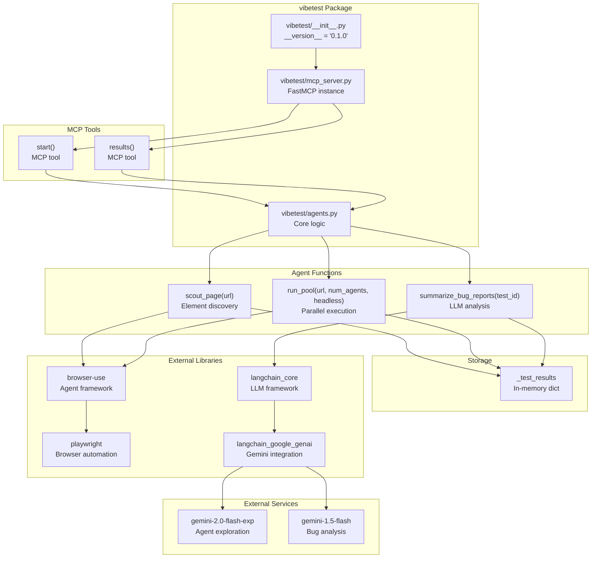
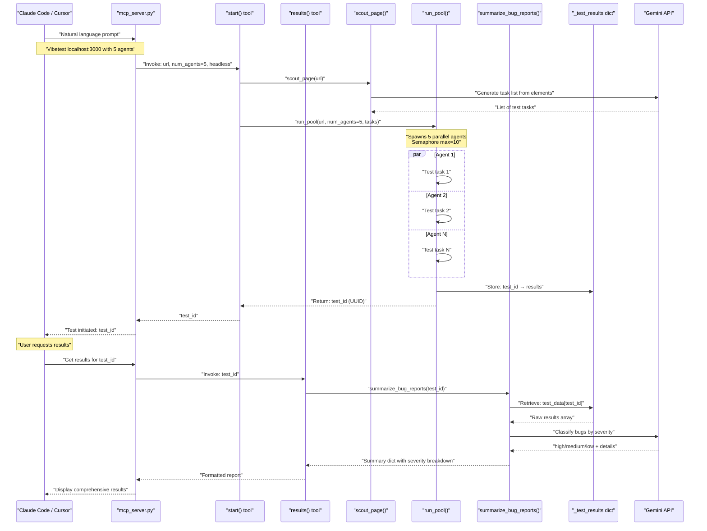

<!-- source: DeepWiki mcp.deepwiki.com · repo browser-use/vibetest-use · page 1 Overview · fetched 2026-10-30 -->

# Overview

<details>
<summary>Relevant source files</summary>

The following files were used as context for generating this wiki page:

- [README.md](README.md)
- [vibetest.egg-info/PKG-INFO](vibetest.egg-info/PKG-INFO)
- [vibetest/__init__.py](vibetest/__init__.py)

</details>


## Purpose and Scope

Vibetest Use is a browser-agent QA swarm system that performs automated testing of AI-generated websites. The system integrates with MCP-compatible IDEs (Claude Code and Cursor) to provide natural language-driven testing through multiple parallel browser agents. It identifies UI bugs, broken links, accessibility issues, and technical problems through AI-powered browser automation.

This overview covers the system's purpose, architecture, and integration patterns. For installation instructions, see [Getting Started](#2). For component implementation details, see [Core Components](#4).

Sources: [README.md:1-13](), [vibetest/__init__.py:1-3]()

## What is Vibetest Use

Vibetest Use is a Python package (version 0.1.0) that functions as an MCP (Model Context Protocol) server, exposing website testing capabilities to IDEs. The package name is `vibetest` and the entry point is `vibetest-mcp`. The system spawns multiple browser agents that work in parallel to comprehensively test websites, from live production sites to localhost development servers.

The system follows a three-phase workflow:
1. **Scout Phase**: Function `scout_page()` inventories interactive elements on the target website using a headless browser agent
2. **Task Generation**: Google Gemini AI partitions discovered elements into specific testable QA tasks
3. **Parallel Execution**: Function `run_pool()` spawns multiple browser agents (default: 3) that execute different test scenarios simultaneously with semaphore-controlled concurrency (max: 10)
4. **Result Analysis**: Function `summarize_bug_reports()` uses Gemini LLM to classify bugs by severity (high/medium/low) and generate comprehensive reports

Sources: [README.md:3-13](), [vibetest/__init__.py:1-3](), [vibetest.egg-info/PKG-INFO:1-13]()

## System Architecture Overview

### Core System Components and Code Structure

The following diagram maps high-level system concepts to actual code entities (files, functions, and dependencies):



**Key Code Entities:**
- **Entry Point**: `vibetest-mcp` command invokes `vibetest/mcp_server.py`
- **MCP Tools**: `start()` and `results()` exposed to IDEs via FastMCP
- **Core Functions**: `scout_page()`, `run_pool()`, `summarize_bug_reports()` in `vibetest/agents.py`
- **Storage**: `_test_results` dictionary stores test data indexed by UUID test_id
- **AI Models**: gemini-2.0-flash-exp for agent exploration, gemini-1.5-flash for result analysis

Sources: [README.md:1-96](), [vibetest/__init__.py:1-3](), [vibetest.egg-info/PKG-INFO:1-13]()

## MCP Integration and Workflow

### MCP Tool Invocation Flow

The following sequence diagram shows how IDE prompts translate to function calls and data transformations:



**Data Flow:**
1. **Input**: Natural language prompt → parsed parameters (url, num_agents, headless)
2. **Scouting**: `scout_page()` returns task list via LLM
3. **Execution**: `run_pool()` distributes tasks round-robin, stores results with UUID test_id
4. **Storage**: `_test_results[test_id] = {"url": str, "results": array, "duration": float, "timestamp": time}`
5. **Analysis**: `summarize_bug_reports()` retrieves results, uses LLM for severity classification
6. **Output**: Summary dict with overall_status, status_emoji, total_issues, severity_breakdown, duration

Sources: [README.md:27-69]()

## Key Capabilities

### Supported Test Targets

The `start()` MCP tool accepts any valid URL:

| Target Type | Example | Usage |
|-------------|---------|-------|
| Live Websites | `https://browser-use.com` | Full URL with protocol |
| Localhost Development | `localhost:3000` | Implicit http:// protocol |
| Custom Development | `http://dev.mysite.com` | Custom domain/port |

Sources: [README.md:66-72]()

### Configurable Parameters

Parameters exposed through the `start()` MCP tool:

| Parameter | Type | Default | Range | Function Parameter |
|-----------|------|---------|-------|-------------------|
| `url` | str | Required | Any valid URL | `run_pool(url, ...)` |
| `num_agents` | int | 3 | 1 to N | `run_pool(..., num_agents, ...)` |
| `headless` | bool | False | True/False | `run_pool(..., headless)` |

**Natural Language Parsing:**
- `"5 agents"` → `num_agents=5`
- `"headless"` → `headless=True`
- `"non-headless"` (default) → `headless=False`

Sources: [README.md:64-74]()

### Test Coverage Areas

The `scout_page()` function discovers and the agent pool tests:

- **UI Bug Detection**: Visual inconsistencies, layout issues, responsive design
- **Link Validation**: Broken links, redirect chains, 404 errors
- **Accessibility Testing**: ARIA compliance, keyboard navigation, screen reader support
- **Technical Issues**: JavaScript errors, console warnings, form validation
- **Interactive Elements**: Buttons, forms, dropdowns, modals, navigation

Sources: [README.md:3-13]()

## IDE Integration

### IDE Configuration Methods

The `vibetest-mcp` entry point integrates with MCP-compatible IDEs:

**Claude Code CLI:**
```bash
claude mcp add vibetest /path/to/.venv/bin/vibetest-mcp -e GOOGLE_API_KEY="key"
```

**Cursor Manual Configuration:**
```json
{
  "mcpServers": {
    "vibetest": {
      "command": "/path/to/.venv/bin/vibetest-mcp",
      "env": {
        "GOOGLE_API_KEY": "your_api_key"
      }
    }
  }
}
```

Sources: [README.md:27-62]()

### Natural Language Interface

Both IDEs expose the MCP tools through natural language prompts:

| User Prompt | MCP Tool | Parsed Parameters |
|-------------|----------|-------------------|
| `"Vibetest my website with 5 agents: browser-use.com"` | `start()` | `url="browser-use.com", num_agents=5, headless=False` |
| `"Run vibetest on localhost:3000"` | `start()` | `url="localhost:3000", num_agents=3, headless=False` |
| `"Run a headless vibetest on localhost:8080 with 10 agents"` | `start()` | `url="localhost:8080", num_agents=10, headless=True` |
| `"Get results for test abc-123"` | `results()` | `test_id="abc-123"` |

The IDE's MCP client translates natural language into JSON-RPC calls to `vibetest/mcp_server.py`, which dispatches to the appropriate tool function.

Sources: [README.md:64-69]()

## Technology Foundation

vibetest-use builds on several key technologies:

- **Browser-Use**: Provides the core browser automation framework with AI-driven web interaction
- **Playwright**: Handles actual browser control and web page manipulation
- **FastMCP**: Implements the MCP server protocol for IDE integration
- **LangChain + Google Gemini**: Powers AI-driven task generation and result analysis
- **Pydantic**: Ensures type safety and data validation throughout the system

The system requires Python 3.11+ and a Google API key for Gemini model access.

Sources: [README.md:69-73](), [README.md:88]()

---

