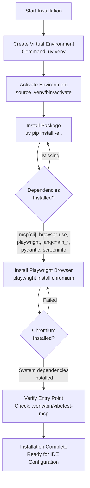
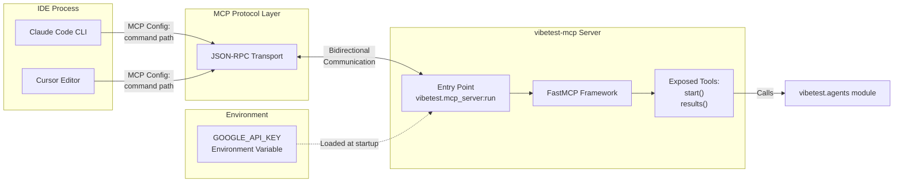
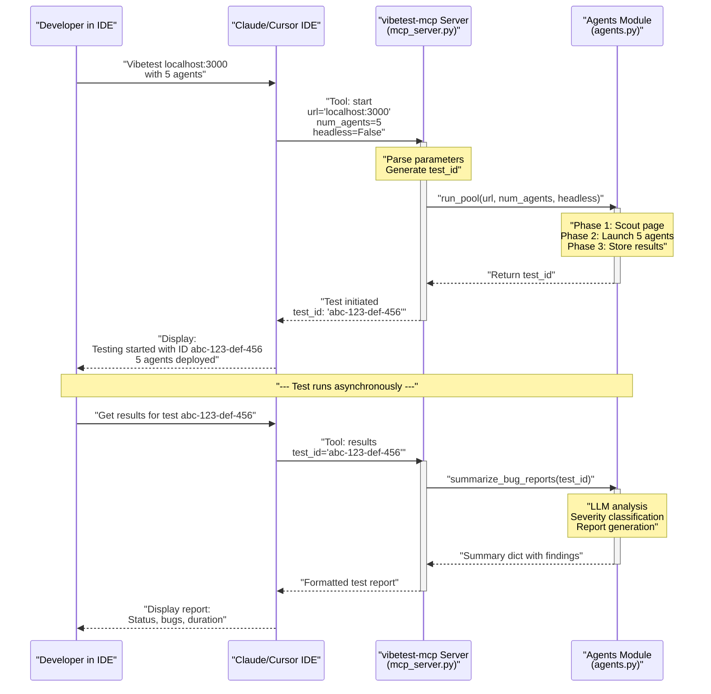

<!-- source: DeepWiki mcp.deepwiki.com · repo browser-use/vibetest-use · page 2 Getting Started · fetched 2026-10-30 -->

# Getting Started

<details>
<summary>Relevant source files</summary>

The following files were used as context for generating this wiki page:

- [README.md](README.md)
- [pyproject.toml](pyproject.toml)
- [vibetest.egg-info/entry_points.txt](vibetest.egg-info/entry_points.txt)
- [vibetest.egg-info/requires.txt](vibetest.egg-info/requires.txt)

</details>


This guide provides step-by-step instructions for installing Vibetest Use, configuring it with your IDE, and running your first automated QA test. By the end of this guide, you will have a working MCP server that can launch browser-agent swarms to test websites.

For a high-level understanding of the system architecture and components, see [System Architecture](#3) and [Core Components](#4). For detailed configuration options, see [Configuration and Environment](#7).

## Prerequisites

Before installation, ensure you have:

| Requirement | Details |
|-------------|---------|
| **Python** | Version 3.11 or higher |
| **Google API Key** | Required for Gemini LLM access ([obtain here](https://developers.google.com/maps/api-security-best-practices)) |
| **MCP-Compatible IDE** | Claude Code CLI or Cursor with MCP support enabled |
| **Operating System** | Linux, macOS, or Windows with WSL |

**Sources**: [README.md:76-80]()

## Installation Process

### Step 1: Create Virtual Environment

The system uses `uv` for fast Python package management. Create and activate a virtual environment:

```bash
uv venv
source .venv/bin/activate  # On Windows: .venv\Scripts\activate
```

This creates an isolated Python environment in the `.venv` directory where all dependencies will be installed.

**Sources**: [README.md:17-20]()

### Step 2: Install Python Dependencies

Install the package in editable mode to enable development and updates:

```bash
uv pip install -e .
```

This command installs the core dependencies specified in [pyproject.toml:6-14]():

| Package | Purpose |
|---------|---------|
| `mcp[cli]>=1.0.0` | FastMCP framework for server implementation |
| `browser-use` | Browser agent automation library |
| `playwright` | Headless browser control |
| `langchain_google_genai` | Google Gemini API integration |
| `langchain_core` | LangChain framework core |
| `pydantic` | Data validation and settings management |
| `screeninfo` | Display information for browser window sizing |

**Sources**: [pyproject.toml:6-14](), [vibetest.egg-info/requires.txt:1-8]()

### Step 3: Install Playwright Browser

Install the Chromium browser with system dependencies:

```bash
playwright install chromium --with-deps --no-shell
```

The `--with-deps` flag installs required system libraries (fonts, media codecs), and `--no-shell` prevents unnecessary shell integration. This step is required for the browser-use agents to function.

**Sources**: [README.md:23-24]()

### Installation Verification Diagram



**Sources**: [README.md:17-24](), [pyproject.toml:6-14]()

## IDE Configuration

The MCP server must be registered with your IDE to enable natural language test commands. The server entry point is defined as `vibetest.mcp_server:run` in [vibetest.egg-info/entry_points.txt:1-2]() and creates the executable `vibetest-mcp`.

### Option 1: Claude Code (CLI)

Add the MCP server using Claude's built-in command:

```bash
claude mcp add vibetest /full/path/to/vibetest-use/.venv/bin/vibetest-mcp -e GOOGLE_API_KEY="your_api_key"
```

**Important**: Replace `/full/path/to/vibetest-use` with the absolute path to your installation directory, and `your_api_key` with your actual Google API key.

Verify the server is connected:

```bash
claude
> /mcp
```

Expected output:
```
⎿  MCP Server Status
   • vibetest: connected
```

**Sources**: [README.md:27-40]()

### Option 2: Cursor (Manual Configuration)

Cursor requires manual configuration file editing:

1. Open Cursor Settings
2. Navigate to **MCP** in the left sidebar
3. Click **Add Server** or the **+** button
4. Edit the configuration JSON directly:

```json
{
  "mcpServers": {
    "vibetest": {
      "command": "/full/path/to/vibetest-use/.venv/bin/vibetest-mcp",
      "env": {
        "GOOGLE_API_KEY": "your_api_key"
      }
    }
  }
}
```

**Configuration Details**:
- `"vibetest"`: Server name (used to identify this MCP server)
- `"command"`: Absolute path to the `vibetest-mcp` executable
- `"env"`: Environment variables passed to the server process
- `"GOOGLE_API_KEY"`: Required for Gemini LLM access

**Sources**: [README.md:42-62]()

### MCP Server Connection Architecture



**Sources**: [README.md:27-62](), [vibetest.egg-info/entry_points.txt:1-2](), [pyproject.toml:19-20]()

## Running Your First Vibetest

Once the IDE is configured, you can initiate tests using natural language prompts. The MCP server interprets these prompts and extracts test parameters.

### Basic Test Commands

The system accepts flexible natural language input. Here are common patterns:

| Prompt Pattern | Example | Parsed Parameters |
|----------------|---------|-------------------|
| Basic URL test | `Vibetest my website with 5 agents: browser-use.com` | url: `browser-use.com`, agents: 5, headless: false |
| Localhost test | `Run vibetest on localhost:3000` | url: `localhost:3000`, agents: 3, headless: false |
| Headless test | `Run a headless vibetest on localhost:8080 with 10 agents` | url: `localhost:8080`, agents: 10, headless: true |

**Sources**: [README.md:64-69]()

### Understanding Test Parameters

The MCP server's `start` tool accepts three parameters:

| Parameter | Type | Default | Description |
|-----------|------|---------|-------------|
| `url` | string | Required | Target website (supports `https://`, `http://`, or bare domains; auto-prefixes `http://` for localhost) |
| `num_agents` | integer | 3 | Number of parallel QA agents (recommended: 3-10; max limited by system resources) |
| `headless` | boolean | false | Browser visibility mode (false = visible windows, true = headless execution) |

**Browser Visibility Modes**:
- **Non-headless** (default): Opens visible browser windows for each agent, useful for debugging and watching test execution
- **Headless**: Runs browsers without UI, faster and more resource-efficient for automated testing

**Sources**: [README.md:71-74]()

### First Test Execution Flow



**Sources**: [README.md:64-74]()

## Verification

After installation and configuration, verify the system is working:

### Check 1: MCP Server Status

In Claude Code:
```bash
> /mcp
```

In Cursor:
- Check for the green connection indicator next to "vibetest" in MCP settings

### Check 2: Test the Tools

Run a simple test command:
```
Run vibetest on browser-use.com with 3 agents
```

Expected behavior:
1. **Immediate response**: Test ID returned (e.g., `abc-123-def-456`)
2. **Browser launch**: 3 Chromium windows open (unless headless mode)
3. **Agent activity**: Visible navigation and interaction with the website
4. **Results available**: After completion, request results using the test ID

### Check 3: Retrieve Results

After the test completes:
```
Get results for test abc-123-def-456
```

Expected response structure:
- Overall status (✅ All passed / ⚠️ Issues found / ❌ Critical issues)
- Total issues count
- Severity breakdown (High/Medium/Low)
- Duration in seconds and formatted time
- Detailed findings per agent

**Sources**: [README.md:33-40]()

## Common Installation Issues

| Issue | Solution |
|-------|----------|
| `vibetest-mcp` command not found | Ensure virtual environment is activated and package installed with `-e` flag |
| Playwright browser missing | Run `playwright install chromium --with-deps --no-shell` |
| `GOOGLE_API_KEY` error | Verify API key is set in IDE configuration's `env` section |
| MCP server not connecting | Check absolute path to `vibetest-mcp` executable is correct |
| Permission denied on Linux | Ensure `vibetest-mcp` is executable: `chmod +x .venv/bin/vibetest-mcp` |

## Next Steps

Now that you have Vibetest Use installed and configured:

- **Understand the architecture**: See [System Architecture](#3) for how components interact
- **Learn about agents**: See [Agent Orchestration System](#4.2) for details on the three-phase testing model
- **Configure advanced options**: See [Configuration and Environment](#7) for parameter tuning
- **Explore the API**: See [API Reference](#9) for programmatic usage

**Sources**: [README.md:1-96](), [pyproject.toml:1-20]()

---

