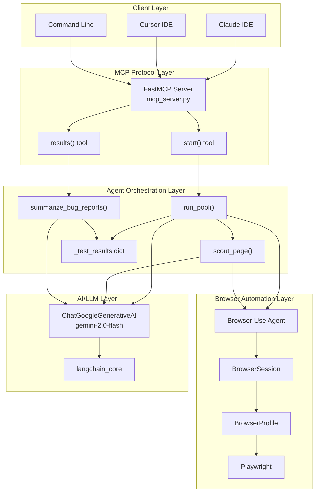
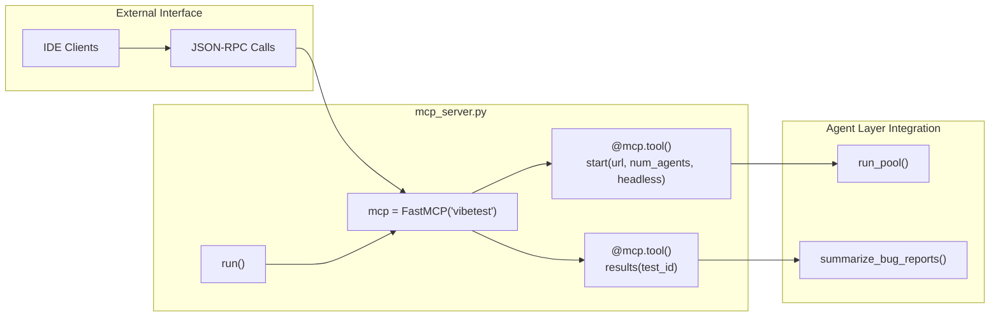
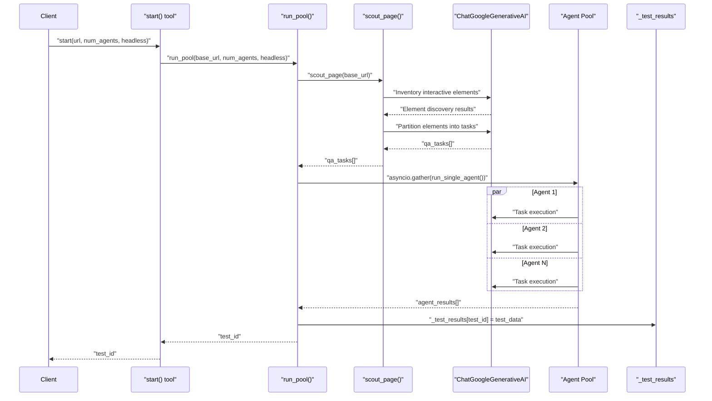
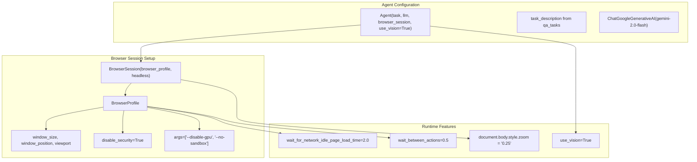
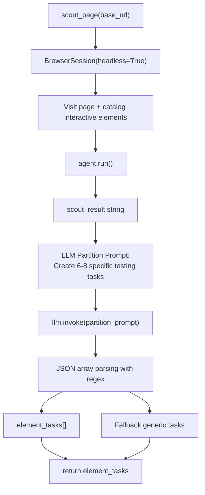
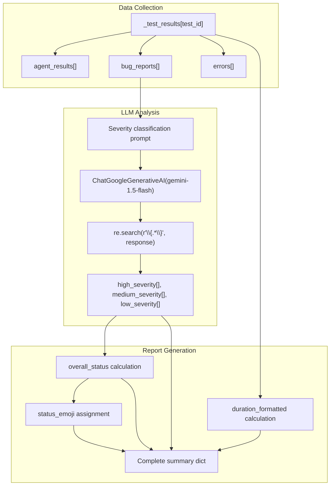

<!-- source: DeepWiki mcp.deepwiki.com · repo browser-use/vibetest-use · page 3 System Architecture · fetched 2026-10-30 -->

# System Architecture

Relevant source files

The following files were used as context for generating this wiki page:

- [README.md](README.md)
- [vibetest/agents.py](vibetest/agents.py)
- [vibetest/mcp_server.py](vibetest/mcp_server.py)

This document provides a detailed explanation of how vibetest-use works internally, covering the MCP server implementation, agent orchestration system, and browser automation components. It focuses on the technical architecture and interactions between core system components.

For setup and installation instructions, see [Getting Started](#2). For detailed API documentation of individual components, see [Core Components](#4).

## Overview

vibetest-use implements a distributed website testing system built around three main architectural layers: an MCP (Model Context Protocol) server interface, an agent orchestration system, and a browser automation engine. The system coordinates multiple parallel browser agents to perform comprehensive QA testing of web applications.

### High-Level Architecture

Sources: [vibetest/mcp_server.py:1-87](), [vibetest/agents.py:1-453](), [README.md:1-89]()

## MCP Server Interface

The system's entry point is a FastMCP server that exposes two primary tools for test orchestration. The server handles JSON-RPC communication and provides a clean interface for external clients.

### Server Implementation

The `start()` tool accepts a URL and configuration parameters, then delegates to `run_pool()` for agent coordination. The `results()` tool retrieves test outcomes via `summarize_bug_reports()` and enriches them with timing data from the `_test_results` global store.

Sources: [vibetest/mcp_server.py:19-84]()

## Agent Orchestration System

The core orchestration logic resides in the `agents.py` module, implementing a multi-phase testing workflow: reconnaissance, task generation, parallel execution, and result analysis.

### Agent Workflow

Sources: [vibetest/agents.py:21-187](), [vibetest/agents.py:370-453]()

### Agent Pool Management

The `run_pool()` function implements sophisticated agent lifecycle management with parallel execution controls:

| Component | Implementation | Purpose |
|-----------|----------------|---------|
| **Semaphore Control** | `asyncio.Semaphore(min(num_agents, 10))` | Limits concurrent browser instances |
| **Window Positioning** | Screen dimension calculation + offset logic | Arranges non-headless browser windows |
| **Browser Configuration** | `BrowserProfile` with security disabled | Optimizes automation performance |
| **Error Handling** | Per-agent exception isolation | Ensures partial test completion |
| **Process Cleanup** | `pkill -f chromium` on macOS | Prevents resource leaks |

The system creates unique `BrowserSession` instances for each agent, with custom `BrowserProfile` configurations that handle both headless and visual modes.

Sources: [vibetest/agents.py:33-187](), [vibetest/agents.py:76-86]()

## Browser Automation Engine

Each agent operates through the Browser-Use library, which provides high-level automation capabilities built on Playwright. The system configures browser instances with specific profiles optimized for QA testing.

### Browser Instance Configuration

Non-headless mode implements sophisticated window positioning logic that calculates screen dimensions and arranges browser windows in a grid pattern to enable visual monitoring of multiple agents.

Sources: [vibetest/agents.py:76-112](), [vibetest/agents.py:44-74]()

## Task Generation and Execution

The system uses a two-phase approach for test case generation: initial reconnaissance via `scout_page()` followed by LLM-driven task partitioning.

### Scout-Based Task Generation

The scout agent operates in headless mode to minimize resource usage and performs comprehensive element discovery. The LLM then partitions discovered elements into specific, non-overlapping test scenarios.

Sources: [vibetest/agents.py:370-453](), [vibetest/agents.py:406-441]()

## Result Processing and Analysis

Test results undergo structured analysis through the `summarize_bug_reports()` function, which applies LLM-based severity classification and generates standardized reports.

### Analysis Pipeline

The analysis pipeline implements strict criteria for issue classification, requiring specific technical problems rather than subjective design opinions. Results include detailed severity breakdowns with actionable descriptions.

Sources: [vibetest/agents.py:191-368](), [vibetest/agents.py:240-281]()

## Data Storage and State Management

The system maintains test state through a global `_test_results` dictionary that persists throughout the server's lifecycle. Each test receives a UUID identifier and comprehensive metadata.

### Test Data Structure

| Field | Type | Description |
|-------|------|-------------|
| `test_id` | `str` | UUID identifier from `uuid.uuid4()` |
| `url` | `str` | Target URL being tested |
| `agents` | `int` | Number of agents spawned |
| `start_time` | `float` | Unix timestamp from `time.time()` |
| `end_time` | `float` | Completion timestamp |
| `duration` | `float` | Calculated execution time |
| `results` | `list` | Array of agent result dictionaries |
| `status` | `str` | Overall test status |

Individual agent results contain task descriptions, execution outcomes, timestamps, and error details when applicable.

Sources: [vibetest/agents.py:10](), [vibetest/agents.py:174-186]()

---

