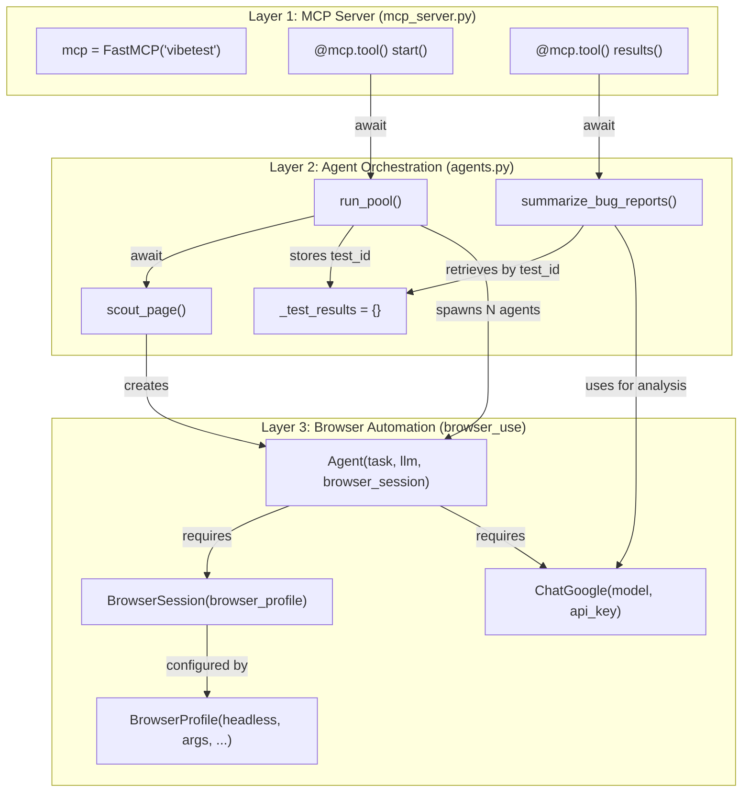
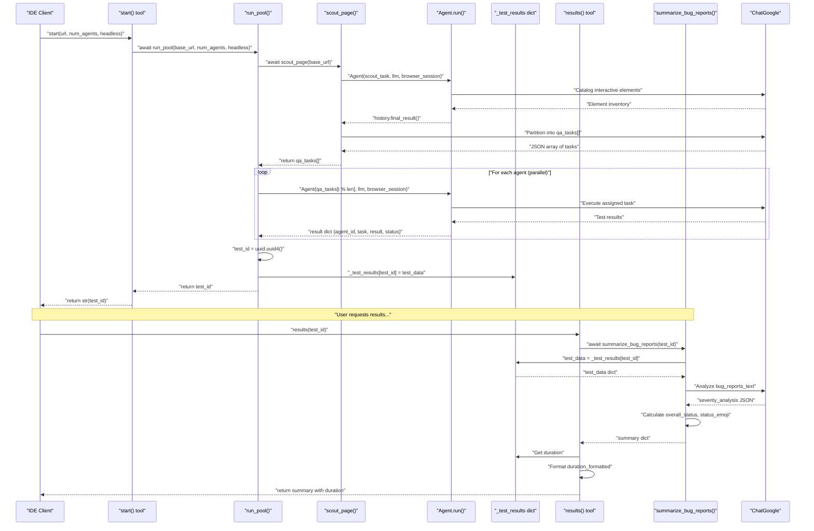
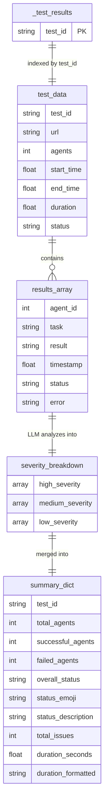
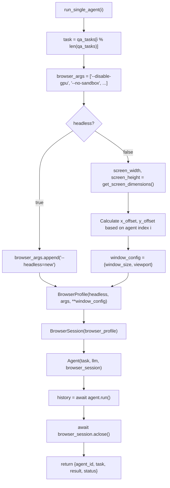

<!-- source: DeepWiki mcp.deepwiki.com · repo browser-use/vibetest-use · page 4 Core Components · fetched 2026-10-30 -->

# Core Components

<details>
<summary>Relevant source files</summary>

The following files were used as context for generating this wiki page:

- [vibetest/agents.py](vibetest/agents.py)
- [vibetest/mcp_server.py](vibetest/mcp_server.py)

</details>


The Vibetest Use system consists of three primary layers that work together to provide AI-powered website testing through browser agents. This page provides an overview of these components and their interactions. For detailed documentation of specific components, see the child pages:

- **Page 4.1** - MCP Server Interface: The FastMCP server that exposes testing tools to IDEs
- **Page 4.2** - Agent Orchestration System: The three-phase agent execution model including scout agent, QA agent pool, and results analysis

This overview focuses on how the components communicate and the key data structures that flow between them.

## Three-Layer Architecture

The system is organized into three distinct layers, each implemented in separate modules:

**Layer 1: MCP Interface** (`vibetest/mcp_server.py`)
- `FastMCP("vibetest")` - The MCP server instance
- `start()` tool - Initiates testing and returns `test_id`
- `results()` tool - Retrieves summarized test results

**Layer 2: Agent Orchestration** (`vibetest/agents.py`)
- `run_pool()` - Orchestrates scout and QA agents
- `scout_page()` - Discovers page elements and generates tasks
- `summarize_bug_reports()` - Analyzes results using LLM
- `_test_results` - In-memory storage dictionary

**Layer 3: Browser Automation** (via `browser_use` library)
- `Agent` - Browser agent with LLM-driven actions
- `BrowserSession` - Playwright session wrapper
- `ChatGoogle` - Google Gemini LLM integration

### Component Interaction Diagram



**Sources:** [vibetest/mcp_server.py:13-17](), [vibetest/mcp_server.py:19-38](), [vibetest/mcp_server.py:40-76](), [vibetest/agents.py:1-3](), [vibetest/agents.py:12](), [vibetest/agents.py:23-170](), [vibetest/agents.py:174-361](), [vibetest/agents.py:363-473]()

## Execution Flow

The following sequence diagram shows the complete execution flow from tool invocation to result retrieval, including all function calls and data structures:



**Sources:** [vibetest/mcp_server.py:20-38](), [vibetest/mcp_server.py:41-76](), [vibetest/agents.py:23-170](), [vibetest/agents.py:363-473](), [vibetest/agents.py:174-361]()

## Component Function Mapping

| Layer | Module | Key Functions | Returns | Storage |
|-------|--------|---------------|---------|---------|
| **MCP Interface** | `mcp_server.py` | `start()`, `results()` | `str` (test_id), `dict` (summary) | None (delegates to agents) |
| **Orchestration** | `agents.py` | `run_pool()`, `scout_page()`, `summarize_bug_reports()` | `str` (test_id), `list` (tasks), `dict` (summary) | `_test_results` dict |
| **Automation** | `browser_use` | `Agent.run()`, `BrowserSession.aclose()` | `history` object | Browser state |
| **LLM** | `browser_use.llm` | `ChatGoogle.ainvoke()` | Response object | API state |

### Key Imports and Dependencies

```
vibetest/mcp_server.py:
    from mcp.server.fastmcp import FastMCP
    from .agents import run_pool, summarize_bug_reports

vibetest/agents.py:
    from browser_use import Agent, BrowserSession, BrowserProfile
    from browser_use.llm import ChatGoogle
    from browser_use.llm.messages import UserMessage
```

**Sources:** [vibetest/mcp_server.py:13-14](), [vibetest/agents.py:1-3](), [vibetest/agents.py:29-32](), [vibetest/agents.py:265-266]()

## Data Structures

The `_test_results` dictionary stores all test execution data using `test_id` as the key. The data structures flow through the system in three stages:

### Storage Schema



### Data Flow Through Functions

| Function | Input | Output | Side Effects |
|----------|-------|--------|--------------|
| `run_pool()` | `base_url`, `num_agents`, `headless` | `test_id` (str) | Stores in `_test_results[test_id]` |
| `scout_page()` | `base_url` | `qa_tasks` (list of str) | Creates temporary browser |
| `summarize_bug_reports()` | `test_id` | `summary` (dict) | Reads from `_test_results[test_id]` |
| `start()` tool | `url`, `num_agents`, `headless` | `test_id` (str) | Calls `run_pool()` |
| `results()` tool | `test_id` | `summary` (dict) | Calls `summarize_bug_reports()`, adds duration |

**Sources:** [vibetest/agents.py:12](), [vibetest/agents.py:157-169](), [vibetest/agents.py:116-122](), [vibetest/agents.py:203-210](), [vibetest/agents.py:303-331](), [vibetest/mcp_server.py:57-72]()

## Browser Configuration

The `run_pool()` function contains an internal `run_single_agent()` async function that configures each browser instance with optimized settings:

### Browser Configuration Flow



### Concurrency Control

The agents execute in parallel with a semaphore limit:

```python
# Line 140-149 in agents.py
semaphore = asyncio.Semaphore(min(num_agents, 10))

async def run_agent_with_semaphore(i: int):
    async with semaphore:
        return await run_single_agent(i)

results = await asyncio.gather(
    *[run_agent_with_semaphore(i) for i in range(num_agents)],
    return_exceptions=True
)
```

The system limits concurrent browser instances to a maximum of 10, regardless of the requested `num_agents` value.

**Sources:** [vibetest/agents.py:35-149](), [vibetest/agents.py:14-21](), [vibetest/agents.py:40-99](), [vibetest/agents.py:140-149]()

## AI Integration Points

The system integrates with Google's Gemini models at three critical points:

| Integration Point | Model | Temperature | Purpose |
|------------------|--------|-------------|---------|
| **scout_page()** | `gemini-1.5-flash` | 0.1 | Element discovery and task generation |
| **run_single_agent()** | `gemini-2.0-flash` | 0.9 | QA task execution with high creativity |
| **summarize_bug_reports()** | `gemini-1.5-flash` | 0.1 | Structured analysis and severity classification |

Each integration point uses `ChatGoogleGenerativeAI` with specific configurations optimized for its role in the testing pipeline.

**Sources:** [vibetest/agents.py:27-31](), [vibetest/agents.py:373-377](), [vibetest/agents.py:233-238]()

---

