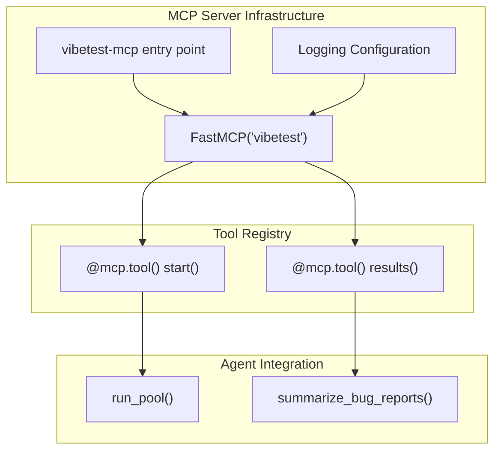
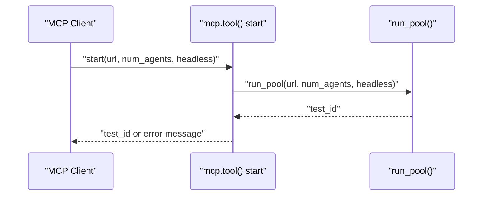
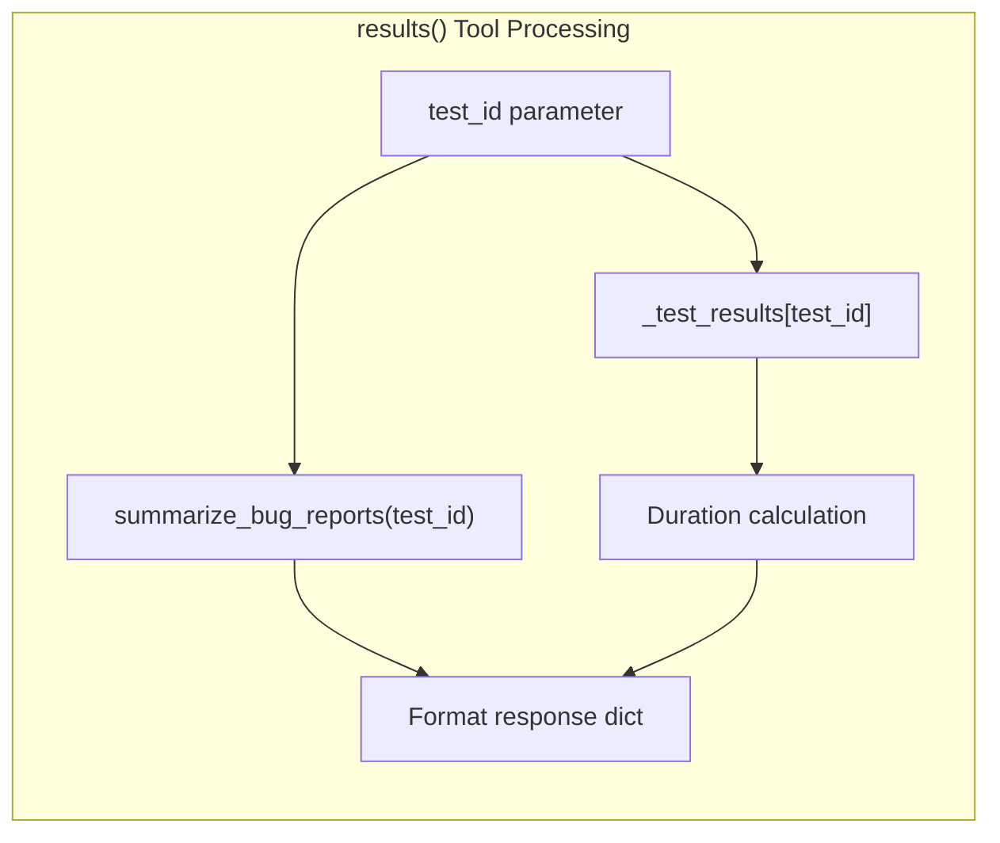
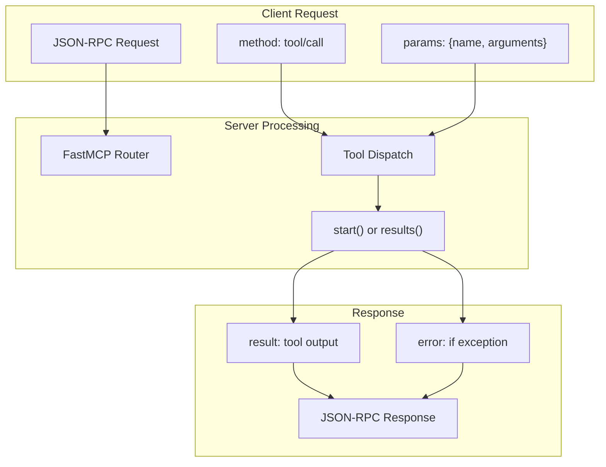
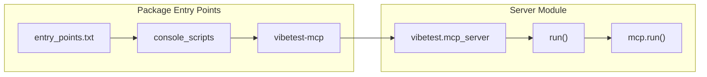
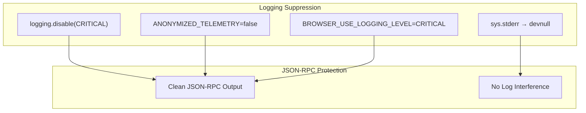
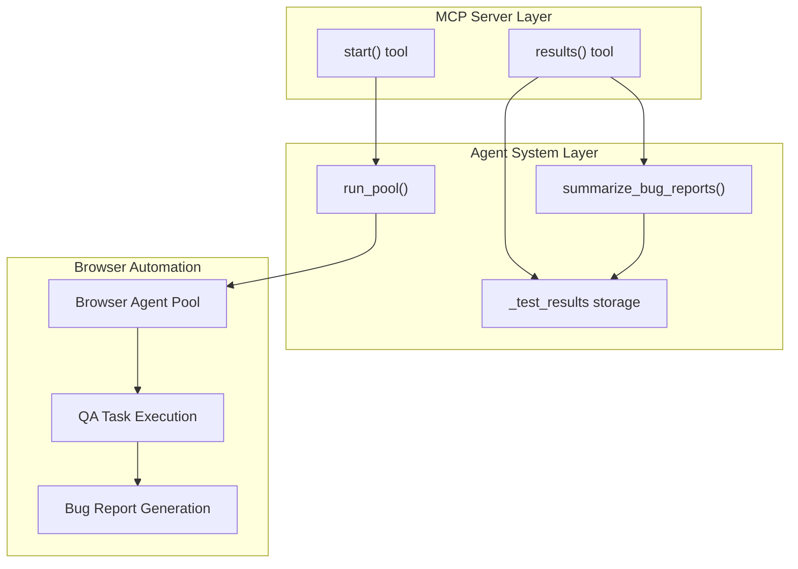

<!-- source: DeepWiki mcp.deepwiki.com · repo browser-use/vibetest-use · page 4.1 MCP Server Interface · fetched 2026-10-30 -->

# MCP Server Interface

Relevant source files

The following files were used as context for generating this wiki page:

- [vibetest.egg-info/entry_points.txt](vibetest.egg-info/entry_points.txt)
- [vibetest/mcp_server.py](vibetest/mcp_server.py)

This document covers the Model Context Protocol (MCP) server implementation in vibetest-use, including the FastMCP server setup, available tools, and JSON-RPC communication patterns. The MCP server acts as the primary interface between IDE clients (Claude, Cursor) and the browser automation system.

For information about the underlying browser agent system that the MCP server orchestrates, see [Browser Agent System](#4.2). For overall system architecture context, see [System Architecture](#3).

## FastMCP Server Implementation

The MCP server is implemented using the FastMCP framework in [vibetest/mcp_server.py](). The server is instantiated as a singleton instance named `mcp` and provides a clean interface for website testing operations.

The server includes extensive logging suppression to prevent interference with JSON-RPC communication:

**Sources:** [vibetest/mcp_server.py:1-19]()

## Available Tools

The MCP server exposes two primary tools for website testing operations.

### start Tool

The `start` tool initiates a new website testing session with configurable parameters:

| Parameter | Type | Default | Description |
|-----------|------|---------|-------------|
| `url` | str | required | Target website URL to test |
| `num_agents` | int | 3 | Number of QA agents to spawn |
| `headless` | bool | False | Browser headless mode setting |

The tool returns a unique `test_id` string for tracking the test session or an error message if initialization fails.

**Sources:** [vibetest/mcp_server.py:21-37]()

### results Tool

The `results` tool retrieves consolidated bug reports for completed test runs:

| Parameter | Type | Description |
|-----------|------|-------------|
| `test_id` | str | Test ID returned from start tool |

The tool returns a comprehensive dictionary containing:
- Test results with detailed findings
- Duration information (seconds and formatted)
- Bug severity classifications
- Error details if retrieval fails

**Sources:** [vibetest/mcp_server.py:39-75]()

## JSON-RPC Communication Patterns

The FastMCP framework handles JSON-RPC protocol details automatically. The server communicates with MCP clients using standard JSON-RPC 2.0 message format:

Error handling is implemented with try-catch blocks that return structured error messages rather than raising exceptions that could disrupt JSON-RPC communication.

**Sources:** [vibetest/mcp_server.py:33-37](), [vibetest/mcp_server.py:49-75]()

## Entry Point Configuration

The MCP server is configured as a console script entry point through the Python packaging system:

The entry point maps the `vibetest-mcp` command to the `run()` function in the MCP server module, enabling command-line execution and MCP client integration.

**Sources:** [vibetest.egg-info/entry_points.txt:1-3](), [vibetest/mcp_server.py:77-86]()

## Error Handling and Logging

The server implements comprehensive error suppression to ensure clean JSON-RPC communication:

| Configuration | Purpose |
|---------------|---------|
| `logging.disable(logging.CRITICAL)` | Completely disable Python logging |
| `ANONYMIZED_TELEMETRY=false` | Disable telemetry output |
| `BROWSER_USE_LOGGING_LEVEL=CRITICAL` | Suppress browser-use logging |
| `sys.stderr` redirection | Redirect stderr to devnull |

**Sources:** [vibetest/mcp_server.py:6-13]()

## Integration with Agent System

The MCP server acts as a facade for the underlying browser agent system, providing simplified tool interfaces while delegating complex operations:

The server maintains stateless tool interfaces while the agent system handles stateful test execution and result storage.

**Sources:** [vibetest/mcp_server.py:16](), [vibetest/mcp_server.py:34](), [vibetest/mcp_server.py:50](), [vibetest/mcp_server.py:56-57]()

---

