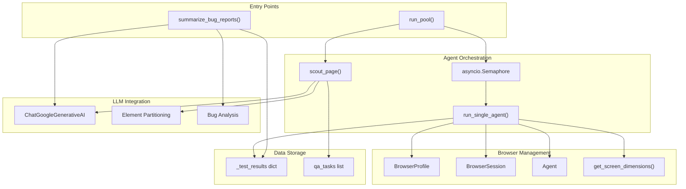
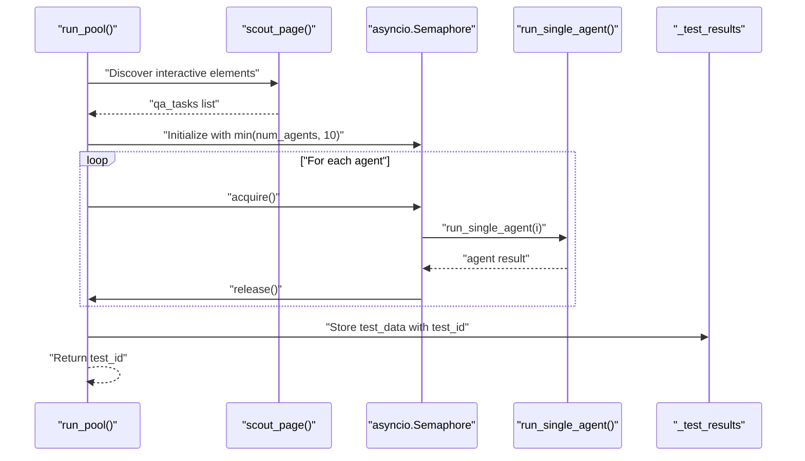
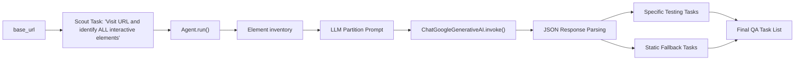
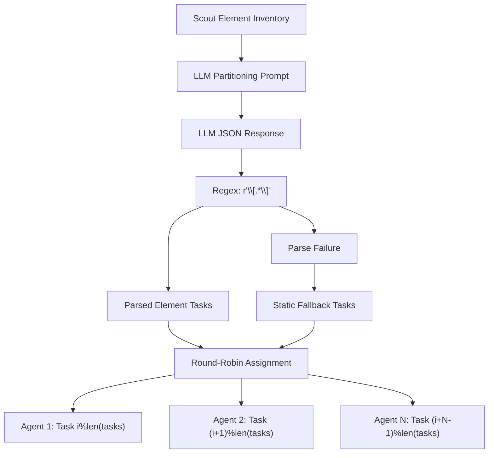
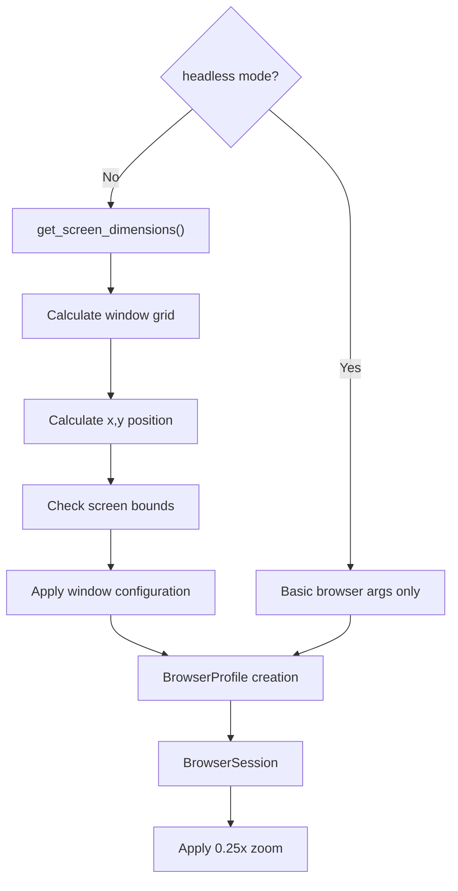
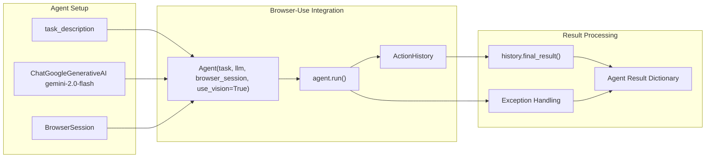
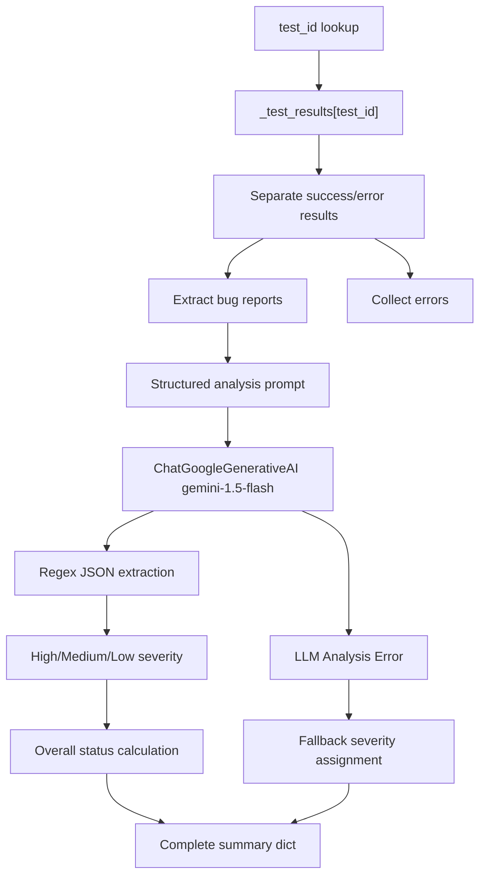
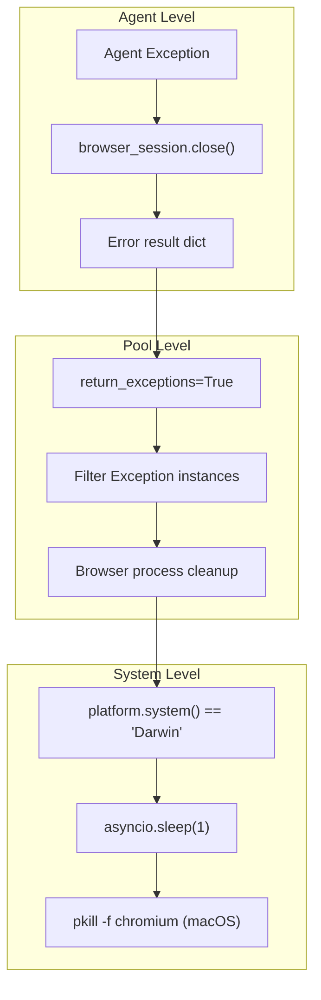

<!-- source: DeepWiki mcp.deepwiki.com · repo browser-use/vibetest-use · page 4.2 Agent Orchestration System · fetched 2026-10-30 -->

# Browser Agent System

<details>
<summary>Relevant source files</summary>

The following files were used as context for generating this wiki page:

- [vibetest/agents.py](vibetest/agents.py)

</details>


## Purpose and Scope

The Browser Agent System is the core automation engine of vibetest-use, responsible for orchestrating multiple concurrent browser agents to test website functionality. This system handles agent pool management, task distribution, browser configuration, and result aggregation. It implements a scout-then-test pattern where one agent discovers interactive elements before multiple agents execute specialized testing tasks in parallel.

For information about the MCP server interface that calls into this system, see [MCP Server Interface](#4.1). For details about dependencies and requirements, see [Dependencies and Requirements](#5).

## System Architecture Overview

The Browser Agent System operates through several interconnected components that manage the complete testing lifecycle from element discovery to result analysis.

**Browser Agent System Architecture**


Sources: [vibetest/agents.py:21-187](), [vibetest/agents.py:370-453](), [vibetest/agents.py:191-368]()

## Agent Pool Management

The `run_pool()` function serves as the primary entry point for coordinating multiple browser agents. It implements a semaphore-based concurrency model to control resource usage while maximizing parallel execution.

**Agent Pool Execution Flow**


The system generates a unique `test_id` using `uuid.uuid4()` and tracks execution timing for performance analysis. Agent tasks are distributed using modulo operation to cycle through available QA tasks when there are more agents than tasks.

Key implementation details:
- **Concurrency Control**: Maximum 10 concurrent agents via semaphore [vibetest/agents.py:150]()
- **Task Distribution**: Round-robin assignment using `qa_tasks[i % len(qa_tasks)]` [vibetest/agents.py:34]()
- **Exception Handling**: `return_exceptions=True` prevents single agent failures from crashing the pool [vibetest/agents.py:156-159]()

Sources: [vibetest/agents.py:21-187](), [vibetest/agents.py:149-159]()

## Scout System

The scout system implements a two-phase discovery process: initial element inventory followed by LLM-driven task partitioning. The `scout_page()` function operates in headless mode to efficiently catalog all interactive elements without visual overhead.

| Scout Phase | Function | Purpose |
|-------------|----------|---------|
| Discovery | `Agent.run()` with scout_task | Catalog all interactive elements |
| Partitioning | `ChatGoogleGenerativeAI.invoke()` | Generate specific testing tasks |
| Fallback | Static task list | Ensure testing continues if LLM fails |

**Scout Task Generation Process**


The scout uses `gemini-1.5-flash` with low temperature (0.1) for consistent element discovery. Task partitioning aims for 6-8 distinct tasks to balance thoroughness with execution time.

**Scout Configuration**:
- **Browser Profile**: Headless with security disabled [vibetest/agents.py:379-387]()
- **LLM Model**: `gemini-1.5-flash` with temperature 0.1 [vibetest/agents.py:374-377]()
- **Task Format**: JSON array with specific element descriptions [vibetest/agents.py:413-421]()

Sources: [vibetest/agents.py:370-453](), [vibetest/agents.py:406-441]()

## Task Generation and Distribution

The system employs sophisticated task partitioning to ensure comprehensive coverage without element overlap. Each generated task specifies exact elements to test, including button text, link descriptions, and form field locations.

**Task Distribution Algorithm**


The fallback task generation ensures testing continues even when LLM partitioning fails, providing coverage for common website areas:
- Header navigation elements
- Main content links and buttons  
- Footer links and elements
- Form elements
- Sidebar or secondary navigation
- Remaining interactive elements

Sources: [vibetest/agents.py:406-441](), [vibetest/agents.py:432-439]()

## Browser Configuration and Window Management

The system implements sophisticated browser configuration with dynamic window positioning for non-headless mode and optimized settings for both visual testing and headless execution.

**Window Positioning Algorithm**


**Window Configuration Parameters**:
| Parameter | Value | Purpose |
|-----------|-------|---------|
| Window Width | 300px | Compact agent windows |
| Window Height | 400px | Adequate viewport height |
| Viewport Width | 280px | Content area within window |
| Viewport Height | 350px | Content area within window |
| Margin | 10px | Screen edge spacing |
| Spacing | 15px | Inter-window spacing |

The system calculates grid positioning with `windows_per_row = max(1, usable_width // (window_width + spacing))` and applies bounds checking to prevent windows from extending beyond screen edges.

**Browser Profile Configuration**:
- **Security**: `disable_security=True` for testing flexibility [vibetest/agents.py:78]()
- **Timing**: 2.0s network idle, 8.0s max page load [vibetest/agents.py:82-83]()
- **Automation**: Ignores `--enable-automation` flag [vibetest/agents.py:81]()
- **Zoom**: 0.25x zoom applied via JavaScript for compact display [vibetest/agents.py:101-104]()

Sources: [vibetest/agents.py:12-19](), [vibetest/agents.py:42-86](), [vibetest/agents.py:94-111]()

## Agent Execution and Browser Control

Individual agent execution combines Browser-Use Agent instances with Google Gemini LLM for intelligent website interaction. Each agent operates in an isolated browser session with vision capabilities enabled.

**Agent Execution Components**


**Agent Configuration**:
- **LLM Model**: `gemini-2.0-flash` with temperature 0.9 for creative testing [vibetest/agents.py:27-31]()
- **Vision**: `use_vision=True` enables screenshot analysis [vibetest/agents.py:118]()
- **Browser Session**: Isolated session per agent with custom profile [vibetest/agents.py:88-91]()

The result dictionary structure captures comprehensive execution metadata:
```python
{
    "agent_id": int,
    "task": str,
    "result": str,  # or "error": str
    "timestamp": float,
    "status": "success" | "error"
}
```

Sources: [vibetest/agents.py:33-147](), [vibetest/agents.py:114-132]()

## Result Processing and Analysis

The `summarize_bug_reports()` function implements a sophisticated multi-stage analysis pipeline that transforms raw agent results into structured bug reports with severity classification.

**Bug Report Analysis Pipeline**


**Severity Classification Logic**:
| Condition | Status | Emoji | Description |
|-----------|--------|-------|-------------|
| High severity issues > 0 | `high-severity` | 🔴 | Critical issues need immediate attention |
| Medium severity issues > 0 | `medium-severity` | 🟠 | Moderate issues should be addressed |
| Low severity issues > 0 | `low-severity` | 🟡 | Minor issues could be improved |
| No issues found | `passing` | ✅ | No technical issues detected |

The LLM analysis prompt emphasizes objective issue identification, requiring specific details:
- Exact element descriptions (button names, link text)
- Specific actions taken (clicked, typed, submitted)
- Exact results observed (404 errors, server failures)
- Relevant context from agent testing

**Analysis Model Configuration**:
- **Model**: `gemini-1.5-flash` with temperature 0.1 for consistent analysis [vibetest/agents.py:234-238]()
- **Output Format**: Structured JSON with severity categories [vibetest/agents.py:264-281]()
- **Fallback**: Manual review classification when LLM fails [vibetest/agents.py:342-353]()

Sources: [vibetest/agents.py:191-368](), [vibetest/agents.py:240-281](), [vibetest/agents.py:304-327]()

## Error Handling and Cleanup

The system implements comprehensive error handling at multiple levels to ensure robust operation and proper resource cleanup, particularly important given the resource-intensive nature of browser automation.

**Error Handling Strategy**


**Cleanup Operations**:
1. **Individual Agent**: Browser session closure in finally block [vibetest/agents.py:135-139]()
2. **Pool Level**: Exception isolation via `return_exceptions=True` [vibetest/agents.py:158]()
3. **System Level**: Platform-specific process cleanup [vibetest/agents.py:164-171]()

**Error Result Structure**:
```python
{
    "agent_id": int,
    "task": str,
    "error": str,
    "timestamp": float,
    "status": "error"
}
```

The cleanup mechanism addresses common browser automation issues:
- **Zombie Processes**: Explicit chromium process termination on macOS
- **Resource Leaks**: Guaranteed browser session closure
- **Exception Propagation**: Isolated failures don't crash the entire pool

Sources: [vibetest/agents.py:134-147](), [vibetest/agents.py:163-171](), [vibetest/agents.py:181]()

---

