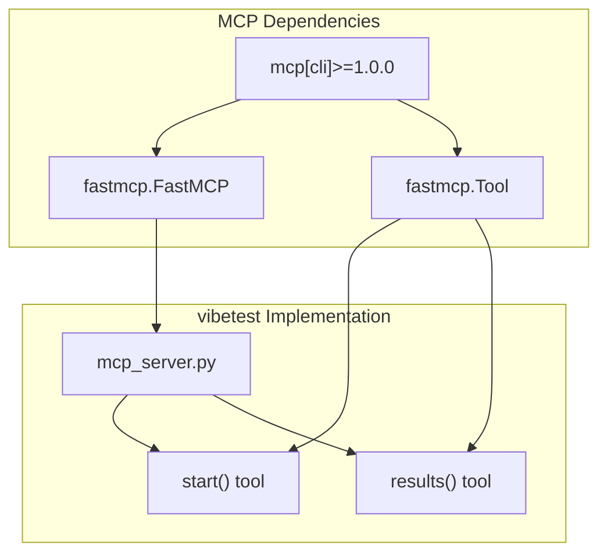
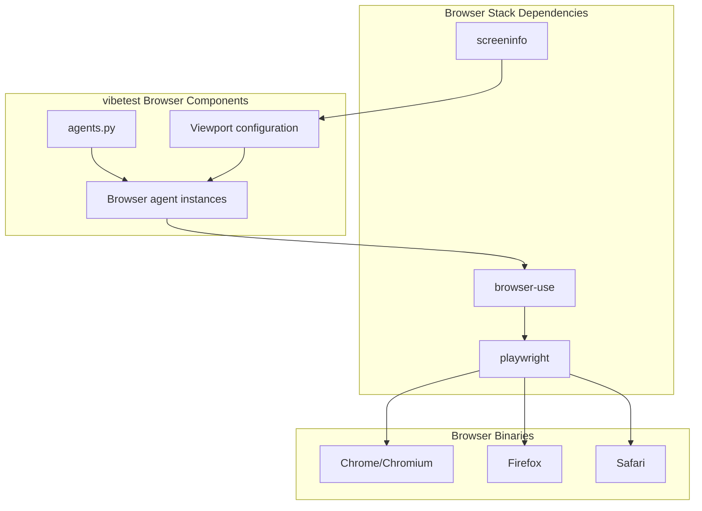
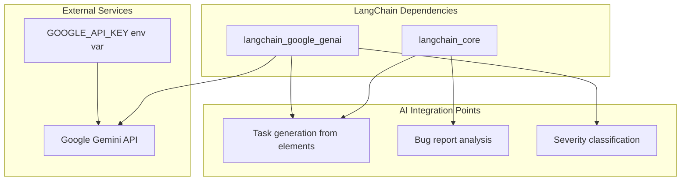
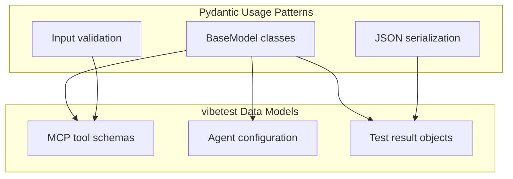

<!-- source: DeepWiki mcp.deepwiki.com · repo browser-use/vibetest-use · page 5 Dependencies and Requirements · fetched 2026-10-30 -->

# Dependencies and Requirements

Relevant source files

The following files were used as context for generating this wiki page:

- [README.md](README.md)
- [pyproject.toml](pyproject.toml)
- [vibetest.egg-info/PKG-INFO](vibetest.egg-info/PKG-INFO)
- [vibetest.egg-info/requires.txt](vibetest.egg-info/requires.txt)

This page provides a comprehensive breakdown of all external dependencies, their purposes, version requirements, and how they integrate into the vibetest-use system architecture. This documentation covers package-level dependencies and runtime requirements but does not cover development dependencies or build tools. For installation and setup instructions, see [Getting Started](#2). For environment configuration details, see [Configuration and Environment](#7).

## Python Version Requirements

vibetest-use requires Python 3.11 or higher as specified in [pyproject.toml:5]() and [vibetest.egg-info/PKG-INFO:5](). This requirement ensures compatibility with modern async/await patterns and type hinting features used throughout the codebase.

**Sources:** [pyproject.toml:5](), [vibetest.egg-info/PKG-INFO:5]()

## Core Dependencies

The system relies on seven primary dependencies as defined in [pyproject.toml:6-14]() and [vibetest.egg-info/requires.txt:1-7]():

| Dependency | Version Constraint | Purpose | Integration Point |
|------------|-------------------|---------|-------------------|
| `mcp[cli]` | `>=1.0.0` | MCP protocol implementation and CLI tools | `mcp_server.py` FastMCP server |
| `browser-use` | Latest | Browser automation framework | `agents.py` browser agent instances |
| `playwright` | Latest | Low-level browser control | `browser-use` dependency chain |
| `langchain_google_genai` | Latest | Google Gemini model integration | `agents.py` LLM task generation |
| `langchain_core` | Latest | LangChain framework core | `agents.py` agent reasoning |
| `pydantic` | Latest | Data validation and serialization | Model definitions across modules |
| `screeninfo` | Latest | Display resolution detection | `agents.py` browser viewport setup |

**Sources:** [pyproject.toml:6-14](), [vibetest.egg-info/requires.txt:1-7]()

## MCP Protocol Layer

### MCP Framework Integration

The `mcp[cli]>=1.0.0` dependency provides the Model Context Protocol implementation through the `fastmcp` package. This enables the system to function as an MCP server that IDE clients can communicate with via JSON-RPC.

The `[cli]` extra ensures command-line interface capabilities are included for development and testing scenarios.

**Sources:** [pyproject.toml:7](), [vibetest.egg-info/requires.txt:1]()

## Browser Automation Stack

### browser-use Framework

The `browser-use` package provides high-level browser automation capabilities specifically designed for AI agents. This dependency enables the creation of browser agent instances in [agents.py]().

### Playwright Integration

`playwright` serves as the underlying browser control engine. While not directly imported in vibetest code, it's a required dependency of `browser-use` and must be explicitly listed to ensure proper installation and browser binary setup.

The `screeninfo` dependency enables automatic detection of display resolution for optimal browser viewport configuration during agent execution.

**Sources:** [pyproject.toml:8-9,13](), [vibetest.egg-info/requires.txt:2-3,7]()

## AI/LLM Integration Layer

### LangChain Framework

Two LangChain packages provide AI capabilities:

- `langchain_core`: Provides base classes and abstractions for LLM interactions
- `langchain_google_genai`: Specific integration for Google Gemini models

These dependencies enable the system to generate QA tasks from webpage elements and analyze bug reports for severity classification.

**Sources:** [pyproject.toml:10-11](), [vibetest.egg-info/requires.txt:4-5]()

## Data Validation Layer

### Pydantic Integration

The `pydantic` dependency provides data validation and serialization capabilities throughout the system. This ensures type safety and proper data structure validation for:

- MCP tool parameters and responses
- Agent configuration objects
- Test result data structures
- API request/response models

**Sources:** [pyproject.toml:12](), [vibetest.egg-info/requires.txt:6]()

## Runtime Environment Requirements

### External Service Dependencies

Beyond Python packages, the system requires:

1. **Google API Key**: Required for `langchain_google_genai` to access Gemini models
2. **Browser Binaries**: Automatically installed by Playwright during setup
3. **Network Access**: Required for both target website testing and API calls

### Version Constraints Strategy

Most dependencies use unpinned versions (latest) except for `mcp[cli]>=1.0.0`. This approach:

- Ensures compatibility with the stable MCP protocol version
- Allows flexibility for other rapidly evolving AI/browser automation libraries
- Reduces dependency conflicts in user environments

**Sources:** [pyproject.toml:6-14](), [vibetest.egg-info/PKG-INFO:6-12]()

## Package Installation Configuration

The dependencies are configured through standard Python packaging mechanisms:

- **pyproject.toml**: Primary configuration with PEP 621 metadata
- **PKG-INFO**: Generated metadata for wheel distribution
- **requires.txt**: Simple dependency list for egg-info

The entry point `vibetest-mcp = "vibetest.mcp_server:run"` is defined in [pyproject.toml:19-20]() to enable command-line execution of the MCP server.

**Sources:** [pyproject.toml:1-20](), [vibetest.egg-info/PKG-INFO:1-13](), [vibetest.egg-info/requires.txt:1-8]()

---

