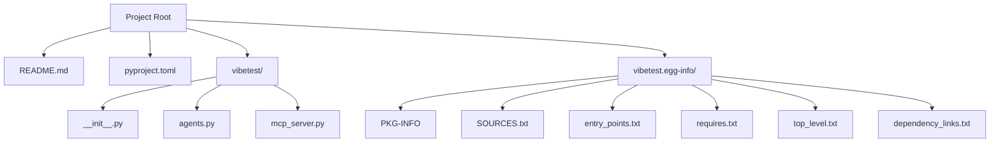
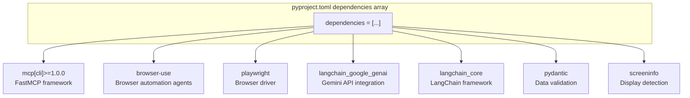
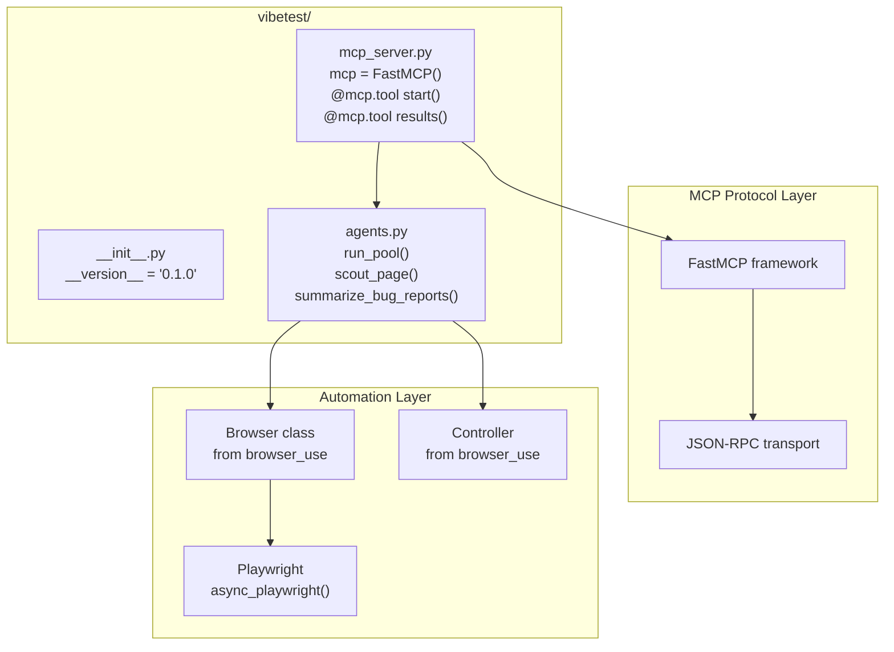
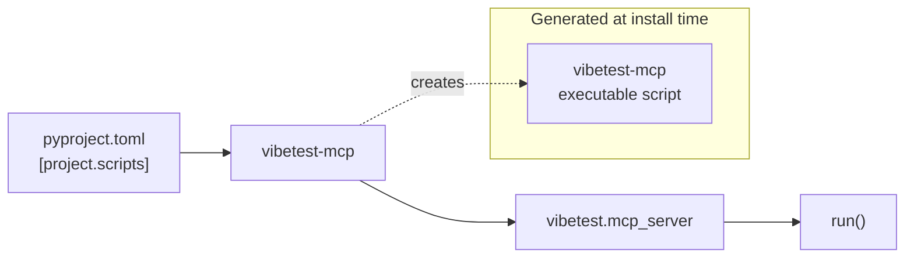

<!-- source: DeepWiki mcp.deepwiki.com · repo browser-use/vibetest-use · page 6 Package Structure · fetched 2026-10-30 -->

# Package Structure

<details>
<summary>Relevant source files</summary>

The following files were used as context for generating this wiki page:

- [pyproject.toml](pyproject.toml)
- [vibetest.egg-info/SOURCES.txt](vibetest.egg-info/SOURCES.txt)
- [vibetest.egg-info/top_level.txt](vibetest.egg-info/top_level.txt)
- [vibetest/__init__.py](vibetest/__init__.py)

</details>


This document describes the Python package organization, distribution metadata, and module hierarchy of the vibetest-use codebase. It covers the setuptools package structure, entry points configuration, and how the package is organized for distribution and installation.

For information about the internal architecture of the system components, see [System Architecture](#3). For details about external dependencies and their purposes, see [Dependencies and Requirements](#5).

## Package Overview

The `vibetest` package follows standard Python setuptools conventions with a top-level package directory containing the core modules and a separate `.egg-info` directory for distribution metadata.

### Package File Structure



**Sources:** [vibetest.egg-info/SOURCES.txt:1-11]()

## Distribution Metadata

The package metadata is stored in the `vibetest.egg-info` directory, which contains standardized distribution information used by Python packaging tools.

| Metadata File | Purpose | Key Contents |
|---------------|---------|--------------|
| `PKG-INFO` | Package metadata | Name, version, summary, dependencies |
| `SOURCES.txt` | Source file manifest | Complete list of package files |
| `top_level.txt` | Top-level packages | Package name for import resolution |
| `entry_points.txt` | Console scripts | MCP server entry point |
| `requires.txt` | Runtime dependencies | Core dependency list |

### Package Identity and Version

The package metadata is declared in `pyproject.toml` using modern PEP 621 configuration:

| Field | Value | Location |
|-------|-------|----------|
| `name` | `"vibetest"` | [pyproject.toml:2]() |
| `version` | `"0.1.0"` | [pyproject.toml:3]() |
| `description` | `"Browser-agent QA swarm with MCP interface for testing AI-generated websites"` | [pyproject.toml:4]() |
| `requires-python` | `">=3.11"` | [pyproject.toml:5]() |
| `__version__` | `"0.1.0"` | [vibetest/__init__.py:3]() |

**Sources:** [pyproject.toml:1-5](), [vibetest/__init__.py:3]()

### Dependency Declarations

The `dependencies` array in `pyproject.toml` declares seven required packages:



All dependencies are specified without version constraints except `mcp[cli]` which requires version `>=1.0.0`. The `[cli]` extra enables command-line MCP server functionality.

**Sources:** [pyproject.toml:6-14]()

## Module Organization

The `vibetest` package contains three primary modules organized by functional responsibility:

### Core Module Structure

The package contains three Python modules with distinct responsibilities:



| Module | Primary Classes/Functions | Purpose |
|--------|---------------------------|---------|
| `__init__.py` | `__version__` | Package metadata |
| `mcp_server.py` | `mcp` (FastMCP instance), `start()`, `results()` | MCP tool interface |
| `agents.py` | `run_pool()`, `scout_page()`, `summarize_bug_reports()` | Agent orchestration logic |

**Sources:** [vibetest/__init__.py:1-3](), [vibetest/mcp_server.py:1-65](), [vibetest/agents.py:1-469](), [vibetest.egg-info/SOURCES.txt:3-5]()

### Package Initialization

The `__init__.py` module provides minimal initialization with three lines:

```python
"""Web QA tool using Browser-Use agents for testing AI-generated websites."""

__version__ = "0.1.0"
```

This lightweight approach:
- Declares the package docstring
- Exports `__version__` for version introspection
- Avoids automatic imports to reduce import overhead

The version string matches the `version` field in `pyproject.toml`.

**Sources:** [vibetest/__init__.py:1-3](), [pyproject.toml:3]()

### Top-Level Package Declaration

The `top_level.txt` file declares `vibetest` as the single top-level package, ensuring the package namespace is isolated and import statements use `from vibetest import ...` or `import vibetest`.

**Sources:** [vibetest.egg-info/top_level.txt:1]()

## Entry Points and Installation

The package uses setuptools entry points to expose console scripts for MCP server functionality.

### MCP Server Entry Point

The `project.scripts` section defines a console script entry point:



The declaration `vibetest-mcp = "vibetest.mcp_server:run"` maps the console command `vibetest-mcp` to the `run()` function in `vibetest/mcp_server.py`. This creates an executable script in the Python environment's `bin/` directory during installation, enabling MCP-compatible IDEs to launch the server via the `vibetest-mcp` command.

**Sources:** [pyproject.toml:19-20]()

### Installation Artifacts

The `.egg-info` directory structure follows Python packaging standards:

- **Build reproducibility**: `SOURCES.txt` ensures consistent package contents
- **Dependency resolution**: `requires.txt` and `PKG-INFO` provide dependency metadata
- **Import resolution**: `top_level.txt` enables proper namespace handling
- **Script generation**: `entry_points.txt` enables console script creation

This structure supports both development installation (`pip install -e .`) and distribution installation (`pip install vibetest`) workflows.

**Sources:** [vibetest.egg-info/SOURCES.txt:6-11]()

---

