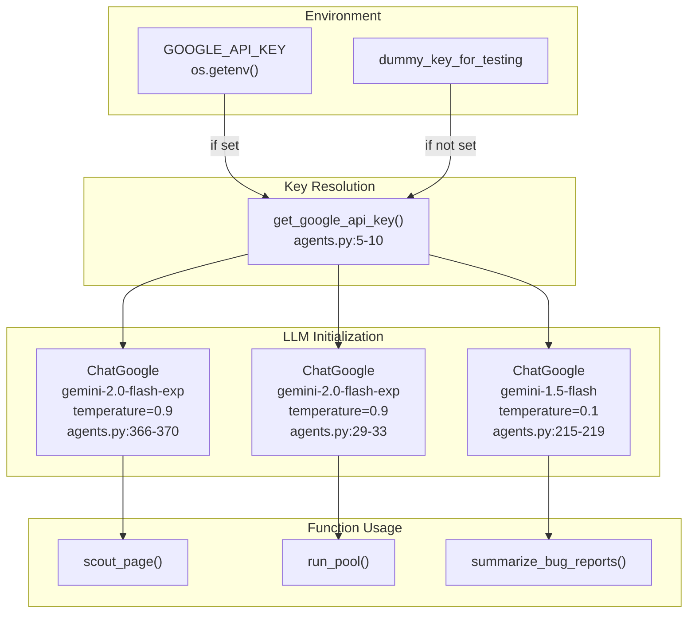
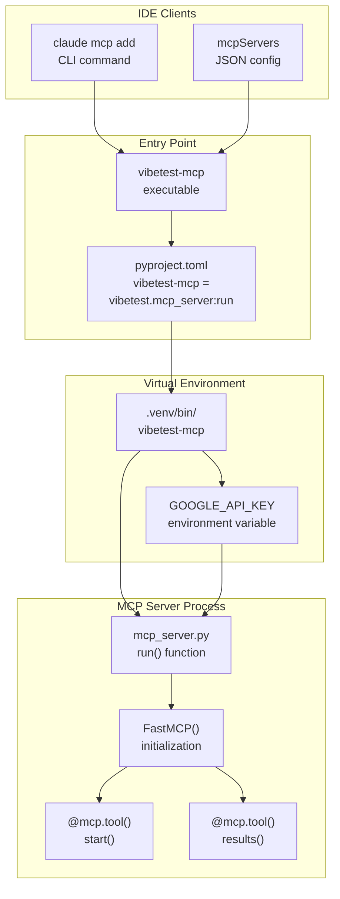
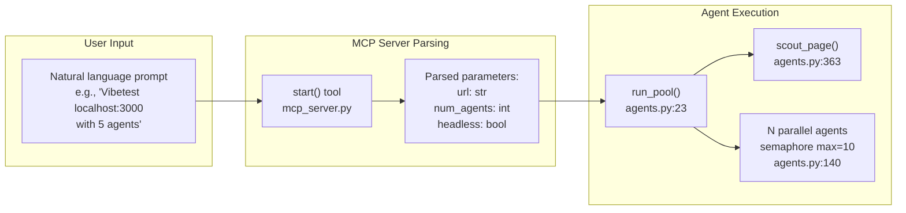
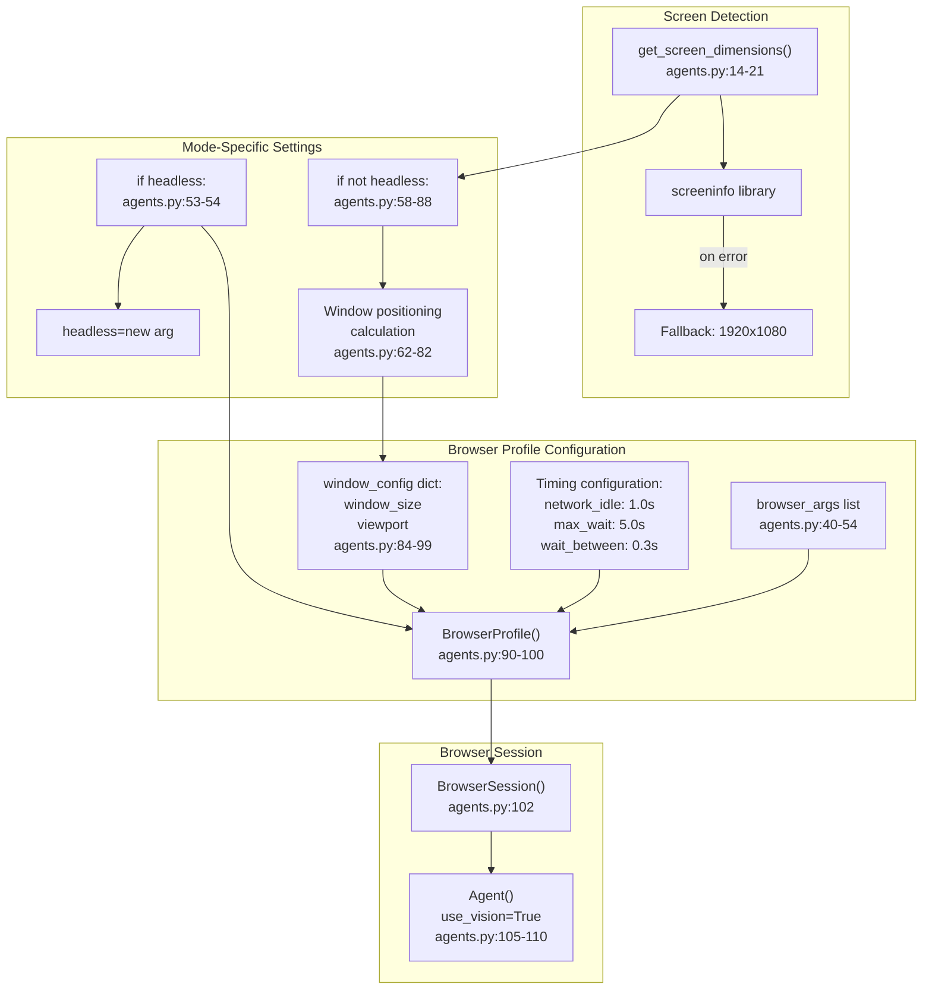
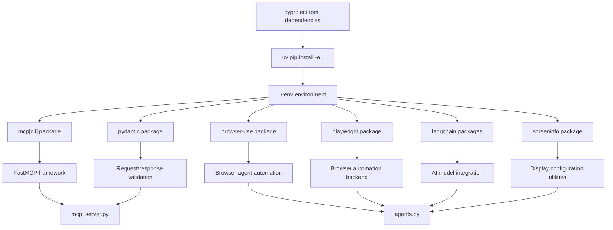

<!-- source: DeepWiki mcp.deepwiki.com · repo browser-use/vibetest-use · page 7 Configuration and Environment · fetched 2026-10-30 -->

# Configuration and Environment

<details>
<summary>Relevant source files</summary>

The following files were used as context for generating this wiki page:

- [README.md](README.md)
- [pyproject.toml](pyproject.toml)
- [vibetest/agents.py](vibetest/agents.py)

</details>


This document covers the configuration requirements and environment setup for vibetest-use, including environment variables, MCP client configuration, test parameters, and browser configuration. For information about the overall system dependencies, see page 5. For development-specific setup instructions, see page 8.

## Environment Variables

The vibetest-use system requires environment variables for authentication to AI services. The system implements a fallback mechanism for testing purposes.

### Required Environment Variables

| Variable | Purpose | Required | Default Fallback | Example |
|----------|---------|----------|------------------|---------|
| `GOOGLE_API_KEY` | Authentication for Google Gemini models (gemini-2.0-flash-exp and gemini-1.5-flash) | Yes | `"dummy_key_for_testing"` | `"AIza..."`|

The `GOOGLE_API_KEY` is retrieved via the `get_google_api_key()` function, which checks `os.getenv("GOOGLE_API_KEY")` and returns a dummy key if not set for testing purposes. This key is used by two different Gemini models:

- **gemini-2.0-flash-exp**: Used by `scout_page()` and `run_pool()` for creative agent task generation (temperature=0.9)
- **gemini-1.5-flash**: Used by `summarize_bug_reports()` for analytical result classification (temperature=0.1)

### API Key Resolution Flow

**Diagram: API Key Resolution and Usage**


Sources: [vibetest/agents.py:5-10](), [vibetest/agents.py:29-33](), [vibetest/agents.py:215-219](), [vibetest/agents.py:366-370]()

## MCP Client Configuration

The vibetest-use system operates as an MCP (Model Context Protocol) server that integrates with compatible IDEs. Configuration varies by client.

### Claude IDE Configuration

Claude IDE uses a command-line interface for MCP server registration:

```bash
claude mcp add vibetest /full/path/to/vibetest-use/.venv/bin/vibetest-mcp -e GOOGLE_API_KEY="your_api_key"
```

The command registers the `vibetest-mcp` entry point with the specified environment variables.

**Verification in Claude IDE:**
```
> claude
> /mcp 
  ⎿  MCP Server Status
     • vibetest: connected
```

### Cursor IDE Configuration

Cursor IDE requires manual JSON configuration in the MCP settings UI:

1. Open Cursor Settings
2. Click on "MCP" in the left sidebar
3. Click "Add Server" or the "+" button
4. Manually edit config:

```json
{
  "mcpServers": {
    "vibetest": {
      "command": "/full/path/to/vibetest-use/.venv/bin/vibetest-mcp",
      "env": {
        "GOOGLE_API_KEY": "your_api_key"
      }
    }
  }
}
```

The configuration maps the server name `vibetest` to the executable entry point and environment variables.

**Diagram: MCP Server Entry Point Resolution**


Sources: [README.md:27-40](), [README.md:42-62](), [pyproject.toml:19-20]()

## Test Execution Parameters

Test execution is controlled through natural language prompts in the IDE. The system parses specific parameters from user prompts.

### Configurable Test Parameters

| Parameter | Description | Default | Example Prompts |
|-----------|-------------|---------|-----------------|
| `url` | Target website URL (live or localhost) | Required | `"browser-use.com"`, `"localhost:3000"`, `"http://dev.mysite.com"` |
| `num_agents` | Number of parallel QA agents to spawn | 3 | `"5 agents"`, `"10 agents"`, `"2 agents"` |
| `headless` | Run browsers in headless mode (no UI) | False (non-headless) | `"headless vibetest"`, `"non-headless"` |

### Example Test Prompts

```
> Vibetest my website with 5 agents: browser-use.com
> Run vibetest on localhost:3000
> Run a headless vibetest on localhost:8080 with 10 agents
```

**Diagram: Test Parameter Flow**


Sources: [README.md:64-75](), [vibetest/agents.py:23]()

## Browser Configuration Parameters

The system configures Playwright browser instances with specific optimizations for performance and reliability. Configuration differs between headless and non-headless modes.

### Browser Launch Arguments

The following browser arguments are applied to all agent instances (configured in `BrowserProfile`):

```python
browser_args = [
    '--disable-gpu',
    '--no-sandbox',
    '--disable-dev-shm-usage',
    '--disable-background-timer-throttling',
    '--disable-backgrounding-occluded-windows',
    '--disable-renderer-backgrounding',
    '--disable-features=TranslateUI',
    '--disable-component-extensions-with-background-pages',
    '--no-first-run',
    '--no-default-browser-check',
    '--disable-background-networking'
]
```

In headless mode, `'--headless=new'` is appended to the args list.

### Timing and Performance Configuration

| Parameter | Value | Purpose | Code Reference |
|-----------|-------|---------|----------------|
| `wait_for_network_idle_page_load_time` | 1.0 seconds | Reduced from default for faster execution | [vibetest/agents.py:96]() |
| `maximum_wait_page_load_time` | 5.0 seconds | Reduced timeout to prevent hanging | [vibetest/agents.py:97]() |
| `wait_between_actions` | 0.3 seconds | Faster action execution | [vibetest/agents.py:98]() |

### Window Configuration (Non-Headless Mode)

When running in non-headless mode, agent browser windows are automatically positioned using `get_screen_dimensions()` to tile across the screen:

| Configuration | Value | Calculation |
|---------------|-------|-------------|
| `window_width` | 300 pixels | Fixed |
| `window_height` | 400 pixels | Fixed |
| `viewport_width` | 280 pixels | Fixed |
| `viewport_height` | 350 pixels | Fixed |
| `windows_per_row` | Calculated | `(screen_width - 2*margin) // (window_width + spacing)` |
| `x_offset` | Calculated | `margin + col * (window_width + spacing)` |
| `y_offset` | Calculated | `margin + row * (window_height + spacing)` |

The screen dimensions are obtained via the `screeninfo` library with a fallback to 1920x1080 for headless environments.

**Diagram: Browser Configuration and Positioning**


Sources: [vibetest/agents.py:14-21](), [vibetest/agents.py:40-100]()

### Concurrency Control

Agent execution is controlled by an asyncio semaphore to limit concurrent browser sessions:

```python
semaphore = asyncio.Semaphore(min(num_agents, 10))
```

This ensures a maximum of 10 simultaneous browser instances regardless of the number of agents requested, preventing resource exhaustion.

Sources: [vibetest/agents.py:140]()

## Python Environment Setup

The system requires Python 3.11 or higher and uses a virtual environment for dependency isolation.

### Virtual Environment Installation

```bash
# Create and activate virtual environment
uv venv
source .venv/bin/activate

# Install package in editable mode
uv pip install -e .

# Install Playwright browser binaries
playwright install chromium --with-deps --no-shell
```

The installation creates an editable package installation that registers the `vibetest-mcp` entry point. The Playwright installation downloads Chromium browser binaries and system dependencies.

### Package Entry Point

The entry point configuration in `pyproject.toml` maps the command-line executable to the Python module:

```toml
[project.scripts]
vibetest-mcp = "vibetest.mcp_server:run"
```

This creates an executable script in `.venv/bin/vibetest-mcp` that invokes the `run` function from the `vibetest.mcp_server` module.

Sources: [README.md:17-25](), [README.md:78](), [pyproject.toml:19-20]()

## Python Requirements Configuration

The system's Python dependencies are declared in `pyproject.toml` and include both direct and transitive dependencies for MCP, browser automation, and AI functionality.

### Core Dependencies

| Dependency | Purpose | Version Constraint |
|------------|---------|-------------------|
| `mcp[cli]` | MCP protocol implementation | `>=1.0.0` |
| `browser-use` | Browser automation framework | Latest |
| `playwright` | Browser automation backend | Latest |
| `langchain_google_genai` | Google Gemini LLM integration | Latest |
| `langchain_core` | LangChain core abstractions | Latest |
| `pydantic` | Data validation and serialization | Latest |
| `screeninfo` | Display information utilities | Latest |

### Dependency Resolution Flow



Sources: [pyproject.toml:1-14](), [README.md:69-73]()

## Runtime Configuration Validation

The system performs configuration validation at startup to ensure all required components are properly configured.

### Configuration Checks

1. **Environment Variable Validation**: The Google API key must be present and valid
2. **Python Version Check**: Python 3.11+ requirement enforced by package metadata
3. **Dependency Availability**: All required packages must be installed and importable
4. **MCP Protocol Compatibility**: The MCP client must support the required protocol version

### Error Handling

Configuration errors are handled at the MCP server level and propagated back to the client through the MCP protocol error response mechanism.

Sources: [pyproject.toml:5](), [README.md:71]()

---

