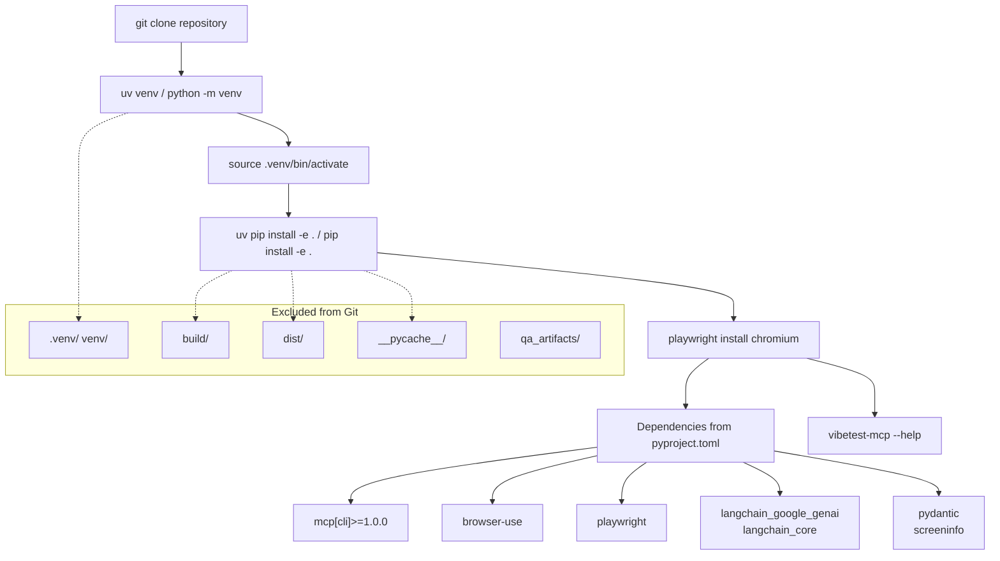
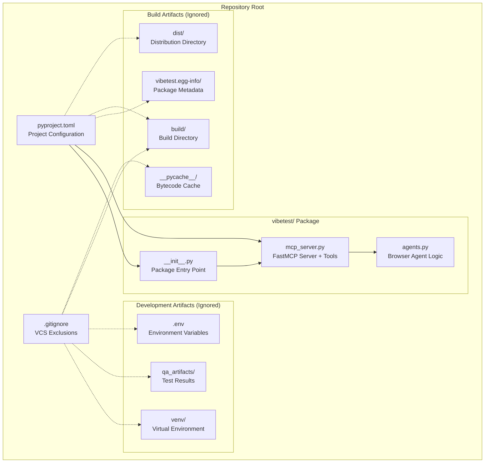
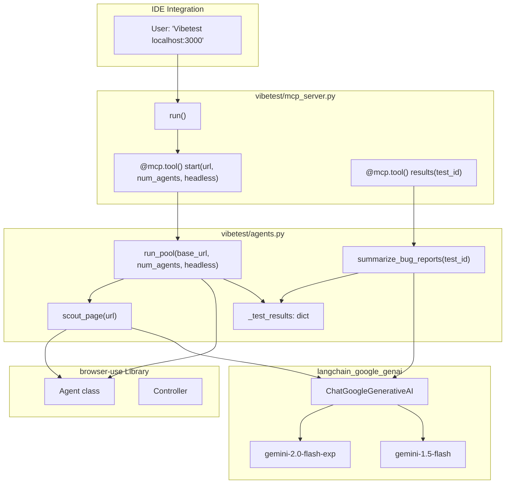

<!-- source: DeepWiki mcp.deepwiki.com · repo browser-use/vibetest-use · page 8 Development Guide · fetched 2026-10-30 -->

# Development Guide

<details>
<summary>Relevant source files</summary>

The following files were used as context for generating this wiki page:

- [.gitignore](.gitignore)
- [README.md](README.md)
- [pyproject.toml](pyproject.toml)

</details>


This guide provides comprehensive instructions for developers who want to contribute to or modify vibetest-use. It covers development environment setup, codebase architecture, testing strategies, and debugging techniques.

For information about system configuration and deployment, see [Configuration and Environment](#7). For architectural details, see [System Architecture](#3) and [Core Components](#4).

## Prerequisites

Before setting up the development environment, ensure you have the following requirements:

| Requirement | Version | Purpose |
|-------------|---------|---------|
| Python | ≥3.11 | Core runtime environment |
| Git | Latest | Source code management |
| Google API Key | N/A | Required for Gemini LLM integration (gemini-2.0-flash-exp, gemini-1.5-flash) |
| uv (optional) | Latest | Fast Python package installer (recommended) |

The Python version requirement is specified in [pyproject.toml:5](). The system uses two Gemini models: `gemini-2.0-flash-exp` for agent exploration and `gemini-1.5-flash` for result summarization.

Sources: [pyproject.toml:5](), [README.md:17-24](), [README.md:79]()

## Environment Setup

### Clone and Install

1. Clone the repository from https://github.com/browser-use/vibetest-use
2. Create and activate a virtual environment:
   ```bash
   # Using uv (recommended)
   uv venv
   source .venv/bin/activate  # On Windows: .venv\Scripts\activate
   
   # Or using standard Python
   python -m venv venv
   source venv/bin/activate  # On Windows: venv\Scripts\activate
   ```
3. Install the package in development mode:
   ```bash
   # Using uv (fast)
   uv pip install -e .
   
   # Or using pip
   pip install -e .
   ```
4. Install Playwright browser:
   ```bash
   playwright install chromium --with-deps --no-shell
   ```

The virtual environment directories (`.venv/`, `venv/`) are excluded from version control as specified in [.gitignore:14-15]().

Sources: [README.md:17-24](), [.gitignore:14-15]()

### Development Dependencies Installation

#### Development Environment Setup Flow



Sources: [README.md:17-24](), [.gitignore:3-6](), [.gitignore:10](), [.gitignore:14-15](), [pyproject.toml:6-14]()

## Project Structure

The vibetest package follows a standard Python package structure with specific configurations for MCP server deployment.

#### Development Project Structure



Sources: [pyproject.toml:16-17](), [.gitignore:3-6](), [.gitignore:10](), [.gitignore:13-15]()

### Key Development Files

| File | Purpose | Development Impact |
|------|---------|-------------------|
| `pyproject.toml` | Project configuration, dependencies, entry points | Modify for dependency changes |
| `vibetest/__init__.py` | Package initialization and version | Update for version releases |
| `vibetest/mcp_server.py` | Main MCP server implementation | Core functionality development |
| `vibetest/agents.py` | Browser agent orchestration | Agent behavior modifications |
| `.gitignore` | VCS exclusions | Keep development artifacts clean |

Sources: [pyproject.toml:1-20](), [.gitignore:1-28]()

## Understanding the Codebase

### Code Entity Map: MCP Server to Agent Execution

This diagram maps the natural language workflow to actual code entities, showing how the system processes requests from start to finish.



Sources: [vibetest/mcp_server.py:1-65](), [vibetest/agents.py:1-469]()

### Key Code Entities and Their Roles

| Code Entity | Location | Purpose |
|-------------|----------|---------|
| `run()` | [vibetest/mcp_server.py]() | Entry point that creates FastMCP server |
| `start` tool | [vibetest/mcp_server.py]() | MCP tool that initiates testing via `run_pool()` |
| `results` tool | [vibetest/mcp_server.py]() | MCP tool that retrieves and summarizes test results |
| `run_pool()` | [vibetest/agents.py]() | Orchestrates scout and parallel QA agents |
| `scout_page()` | [vibetest/agents.py]() | Discovers interactive elements and generates tasks |
| `summarize_bug_reports()` | [vibetest/agents.py]() | LLM-based analysis of test results |
| `_test_results` | [vibetest/agents.py]() | In-memory dictionary storing test data by test_id |
| `Agent` | browser-use library | Browser automation agent class |
| `ChatGoogleGenerativeAI` | langchain_google_genai | LLM interface for Gemini models |

Sources: [vibetest/mcp_server.py](), [vibetest/agents.py]()

### Three-Phase Execution Flow in Code

This diagram shows the three execution phases and the actual functions that implement them.

```mermaid
graph LR
    subgraph Phase1["Phase 1: Scouting"]
        ScoutFunc["scout_page(url)"]
        ScoutAgent["Agent(task='catalog elements')"]
        ScoutLLM["ChatGoogleGenerativeAI<br/>gemini-2.0-flash-exp"]
        TaskList["List[str] tasks"]
    end
    
    subgraph Phase2["Phase 2: Parallel Testing"]
        RunPoolFunc["run_pool(base_url, num_agents)"]
        Semaphore["asyncio.Semaphore(10)"]
        AgentPool["Agent instances × N"]
        Results["results: List[dict]"]
    end
    
    subgraph Phase3["Phase 3: Analysis"]
        TestResultsDict["_test_results[test_id]"]
        SummarizeFunc["summarize_bug_reports(test_id)"]
        AnalysisLLM["ChatGoogleGenerativeAI<br/>gemini-1.5-flash"]
        Summary["dict with severity breakdown"]
    end
    
    ScoutFunc --> ScoutAgent
    ScoutAgent --> ScoutLLM
    ScoutLLM --> TaskList
    
    TaskList --> RunPoolFunc
    RunPoolFunc --> Semaphore
    Semaphore --> AgentPool
    AgentPool --> Results
    
    Results --> TestResultsDict
    TestResultsDict --> SummarizeFunc
    SummarizeFunc --> AnalysisLLM
    AnalysisLLM --> Summary
```



Sources: [vibetest/agents.py:29-201](), [vibetest/agents.py:205-369](), [vibetest/agents.py:372-469]()

### File Structure and Dependencies

| File | Primary Functions/Classes | Dependencies |
|------|--------------------------|--------------|
| `vibetest/mcp_server.py` | `run()`, `start` tool, `results` tool | `mcp`, `vibetest.agents` |
| `vibetest/agents.py` | `run_pool()`, `scout_page()`, `summarize_bug_reports()`, `_test_results` | `browser_use`, `langchain_google_genai`, `playwright`, `pydantic` |
| `pyproject.toml` | Package configuration | N/A |
| `.gitignore` | VCS exclusions | N/A |

Sources: [vibetest/mcp_server.py](), [vibetest/agents.py](), [pyproject.toml](), [.gitignore]()

## Build Configuration

The project uses `pyproject.toml` for modern Python packaging standards. The build configuration includes:

### Project Metadata

The project is configured with the following metadata in [pyproject.toml:1-5]():
- **Name**: `vibetest`
- **Version**: `0.1.0`
- **Description**: Browser-agent QA swarm with MCP interface
- **Python Requirement**: `>=3.11`

### Entry Points

The package provides a console script entry point defined in [pyproject.toml:19-20]():
```
vibetest-mcp = "vibetest.mcp_server:run"
```

This allows the `vibetest-mcp` command to execute the `run()` function from the `vibetest.mcp_server` module. The `run()` function creates and serves the FastMCP server with the `start` and `results` tools.

### Package Discovery

Package discovery is configured in [pyproject.toml:16-17]() to include all `vibetest*` packages using setuptools' automatic discovery.

Sources: [pyproject.toml:1-20]()

## Testing and Debugging

### Local Testing Setup

To test the MCP server locally during development:

1. **Set up environment variables**:
   ```bash
   export GOOGLE_API_KEY="your_api_key"
   ```

2. **Configure MCP in your IDE** (see [Getting Started](#2) for detailed IDE setup):
   - Claude Code: `claude mcp add vibetest /path/to/.venv/bin/vibetest-mcp`
   - Cursor: Add server configuration to MCP settings

3. **Test the server**:
   ```bash
   # Verify the entry point works
   vibetest-mcp --help
   
   # Or run directly with Python
   python -m vibetest.mcp_server
   ```

Sources: [README.md:29-62](), [pyproject.toml:19-20]()

### Testing Individual Functions

You can test individual functions in isolation:

```python
# Test scout_page function
from vibetest.agents import scout_page
import asyncio

async def test_scout():
    tasks = await scout_page("https://example.com")
    print(f"Generated {len(tasks)} tasks")
    for task in tasks:
        print(f"  - {task}")

asyncio.run(test_scout())
```

```python
# Test run_pool function
from vibetest.agents import run_pool
import asyncio

async def test_pool():
    test_id = await run_pool(
        base_url="http://localhost:3000",
        num_agents=3,
        headless=True
    )
    print(f"Test ID: {test_id}")

asyncio.run(test_pool())
```

Sources: [vibetest/agents.py:372-469](), [vibetest/agents.py:29-201]()

### Debugging Browser Automation

When debugging browser automation issues:

1. **Use non-headless mode**: Set `headless=False` in `run_pool()` to see browser interactions
2. **Check browser configuration**: Review browser setup in `run_pool()` where Playwright is configured
3. **Examine task assignments**: Tasks are assigned round-robin to agents (index % num_agents)
4. **Review semaphore limits**: Maximum 10 concurrent browsers via `asyncio.Semaphore(10)`

Sources: [vibetest/agents.py:29-201]()

### Debugging LLM Interactions

The system uses two Gemini models:
- **gemini-2.0-flash-exp**: Used in `scout_page()` for creative task generation
- **gemini-1.5-flash**: Used in `summarize_bug_reports()` for analytical summarization

To debug LLM issues:
1. Check API key configuration
2. Review model responses in function outputs
3. Examine the prompts sent to each model
4. Check for rate limiting or API errors

Sources: [vibetest/agents.py:205-369](), [vibetest/agents.py:372-469]()

### Test Artifacts and Results

The system stores test results in the `_test_results` in-memory dictionary:
- **Key**: `test_id` (UUID string)
- **Value**: Dictionary containing `url`, `results` array, `duration`, and `timestamp`

Test artifacts are also written to the `qa_artifacts/` directory during execution (excluded from Git via [.gitignore:10]()).

To inspect test results programmatically:
```python
from vibetest.agents import _test_results, summarize_bug_reports
import asyncio

async def inspect_results(test_id):
    # Get raw results
    test_data = _test_results.get(test_id)
    print(f"Raw results: {test_data}")
    
    # Get summarized results
    summary = await summarize_bug_reports(test_id)
    print(f"Summary: {summary}")

asyncio.run(inspect_results("your-test-id"))
```

Sources: [vibetest/agents.py:205-369](), [.gitignore:10]()

## Development Dependencies

#### Dependency Architecture for Development

```mermaid
graph LR
    subgraph CoreDeps["Core Dependencies"]
        MCP["mcp[cli]>=1.0.0<br/>FastMCP + CLI tools"]
        BrowserUse["browser-use<br/>Agent automation"]
        Playwright["playwright<br/>Chromium driver"]
    end
    
    subgraph AIDeps["AI Dependencies"] 
        LangChainGoogle["langchain_google_genai<br/>Gemini integration"]
        LangChainCore["langchain_core<br/>LLM framework"]
    end
    
    subgraph UtilDeps["Utility Dependencies"]
        Pydantic["pydantic<br/>Schema validation"]
        ScreenInfo["screeninfo<br/>Display config"]
    end
    
    subgraph DevEnv["Development Environment"]
        Python["Python >=3.11"]
        VirtualEnv["uv venv / venv"]
        PipEditable["uv pip install -e ."]
    end
    
    Python --> VirtualEnv
    VirtualEnv --> PipEditable
    PipEditable --> MCP
    PipEditable --> BrowserUse
    PipEditable --> Playwright
    PipEditable --> LangChainGoogle
    PipEditable --> LangChainCore
    PipEditable --> Pydantic
    PipEditable --> ScreenInfo
    
    BrowserUse --> Playwright
    LangChainGoogle --> LangChainCore
```

Sources: [pyproject.toml:5-14](), [README.md:17-24]()

## Development Workflow

### Ignored Artifacts

The development workflow generates various artifacts that are excluded from version control via [.gitignore]():

| Artifact Type | Pattern | Purpose |
|---------------|---------|---------|
| Build artifacts | `build/`, `dist/`, `__pycache__/` | Python packaging outputs |
| QA artifacts | `qa_artifacts/` | Test execution results |
| Environment | `.env`, `.venv/`, `venv/` | Local configuration and virtual environments |
| IDE files | `.vscode/`, `.idea/`, `*.swp` | Editor-specific configurations |
| OS files | `.DS_Store`, `Thumbs.db` | Operating system metadata |
| Logs | `*.log` | Runtime logging outputs |

### Testing Artifacts

The system generates QA test artifacts during development testing, which are stored in the `qa_artifacts/` directory and excluded from version control per [.gitignore:10](). This allows developers to run tests locally without polluting the repository.

### Development Commands

After installation, verify the setup works:
```bash
vibetest-mcp --help
```

This command should execute the entry point defined in [pyproject.toml:20]() and display the MCP server help information.

Sources: [.gitignore:1-28](), [pyproject.toml:19-20]()

---

