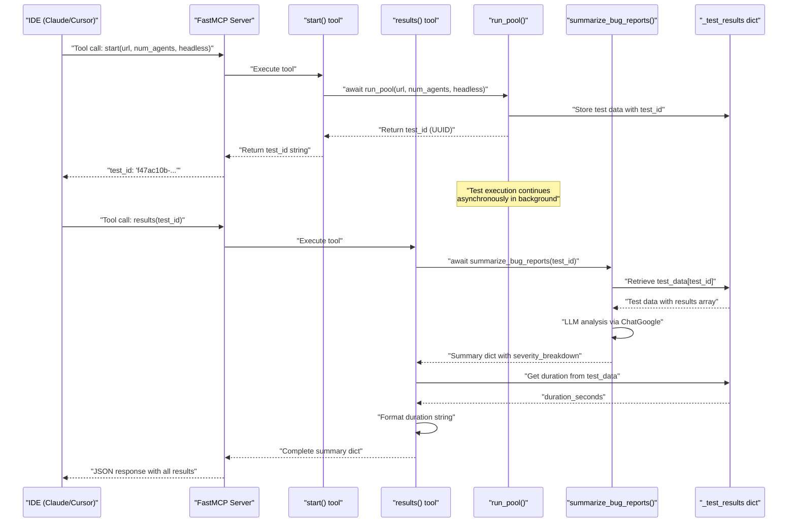
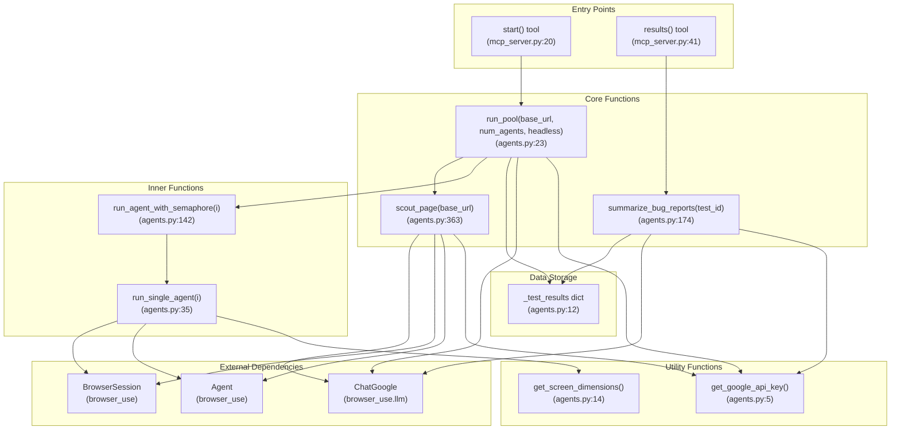

<!-- source: DeepWiki mcp.deepwiki.com · repo browser-use/vibetest-use · page 9 API Reference · fetched 2026-10-30 -->

# API Reference

<details>
<summary>Relevant source files</summary>

The following files were used as context for generating this wiki page:

- [vibetest/agents.py](vibetest/agents.py)
- [vibetest/mcp_server.py](vibetest/mcp_server.py)

</details>


This document provides detailed API documentation for the Vibetest Use system. It covers the MCP server tools (`start` and `results`), core agent orchestration functions (`run_pool`, `scout_page`, `summarize_bug_reports`), data structures, and utility functions.

For installation and configuration instructions, see [Getting Started](#2). For architectural context on how these APIs fit into the overall system, see [System Architecture](#3).

## MCP Server Tools

The MCP server exposes two primary tools through the FastMCP framework. These tools are defined in [vibetest/mcp_server.py:19-76]() and serve as the external interface for IDE integration.

### start Tool

**Function:** `async def start(url: str, num_agents: int = 3, headless: bool = False) -> str`

Initiates a browser agent pool to test a website. This tool spawns a scout agent to discover test tasks, then launches multiple QA agents in parallel to execute those tasks.

**Parameters:**

| Parameter | Type | Default | Description |
|-----------|------|---------|-------------|
| `url` | `str` | Required | The website URL to test (e.g., `https://example.com` or `http://localhost:3000`) |
| `num_agents` | `int` | `3` | Number of QA agents to spawn for parallel testing |
| `headless` | `bool` | `False` | Whether to run browsers in headless mode (no visible windows) |

**Returns:** `str` - A unique test identifier (UUID format) used to retrieve results later

**Example Response:**
```
"f47ac10b-58cc-4372-a567-0e02b2c3d479"
```

**Error Response:**
```
"Error starting test: <error description>"
```

**Internal Flow:**
1. Calls [run_pool():vibetest/agents.py:23-170]()
2. Generates UUID via `uuid.uuid4()`
3. Returns test_id immediately (non-blocking)
4. Test execution continues asynchronously in background

**Sources:** [vibetest/mcp_server.py:19-38]()

---

### results Tool

**Function:** `async def results(test_id: str) -> dict`

Retrieves and analyzes the results of a completed test run. This tool performs LLM-based analysis to classify bugs by severity and generate a comprehensive report.

**Parameters:**

| Parameter | Type | Description |
|-----------|------|-------------|
| `test_id` | `str` | The test identifier returned by the `start` tool |

**Returns:** `dict` - Complete test summary with severity classification (see Data Structures section)

**Example Response:**
```json
{
  "test_id": "f47ac10b-58cc-4372-a567-0e02b2c3d479",
  "total_agents": 5,
  "successful_agents": 4,
  "failed_agents": 1,
  "overall_status": "medium-severity",
  "status_emoji": "🟠",
  "status_description": "Moderate issues found that should be addressed",
  "total_issues": 3,
  "severity_breakdown": {
    "high_severity": [],
    "medium_severity": [
      {
        "category": "broken_link",
        "description": "Upon clicking the 'Contact Us' button in the header navigation, the page redirected to a 404 error"
      }
    ],
    "low_severity": [...]
  },
  "duration_seconds": 45.3,
  "duration_formatted": "45s"
}
```

**Error Response:**
```json
{
  "error": "Test ID <test_id> not found"
}
```

**Internal Flow:**
1. Calls [summarize_bug_reports():vibetest/agents.py:174-361]()
2. Accesses `_test_results` dict via test_id
3. Extracts duration from test data
4. Formats duration as human-readable string

**Sources:** [vibetest/mcp_server.py:40-76]()

---

## MCP Tool Flow Diagram



**Sources:** [vibetest/mcp_server.py:19-76](), [vibetest/agents.py:23-170](), [vibetest/agents.py:174-361]()

---

## Core Agent Functions

These functions implement the agent orchestration logic and are the primary internal APIs of the system.

### run_pool

**Function:** `async def run_pool(base_url: str, num_agents: int = 3, headless: bool = False) -> str`

Orchestrates the complete test execution workflow: scouting, parallel agent deployment, and result collection.

**Parameters:**

| Parameter | Type | Default | Description |
|-----------|------|---------|-------------|
| `base_url` | `str` | Required | URL of the website to test |
| `num_agents` | `int` | `3` | Number of parallel QA agents to spawn |
| `headless` | `bool` | `False` | Browser visibility mode |

**Returns:** `str` - Test identifier (UUID)

**Internal Operations:**

1. **Test Initialization** [vibetest/agents.py:24-25]()
   - Generates test_id via `uuid.uuid4()`
   - Records start_time via `time.time()`

2. **Scouting Phase** [vibetest/agents.py:27]()
   - Calls `await scout_page(base_url)`
   - Returns list of specific test tasks

3. **LLM Setup** [vibetest/agents.py:29-33]()
   - Initializes `ChatGoogle` with model `gemini-2.0-flash-exp`
   - Sets temperature to `0.9` for creative exploration
   - Uses API key from `get_google_api_key()`

4. **Agent Configuration** [vibetest/agents.py:35-137]()
   - Defines `run_single_agent(i)` inner function
   - Configures browser with optimized startup args
   - Implements window positioning for non-headless mode
   - Handles browser session lifecycle

5. **Parallel Execution** [vibetest/agents.py:139-149]()
   - Creates semaphore with `min(num_agents, 10)` limit
   - Uses `asyncio.gather()` for concurrent execution
   - Assigns tasks round-robin: `task = qa_tasks[i % len(qa_tasks)]`

6. **Result Collection** [vibetest/agents.py:151-168]()
   - Stores results in `_test_results[test_id]`
   - Records end_time and calculates duration
   - Returns test_id

**Browser Configuration:**

The function applies extensive browser optimizations [vibetest/agents.py:40-52]():

```
--disable-gpu
--no-sandbox
--disable-dev-shm-usage
--disable-background-timer-throttling
--disable-backgrounding-occluded-windows
--disable-renderer-backgrounding
--disable-features=TranslateUI
--disable-component-extensions-with-background-pages
--no-first-run
--no-default-browser-check
--disable-background-networking
--headless=new  (if headless=True)
```

**Window Positioning Algorithm (Non-Headless):**

[vibetest/agents.py:58-88]() implements automatic window tiling:

- Window size: 300x400 pixels
- Viewport: 280x350 pixels
- Calculates grid layout based on screen dimensions
- Prevents window overlap via margin and spacing

**Concurrency Control:**

Maximum 10 simultaneous browser sessions enforced via `asyncio.Semaphore` [vibetest/agents.py:140]().

**Sources:** [vibetest/agents.py:23-170]()

---

### scout_page

**Function:** `async def scout_page(base_url: str) -> list`

Deploys a headless scout agent to catalog interactive elements and generate specific test tasks via LLM partitioning.

**Parameters:**

| Parameter | Type | Description |
|-----------|------|-------------|
| `base_url` | `str` | URL to scout |

**Returns:** `list[str]` - Array of specific test task descriptions

**Execution Flow:**

1. **LLM Initialization** [vibetest/agents.py:366-370]()
   - Model: `gemini-2.0-flash-exp`
   - Temperature: `0.9` (high creativity)

2. **Browser Setup** [vibetest/agents.py:372-392]()
   - Always runs in headless mode
   - Uses same optimized browser args as QA agents
   - Shorter timeouts: 1.0s network idle, 5.0s max load

3. **Scout Task Execution** [vibetest/agents.py:395-404]()
   - Task: "Navigate to {url} using go_to_url, then identify ALL interactive elements..."
   - Agent instructed NOT to click, only observe
   - Catalogs buttons, links, forms, inputs, menus, dropdowns

4. **Element Partitioning** [vibetest/agents.py:414-435]()
   - Sends scout results to LLM with partition prompt
   - Requests 6-8 distinct tasks covering different elements
   - Each task specifies exact elements to test
   - Always includes navigation instructions

5. **Response Parsing** [vibetest/agents.py:437-461]()
   - Handles multiple response formats: `content`, `completion`, `text`
   - Uses regex to extract JSON array: `\[.*\]`
   - Falls back to generic tasks if parsing fails

**Example Output:**
```json
[
  "Navigate to https://example.com using go_to_url, then test the 'Sign In' button in the top-right header - click on it",
  "Navigate to https://example.com using go_to_url, then test the main newsletter signup form - enter email and submit",
  "Navigate to https://example.com using go_to_url, then test the footer 'Contact' link - click to verify navigation",
  ...
]
```

**Fallback Tasks:**

If scouting fails [vibetest/agents.py:466-473](), returns generic tasks:
- Test navigation elements in header
- Test main content links and buttons
- Test footer links and elements
- Test form elements
- Test sidebar/secondary navigation
- Test remaining interactive elements

**Sources:** [vibetest/agents.py:363-473]()

---

### summarize_bug_reports

**Function:** `async def summarize_bug_reports(test_id: str) -> dict`

Analyzes test results using LLM-based severity classification and generates a comprehensive summary report.

**Parameters:**

| Parameter | Type | Description |
|-----------|------|-------------|
| `test_id` | `str` | Test identifier from `run_pool()` |

**Returns:** `dict` - Summary with severity breakdown (see Data Structures)

**Error Response:**
```json
{"error": "Test ID <test_id> not found"}
```

**Processing Steps:**

1. **Data Retrieval** [vibetest/agents.py:175-178]()
   - Fetches test data from `_test_results[test_id]`
   - Returns error if test_id not found

2. **Result Separation** [vibetest/agents.py:180-196]()
   - Separates successful results from errors
   - Extracts bug reports from successful agents
   - Formats as structured data with agent_id, task, findings

3. **Text Formatting** [vibetest/agents.py:198-201]()
   - Concatenates bug reports into single text
   - Format: "Agent {id} Report:\nTask: {task}\nFindings: {findings}"

4. **LLM Analysis** (if `GOOGLE_API_KEY` present) [vibetest/agents.py:213-331]()
   - Uses `ChatGoogle` with model `gemini-1.5-flash`
   - Temperature `0.1` for analytical consistency
   - Prompt instructs objective QA analysis
   - Classifies only actual functional issues

5. **Severity Classification** [vibetest/agents.py:270-295]()
   - Parses JSON response with regex: `\{.*\}`
   - Extracts three severity arrays: high, medium, low
   - Falls back to empty arrays if parsing fails

6. **Status Determination** [vibetest/agents.py:303-319]()
   - High severity: `🔴 high-severity`
   - Medium severity: `🟠 medium-severity`
   - Low severity: `🟡 low-severity`
   - No issues: `✅ passing`

7. **Summary Construction** [vibetest/agents.py:321-331]()
   - Combines all metadata
   - Includes raw LLM response for debugging
   - Records model used for analysis

**Fallback Behavior:**

If LLM analysis fails or API key missing [vibetest/agents.py:333-359]():
- Sets status to `low-severity` or `passing`
- Creates generic low_severity entry with count
- Includes error message in `llm_analysis_error`

**LLM Prompt Key Instructions:**

[vibetest/agents.py:221-262]() defines strict criteria for issue classification:

- Only report actual functional issues, broken features, or technical problems
- Exclude subjective opinions, missing features, design preferences
- Provide SPECIFIC and DETAILED descriptions with exact elements, actions, results
- Deduplicate similar issues
- Format as JSON with three severity arrays

**Sources:** [vibetest/agents.py:174-361]()

---

## Function Call Relationships



**Sources:** [vibetest/mcp_server.py:19-76](), [vibetest/agents.py:23-473]()

---

## Data Structures

### Test Data Structure

Stored in `_test_results` dictionary [vibetest/agents.py:12]() with test_id as key.

**Structure:**
```python
{
    "test_id": str,          # UUID v4
    "url": str,              # Tested URL
    "agents": int,           # Number of agents spawned
    "start_time": float,     # Unix timestamp
    "end_time": float,       # Unix timestamp
    "duration": float,       # Seconds elapsed
    "results": [             # Array of agent results
        {
            "agent_id": int,
            "task": str,
            "result": str,        # Success result text
            "timestamp": float,
            "status": "success"
        },
        {
            "agent_id": int,
            "task": str,
            "error": str,         # Error message
            "timestamp": float,
            "status": "error"
        }
    ],
    "status": "completed"
}
```

**Sources:** [vibetest/agents.py:157-168]()

---

### Summary Structure

Returned by `summarize_bug_reports()` and `results` tool.

**Full Structure:**
```python
{
    # Test Metadata
    "test_id": str,
    "total_agents": int,
    "successful_agents": int,
    "failed_agents": int,
    "errors": [              # Array of error results
        {
            "agent_id": int,
            "task": str,
            "error": str,
            "timestamp": float,
            "status": "error"
        }
    ],
    
    # Summary Status
    "overall_status": str,   # "high-severity" | "medium-severity" | "low-severity" | "passing"
    "status_emoji": str,     # "🔴" | "🟠" | "🟡" | "✅"
    "status_description": str,
    "total_issues": int,
    
    # Severity Breakdown
    "severity_breakdown": {
        "high_severity": [
            {
                "category": str,
                "description": str
            }
        ],
        "medium_severity": [...],
        "low_severity": [...]
    },
    
    # LLM Analysis Metadata
    "llm_analysis": {
        "raw_response": str,
        "model_used": str    # "gemini-1.5-flash"
    },
    
    # Duration (added by results tool)
    "duration_seconds": float,
    "duration_formatted": str,  # "45s" or "1m 23s"
    
    # Timestamps
    "summary_generated": float
}
```

**Status Values:**

| Status | Emoji | Condition |
|--------|-------|-----------|
| `high-severity` | 🔴 | `len(high_severity) > 0` |
| `medium-severity` | 🟠 | `len(medium_severity) > 0 and len(high_severity) == 0` |
| `low-severity` | 🟡 | `len(low_severity) > 0 and no high/medium` |
| `passing` | ✅ | All severity arrays empty |

**Sources:** [vibetest/agents.py:203-331](), [vibetest/mcp_server.py:56-71]()

---

### Agent Result Structure

Individual agent outcome stored in test_data.results array.

**Success Result:**
```python
{
    "agent_id": int,         # Agent index (0 to num_agents-1)
    "task": str,             # Task description from scout_page
    "result": str,           # Agent's findings or completion message
    "timestamp": float,      # Unix timestamp
    "status": "success"
}
```

**Error Result:**
```python
{
    "agent_id": int,
    "task": str,
    "error": str,            # Exception message
    "timestamp": float,
    "status": "error"
}
```

**Sources:** [vibetest/agents.py:116-122](), [vibetest/agents.py:131-137]()

---

## Data Flow Through Functions

```mermaid
graph LR
    subgraph "Input"
        url["base_url"]
        num["num_agents"]
        headless["headless"]
    end
    
    subgraph "run_pool()"
        test_id_gen["Generate test_id<br/>(uuid.uuid4)"]
        scout_call["Call scout_page(url)"]
        qa_tasks["qa_tasks: list[str]"]
        agents_spawn["Spawn num_agents<br/>agents"]
        results_collect["Collect results<br/>array"]
    end
    
    subgraph "scout_page()"
        scout_agent["Scout Agent"]
        element_catalog["Element catalog<br/>(string)"]
        llm_partition["LLM partitioning"]
        task_list["Task list<br/>(JSON array)"]
    end
    
    subgraph "run_single_agent()"
        agent_i["Agent i"]
        task_i["Task: qa_tasks[i % len]"]
        result_i["Result dict"]
    end
    
    subgraph "_test_results"
        storage["test_id → test_data"]
    end
    
    subgraph "summarize_bug_reports()"
        retrieve["Retrieve test_data"]
        format_bugs["Format bug reports"]
        llm_analysis["LLM severity<br/>classification"]
        summary_dict["Summary dict<br/>with breakdown"]
    end
    
    url --> scout_call
    scout_call --> scout_agent
    scout_agent --> element_catalog
    element_catalog --> llm_partition
    llm_partition --> task_list
    task_list --> qa_tasks
    
    qa_tasks --> agents_spawn
    num --> agents_spawn
    headless --> agents_spawn
    
    agents_spawn --> agent_i
    qa_tasks --> task_i
    task_i --> agent_i
    agent_i --> result_i
    result_i --> results_collect
    
    test_id_gen --> storage
    results_collect --> storage
    
    storage --> retrieve
    retrieve --> format_bugs
    format_bugs --> llm_analysis
    llm_analysis --> summary_dict
```



**Sources:** [vibetest/agents.py:23-473]()

---

## Utility Functions

### get_google_api_key

**Function:** `def get_google_api_key() -> str`

Retrieves Google API key from environment with fallback for testing.

**Returns:** `str` - API key or `"dummy_key_for_testing"`

**Implementation:**
```python
key = os.getenv("GOOGLE_API_KEY")
if not key:
    return "dummy_key_for_testing"
return key
```

**Used By:**
- `run_pool()` [vibetest/agents.py:32]()
- `scout_page()` [vibetest/agents.py:369]()
- `summarize_bug_reports()` [vibetest/agents.py:217]()

**Sources:** [vibetest/agents.py:5-10]()

---

### get_screen_dimensions

**Function:** `def get_screen_dimensions() -> tuple[int, int]`

Retrieves primary monitor dimensions with fallback for headless environments.

**Returns:** `tuple[int, int]` - (width, height) in pixels

**Default Fallback:** `(1920, 1080)`

**Implementation:**
- Uses `screeninfo.get_monitors()[0]` to detect actual screen
- Returns `screen.width, screen.height`
- Falls back to 1920x1080 on exception (e.g., headless servers)

**Used By:**
- `run_pool()` for window positioning [vibetest/agents.py:60]()

**Sources:** [vibetest/agents.py:14-21]()

---

## Error Handling

### MCP Tool Level

Both `start()` and `results()` tools implement try-except wrappers:

**start tool** [vibetest/mcp_server.py:31-38]():
- Catches all exceptions during `run_pool()` execution
- Returns error string: `"Error starting test: <message>"`
- Ensures non-None return value

**results tool** [vibetest/mcp_server.py:50-76]():
- Catches all exceptions during `summarize_bug_reports()`
- Returns error dict: `{"error": "Error getting results: <message>"}`

### Agent Level

**run_single_agent** [vibetest/agents.py:130-137]():
- Wraps each agent execution in try-except
- Returns error result dict on exception
- Includes agent_id, task, error message, timestamp
- Sets status to `"error"`

**Browser Session Cleanup:**
- Finally blocks ensure `browser_session.aclose()` called [vibetest/agents.py:124-128](), [vibetest/agents.py:406-410]()
- Prevents lingering browser processes
- Swallows cleanup exceptions to avoid masking primary errors

### Scouting Fallback

If `scout_page()` fails [vibetest/agents.py:464-473]():
- Returns generic task list covering standard website areas
- Allows testing to proceed despite scouting failure

### LLM Analysis Fallback

If severity analysis fails [vibetest/agents.py:333-346]():
- Sets status to `"low-severity"` or `"passing"`
- Creates generic low_severity entry with bug count
- Includes `llm_analysis_error` field with exception message

**Sources:** [vibetest/mcp_server.py:31-76](), [vibetest/agents.py:124-137](), [vibetest/agents.py:333-346](), [vibetest/agents.py:464-473]()

---

## Concurrency and Performance

### Semaphore Limit

`run_pool()` enforces maximum 10 simultaneous browser sessions [vibetest/agents.py:140]():
```python
semaphore = asyncio.Semaphore(min(num_agents, 10))
```

If `num_agents > 10`, agents execute in batches of 10.

### Browser Optimizations

**Startup Args** [vibetest/agents.py:40-52]():
- Disable GPU acceleration
- Disable sandboxing
- Disable background processes
- Disable component extensions
- Skip first-run checks

**Timeout Configuration:**
- Network idle: 1.0s [vibetest/agents.py:96](), [vibetest/agents.py:387]()
- Maximum page load: 5.0s [vibetest/agents.py:97](), [vibetest/agents.py:388]()
- Action delay: 0.3s [vibetest/agents.py:98](), [vibetest/agents.py:389]()

### Session Cleanup

Graceful shutdown period [vibetest/agents.py:154]():
```python
await asyncio.sleep(1)
```
Allows browser processes to fully terminate before function returns.

**Sources:** [vibetest/agents.py:40-98](), [vibetest/agents.py:140](), [vibetest/agents.py:154](), [vibetest/agents.py:387-389]()

---

## Model Configuration

### Agent Exploration Model

Used in `run_pool()` and `scout_page()`:

| Parameter | Value | Reasoning |
|-----------|-------|-----------|
| Model | `gemini-2.0-flash-exp` | Latest experimental model with enhanced capabilities |
| Temperature | `0.9` | High creativity for exploratory testing |
| API Key | From environment | Via `get_google_api_key()` |

**Sources:** [vibetest/agents.py:29-33](), [vibetest/agents.py:366-370]()

### Analysis Model

Used in `summarize_bug_reports()`:

| Parameter | Value | Reasoning |
|-----------|-------|-----------|
| Model | `gemini-1.5-flash` | Stable model for analytical tasks |
| Temperature | `0.1` | Low temperature for consistent classification |
| API Key | From environment | Via `get_google_api_key()` |

**Sources:** [vibetest/agents.py:215-219]()