# Page: Overview

# Overview

<details>
<summary>Relevant source files</summary>

The following files were used as context for generating this wiki page:

- [README.md](README.md)
- [vibetest.egg-info/PKG-INFO](vibetest.egg-info/PKG-INFO)
- [vibetest/__init__.py](vibetest/__init__.py)

</details>


## Purpose and Scope

Vibetest Use is a browser-agent QA swarm system that performs automated testing of AI-generated websites. The system integrates with MCP-compatible IDEs (Claude Code and Cursor) to provide natural language-driven testing through multiple parallel browser agents. It identifies UI bugs, broken links, accessibility issues, and technical problems through AI-powered browser automation.

This overview covers the system's purpose, architecture, and integration patterns. For installation instructions, see [Getting Started](#2). For component implementation details, see [Core Components](#4).

Sources: [README.md:1-13](), [vibetest/__init__.py:1-3]()

## What is Vibetest Use

Vibetest Use is a Python package (version 0.1.0) that functions as an MCP (Model Context Protocol) server, exposing website testing capabilities to IDEs. The package name is `vibetest` and the entry point is `vibetest-mcp`. The system spawns multiple browser agents that work in parallel to comprehensively test websites, from live production sites to localhost development servers.

The system follows a three-phase workflow:
1. **Scout Phase**: Function `scout_page()` inventories interactive elements on the target website using a headless browser agent
2. **Task Generation**: Google Gemini AI partitions discovered elements into specific testable QA tasks
3. **Parallel Execution**: Function `run_pool()` spawns multiple browser agents (default: 3) that execute different test scenarios simultaneously with semaphore-controlled concurrency (max: 10)
4. **Result Analysis**: Function `summarize_bug_reports()` uses Gemini LLM to classify bugs by severity (high/medium/low) and generate comprehensive reports

Sources: [README.md:3-13](), [vibetest/__init__.py:1-3](), [vibetest.egg-info/PKG-INFO:1-13]()

## System Architecture Overview

### Core System Components and Code Structure

The following diagram maps high-level system concepts to actual code entities (files, functions, and dependencies):

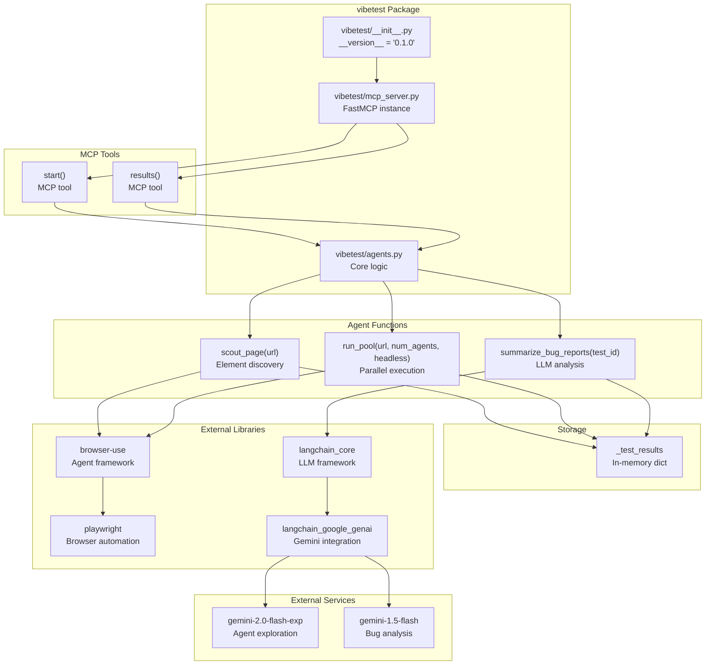

**Key Code Entities:**
- **Entry Point**: `vibetest-mcp` command invokes `vibetest/mcp_server.py`
- **MCP Tools**: `start()` and `results()` exposed to IDEs via FastMCP
- **Core Functions**: `scout_page()`, `run_pool()`, `summarize_bug_reports()` in `vibetest/agents.py`
- **Storage**: `_test_results` dictionary stores test data indexed by UUID test_id
- **AI Models**: gemini-2.0-flash-exp for agent exploration, gemini-1.5-flash for result analysis

Sources: [README.md:1-96](), [vibetest/__init__.py:1-3](), [vibetest.egg-info/PKG-INFO:1-13]()

## MCP Integration and Workflow

### MCP Tool Invocation Flow

The following sequence diagram shows how IDE prompts translate to function calls and data transformations:

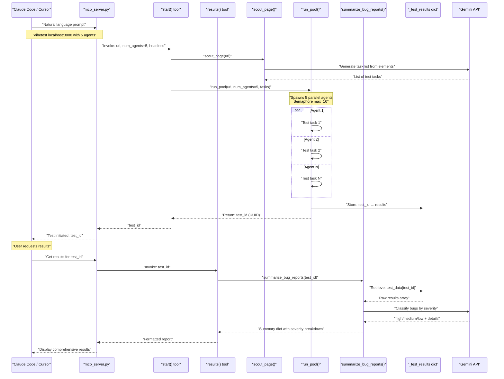

**Data Flow:**
1. **Input**: Natural language prompt → parsed parameters (url, num_agents, headless)
2. **Scouting**: `scout_page()` returns task list via LLM
3. **Execution**: `run_pool()` distributes tasks round-robin, stores results with UUID test_id
4. **Storage**: `_test_results[test_id] = {"url": str, "results": array, "duration": float, "timestamp": time}`
5. **Analysis**: `summarize_bug_reports()` retrieves results, uses LLM for severity classification
6. **Output**: Summary dict with overall_status, status_emoji, total_issues, severity_breakdown, duration

Sources: [README.md:27-69]()

## Key Capabilities

### Supported Test Targets

The `start()` MCP tool accepts any valid URL:

| Target Type | Example | Usage |
|-------------|---------|-------|
| Live Websites | `https://browser-use.com` | Full URL with protocol |
| Localhost Development | `localhost:3000` | Implicit http:// protocol |
| Custom Development | `http://dev.mysite.com` | Custom domain/port |

Sources: [README.md:66-72]()

### Configurable Parameters

Parameters exposed through the `start()` MCP tool:

| Parameter | Type | Default | Range | Function Parameter |
|-----------|------|---------|-------|-------------------|
| `url` | str | Required | Any valid URL | `run_pool(url, ...)` |
| `num_agents` | int | 3 | 1 to N | `run_pool(..., num_agents, ...)` |
| `headless` | bool | False | True/False | `run_pool(..., headless)` |

**Natural Language Parsing:**
- `"5 agents"` → `num_agents=5`
- `"headless"` → `headless=True`
- `"non-headless"` (default) → `headless=False`

Sources: [README.md:64-74]()

### Test Coverage Areas

The `scout_page()` function discovers and the agent pool tests:

- **UI Bug Detection**: Visual inconsistencies, layout issues, responsive design
- **Link Validation**: Broken links, redirect chains, 404 errors
- **Accessibility Testing**: ARIA compliance, keyboard navigation, screen reader support
- **Technical Issues**: JavaScript errors, console warnings, form validation
- **Interactive Elements**: Buttons, forms, dropdowns, modals, navigation

Sources: [README.md:3-13]()

## IDE Integration

### IDE Configuration Methods

The `vibetest-mcp` entry point integrates with MCP-compatible IDEs:

**Claude Code CLI:**
```bash
claude mcp add vibetest /path/to/.venv/bin/vibetest-mcp -e GOOGLE_API_KEY="key"
```

**Cursor Manual Configuration:**
```json
{
  "mcpServers": {
    "vibetest": {
      "command": "/path/to/.venv/bin/vibetest-mcp",
      "env": {
        "GOOGLE_API_KEY": "your_api_key"
      }
    }
  }
}
```

Sources: [README.md:27-62]()

### Natural Language Interface

Both IDEs expose the MCP tools through natural language prompts:

| User Prompt | MCP Tool | Parsed Parameters |
|-------------|----------|-------------------|
| `"Vibetest my website with 5 agents: browser-use.com"` | `start()` | `url="browser-use.com", num_agents=5, headless=False` |
| `"Run vibetest on localhost:3000"` | `start()` | `url="localhost:3000", num_agents=3, headless=False` |
| `"Run a headless vibetest on localhost:8080 with 10 agents"` | `start()` | `url="localhost:8080", num_agents=10, headless=True` |
| `"Get results for test abc-123"` | `results()` | `test_id="abc-123"` |

The IDE's MCP client translates natural language into JSON-RPC calls to `vibetest/mcp_server.py`, which dispatches to the appropriate tool function.

Sources: [README.md:64-69]()

## Technology Foundation

vibetest-use builds on several key technologies:

- **Browser-Use**: Provides the core browser automation framework with AI-driven web interaction
- **Playwright**: Handles actual browser control and web page manipulation
- **FastMCP**: Implements the MCP server protocol for IDE integration
- **LangChain + Google Gemini**: Powers AI-driven task generation and result analysis
- **Pydantic**: Ensures type safety and data validation throughout the system

The system requires Python 3.11+ and a Google API key for Gemini model access.

Sources: [README.md:69-73](), [README.md:88]()

---

# Page: Getting Started

# Getting Started

<details>
<summary>Relevant source files</summary>

The following files were used as context for generating this wiki page:

- [README.md](README.md)
- [pyproject.toml](pyproject.toml)
- [vibetest.egg-info/entry_points.txt](vibetest.egg-info/entry_points.txt)
- [vibetest.egg-info/requires.txt](vibetest.egg-info/requires.txt)

</details>


This guide provides step-by-step instructions for installing Vibetest Use, configuring it with your IDE, and running your first automated QA test. By the end of this guide, you will have a working MCP server that can launch browser-agent swarms to test websites.

For a high-level understanding of the system architecture and components, see [System Architecture](#3) and [Core Components](#4). For detailed configuration options, see [Configuration and Environment](#7).

## Prerequisites

Before installation, ensure you have:

| Requirement | Details |
|-------------|---------|
| **Python** | Version 3.11 or higher |
| **Google API Key** | Required for Gemini LLM access ([obtain here](https://developers.google.com/maps/api-security-best-practices)) |
| **MCP-Compatible IDE** | Claude Code CLI or Cursor with MCP support enabled |
| **Operating System** | Linux, macOS, or Windows with WSL |

**Sources**: [README.md:76-80]()

## Installation Process

### Step 1: Create Virtual Environment

The system uses `uv` for fast Python package management. Create and activate a virtual environment:

```bash
uv venv
source .venv/bin/activate  # On Windows: .venv\Scripts\activate
```

This creates an isolated Python environment in the `.venv` directory where all dependencies will be installed.

**Sources**: [README.md:17-20]()

### Step 2: Install Python Dependencies

Install the package in editable mode to enable development and updates:

```bash
uv pip install -e .
```

This command installs the core dependencies specified in [pyproject.toml:6-14]():

| Package | Purpose |
|---------|---------|
| `mcp[cli]>=1.0.0` | FastMCP framework for server implementation |
| `browser-use` | Browser agent automation library |
| `playwright` | Headless browser control |
| `langchain_google_genai` | Google Gemini API integration |
| `langchain_core` | LangChain framework core |
| `pydantic` | Data validation and settings management |
| `screeninfo` | Display information for browser window sizing |

**Sources**: [pyproject.toml:6-14](), [vibetest.egg-info/requires.txt:1-8]()

### Step 3: Install Playwright Browser

Install the Chromium browser with system dependencies:

```bash
playwright install chromium --with-deps --no-shell
```

The `--with-deps` flag installs required system libraries (fonts, media codecs), and `--no-shell` prevents unnecessary shell integration. This step is required for the browser-use agents to function.

**Sources**: [README.md:23-24]()

### Installation Verification Diagram

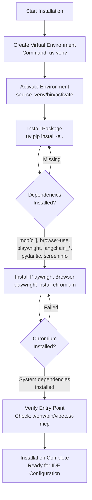

**Sources**: [README.md:17-24](), [pyproject.toml:6-14]()

## IDE Configuration

The MCP server must be registered with your IDE to enable natural language test commands. The server entry point is defined as `vibetest.mcp_server:run` in [vibetest.egg-info/entry_points.txt:1-2]() and creates the executable `vibetest-mcp`.

### Option 1: Claude Code (CLI)

Add the MCP server using Claude's built-in command:

```bash
claude mcp add vibetest /full/path/to/vibetest-use/.venv/bin/vibetest-mcp -e GOOGLE_API_KEY="your_api_key"
```

**Important**: Replace `/full/path/to/vibetest-use` with the absolute path to your installation directory, and `your_api_key` with your actual Google API key.

Verify the server is connected:

```bash
claude
> /mcp
```

Expected output:
```
⎿  MCP Server Status
   • vibetest: connected
```

**Sources**: [README.md:27-40]()

### Option 2: Cursor (Manual Configuration)

Cursor requires manual configuration file editing:

1. Open Cursor Settings
2. Navigate to **MCP** in the left sidebar
3. Click **Add Server** or the **+** button
4. Edit the configuration JSON directly:

```json
{
  "mcpServers": {
    "vibetest": {
      "command": "/full/path/to/vibetest-use/.venv/bin/vibetest-mcp",
      "env": {
        "GOOGLE_API_KEY": "your_api_key"
      }
    }
  }
}
```

**Configuration Details**:
- `"vibetest"`: Server name (used to identify this MCP server)
- `"command"`: Absolute path to the `vibetest-mcp` executable
- `"env"`: Environment variables passed to the server process
- `"GOOGLE_API_KEY"`: Required for Gemini LLM access

**Sources**: [README.md:42-62]()

### MCP Server Connection Architecture

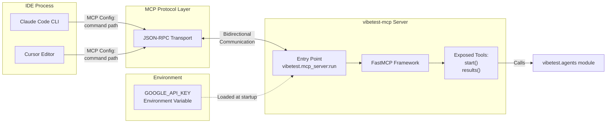

**Sources**: [README.md:27-62](), [vibetest.egg-info/entry_points.txt:1-2](), [pyproject.toml:19-20]()

## Running Your First Vibetest

Once the IDE is configured, you can initiate tests using natural language prompts. The MCP server interprets these prompts and extracts test parameters.

### Basic Test Commands

The system accepts flexible natural language input. Here are common patterns:

| Prompt Pattern | Example | Parsed Parameters |
|----------------|---------|-------------------|
| Basic URL test | `Vibetest my website with 5 agents: browser-use.com` | url: `browser-use.com`, agents: 5, headless: false |
| Localhost test | `Run vibetest on localhost:3000` | url: `localhost:3000`, agents: 3, headless: false |
| Headless test | `Run a headless vibetest on localhost:8080 with 10 agents` | url: `localhost:8080`, agents: 10, headless: true |

**Sources**: [README.md:64-69]()

### Understanding Test Parameters

The MCP server's `start` tool accepts three parameters:

| Parameter | Type | Default | Description |
|-----------|------|---------|-------------|
| `url` | string | Required | Target website (supports `https://`, `http://`, or bare domains; auto-prefixes `http://` for localhost) |
| `num_agents` | integer | 3 | Number of parallel QA agents (recommended: 3-10; max limited by system resources) |
| `headless` | boolean | false | Browser visibility mode (false = visible windows, true = headless execution) |

**Browser Visibility Modes**:
- **Non-headless** (default): Opens visible browser windows for each agent, useful for debugging and watching test execution
- **Headless**: Runs browsers without UI, faster and more resource-efficient for automated testing

**Sources**: [README.md:71-74]()

### First Test Execution Flow

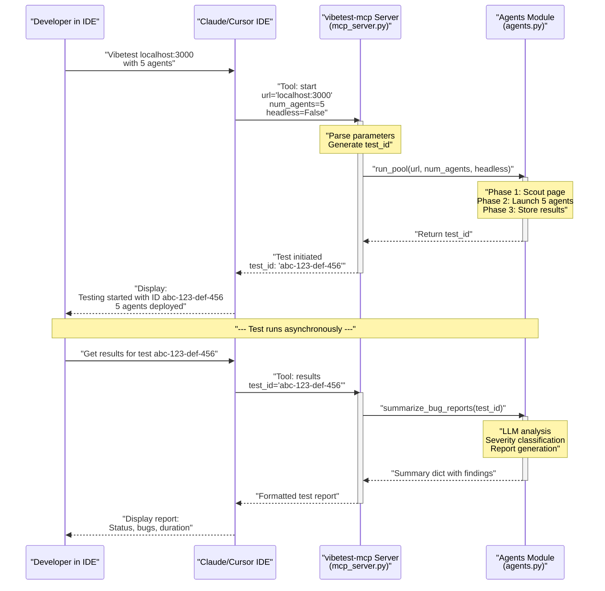

**Sources**: [README.md:64-74]()

## Verification

After installation and configuration, verify the system is working:

### Check 1: MCP Server Status

In Claude Code:
```bash
> /mcp
```

In Cursor:
- Check for the green connection indicator next to "vibetest" in MCP settings

### Check 2: Test the Tools

Run a simple test command:
```
Run vibetest on browser-use.com with 3 agents
```

Expected behavior:
1. **Immediate response**: Test ID returned (e.g., `abc-123-def-456`)
2. **Browser launch**: 3 Chromium windows open (unless headless mode)
3. **Agent activity**: Visible navigation and interaction with the website
4. **Results available**: After completion, request results using the test ID

### Check 3: Retrieve Results

After the test completes:
```
Get results for test abc-123-def-456
```

Expected response structure:
- Overall status (✅ All passed / ⚠️ Issues found / ❌ Critical issues)
- Total issues count
- Severity breakdown (High/Medium/Low)
- Duration in seconds and formatted time
- Detailed findings per agent

**Sources**: [README.md:33-40]()

## Common Installation Issues

| Issue | Solution |
|-------|----------|
| `vibetest-mcp` command not found | Ensure virtual environment is activated and package installed with `-e` flag |
| Playwright browser missing | Run `playwright install chromium --with-deps --no-shell` |
| `GOOGLE_API_KEY` error | Verify API key is set in IDE configuration's `env` section |
| MCP server not connecting | Check absolute path to `vibetest-mcp` executable is correct |
| Permission denied on Linux | Ensure `vibetest-mcp` is executable: `chmod +x .venv/bin/vibetest-mcp` |

## Next Steps

Now that you have Vibetest Use installed and configured:

- **Understand the architecture**: See [System Architecture](#3) for how components interact
- **Learn about agents**: See [Agent Orchestration System](#4.2) for details on the three-phase testing model
- **Configure advanced options**: See [Configuration and Environment](#7) for parameter tuning
- **Explore the API**: See [API Reference](#9) for programmatic usage

**Sources**: [README.md:1-96](), [pyproject.toml:1-20]()

---

# Page: System Architecture

# System Architecture

<details>
<summary>Relevant source files</summary>

The following files were used as context for generating this wiki page:

- [README.md](README.md)
- [vibetest/agents.py](vibetest/agents.py)
- [vibetest/mcp_server.py](vibetest/mcp_server.py)

</details>


This document provides a detailed explanation of how vibetest-use works internally, covering the MCP server implementation, agent orchestration system, and browser automation components. It focuses on the technical architecture and interactions between core system components.

For setup and installation instructions, see [Getting Started](#2). For detailed API documentation of individual components, see [Core Components](#4).

## Overview

vibetest-use implements a distributed website testing system built around three main architectural layers: an MCP (Model Context Protocol) server interface, an agent orchestration system, and a browser automation engine. The system coordinates multiple parallel browser agents to perform comprehensive QA testing of web applications.

### High-Level Architecture

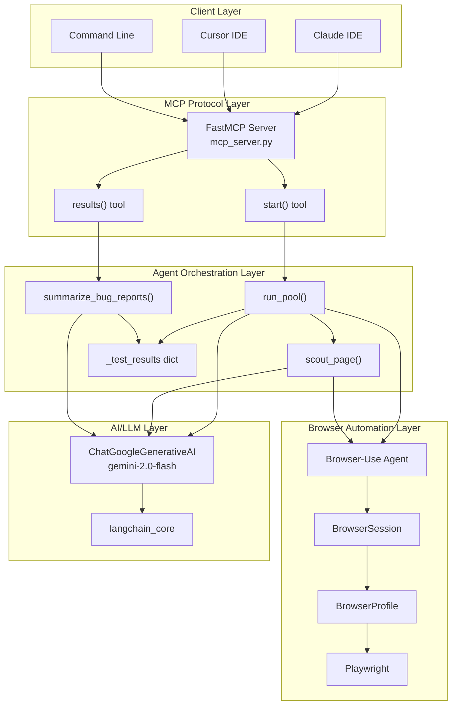

Sources: [vibetest/mcp_server.py:1-87](), [vibetest/agents.py:1-453](), [README.md:1-89]()

## MCP Server Interface

The system's entry point is a FastMCP server that exposes two primary tools for test orchestration. The server handles JSON-RPC communication and provides a clean interface for external clients.

### Server Implementation

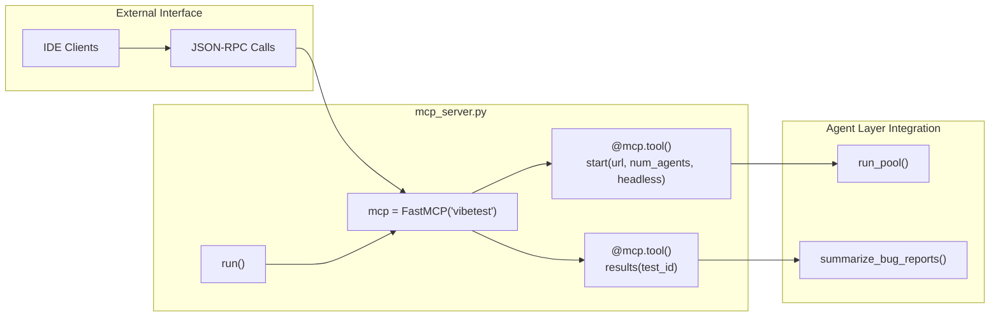

The `start()` tool accepts a URL and configuration parameters, then delegates to `run_pool()` for agent coordination. The `results()` tool retrieves test outcomes via `summarize_bug_reports()` and enriches them with timing data from the `_test_results` global store.

Sources: [vibetest/mcp_server.py:19-84]()

## Agent Orchestration System

The core orchestration logic resides in the `agents.py` module, implementing a multi-phase testing workflow: reconnaissance, task generation, parallel execution, and result analysis.

### Agent Workflow

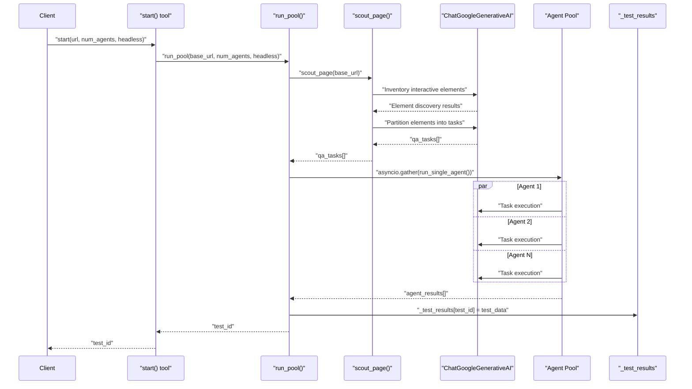

Sources: [vibetest/agents.py:21-187](), [vibetest/agents.py:370-453]()

### Agent Pool Management

The `run_pool()` function implements sophisticated agent lifecycle management with parallel execution controls:

| Component | Implementation | Purpose |
|-----------|----------------|---------|
| **Semaphore Control** | `asyncio.Semaphore(min(num_agents, 10))` | Limits concurrent browser instances |
| **Window Positioning** | Screen dimension calculation + offset logic | Arranges non-headless browser windows |
| **Browser Configuration** | `BrowserProfile` with security disabled | Optimizes automation performance |
| **Error Handling** | Per-agent exception isolation | Ensures partial test completion |
| **Process Cleanup** | `pkill -f chromium` on macOS | Prevents resource leaks |

The system creates unique `BrowserSession` instances for each agent, with custom `BrowserProfile` configurations that handle both headless and visual modes.

Sources: [vibetest/agents.py:33-187](), [vibetest/agents.py:76-86]()

## Browser Automation Engine

Each agent operates through the Browser-Use library, which provides high-level automation capabilities built on Playwright. The system configures browser instances with specific profiles optimized for QA testing.

### Browser Instance Configuration

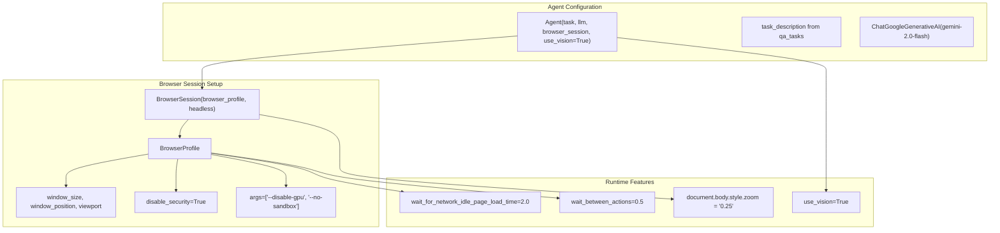

Non-headless mode implements sophisticated window positioning logic that calculates screen dimensions and arranges browser windows in a grid pattern to enable visual monitoring of multiple agents.

Sources: [vibetest/agents.py:76-112](), [vibetest/agents.py:44-74]()

## Task Generation and Execution

The system uses a two-phase approach for test case generation: initial reconnaissance via `scout_page()` followed by LLM-driven task partitioning.

### Scout-Based Task Generation

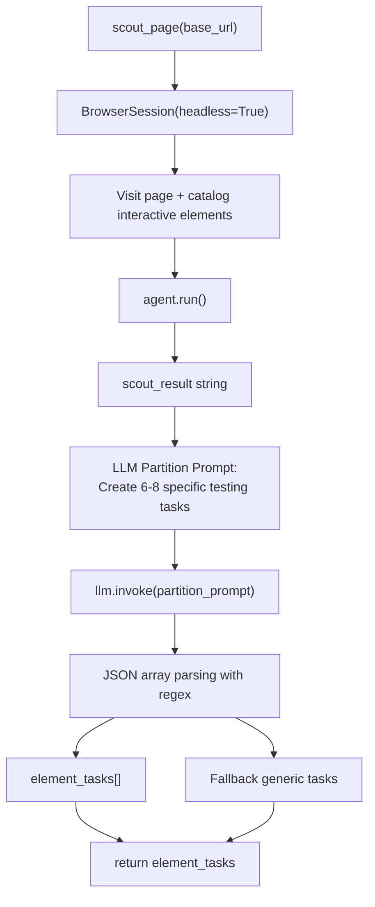

The scout agent operates in headless mode to minimize resource usage and performs comprehensive element discovery. The LLM then partitions discovered elements into specific, non-overlapping test scenarios.

Sources: [vibetest/agents.py:370-453](), [vibetest/agents.py:406-441]()

## Result Processing and Analysis

Test results undergo structured analysis through the `summarize_bug_reports()` function, which applies LLM-based severity classification and generates standardized reports.

### Analysis Pipeline

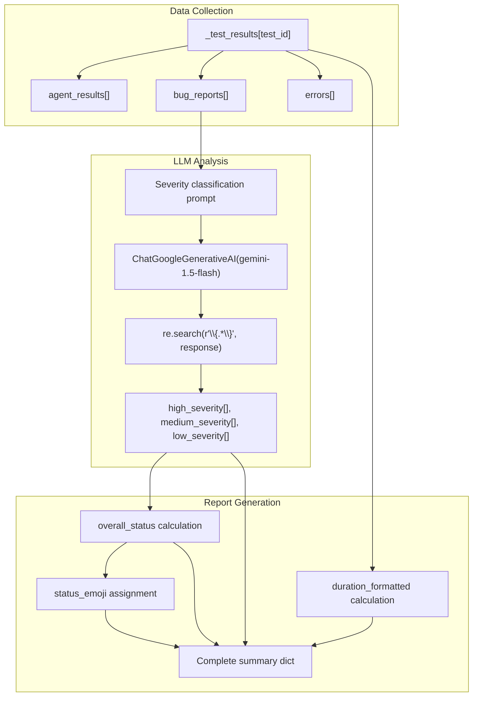

The analysis pipeline implements strict criteria for issue classification, requiring specific technical problems rather than subjective design opinions. Results include detailed severity breakdowns with actionable descriptions.

Sources: [vibetest/agents.py:191-368](), [vibetest/agents.py:240-281]()

## Data Storage and State Management

The system maintains test state through a global `_test_results` dictionary that persists throughout the server's lifecycle. Each test receives a UUID identifier and comprehensive metadata.

### Test Data Structure

| Field | Type | Description |
|-------|------|-------------|
| `test_id` | `str` | UUID identifier from `uuid.uuid4()` |
| `url` | `str` | Target URL being tested |
| `agents` | `int` | Number of agents spawned |
| `start_time` | `float` | Unix timestamp from `time.time()` |
| `end_time` | `float` | Completion timestamp |
| `duration` | `float` | Calculated execution time |
| `results` | `list` | Array of agent result dictionaries |
| `status` | `str` | Overall test status |

Individual agent results contain task descriptions, execution outcomes, timestamps, and error details when applicable.

Sources: [vibetest/agents.py:10](), [vibetest/agents.py:174-186]()

---

# Page: Core Components

# Core Components

<details>
<summary>Relevant source files</summary>

The following files were used as context for generating this wiki page:

- [vibetest/agents.py](vibetest/agents.py)
- [vibetest/mcp_server.py](vibetest/mcp_server.py)

</details>


The Vibetest Use system consists of three primary layers that work together to provide AI-powered website testing through browser agents. This page provides an overview of these components and their interactions. For detailed documentation of specific components, see the child pages:

- **Page 4.1** - MCP Server Interface: The FastMCP server that exposes testing tools to IDEs
- **Page 4.2** - Agent Orchestration System: The three-phase agent execution model including scout agent, QA agent pool, and results analysis

This overview focuses on how the components communicate and the key data structures that flow between them.

## Three-Layer Architecture

The system is organized into three distinct layers, each implemented in separate modules:

**Layer 1: MCP Interface** (`vibetest/mcp_server.py`)
- `FastMCP("vibetest")` - The MCP server instance
- `start()` tool - Initiates testing and returns `test_id`
- `results()` tool - Retrieves summarized test results

**Layer 2: Agent Orchestration** (`vibetest/agents.py`)
- `run_pool()` - Orchestrates scout and QA agents
- `scout_page()` - Discovers page elements and generates tasks
- `summarize_bug_reports()` - Analyzes results using LLM
- `_test_results` - In-memory storage dictionary

**Layer 3: Browser Automation** (via `browser_use` library)
- `Agent` - Browser agent with LLM-driven actions
- `BrowserSession` - Playwright session wrapper
- `ChatGoogle` - Google Gemini LLM integration

### Component Interaction Diagram

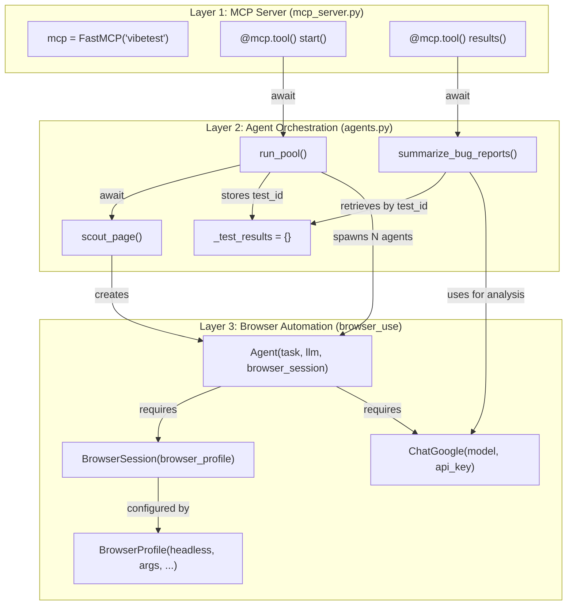

**Sources:** [vibetest/mcp_server.py:13-17](), [vibetest/mcp_server.py:19-38](), [vibetest/mcp_server.py:40-76](), [vibetest/agents.py:1-3](), [vibetest/agents.py:12](), [vibetest/agents.py:23-170](), [vibetest/agents.py:174-361](), [vibetest/agents.py:363-473]()

## Execution Flow

The following sequence diagram shows the complete execution flow from tool invocation to result retrieval, including all function calls and data structures:

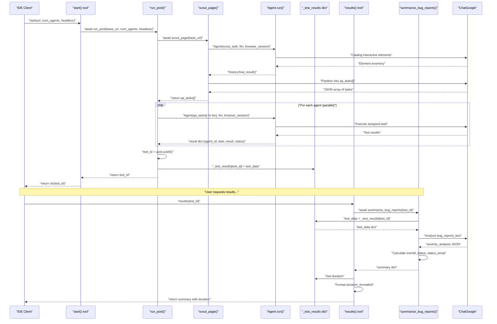

**Sources:** [vibetest/mcp_server.py:20-38](), [vibetest/mcp_server.py:41-76](), [vibetest/agents.py:23-170](), [vibetest/agents.py:363-473](), [vibetest/agents.py:174-361]()

## Component Function Mapping

| Layer | Module | Key Functions | Returns | Storage |
|-------|--------|---------------|---------|---------|
| **MCP Interface** | `mcp_server.py` | `start()`, `results()` | `str` (test_id), `dict` (summary) | None (delegates to agents) |
| **Orchestration** | `agents.py` | `run_pool()`, `scout_page()`, `summarize_bug_reports()` | `str` (test_id), `list` (tasks), `dict` (summary) | `_test_results` dict |
| **Automation** | `browser_use` | `Agent.run()`, `BrowserSession.aclose()` | `history` object | Browser state |
| **LLM** | `browser_use.llm` | `ChatGoogle.ainvoke()` | Response object | API state |

### Key Imports and Dependencies

```
vibetest/mcp_server.py:
    from mcp.server.fastmcp import FastMCP
    from .agents import run_pool, summarize_bug_reports

vibetest/agents.py:
    from browser_use import Agent, BrowserSession, BrowserProfile
    from browser_use.llm import ChatGoogle
    from browser_use.llm.messages import UserMessage
```

**Sources:** [vibetest/mcp_server.py:13-14](), [vibetest/agents.py:1-3](), [vibetest/agents.py:29-32](), [vibetest/agents.py:265-266]()

## Data Structures

The `_test_results` dictionary stores all test execution data using `test_id` as the key. The data structures flow through the system in three stages:

### Storage Schema

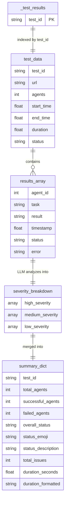

### Data Flow Through Functions

| Function | Input | Output | Side Effects |
|----------|-------|--------|--------------|
| `run_pool()` | `base_url`, `num_agents`, `headless` | `test_id` (str) | Stores in `_test_results[test_id]` |
| `scout_page()` | `base_url` | `qa_tasks` (list of str) | Creates temporary browser |
| `summarize_bug_reports()` | `test_id` | `summary` (dict) | Reads from `_test_results[test_id]` |
| `start()` tool | `url`, `num_agents`, `headless` | `test_id` (str) | Calls `run_pool()` |
| `results()` tool | `test_id` | `summary` (dict) | Calls `summarize_bug_reports()`, adds duration |

**Sources:** [vibetest/agents.py:12](), [vibetest/agents.py:157-169](), [vibetest/agents.py:116-122](), [vibetest/agents.py:203-210](), [vibetest/agents.py:303-331](), [vibetest/mcp_server.py:57-72]()

## Browser Configuration

The `run_pool()` function contains an internal `run_single_agent()` async function that configures each browser instance with optimized settings:

### Browser Configuration Flow

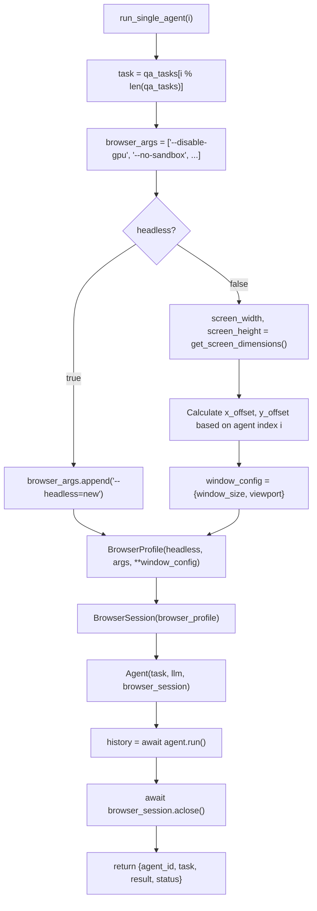

### Concurrency Control

The agents execute in parallel with a semaphore limit:

```python
# Line 140-149 in agents.py
semaphore = asyncio.Semaphore(min(num_agents, 10))

async def run_agent_with_semaphore(i: int):
    async with semaphore:
        return await run_single_agent(i)

results = await asyncio.gather(
    *[run_agent_with_semaphore(i) for i in range(num_agents)],
    return_exceptions=True
)
```

The system limits concurrent browser instances to a maximum of 10, regardless of the requested `num_agents` value.

**Sources:** [vibetest/agents.py:35-149](), [vibetest/agents.py:14-21](), [vibetest/agents.py:40-99](), [vibetest/agents.py:140-149]()

## AI Integration Points

The system integrates with Google's Gemini models at three critical points:

| Integration Point | Model | Temperature | Purpose |
|------------------|--------|-------------|---------|
| **scout_page()** | `gemini-1.5-flash` | 0.1 | Element discovery and task generation |
| **run_single_agent()** | `gemini-2.0-flash` | 0.9 | QA task execution with high creativity |
| **summarize_bug_reports()** | `gemini-1.5-flash` | 0.1 | Structured analysis and severity classification |

Each integration point uses `ChatGoogleGenerativeAI` with specific configurations optimized for its role in the testing pipeline.

**Sources:** [vibetest/agents.py:27-31](), [vibetest/agents.py:373-377](), [vibetest/agents.py:233-238]()

---

# Page: MCP Server Interface

# MCP Server Interface

<details>
<summary>Relevant source files</summary>

The following files were used as context for generating this wiki page:

- [vibetest.egg-info/entry_points.txt](vibetest.egg-info/entry_points.txt)
- [vibetest/mcp_server.py](vibetest/mcp_server.py)

</details>


This document covers the Model Context Protocol (MCP) server implementation in vibetest-use, including the FastMCP server setup, available tools, and JSON-RPC communication patterns. The MCP server acts as the primary interface between IDE clients (Claude, Cursor) and the browser automation system.

For information about the underlying browser agent system that the MCP server orchestrates, see [Browser Agent System](#4.2). For overall system architecture context, see [System Architecture](#3).

## FastMCP Server Implementation

The MCP server is implemented using the FastMCP framework in [vibetest/mcp_server.py](). The server is instantiated as a singleton instance named `mcp` and provides a clean interface for website testing operations.

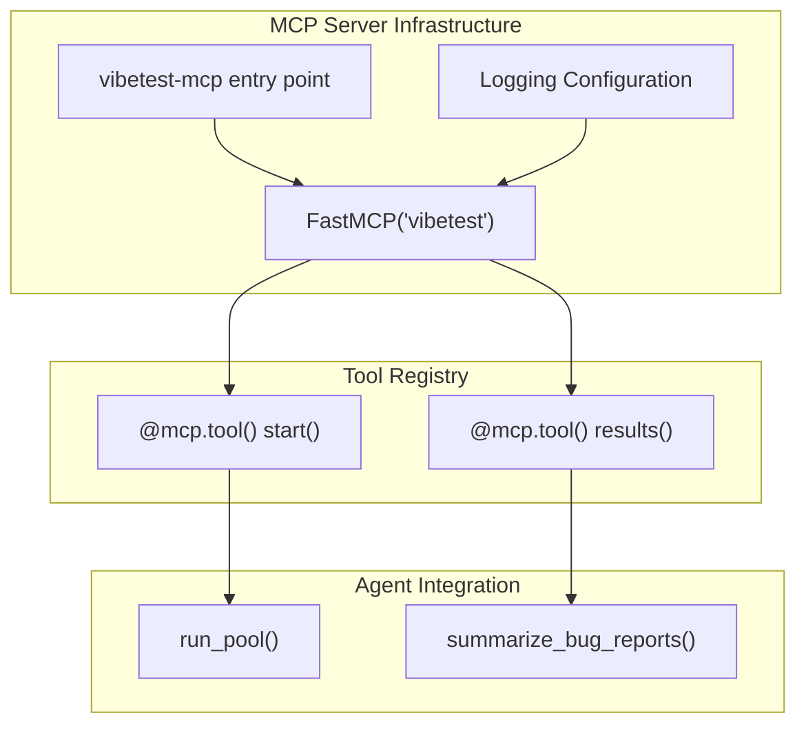

The server includes extensive logging suppression to prevent interference with JSON-RPC communication:

**Sources:** [vibetest/mcp_server.py:1-19]()

## Available Tools

The MCP server exposes two primary tools for website testing operations.

### start Tool

The `start` tool initiates a new website testing session with configurable parameters:

| Parameter | Type | Default | Description |
|-----------|------|---------|-------------|
| `url` | str | required | Target website URL to test |
| `num_agents` | int | 3 | Number of QA agents to spawn |
| `headless` | bool | False | Browser headless mode setting |

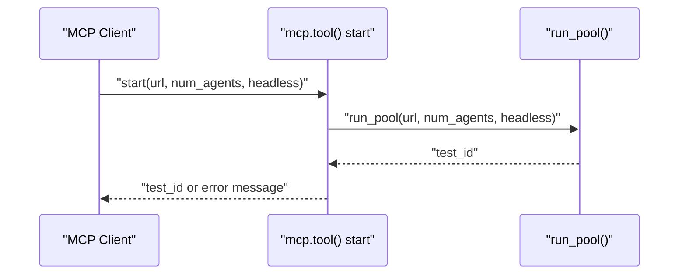

The tool returns a unique `test_id` string for tracking the test session or an error message if initialization fails.

**Sources:** [vibetest/mcp_server.py:21-37]()

### results Tool

The `results` tool retrieves consolidated bug reports for completed test runs:

| Parameter | Type | Description |
|-----------|------|-------------|
| `test_id` | str | Test ID returned from start tool |

The tool returns a comprehensive dictionary containing:
- Test results with detailed findings
- Duration information (seconds and formatted)
- Bug severity classifications
- Error details if retrieval fails

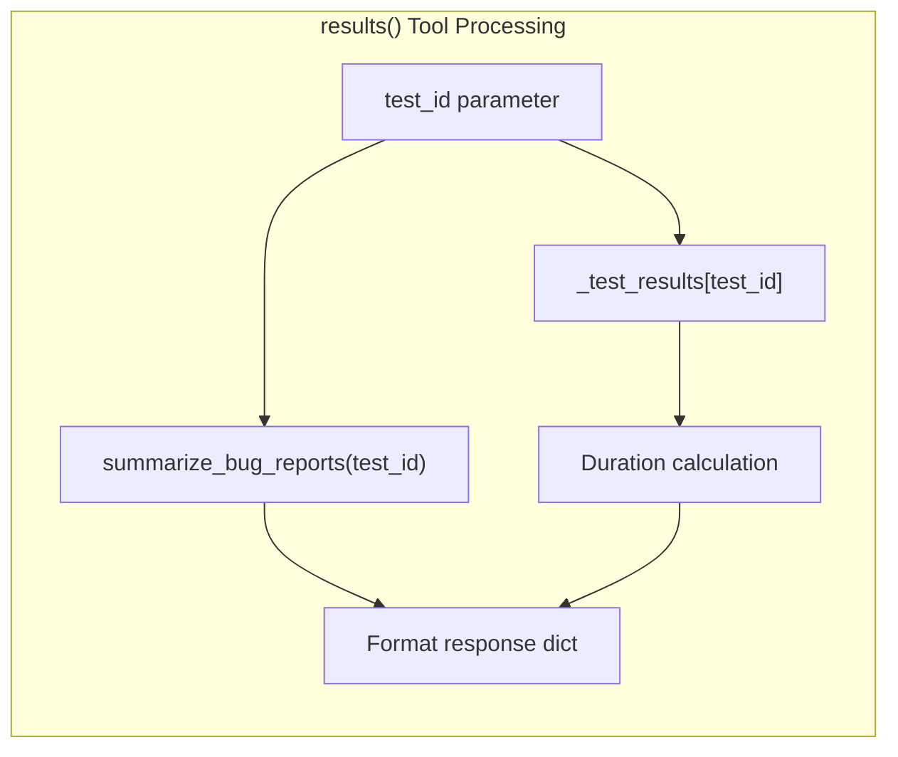

**Sources:** [vibetest/mcp_server.py:39-75]()

## JSON-RPC Communication Patterns

The FastMCP framework handles JSON-RPC protocol details automatically. The server communicates with MCP clients using standard JSON-RPC 2.0 message format:

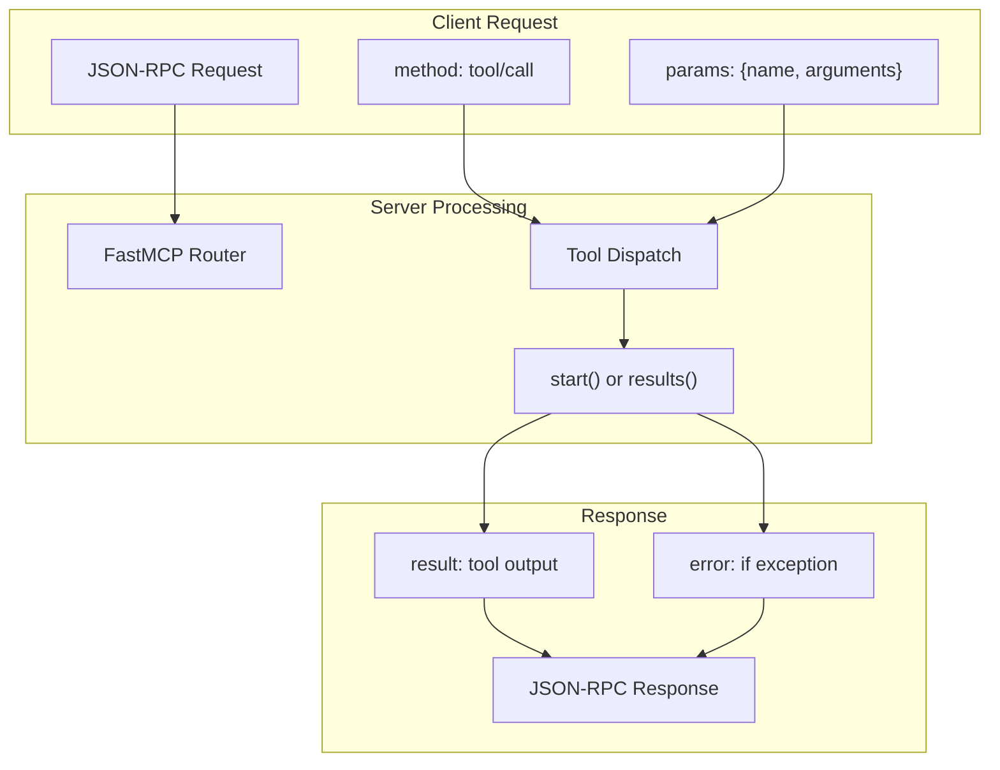

Error handling is implemented with try-catch blocks that return structured error messages rather than raising exceptions that could disrupt JSON-RPC communication.

**Sources:** [vibetest/mcp_server.py:33-37](), [vibetest/mcp_server.py:49-75]()

## Entry Point Configuration

The MCP server is configured as a console script entry point through the Python packaging system:

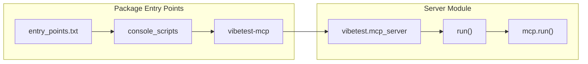

The entry point maps the `vibetest-mcp` command to the `run()` function in the MCP server module, enabling command-line execution and MCP client integration.

**Sources:** [vibetest.egg-info/entry_points.txt:1-3](), [vibetest/mcp_server.py:77-86]()

## Error Handling and Logging

The server implements comprehensive error suppression to ensure clean JSON-RPC communication:

| Configuration | Purpose |
|---------------|---------|
| `logging.disable(logging.CRITICAL)` | Completely disable Python logging |
| `ANONYMIZED_TELEMETRY=false` | Disable telemetry output |
| `BROWSER_USE_LOGGING_LEVEL=CRITICAL` | Suppress browser-use logging |
| `sys.stderr` redirection | Redirect stderr to devnull |

```mermaid
graph TD
    subgraph "Logging Suppression"
        PythonLogging["logging.disable(CRITICAL)"]
        TelemetryEnv["ANONYMIZED_TELEMETRY=false"]
        BrowserUseEnv["BROWSER_USE_LOGGING_LEVEL=CRITICAL"]
        StderrRedirect["sys.stderr → devnull"]
    end
    
    subgraph "JSON-RPC Protection"
        CleanOutput["Clean JSON-RPC Output"]
        NoInterference["No Log Interference"]
    end
    
    PythonLogging --> CleanOutput
    TelemetryEnv --> CleanOutput
    BrowserUseEnv --> CleanOutput
    StderrRedirect --> NoInterference
```

**Sources:** [vibetest/mcp_server.py:6-13]()

## Integration with Agent System

The MCP server acts as a facade for the underlying browser agent system, providing simplified tool interfaces while delegating complex operations:

```mermaid
graph TD
    subgraph "MCP Server Layer"
        StartTool["start() tool"]
        ResultsTool["results() tool"]
    end
    
    subgraph "Agent System Layer"
        RunPoolFunc["run_pool()"]
        SummarizeFunc["summarize_bug_reports()"]
        TestResults["_test_results storage"]
    end
    
    subgraph "Browser Automation"
        AgentPool["Browser Agent Pool"]
        TaskExecution["QA Task Execution"]
        BugReporting["Bug Report Generation"]
    end
    
    StartTool --> RunPoolFunc
    ResultsTool --> SummarizeFunc
    ResultsTool --> TestResults
    RunPoolFunc --> AgentPool
    AgentPool --> TaskExecution
    TaskExecution --> BugReporting
    SummarizeFunc --> TestResults
```

The server maintains stateless tool interfaces while the agent system handles stateful test execution and result storage.

**Sources:** [vibetest/mcp_server.py:16](), [vibetest/mcp_server.py:34](), [vibetest/mcp_server.py:50](), [vibetest/mcp_server.py:56-57]()

---

# Page: Agent Orchestration System

# Browser Agent System

<details>
<summary>Relevant source files</summary>

The following files were used as context for generating this wiki page:

- [vibetest/agents.py](vibetest/agents.py)

</details>


## Purpose and Scope

The Browser Agent System is the core automation engine of vibetest-use, responsible for orchestrating multiple concurrent browser agents to test website functionality. This system handles agent pool management, task distribution, browser configuration, and result aggregation. It implements a scout-then-test pattern where one agent discovers interactive elements before multiple agents execute specialized testing tasks in parallel.

For information about the MCP server interface that calls into this system, see [MCP Server Interface](#4.1). For details about dependencies and requirements, see [Dependencies and Requirements](#5).

## System Architecture Overview

The Browser Agent System operates through several interconnected components that manage the complete testing lifecycle from element discovery to result analysis.

**Browser Agent System Architecture**
```mermaid
graph TB
    subgraph "Entry Points"
        run_pool["run_pool()"]
        summarize["summarize_bug_reports()"]
    end
    
    subgraph "Agent Orchestration"
        scout["scout_page()"]
        semaphore["asyncio.Semaphore"]
        single_agent["run_single_agent()"]
    end
    
    subgraph "Browser Management"
        BrowserProfile["BrowserProfile"]
        BrowserSession["BrowserSession"] 
        Agent["Agent"]
        screen_dims["get_screen_dimensions()"]
    end
    
    subgraph "LLM Integration"
        ChatGoogleGenerativeAI["ChatGoogleGenerativeAI"]
        partition_task["Element Partitioning"]
        analyze_bugs["Bug Analysis"]
    end
    
    subgraph "Data Storage"
        test_results["_test_results dict"]
        task_queue["qa_tasks list"]
    end
    
    run_pool --> scout
    run_pool --> semaphore
    semaphore --> single_agent
    single_agent --> BrowserProfile
    single_agent --> BrowserSession
    single_agent --> Agent
    single_agent --> screen_dims
    
    scout --> ChatGoogleGenerativeAI
    scout --> partition_task
    
    summarize --> ChatGoogleGenerativeAI
    summarize --> analyze_bugs
    
    scout --> task_queue
    single_agent --> test_results
    summarize --> test_results
```

Sources: [vibetest/agents.py:21-187](), [vibetest/agents.py:370-453](), [vibetest/agents.py:191-368]()

## Agent Pool Management

The `run_pool()` function serves as the primary entry point for coordinating multiple browser agents. It implements a semaphore-based concurrency model to control resource usage while maximizing parallel execution.

**Agent Pool Execution Flow**
```mermaid
sequenceDiagram
    participant Pool as "run_pool()"
    participant Scout as "scout_page()"
    participant Semaphore as "asyncio.Semaphore"
    participant Agents as "run_single_agent()"
    participant Storage as "_test_results"
    
    Pool->>Scout: "Discover interactive elements"
    Scout-->>Pool: "qa_tasks list"
    
    Pool->>Semaphore: "Initialize with min(num_agents, 10)"
    
    loop "For each agent"
        Pool->>Semaphore: "acquire()"
        Semaphore->>Agents: "run_single_agent(i)"
        Agents-->>Semaphore: "agent result"
        Semaphore->>Pool: "release()"
    end
    
    Pool->>Storage: "Store test_data with test_id"
    Pool-->>Pool: "Return test_id"
```

The system generates a unique `test_id` using `uuid.uuid4()` and tracks execution timing for performance analysis. Agent tasks are distributed using modulo operation to cycle through available QA tasks when there are more agents than tasks.

Key implementation details:
- **Concurrency Control**: Maximum 10 concurrent agents via semaphore [vibetest/agents.py:150]()
- **Task Distribution**: Round-robin assignment using `qa_tasks[i % len(qa_tasks)]` [vibetest/agents.py:34]()
- **Exception Handling**: `return_exceptions=True` prevents single agent failures from crashing the pool [vibetest/agents.py:156-159]()

Sources: [vibetest/agents.py:21-187](), [vibetest/agents.py:149-159]()

## Scout System

The scout system implements a two-phase discovery process: initial element inventory followed by LLM-driven task partitioning. The `scout_page()` function operates in headless mode to efficiently catalog all interactive elements without visual overhead.

| Scout Phase | Function | Purpose |
|-------------|----------|---------|
| Discovery | `Agent.run()` with scout_task | Catalog all interactive elements |
| Partitioning | `ChatGoogleGenerativeAI.invoke()` | Generate specific testing tasks |
| Fallback | Static task list | Ensure testing continues if LLM fails |

**Scout Task Generation Process**
```mermaid
graph LR
    url["base_url"] --> scout_task["Scout Task: 'Visit URL and identify ALL interactive elements'"]
    scout_task --> agent_run["Agent.run()"]
    agent_run --> scout_result["Element inventory"]
    
    scout_result --> partition_prompt["LLM Partition Prompt"]
    partition_prompt --> llm_invoke["ChatGoogleGenerativeAI.invoke()"]
    llm_invoke --> json_parse["JSON Response Parsing"]
    
    json_parse --> element_tasks["Specific Testing Tasks"]
    json_parse --> fallback_tasks["Static Fallback Tasks"]
    
    element_tasks --> qa_tasks["Final QA Task List"]
    fallback_tasks --> qa_tasks
```

The scout uses `gemini-1.5-flash` with low temperature (0.1) for consistent element discovery. Task partitioning aims for 6-8 distinct tasks to balance thoroughness with execution time.

**Scout Configuration**:
- **Browser Profile**: Headless with security disabled [vibetest/agents.py:379-387]()
- **LLM Model**: `gemini-1.5-flash` with temperature 0.1 [vibetest/agents.py:374-377]()
- **Task Format**: JSON array with specific element descriptions [vibetest/agents.py:413-421]()

Sources: [vibetest/agents.py:370-453](), [vibetest/agents.py:406-441]()

## Task Generation and Distribution

The system employs sophisticated task partitioning to ensure comprehensive coverage without element overlap. Each generated task specifies exact elements to test, including button text, link descriptions, and form field locations.

**Task Distribution Algorithm**
```mermaid
graph TB
    scout_result["Scout Element Inventory"] --> partition_prompt["LLM Partitioning Prompt"]
    
    partition_prompt --> llm_response["LLM JSON Response"]
    llm_response --> regex_parse["Regex: r'\\[.*\\]'"]
    
    regex_parse --> element_tasks["Parsed Element Tasks"]
    regex_parse --> parse_failure["Parse Failure"]
    
    parse_failure --> fallback_tasks["Static Fallback Tasks"]
    element_tasks --> task_assignment["Round-Robin Assignment"]
    fallback_tasks --> task_assignment
    
    task_assignment --> agent1["Agent 1: Task i%len(tasks)"]
    task_assignment --> agent2["Agent 2: Task (i+1)%len(tasks)"]
    task_assignment --> agentN["Agent N: Task (i+N-1)%len(tasks)"]
```

The fallback task generation ensures testing continues even when LLM partitioning fails, providing coverage for common website areas:
- Header navigation elements
- Main content links and buttons  
- Footer links and elements
- Form elements
- Sidebar or secondary navigation
- Remaining interactive elements

Sources: [vibetest/agents.py:406-441](), [vibetest/agents.py:432-439]()

## Browser Configuration and Window Management

The system implements sophisticated browser configuration with dynamic window positioning for non-headless mode and optimized settings for both visual testing and headless execution.

**Window Positioning Algorithm**
```mermaid
graph TB
    headless_check{"headless mode?"}
    headless_check -->|"Yes"| headless_config["Basic browser args only"]
    headless_check -->|"No"| screen_dims["get_screen_dimensions()"]
    
    screen_dims --> window_calc["Calculate window grid"]
    window_calc --> position_calc["Calculate x,y position"]
    position_calc --> bounds_check["Check screen bounds"]
    bounds_check --> window_config["Apply window configuration"]
    
    window_config --> browser_profile["BrowserProfile creation"]
    headless_config --> browser_profile
    
    browser_profile --> browser_session["BrowserSession"]
    browser_session --> zoom_setup["Apply 0.25x zoom"]
```

**Window Configuration Parameters**:
| Parameter | Value | Purpose |
|-----------|-------|---------|
| Window Width | 300px | Compact agent windows |
| Window Height | 400px | Adequate viewport height |
| Viewport Width | 280px | Content area within window |
| Viewport Height | 350px | Content area within window |
| Margin | 10px | Screen edge spacing |
| Spacing | 15px | Inter-window spacing |

The system calculates grid positioning with `windows_per_row = max(1, usable_width // (window_width + spacing))` and applies bounds checking to prevent windows from extending beyond screen edges.

**Browser Profile Configuration**:
- **Security**: `disable_security=True` for testing flexibility [vibetest/agents.py:78]()
- **Timing**: 2.0s network idle, 8.0s max page load [vibetest/agents.py:82-83]()
- **Automation**: Ignores `--enable-automation` flag [vibetest/agents.py:81]()
- **Zoom**: 0.25x zoom applied via JavaScript for compact display [vibetest/agents.py:101-104]()

Sources: [vibetest/agents.py:12-19](), [vibetest/agents.py:42-86](), [vibetest/agents.py:94-111]()

## Agent Execution and Browser Control

Individual agent execution combines Browser-Use Agent instances with Google Gemini LLM for intelligent website interaction. Each agent operates in an isolated browser session with vision capabilities enabled.

**Agent Execution Components**
```mermaid
graph LR
    subgraph "Agent Setup"
        task_desc["task_description"]
        llm_gemini["ChatGoogleGenerativeAI gemini-2.0-flash"]
        browser_session["BrowserSession"]
    end
    
    subgraph "Browser-Use Integration"
        Agent["Agent(task, llm, browser_session, use_vision=True)"]
        agent_run["agent.run()"]
        history["ActionHistory"]
    end
    
    subgraph "Result Processing"
        final_result["history.final_result()"]
        result_dict["Agent Result Dictionary"]
        error_handling["Exception Handling"]
    end
    
    task_desc --> Agent
    llm_gemini --> Agent
    browser_session --> Agent
    
    Agent --> agent_run
    agent_run --> history
    history --> final_result
    final_result --> result_dict
    
    agent_run --> error_handling
    error_handling --> result_dict
```

**Agent Configuration**:
- **LLM Model**: `gemini-2.0-flash` with temperature 0.9 for creative testing [vibetest/agents.py:27-31]()
- **Vision**: `use_vision=True` enables screenshot analysis [vibetest/agents.py:118]()
- **Browser Session**: Isolated session per agent with custom profile [vibetest/agents.py:88-91]()

The result dictionary structure captures comprehensive execution metadata:
```python
{
    "agent_id": int,
    "task": str,
    "result": str,  # or "error": str
    "timestamp": float,
    "status": "success" | "error"
}
```

Sources: [vibetest/agents.py:33-147](), [vibetest/agents.py:114-132]()

## Result Processing and Analysis

The `summarize_bug_reports()` function implements a sophisticated multi-stage analysis pipeline that transforms raw agent results into structured bug reports with severity classification.

**Bug Report Analysis Pipeline**
```mermaid
graph TB
    test_id["test_id lookup"] --> test_data["_test_results[test_id]"]
    test_data --> separation["Separate success/error results"]
    
    separation --> bug_reports["Extract bug reports"]
    separation --> errors["Collect errors"]
    
    bug_reports --> llm_prompt["Structured analysis prompt"]
    llm_prompt --> gemini_analysis["ChatGoogleGenerativeAI gemini-1.5-flash"]
    
    gemini_analysis --> json_extraction["Regex JSON extraction"]
    json_extraction --> severity_classification["High/Medium/Low severity"]
    
    severity_classification --> status_determination["Overall status calculation"]
    status_determination --> final_summary["Complete summary dict"]
    
    gemini_analysis --> analysis_error["LLM Analysis Error"]
    analysis_error --> fallback_analysis["Fallback severity assignment"]
    fallback_analysis --> final_summary
```

**Severity Classification Logic**:
| Condition | Status | Emoji | Description |
|-----------|--------|-------|-------------|
| High severity issues > 0 | `high-severity` | 🔴 | Critical issues need immediate attention |
| Medium severity issues > 0 | `medium-severity` | 🟠 | Moderate issues should be addressed |
| Low severity issues > 0 | `low-severity` | 🟡 | Minor issues could be improved |
| No issues found | `passing` | ✅ | No technical issues detected |

The LLM analysis prompt emphasizes objective issue identification, requiring specific details:
- Exact element descriptions (button names, link text)
- Specific actions taken (clicked, typed, submitted)
- Exact results observed (404 errors, server failures)
- Relevant context from agent testing

**Analysis Model Configuration**:
- **Model**: `gemini-1.5-flash` with temperature 0.1 for consistent analysis [vibetest/agents.py:234-238]()
- **Output Format**: Structured JSON with severity categories [vibetest/agents.py:264-281]()
- **Fallback**: Manual review classification when LLM fails [vibetest/agents.py:342-353]()

Sources: [vibetest/agents.py:191-368](), [vibetest/agents.py:240-281](), [vibetest/agents.py:304-327]()

## Error Handling and Cleanup

The system implements comprehensive error handling at multiple levels to ensure robust operation and proper resource cleanup, particularly important given the resource-intensive nature of browser automation.

**Error Handling Strategy**
```mermaid
graph TB
    subgraph "Agent Level"
        agent_exception["Agent Exception"]
        browser_cleanup["browser_session.close()"]
        error_result["Error result dict"]
    end
    
    subgraph "Pool Level"
        return_exceptions["return_exceptions=True"]
        result_filtering["Filter Exception instances"]
        process_cleanup["Browser process cleanup"]
    end
    
    subgraph "System Level"
        pkill_chromium["pkill -f chromium (macOS)"]
        sleep_delay["asyncio.sleep(1)"]
        platform_check["platform.system() == 'Darwin'"]
    end
    
    agent_exception --> browser_cleanup
    browser_cleanup --> error_result
    
    error_result --> return_exceptions
    return_exceptions --> result_filtering
    result_filtering --> process_cleanup
    
    process_cleanup --> platform_check
    platform_check --> sleep_delay
    sleep_delay --> pkill_chromium
```

**Cleanup Operations**:
1. **Individual Agent**: Browser session closure in finally block [vibetest/agents.py:135-139]()
2. **Pool Level**: Exception isolation via `return_exceptions=True` [vibetest/agents.py:158]()
3. **System Level**: Platform-specific process cleanup [vibetest/agents.py:164-171]()

**Error Result Structure**:
```python
{
    "agent_id": int,
    "task": str,
    "error": str,
    "timestamp": float,
    "status": "error"
}
```

The cleanup mechanism addresses common browser automation issues:
- **Zombie Processes**: Explicit chromium process termination on macOS
- **Resource Leaks**: Guaranteed browser session closure
- **Exception Propagation**: Isolated failures don't crash the entire pool

Sources: [vibetest/agents.py:134-147](), [vibetest/agents.py:163-171](), [vibetest/agents.py:181]()

---

# Page: Scout Agent

# Scout Agent

<details>
<summary>Relevant source files</summary>

The following files were used as context for generating this wiki page:

- [vibetest/agents.py](vibetest/agents.py)

</details>


## Purpose and Scope

The Scout Agent is the discovery phase of the Vibetest Use system, responsible for intelligently mapping a website's interactive elements and generating specific test tasks for QA agents. Implemented in the `scout_page` function [vibetest/agents.py:363-473](), it operates in headless mode to catalog buttons, links, forms, and other interactive elements without executing any interactions. The scout then uses LLM-based partitioning to divide the discovered elements into 6-8 distinct, non-overlapping test tasks.

This document covers the scout's architecture, LLM interaction strategy, and task generation logic. For information about how these tasks are executed, see [QA Agent Pool](#4.2.2). For the full orchestration flow, see [Agent Orchestration System](#4.2).

**Sources**: [vibetest/agents.py:363-473]()

## Scout Agent Architecture

The scout operates as a single-purpose, headless browser agent that performs reconnaissance before the parallel testing phase. It integrates with the Browser-Use library and Google Gemini API to perform visual analysis of web pages.

### Scout Execution Flow

```mermaid
graph TB
    subgraph Input["Input Phase"]
        URL["base_url<br/>(e.g., https://example.com)"]
    end
    
    subgraph Scout["Scout Agent Execution"]
        LLM_Init["ChatGoogle<br/>model: gemini-2.0-flash-exp<br/>temperature: 0.9"]
        Profile["BrowserProfile<br/>headless: True<br/>disable_security: True"]
        Session["BrowserSession"]
        Task["scout_task string<br/>'Navigate to URL and catalog<br/>ALL interactive elements'"]
        Agent["Agent<br/>use_vision: True"]
        Run["agent.run()"]
        History["history.final_result()"]
    end
    
    subgraph Partition["LLM Partitioning Phase"]
        ScoutResult["scout_result<br/>(element catalog string)"]
        PartitionPrompt["partition_prompt<br/>'Create 6-8 specific tasks'"]
        LLMInvoke["llm.ainvoke()"]
        ParseJSON["JSON array parsing<br/>regex: r'\[.*\]'"]
        ElementTasks["element_tasks<br/>(list of task strings)"]
    end
    
    subgraph Fallback["Error Handling"]
        Exception["Exception caught"]
        FallbackTasks["6 generic fallback tasks<br/>(header, content, footer, etc.)"]
    end
    
    URL --> LLM_Init
    LLM_Init --> Profile
    Profile --> Session
    Session --> Agent
    Task --> Agent
    Agent --> Run
    Run --> History
    
    History --> ScoutResult
    ScoutResult --> PartitionPrompt
    PartitionPrompt --> LLMInvoke
    LLMInvoke --> ParseJSON
    ParseJSON --> ElementTasks
    
    Exception -.-> FallbackTasks
    
    ElementTasks --> Output["Return: list[str]"]
    FallbackTasks -.-> Output
    
    Session -.->|"browser_session.aclose()"| Cleanup["Browser Cleanup"]
```

**Sources**: [vibetest/agents.py:363-473]()

### Component Integration

```mermaid
graph LR
    subgraph CoreFunction["scout_page Function"]
        FuncDef["async def scout_page(base_url: str) -> list"]
    end
    
    subgraph Dependencies["External Dependencies"]
        ChatGoogle["ChatGoogle<br/>(browser_use.llm)"]
        BrowserProfile["BrowserProfile<br/>(browser_use)"]
        BrowserSession["BrowserSession<br/>(browser_use)"]
        Agent["Agent<br/>(browser_use)"]
        UserMessage["UserMessage<br/>(browser_use.llm.messages)"]
    end
    
    subgraph Configuration["Browser Configuration"]
        Args["args list<br/>--headless=new<br/>--disable-gpu<br/>--no-sandbox<br/>--disable-dev-shm-usage"]
        Timeouts["wait_for_network_idle: 1.0s<br/>maximum_wait_page_load: 5.0s<br/>wait_between_actions: 0.3s"]
    end
    
    subgraph APIIntegration["Google Gemini API"]
        APIKey["get_google_api_key()"]
        Model["gemini-2.0-flash-exp"]
    end
    
    FuncDef --> ChatGoogle
    FuncDef --> BrowserProfile
    FuncDef --> BrowserSession
    FuncDef --> Agent
    FuncDef --> UserMessage
    
    BrowserProfile --> Args
    BrowserProfile --> Timeouts
    
    ChatGoogle --> APIKey
    ChatGoogle --> Model
```

**Sources**: [vibetest/agents.py:363-392](), [vibetest/agents.py:5-10]()

## Browser Configuration

The scout agent uses an optimized headless browser configuration designed for fast execution and minimal resource usage. The configuration is defined at [vibetest/agents.py:372-390]().

### Browser Profile Settings

| Setting | Value | Purpose |
|---------|-------|---------|
| `headless` | `True` | Runs without GUI for speed and resource efficiency |
| `disable_security` | `True` | Allows testing of local/development sites |
| `user_data_dir` | `None` | No persistent browser data |
| `wait_for_network_idle_page_load_time` | `1.0` | Reduced from default for faster page loads |
| `maximum_wait_page_load_time` | `5.0` | Timeout limit for page loading |
| `wait_between_actions` | `0.3` | Minimal delay between browser actions |

### Browser Arguments

The scout uses aggressive browser optimization flags [vibetest/agents.py:376-386]():

```
--disable-gpu
--no-sandbox
--disable-dev-shm-usage
--headless=new
--disable-background-timer-throttling
--disable-backgrounding-occluded-windows
--disable-renderer-backgrounding
--disable-features=TranslateUI
--disable-component-extensions-with-background-pages
--no-first-run
--no-default-browser-check
--disable-background-networking
```

These flags minimize startup time, disable unnecessary features, and reduce resource consumption during the scouting phase.

**Sources**: [vibetest/agents.py:372-390]()

## Scout Task Generation

The scout agent receives a carefully crafted task instruction designed to perform observation without interaction [vibetest/agents.py:395]():

```
Navigate to {base_url} using the go_to_url action, then identify ALL 
interactive elements on the page. Do NOT click anything, just observe 
and catalog what's available. List buttons, links, forms, input fields, 
menus, dropdowns, and any other clickable elements you can see. Provide 
a comprehensive inventory.
```

This instruction leverages the vision-enabled agent (`use_vision=True`) to perform visual analysis of the page, identifying interactive elements through both DOM inspection and visual observation.

**Sources**: [vibetest/agents.py:395-402]()

## LLM-Based Task Partitioning

After the scout catalogues elements, the system uses a second LLM call to partition the discovered elements into specific, non-overlapping test tasks. This two-stage approach separates discovery from task planning.

### Partitioning Flow

```mermaid
sequenceDiagram
    participant Scout as scout_page function
    participant Agent as Scout Agent
    participant LLM as ChatGoogle<br/>(gemini-2.0-flash-exp)
    participant Parser as JSON Parser
    
    Scout->>Agent: Execute scout_task
    Agent->>LLM: "Catalog all interactive elements"
    LLM-->>Agent: Element descriptions
    Agent-->>Scout: scout_result (string)
    
    Scout->>Scout: Build partition_prompt
    Note over Scout: Template includes scout_result<br/>and base_url
    
    Scout->>LLM: partition_prompt<br/>(via UserMessage)
    Note over LLM: "Create 6-8 specific tasks<br/>Format as JSON array"
    
    LLM-->>Scout: partition_response
    
    Scout->>Parser: regex.search(r'\[.*\]')
    
    alt JSON found
        Parser-->>Scout: element_tasks (parsed list)
    else No JSON match
        Parser-->>Scout: None
        Scout->>Scout: Generate fallback_tasks
    end
    
    Scout-->>Scout: Return element_tasks
```

**Sources**: [vibetest/agents.py:414-462]()

### Partition Prompt Template

The partition prompt [vibetest/agents.py:415-430]() instructs the LLM to:

1. **Analyze** the scout report of interactive elements
2. **Create** 6-8 distinct testing tasks
3. **Specify** exact elements to test (by text, location, or description)
4. **Avoid** overlap between tasks
5. **Include** navigation instructions in each task
6. **Format** as a JSON array

Example partition prompt structure:

```
Based on this scout report of interactive elements found on {base_url}:

{scout_result}

Create a list of specific testing tasks, each focusing on different 
elements. Each task should specify exactly which elements to test 
(by their text, location, or description). Aim for 6-8 distinct 
tasks that cover different elements without overlap.

Format as JSON array:
[
    "Navigate to {base_url} using go_to_url, then test the 
     [specific element description] - click on [exact button/link 
     text or location]",
    ...
]
```

**Sources**: [vibetest/agents.py:415-430]()

## Response Parsing and Handling

The scout implements robust parsing logic to handle various LLM response formats [vibetest/agents.py:437-450]().

### Multi-Attribute Response Handling

```mermaid
graph TB
    Response["partition_response object"]
    
    Check1{{"hasattr(response, 'content')"}}
    Check2{{"hasattr(response, 'completion')"}}
    Check3{{"hasattr(response, 'text')"}}
    
    Content["response_text = str(response.content)"]
    Completion["response_text = str(response.completion)"]
    Text["response_text = str(response.text)"]
    Fallback["response_text = str(response)"]
    
    RegexSearch["json_match = re.search(r'\[.*\]')"]
    
    JSONFound{{"json_match exists"}}
    Parse["element_tasks = json.loads(match)"]
    FallbackTasks["element_tasks = 6 generic tasks"]
    
    Return["return element_tasks"]
    
    Response --> Check1
    Check1 -->|Yes| Content
    Check1 -->|No| Check2
    Check2 -->|Yes| Completion
    Check2 -->|No| Check3
    Check3 -->|Yes| Text
    Check3 -->|No| Fallback
    
    Content --> RegexSearch
    Completion --> RegexSearch
    Text --> RegexSearch
    Fallback --> RegexSearch
    
    RegexSearch --> JSONFound
    JSONFound -->|Yes| Parse
    JSONFound -->|No| FallbackTasks
    
    Parse --> Return
    FallbackTasks --> Return
```

This multi-level fallback strategy ensures the scout always returns a usable task list, even if LLM response formats change or JSON parsing fails.

**Sources**: [vibetest/agents.py:437-462]()

## Fallback Task Generation

If the scout agent fails (network error, timeout, LLM error), the system provides six generic fallback tasks [vibetest/agents.py:464-473]():

| Task Index | Task Description |
|------------|------------------|
| 0 | Test navigation elements in the header area |
| 1 | Test main content links and buttons |
| 2 | Test footer links and elements |
| 3 | Test any form elements found |
| 4 | Test sidebar or secondary navigation |
| 5 | Test any remaining interactive elements |

These fallback tasks provide broad coverage across common website sections, ensuring testing can proceed even when intelligent scouting fails.

**Sources**: [vibetest/agents.py:464-473]()

## Resource Management

The scout implements proper resource cleanup to prevent lingering browser processes [vibetest/agents.py:405-410]().

### Cleanup Pattern

```mermaid
graph TB
    TryBlock["try:<br/>agent = Agent(...)<br/>history = await agent.run()"]
    FinallyBlock["finally:<br/>await browser_session.aclose()"]
    ExceptionCatch["except Exception:<br/>pass"]
    
    TryBlock --> FinallyBlock
    FinallyBlock --> ExceptionCatch
    ExceptionCatch --> Return["Return scout_result or fallback"]
    
    Note["Browser session cleanup<br/>always executes,<br/>preventing zombie processes"]
    
    FinallyBlock -.-> Note
```

The `finally` block ensures browser session closure even if the scout agent encounters errors. The inner `try-except` on `aclose()` prevents cleanup failures from affecting the overall scouting process.

**Sources**: [vibetest/agents.py:394-410]()

## Integration with Agent Pool

The scout agent is called at the beginning of `run_pool` to generate tasks before spawning QA agents [vibetest/agents.py:27]():

```python
qa_tasks = await scout_page(base_url)
```

The returned task list is then distributed round-robin to QA agents:

```python
task_description = qa_tasks[i % len(qa_tasks)]
```

This ensures even task distribution across all agents. If 5 agents are spawned and 8 tasks are generated, agents 0-4 receive tasks 0-4, and agents 0-2 receive tasks 5-7 (wrapping around).

**Sources**: [vibetest/agents.py:27](), [vibetest/agents.py:36]()

## Model Selection and Temperature

The scout uses `gemini-2.0-flash-exp` with `temperature=0.9` [vibetest/agents.py:366-370](). This configuration choice reflects:

- **Model**: Flash variant for fast response times during discovery
- **Temperature**: High (0.9) to encourage creative exploration and diverse element identification
- **Version**: 2.0 experimental for latest multimodal capabilities

This contrasts with the results analysis phase, which uses `gemini-1.5-flash` at `temperature=0.1` for more deterministic, analytical outputs (see [Results Analysis](#4.2.3)).

**Sources**: [vibetest/agents.py:366-370]()

## Example Task Output

Given a scout discovering elements on a blog homepage, the partition phase might generate:

```json
[
  "Navigate to https://blog.example.com using go_to_url, then test the 'Subscribe' button in the header - click on the button labeled 'Subscribe to Newsletter'",
  "Navigate to https://blog.example.com using go_to_url, then test the search functionality - click on the search icon and enter a test query",
  "Navigate to https://blog.example.com using go_to_url, then test the category navigation - click on 'Technology' in the sidebar menu",
  "Navigate to https://blog.example.com using go_to_url, then test the 'Read More' links in article previews - click on the first article's read more button",
  "Navigate to https://blog.example.com using go_to_url, then test social media links in the footer - click on the Twitter icon",
  "Navigate to https://blog.example.com using go_to_url, then test the contact form - fill in name, email, and message fields"
]
```

Each task includes explicit navigation instructions and specific element descriptions, enabling QA agents to execute precise, focused tests.

**Sources**: [vibetest/agents.py:415-430]()

## Performance Characteristics

| Metric | Value | Configuration |
|--------|-------|---------------|
| Average execution time | 10-20 seconds | Depends on page complexity |
| Browser startup | ~2 seconds | Optimized with fast-start flags |
| Page load timeout | 5 seconds | `maximum_wait_page_load_time` |
| Network idle wait | 1 second | `wait_for_network_idle_page_load_time` |
| LLM calls | 2 per scout | Initial catalog + partition |
| Concurrency | 1 (serial) | Single headless browser |

The scout's serial execution is acceptable because it runs only once per test session, before parallel QA agent deployment.

**Sources**: [vibetest/agents.py:387-389]()

---

# Page: QA Agent Pool

# QA Agent Pool

<details>
<summary>Relevant source files</summary>

The following files were used as context for generating this wiki page:

- [vibetest/agents.py](vibetest/agents.py)

</details>


## Purpose and Scope

This document details the `run_pool` function ([vibetest/agents.py:23-170]()), which implements the parallel QA agent execution system. It covers task distribution, browser configuration, window management, concurrent execution control, and result collection.

For information about how test tasks are generated, see [Scout Agent](#4.2.1). For details on how collected results are analyzed and summarized, see [Results Analysis](#4.2.3).

**Sources**: [vibetest/agents.py:23-170]()

---

## Function Overview

The `run_pool` function orchestrates multiple browser-based QA agents that test a target URL in parallel. It coordinates the three-phase testing process:

1. **Task Generation**: Calls `scout_page` to discover testable elements
2. **Parallel Execution**: Spawns multiple agents with optimized browser configurations
3. **Result Collection**: Aggregates findings into an in-memory store indexed by `test_id`

```python
async def run_pool(base_url: str, num_agents: int = 3, headless: bool = False) -> str
```

**Sources**: [vibetest/agents.py:23-26]()

---

## Function Signature and Parameters

| Parameter | Type | Default | Description |
|-----------|------|---------|-------------|
| `base_url` | `str` | Required | Target URL to test (e.g., `https://example.com` or `localhost:3000`) |
| `num_agents` | `int` | `3` | Number of parallel QA agents to spawn |
| `headless` | `bool` | `False` | Whether to run browsers in headless mode |

**Return Value**: `str` - UUID test identifier for retrieving results later

The function generates a unique `test_id` using `uuid.uuid4()` and records execution timing from `start_time` to `end_time` for duration tracking.

**Sources**: [vibetest/agents.py:23-25]()

---

## Execution Flow Diagram

```mermaid
flowchart TD
    START["run_pool(base_url, num_agents, headless)"]
    GEN_ID["Generate test_id = uuid.uuid4()"]
    SCOUT["qa_tasks = await scout_page(base_url)"]
    CREATE_LLM["llm = ChatGoogle(gemini-2.0-flash-exp)"]
    DEFINE_FUNC["Define run_single_agent(i)"]
    CREATE_SEM["semaphore = Semaphore(min(num_agents, 10))"]
    SPAWN["asyncio.gather([run_agent_with_semaphore(i) for i in range(num_agents)])"]
    
    subgraph "run_single_agent(i)"
        GET_TASK["task = qa_tasks[i % len(qa_tasks)]"]
        BUILD_ARGS["browser_args = [--disable-gpu, ...]"]
        CALC_POS["Calculate window position (x,y)"]
        BUILD_PROFILE["BrowserProfile(headless, args, window_config)"]
        CREATE_SESSION["BrowserSession(browser_profile)"]
        CREATE_AGENT["Agent(task, llm, browser_session)"]
        RUN["history = await agent.run()"]
        CLOSE["await browser_session.aclose()"]
        RETURN_RESULT["return {agent_id, task, result, timestamp, status}"]
        
        GET_TASK --> BUILD_ARGS
        BUILD_ARGS --> CALC_POS
        CALC_POS --> BUILD_PROFILE
        BUILD_PROFILE --> CREATE_SESSION
        CREATE_SESSION --> CREATE_AGENT
        CREATE_AGENT --> RUN
        RUN --> CLOSE
        CLOSE --> RETURN_RESULT
    end
    
    COLLECT["results = gather output"]
    STORE["_test_results[test_id] = {test_id, url, results, duration, ...}"]
    RETURN["return test_id"]
    
    START --> GEN_ID
    GEN_ID --> SCOUT
    SCOUT --> CREATE_LLM
    CREATE_LLM --> DEFINE_FUNC
    DEFINE_FUNC --> CREATE_SEM
    CREATE_SEM --> SPAWN
    SPAWN --> GET_TASK
    RETURN_RESULT --> COLLECT
    COLLECT --> STORE
    STORE --> RETURN
```

**Sources**: [vibetest/agents.py:23-170]()

---

## Task Distribution Model

Tasks are distributed to agents using a **round-robin assignment strategy**:

```python
task_description = qa_tasks[i % len(qa_tasks)]
```

This ensures:
- **Even distribution**: If 6 tasks exist and 10 agents are spawned, tasks 0-5 are assigned once, then tasks 0-3 are assigned again
- **Scalability**: Works regardless of the ratio between `num_agents` and task count
- **Simplicity**: No complex load balancing required

### Distribution Examples

| Scenario | Agent 0 | Agent 1 | Agent 2 | Agent 3 | Agent 4 | Agent 5 |
|----------|---------|---------|---------|---------|---------|---------|
| 3 tasks, 6 agents | Task 0 | Task 1 | Task 2 | Task 0 | Task 1 | Task 2 |
| 5 tasks, 3 agents | Task 0 | Task 1 | Task 2 | - | - | - |

**Sources**: [vibetest/agents.py:36]()

---

## Browser Configuration Architecture

Each agent receives an optimized `BrowserProfile` configuration designed for fast startup and stable execution.

```mermaid
graph TD
    START["run_single_agent(i)"]
    
    subgraph "Browser Arguments Assembly"
        BASE_ARGS["browser_args = [\n  --disable-gpu,\n  --no-sandbox,\n  --disable-dev-shm-usage,\n  --disable-background-timer-throttling,\n  --disable-renderer-backgrounding,\n  --no-first-run,\n  --disable-background-networking\n]"]
        HEADLESS_CHECK{"headless\n mode?"}
        ADD_HEADLESS["browser_args.append(--headless=new)"]
    end
    
    subgraph "Window Configuration Assembly"
        WINDOW_CHECK{"headless\n mode?"}
        GET_SCREEN["screen_width, screen_height = get_screen_dimensions()"]
        CALC_LAYOUT["window_width=300, window_height=400\nviewport_width=280, viewport_height=350\nmargin=10, spacing=15"]
        CALC_GRID["windows_per_row = usable_width / (window_width + spacing)\nrow = i // windows_per_row\ncol = i % windows_per_row"]
        CALC_OFFSET["x_offset = margin + col * (window_width + spacing)\ny_offset = margin + row * (window_height + spacing)"]
        BOUNDS_CHECK["Clamp x_offset, y_offset\nto screen bounds"]
        BUILD_WINDOW["window_config = {\n  window_size: {width, height},\n  viewport: {width, height}\n}"]
        EMPTY_CONFIG["window_config = {}"]
    end
    
    subgraph "BrowserProfile Construction"
        BUILD_PROFILE["BrowserProfile(\n  headless=headless,\n  disable_security=True,\n  args=browser_args,\n  ignore_default_args=['--enable-automation'],\n  wait_for_network_idle_page_load_time=1.0,\n  maximum_wait_page_load_time=5.0,\n  wait_between_actions=0.3,\n  **window_config\n)"]
    end
    
    SESSION["BrowserSession(browser_profile)"]
    
    START --> BASE_ARGS
    BASE_ARGS --> HEADLESS_CHECK
    HEADLESS_CHECK -->|Yes| ADD_HEADLESS
    HEADLESS_CHECK -->|No| WINDOW_CHECK
    ADD_HEADLESS --> WINDOW_CHECK
    
    WINDOW_CHECK -->|No| GET_SCREEN
    WINDOW_CHECK -->|Yes| EMPTY_CONFIG
    GET_SCREEN --> CALC_LAYOUT
    CALC_LAYOUT --> CALC_GRID
    CALC_GRID --> CALC_OFFSET
    CALC_OFFSET --> BOUNDS_CHECK
    BOUNDS_CHECK --> BUILD_WINDOW
    
    BUILD_WINDOW --> BUILD_PROFILE
    EMPTY_CONFIG --> BUILD_PROFILE
    BUILD_PROFILE --> SESSION
```

**Sources**: [vibetest/agents.py:39-102]()

---

## Browser Configuration Parameters

### Performance Optimization Arguments

The `browser_args` list ([vibetest/agents.py:40-52]()) contains flags that reduce startup time and resource consumption:

| Argument | Purpose |
|----------|---------|
| `--disable-gpu` | Disables GPU hardware acceleration (reduces overhead for testing) |
| `--no-sandbox` | Disables Chrome sandboxing (required in some containerized environments) |
| `--disable-dev-shm-usage` | Prevents shared memory issues in Docker/limited-memory environments |
| `--disable-background-timer-throttling` | Prevents background tab throttling for consistent timing |
| `--disable-backgrounding-occluded-windows` | Keeps hidden windows active |
| `--disable-renderer-backgrounding` | Prevents renderer process throttling |
| `--disable-features=TranslateUI` | Disables translation popup overlays |
| `--disable-component-extensions-with-background-pages` | Reduces extension overhead |
| `--no-first-run` | Skips first-run wizard |
| `--no-default-browser-check` | Skips default browser prompt |
| `--disable-background-networking` | Prevents background network activity |
| `--headless=new` | Enables new headless mode (only when `headless=True`) |

Additionally, `ignore_default_args=['--enable-automation']` ([vibetest/agents.py:95]()) removes the automation flag that some websites detect.

**Sources**: [vibetest/agents.py:40-55]()

### Timing Configuration

The `BrowserProfile` includes aggressive timeout settings for faster execution:

| Parameter | Value | Purpose |
|-----------|-------|---------|
| `wait_for_network_idle_page_load_time` | `1.0` seconds | Reduced from default for faster page loads |
| `maximum_wait_page_load_time` | `5.0` seconds | Maximum wait before timeout |
| `wait_between_actions` | `0.3` seconds | Minimal delay between agent actions |

**Sources**: [vibetest/agents.py:96-98]()

---

## Window Positioning Algorithm

For non-headless mode, agents are arranged in a grid layout across the screen to allow visual monitoring.

### Positioning Logic

```mermaid
flowchart TD
    START["Agent i starting"]
    DIMS["screen_width, screen_height = get_screen_dimensions()"]
    CONSTANTS["window_width = 300\nwindow_height = 400\nmargin = 10\nspacing = 15"]
    
    CALC_ROW["usable_width = screen_width - (2 * margin)\nwindows_per_row = max(1, usable_width // (window_width + spacing))"]
    
    POSITION["row = i // windows_per_row\ncol = i % windows_per_row"]
    
    OFFSET["x_offset = margin + col * (window_width + spacing)\ny_offset = margin + row * (window_height + spacing)"]
    
    CLAMP_X{"x_offset + window_width\n> screen_width?"}
    ADJUST_X["x_offset = screen_width - window_width - margin"]
    
    CLAMP_Y{"y_offset + window_height\n> screen_height?"}
    ADJUST_Y["y_offset = screen_height - window_height - margin"]
    
    APPLY["window_config = {\n  window_size: {width: 300, height: 400},\n  viewport: {width: 280, height: 350}\n}"]
    
    START --> DIMS
    DIMS --> CONSTANTS
    CONSTANTS --> CALC_ROW
    CALC_ROW --> POSITION
    POSITION --> OFFSET
    OFFSET --> CLAMP_X
    CLAMP_X -->|Yes| ADJUST_X
    CLAMP_X -->|No| CLAMP_Y
    ADJUST_X --> CLAMP_Y
    CLAMP_Y -->|Yes| ADJUST_Y
    CLAMP_Y -->|No| APPLY
    ADJUST_Y --> APPLY
```

### Layout Example

On a 1920x1080 screen with margin=10 and spacing=15:
- `usable_width = 1920 - 20 = 1900`
- `windows_per_row = 1900 // 315 = 6`
- Agents 0-5 appear in row 0, agents 6-11 in row 1, etc.

**Note**: The window position coordinates (x, y) are calculated but not applied due to API incompatibility. The comment at [vibetest/agents.py:88]() indicates the `window_position` parameter expects `width/height` but requires `x/y` coordinates.

**Sources**: [vibetest/agents.py:58-88]()

---

## Agent Execution Lifecycle

Each agent follows this lifecycle within `run_single_agent(i)`:

```mermaid
sequenceDiagram
    participant Pool as run_pool
    participant Single as run_single_agent(i)
    participant Profile as BrowserProfile
    participant Session as BrowserSession
    participant Agent as Agent
    participant LLM as ChatGoogle
    
    Pool->>Single: run_single_agent(i)
    activate Single
    
    Single->>Single: task = qa_tasks[i % len(qa_tasks)]
    Single->>Profile: Create with browser_args + window_config
    Single->>Session: BrowserSession(browser_profile)
    activate Session
    
    Single->>Agent: Agent(task, llm, browser_session, use_vision=True)
    activate Agent
    
    Agent->>LLM: Execute task with vision-enabled prompts
    LLM-->>Agent: Action sequences
    Agent->>Agent: Interact with browser (click, type, navigate)
    Agent-->>Single: history (final_result)
    deactivate Agent
    
    Single->>Session: await aclose()
    deactivate Session
    
    Single-->>Pool: {agent_id, task, result, timestamp, status}
    deactivate Single
```

**Sources**: [vibetest/agents.py:35-137]()

---

## Agent Result Structure

Each agent returns a dictionary with standardized fields:

### Success Result

```python
{
    "agent_id": int,           # Agent index (0 to num_agents-1)
    "task": str,               # Task description from qa_tasks
    "result": str,             # Final result from agent.run()
    "timestamp": float,        # Unix timestamp when completed
    "status": "success"
}
```

### Error Result

```python
{
    "agent_id": int,
    "task": str,
    "error": str,              # Exception message
    "timestamp": float,
    "status": "error"
}
```

Error handling at [vibetest/agents.py:130-137]() ensures that agent failures don't crash the entire pool.

**Sources**: [vibetest/agents.py:116-137]()

---

## Parallel Execution and Resource Management

### Semaphore-Based Concurrency Control

```python
semaphore = asyncio.Semaphore(min(num_agents, 10))

async def run_agent_with_semaphore(i: int):
    async with semaphore:
        return await run_single_agent(i)
```

The semaphore limits concurrent browser sessions to prevent resource exhaustion:

- **Maximum concurrent browsers**: 10 (hardcoded limit)
- **Actual concurrency**: `min(num_agents, 10)`
- **Queue behavior**: If 15 agents are requested, only 10 run simultaneously; remaining 5 wait for slots

This prevents excessive memory consumption and browser process limits.

**Sources**: [vibetest/agents.py:140-144]()

### Parallel Execution with asyncio.gather

```python
results = await asyncio.gather(
    *[run_agent_with_semaphore(i) for i in range(num_agents)], 
    return_exceptions=True
)
```

| Parameter | Value | Purpose |
|-----------|-------|---------|
| `return_exceptions=True` | Returns exceptions as values instead of raising | Allows partial success even if some agents fail |

The function continues execution even if individual agents crash, collecting both successful results and exception objects.

**Sources**: [vibetest/agents.py:146-149]()

---

## Browser Session Cleanup

Proper cleanup prevents orphaned browser processes:

```python
try:
    # ... agent execution
finally:
    try:
        await browser_session.aclose()
    except Exception:
        pass
```

Cleanup occurs at two levels:

1. **Per-agent cleanup** ([vibetest/agents.py:124-128]()): Each `run_single_agent` uses a try/finally block to close its session
2. **Pool-level grace period** ([vibetest/agents.py:154]()): After gathering results, a 1-second sleep allows lingering processes to terminate

**Sources**: [vibetest/agents.py:124-128, 154]()

---

## Result Storage Structure

The `_test_results` global dictionary ([vibetest/agents.py:12]()) stores test data in memory:

```python
_test_results[test_id] = {
    "test_id": str,           # UUID identifier
    "url": str,               # Target URL tested
    "agents": int,            # Number of agents spawned
    "start_time": float,      # Unix timestamp at test start
    "end_time": float,        # Unix timestamp at test end
    "duration": float,        # Calculated as end_time - start_time
    "results": list,          # Array of result dicts (excludes exceptions)
    "status": "completed"
}
```

The results list excludes exception objects using list comprehension:

```python
"results": [r for r in results if not isinstance(r, Exception)]
```

This ensures only valid result dictionaries (with `agent_id`, `task`, `result`/`error`, etc.) are stored.

**Sources**: [vibetest/agents.py:156-168]()

---

## LLM Configuration

The pool uses **Google Gemini 2.0 Flash Experimental** for agent execution:

```python
llm = ChatGoogle(
    model="gemini-2.0-flash-exp",
    temperature=0.9,
    api_key=get_google_api_key()
)
```

| Parameter | Value | Rationale |
|-----------|-------|-----------|
| `model` | `gemini-2.0-flash-exp` | Fast, experimental model for creative exploration |
| `temperature` | `0.9` | High temperature encourages diverse testing approaches |
| `api_key` | From `GOOGLE_API_KEY` env var | API authentication |

This contrasts with the `gemini-1.5-flash` model (temperature=0.1) used in [Results Analysis](#4.2.3) for deterministic summarization.

**Sources**: [vibetest/agents.py:29-33]()

---

## Integration with Scout and Analysis

```mermaid
graph LR
    SCOUT["scout_page(base_url)\nReturns: qa_tasks list"]
    POOL["run_pool(base_url, num_agents, headless)\nReturns: test_id"]
    RESULTS["_test_results[test_id]\nStores: test data"]
    SUMMARY["summarize_bug_reports(test_id)\nReturns: summary dict"]
    
    SCOUT -->|"qa_tasks"| POOL
    POOL -->|"Stores data"| RESULTS
    RESULTS -->|"Retrieves data"| SUMMARY
    
    style SCOUT fill:#f9f9f9
    style POOL fill:#f9f9f9
    style RESULTS fill:#f9f9f9
    style SUMMARY fill:#f9f9f9
```

The QA agent pool sits between:
- **Upstream**: `scout_page` ([Scout Agent](#4.2.1)) provides the `qa_tasks` list
- **Downstream**: `summarize_bug_reports` ([Results Analysis](#4.2.3)) retrieves data from `_test_results`

**Sources**: [vibetest/agents.py:27, 168, 174-178]()

---

## Performance Characteristics

### Timing Breakdown

For a typical test run:

| Phase | Approximate Duration | Notes |
|-------|---------------------|-------|
| Scout discovery | 5-15 seconds | Single headless browser, depends on page complexity |
| Agent spawn | < 1 second | Parallel browser initialization |
| Agent execution | 10-60 seconds | Varies by task complexity and timeout settings |
| Cleanup grace period | 1 second | Fixed sleep for browser closure |

Total duration is stored in `test_data["duration"]` as `end_time - start_time`.

### Resource Consumption

With default settings (3 agents, non-headless):
- **Memory**: ~500-800 MB per browser instance
- **CPU**: Variable, spikes during page interactions
- **Network**: Depends on target website size
- **Processes**: 10+ per browser (Chromium multiprocess architecture)

The 10-agent concurrency limit prevents resource exhaustion on typical development machines.

**Sources**: [vibetest/agents.py:140, 151-163]()

---

# Page: Results Analysis

# Results Analysis

<details>
<summary>Relevant source files</summary>

The following files were used as context for generating this wiki page:

- [vibetest/agents.py](vibetest/agents.py)

</details>


## Purpose and Scope

This document details the results analysis system that processes raw test execution data into structured, severity-classified bug reports. The analysis is performed by the `summarize_bug_reports` function, which constitutes the third and final phase of the agent execution pipeline.

For information about the preceding phases, see [Scout Agent](#4.2.1) and [QA Agent Pool](#4.2.2). For the MCP server interface that exposes this functionality, see [MCP Server Interface](#4.1).

**Sources**: [vibetest/agents.py:174-361]()

---

## Overview

The `summarize_bug_reports` function transforms raw agent execution results into an actionable test report with AI-powered severity classification. This function is invoked via the MCP server's `results` tool and provides the final output returned to the IDE.

The analysis process involves four key stages:

1. **Test Data Retrieval**: Fetching stored results from the `_test_results` in-memory dictionary
2. **Bug Report Formatting**: Converting agent outputs into structured text for LLM analysis
3. **LLM-Based Classification**: Using Gemini 1.5-flash to categorize issues by severity
4. **Summary Generation**: Creating a comprehensive report with status indicators and metrics

**Sources**: [vibetest/agents.py:174-361](), [vibetest/mcp_server.py:22-65]()

---

## Data Flow Architecture

The following diagram illustrates how test data flows through the analysis pipeline:

**Diagram: Results Analysis Data Flow**

```mermaid
graph TB
    INPUT["summarize_bug_reports(test_id)"]
    
    RETRIEVE["_test_results[test_id]"]
    TEST_DATA["test_data dict<br/>- test_id<br/>- url<br/>- agents<br/>- start_time<br/>- end_time<br/>- duration<br/>- results[]<br/>- status"]
    
    SEPARATOR["Result Separator"]
    SUCCESS_RESULTS["agent_results[]<br/>status == 'success'"]
    ERROR_RESULTS["errors[]<br/>status == 'error'"]
    
    FORMATTER["Bug Report Formatter"]
    BUG_REPORTS_TEXT["bug_reports_text<br/>Concatenated agent findings"]
    
    LLM_ANALYZER["LLM Analyzer<br/>gemini-1.5-flash<br/>temperature=0.1"]
    
    JSON_PARSER["JSON Response Parser<br/>regex extraction"]
    
    SEVERITY_ANALYSIS["severity_analysis dict<br/>- high_severity[]<br/>- medium_severity[]<br/>- low_severity[]"]
    
    STATUS_CALC["Overall Status Calculator"]
    
    SUMMARY_BUILDER["Summary Dictionary Builder"]
    
    OUTPUT["summary dict<br/>- overall_status<br/>- status_emoji<br/>- total_issues<br/>- severity_breakdown<br/>- duration info"]
    
    INPUT --> RETRIEVE
    RETRIEVE --> TEST_DATA
    TEST_DATA --> SEPARATOR
    
    SEPARATOR --> SUCCESS_RESULTS
    SEPARATOR --> ERROR_RESULTS
    
    SUCCESS_RESULTS --> FORMATTER
    FORMATTER --> BUG_REPORTS_TEXT
    
    BUG_REPORTS_TEXT --> LLM_ANALYZER
    LLM_ANALYZER --> JSON_PARSER
    JSON_PARSER --> SEVERITY_ANALYSIS
    
    SEVERITY_ANALYSIS --> STATUS_CALC
    STATUS_CALC --> SUMMARY_BUILDER
    
    SUCCESS_RESULTS --> SUMMARY_BUILDER
    ERROR_RESULTS --> SUMMARY_BUILDER
    TEST_DATA --> SUMMARY_BUILDER
    
    SUMMARY_BUILDER --> OUTPUT
```

**Sources**: [vibetest/agents.py:174-210](), [vibetest/agents.py:213-331]()

---

## Test Results Retrieval

The function begins by retrieving test data from the `_test_results` global dictionary, which is populated by the `run_pool` function during test execution.

### Storage Structure

Test results are stored with the following schema:

| Field | Type | Description |
|-------|------|-------------|
| `test_id` | `str` | UUID identifier for the test run |
| `url` | `str` | Base URL that was tested |
| `agents` | `int` | Number of agents deployed |
| `start_time` | `float` | Unix timestamp of test start |
| `end_time` | `float` | Unix timestamp of test completion |
| `duration` | `float` | Test duration in seconds |
| `results` | `list[dict]` | Array of individual agent results |
| `status` | `str` | Overall test execution status |

### Retrieval Logic

```python
if test_id not in _test_results:
    return {"error": f"Test ID {test_id} not found"}

test_data = _test_results[test_id]
```

**Sources**: [vibetest/agents.py:175-178](), [vibetest/agents.py:12](), [vibetest/agents.py:157-168]()

---

## Result Separation and Bug Report Formatting

The function separates successful agent results from errors and formats them for LLM analysis.

### Separation Logic

Results are categorized based on their `status` field:

```python
for result in test_data["results"]:
    if result["status"] == "success":
        agent_results.append(result)
        if "result" in result and result["result"]:
            bug_reports.append({
                "agent_id": result["agent_id"],
                "task": result["task"],
                "findings": result["result"],
                "timestamp": result["timestamp"]
            })
    else:
        errors.append(result)
```

### Text Formatting

Bug reports are concatenated into a single text document:

```python
bug_reports_text = "\n\n".join([
    f"Agent {report['agent_id']} Report:\nTask: {report['task']}\nFindings: {report['findings']}"
    for report in bug_reports
])
```

This formatted text serves as input to the LLM for severity analysis.

**Sources**: [vibetest/agents.py:181-201]()

---

## LLM-Based Severity Analysis

The core of the analysis system is the LLM-powered severity classification using Google's Gemini 1.5-flash model.

**Diagram: LLM Analysis Workflow**

```mermaid
graph TB
    CHECK_API["Check GOOGLE_API_KEY<br/>environment variable"]
    
    INIT_LLM["Initialize ChatGoogle<br/>model: gemini-1.5-flash<br/>temperature: 0.1<br/>api_key: get_google_api_key()"]
    
    BUILD_PROMPT["Build Analysis Prompt<br/>- URL context<br/>- Classification criteria<br/>- Formatting instructions<br/>- Bug reports text"]
    
    FORMAT_MSG["Format as UserMessage"]
    
    INVOKE["await client.ainvoke(messages)"]
    
    EXTRACT_RESPONSE["Extract Response Text<br/>- Try response.content<br/>- Try response.completion<br/>- Try response.text<br/>- Fallback to str(response)"]
    
    REGEX_PARSE["Regex JSON Extraction<br/>r'\\{.*\\}' with DOTALL"]
    
    JSON_LOAD["json.loads(json_match.group())"]
    
    SEVERITY_DICT["severity_analysis dict<br/>- high_severity[]<br/>- medium_severity[]<br/>- low_severity[]"]
    
    FALLBACK["Fallback to Empty Categories<br/>on parse error"]
    
    CHECK_API -->|Has API key| INIT_LLM
    INIT_LLM --> BUILD_PROMPT
    BUILD_PROMPT --> FORMAT_MSG
    FORMAT_MSG --> INVOKE
    INVOKE --> EXTRACT_RESPONSE
    EXTRACT_RESPONSE --> REGEX_PARSE
    REGEX_PARSE -->|Match found| JSON_LOAD
    REGEX_PARSE -->|No match| FALLBACK
    JSON_LOAD -->|Success| SEVERITY_DICT
    JSON_LOAD -->|Error| FALLBACK
    FALLBACK --> SEVERITY_DICT
```

### Model Configuration

The analysis uses specific model parameters optimized for objective classification:

| Parameter | Value | Rationale |
|-----------|-------|-----------|
| `model` | `gemini-1.5-flash` | Fast, analytical model (vs. gemini-2.0-flash-exp for exploration) |
| `temperature` | `0.1` | Low temperature for consistent, objective analysis |
| `api_key` | `get_google_api_key()` | Retrieved from environment with fallback |

**Sources**: [vibetest/agents.py:213-219]()

---

## Analysis Prompt Structure

The LLM receives a carefully structured prompt that defines objective classification criteria and output format.

### Classification Criteria

The prompt specifies that issues must represent:

- **Broken functionality**: Buttons that don't work, forms that fail
- **Technical errors**: 404s, JavaScript errors, broken links
- **Accessibility violations**: Missing alt text, poor contrast
- **Performance problems**: Very slow loading, timeouts

The prompt explicitly excludes:
- Subjective opinions
- Missing features that may be intentional
- Design preferences

### Required Detail Level

Each issue must include:
- Exact element tested (button name, link text, form field)
- Specific action taken (clicked, typed, submitted)
- Exact result or error observed (404 error, no response, broken redirect)
- Relevant context from agent testing

### Output Format Specification

```json
{
    "high_severity": [
        { "category": "category_name", "description": "specific detailed description with exact steps and results" }
    ],
    "medium_severity": [
        { "category": "category_name", "description": "specific detailed description with exact steps and results" }
    ],
    "low_severity": [
        { "category": "category_name", "description": "specific detailed description with exact steps and results" }
    ]
}
```

**Sources**: [vibetest/agents.py:221-262]()

---

## Response Processing and Parsing

The function handles multiple response formats and extracts JSON content robustly.

### Multi-Attribute Response Handling

The code checks multiple possible response attributes to extract text:

```python
if hasattr(response, 'content'):
    response_text = str(response.content)
elif hasattr(response, 'completion'):
    response_text = str(response.completion)
elif hasattr(response, 'text'):
    response_text = str(response.text)
else:
    response_text = str(response)
```

### JSON Extraction with Regex

A regular expression extracts JSON content from potentially verbose responses:

```python
json_match = re.search(r'\{.*\}', response_text, re.DOTALL)
if json_match:
    severity_analysis = json.loads(json_match.group())
```

This approach handles cases where the LLM includes explanatory text before or after the JSON.

**Sources**: [vibetest/agents.py:269-295]()

---

## Severity Classification Logic

After parsing the LLM response, the function calculates metrics and determines overall test status.

**Diagram: Overall Status Determination Logic**

```mermaid
graph TD
    PARSE["severity_analysis dict<br/>parsed from LLM response"]
    
    COUNT_TOTAL["total_issues =<br/>len(high_severity) +<br/>len(medium_severity) +<br/>len(low_severity)"]
    
    CHECK_HIGH{"len(high_severity) > 0"}
    CHECK_MEDIUM{"len(medium_severity) > 0"}
    CHECK_LOW{"len(low_severity) > 0"}
    
    STATUS_HIGH["overall_status = 'high-severity'<br/>status_emoji = '🔴'<br/>description = 'Critical issues found<br/>that need immediate attention'"]
    
    STATUS_MEDIUM["overall_status = 'medium-severity'<br/>status_emoji = '🟠'<br/>description = 'Moderate issues found<br/>that should be addressed'"]
    
    STATUS_LOW["overall_status = 'low-severity'<br/>status_emoji = '🟡'<br/>description = 'Minor issues found<br/>that could be improved'"]
    
    STATUS_PASS["overall_status = 'passing'<br/>status_emoji = '✅'<br/>description = 'No technical issues<br/>detected during testing'"]
    
    PARSE --> COUNT_TOTAL
    COUNT_TOTAL --> CHECK_HIGH
    
    CHECK_HIGH -->|Yes| STATUS_HIGH
    CHECK_HIGH -->|No| CHECK_MEDIUM
    
    CHECK_MEDIUM -->|Yes| STATUS_MEDIUM
    CHECK_MEDIUM -->|No| CHECK_LOW
    
    CHECK_LOW -->|Yes| STATUS_LOW
    CHECK_LOW -->|No| STATUS_PASS
```

### Status Hierarchy

The status determination follows a strict priority hierarchy:

1. **High Severity** (`🔴`): Any high-severity issues found
2. **Medium Severity** (`🟠`): Medium-severity issues but no high-severity
3. **Low Severity** (`🟡`): Only low-severity issues found
4. **Passing** (`✅`): No issues detected

**Sources**: [vibetest/agents.py:297-320]()

---

## Summary Output Structure

The function constructs a comprehensive summary dictionary that combines all analysis results.

### Core Summary Fields

| Field | Type | Description |
|-------|------|-------------|
| `test_id` | `str` | Original test identifier |
| `total_agents` | `int` | Total number of agents deployed |
| `successful_agents` | `int` | Agents that completed successfully |
| `failed_agents` | `int` | Agents that encountered errors |
| `errors` | `list[dict]` | Detailed error information |
| `summary_generated` | `float` | Unix timestamp of summary creation |

### LLM Analysis Fields

When LLM analysis is available, these fields are added:

| Field | Type | Description |
|-------|------|-------------|
| `overall_status` | `str` | One of: `high-severity`, `medium-severity`, `low-severity`, `passing` |
| `status_emoji` | `str` | Visual indicator: `🔴`, `🟠`, `🟡`, or `✅` |
| `status_description` | `str` | Human-readable status explanation |
| `total_issues` | `int` | Sum of all severity levels |
| `severity_breakdown` | `dict` | Complete severity analysis from LLM |
| `llm_analysis` | `dict` | Metadata including raw response and model used |

### Complete Example Structure

```python
{
    "test_id": "abc-123-...",
    "total_agents": 5,
    "successful_agents": 5,
    "failed_agents": 0,
    "errors": [],
    "summary_generated": 1735689600.0,
    "overall_status": "medium-severity",
    "status_emoji": "🟠",
    "status_description": "Moderate issues found that should be addressed",
    "total_issues": 3,
    "severity_breakdown": {
        "high_severity": [],
        "medium_severity": [
            {"category": "Navigation", "description": "Upon clicking the 'Contact Us' button..."},
            {"category": "Forms", "description": "When submitting the newsletter signup form..."}
        ],
        "low_severity": [
            {"category": "Accessibility", "description": "The hero image is missing alt text..."}
        ]
    },
    "llm_analysis": {
        "raw_response": "...",
        "model_used": "gemini-1.5-flash"
    }
}
```

**Sources**: [vibetest/agents.py:203-331]()

---

## Error Handling and Fallback Mechanisms

The function implements multiple layers of error handling to ensure graceful degradation.

### LLM Analysis Error Handling

If LLM analysis fails, the function provides a fallback summary:

```python
except Exception as e:
    summary.update({
        "overall_status": "low-severity" if bug_reports else "passing",
        "status_emoji": "🟡" if bug_reports else "✅",
        "status_description": f"Found {len(bug_reports)} potential issues requiring manual review" if bug_reports else "No technical issues detected during testing",
        "total_issues": len(bug_reports),
        "severity_breakdown": {
            "high_severity": [],
            "medium_severity": [],
            "low_severity": [{"category": "general", "description": f"Found {len(bug_reports)} potential issues requiring manual review"}] if bug_reports else []
        },
        "llm_analysis_error": str(e)
    })
```

### No API Key Fallback

When `GOOGLE_API_KEY` is not available, the function skips LLM analysis and provides basic categorization:

```python
else:
    summary.update({
        "overall_status": "low-severity" if bug_reports else "passing",
        "status_emoji": "🟡" if bug_reports else "✅",
        "status_description": f"Found {len(bug_reports)} potential issues requiring manual review" if bug_reports else "No technical issues detected during testing",
        "total_issues": len(bug_reports),
        "severity_breakdown": {
            "high_severity": [],
            "medium_severity": [],
            "low_severity": [{"category": "general", "description": f"Found {len(bug_reports)} potential issues requiring manual review"}] if bug_reports else []
        }
    })
```

### JSON Parsing Fallback

If JSON extraction or parsing fails, the function returns empty severity categories:

```python
except:
    severity_analysis = {
        "high_severity": [],
        "medium_severity": [],
        "low_severity": []
    }
```

**Sources**: [vibetest/agents.py:290-295](), [vibetest/agents.py:333-346](), [vibetest/agents.py:347-359]()

---

## Integration with MCP Server

The `summarize_bug_reports` function is exposed to IDEs via the MCP server's `results` tool. The MCP server adds duration formatting before returning the summary to the client.

### Duration Enhancement

The MCP server calculates human-readable duration:

```python
duration = test_data.get("duration", 0)
minutes = int(duration // 60)
seconds = int(duration % 60)
duration_formatted = f"{minutes}m {seconds}s"

summary["duration_seconds"] = duration
summary["duration_formatted"] = duration_formatted
```

This enhanced summary is then returned to the IDE for display to the developer.

**Sources**: [vibetest/mcp_server.py:48-64]()

---

# Page: Dependencies and Requirements

# Dependencies and Requirements

<details>
<summary>Relevant source files</summary>

The following files were used as context for generating this wiki page:

- [README.md](README.md)
- [pyproject.toml](pyproject.toml)
- [vibetest.egg-info/PKG-INFO](vibetest.egg-info/PKG-INFO)
- [vibetest.egg-info/requires.txt](vibetest.egg-info/requires.txt)

</details>


This page provides a comprehensive breakdown of all external dependencies, their purposes, version requirements, and how they integrate into the vibetest-use system architecture. This documentation covers package-level dependencies and runtime requirements but does not cover development dependencies or build tools. For installation and setup instructions, see [Getting Started](#2). For environment configuration details, see [Configuration and Environment](#7).

## Python Version Requirements

vibetest-use requires Python 3.11 or higher as specified in [pyproject.toml:5]() and [vibetest.egg-info/PKG-INFO:5](). This requirement ensures compatibility with modern async/await patterns and type hinting features used throughout the codebase.

**Sources:** [pyproject.toml:5](), [vibetest.egg-info/PKG-INFO:5]()

## Core Dependencies

The system relies on seven primary dependencies as defined in [pyproject.toml:6-14]() and [vibetest.egg-info/requires.txt:1-7]():

| Dependency | Version Constraint | Purpose | Integration Point |
|------------|-------------------|---------|-------------------|
| `mcp[cli]` | `>=1.0.0` | MCP protocol implementation and CLI tools | `mcp_server.py` FastMCP server |
| `browser-use` | Latest | Browser automation framework | `agents.py` browser agent instances |
| `playwright` | Latest | Low-level browser control | `browser-use` dependency chain |
| `langchain_google_genai` | Latest | Google Gemini model integration | `agents.py` LLM task generation |
| `langchain_core` | Latest | LangChain framework core | `agents.py` agent reasoning |
| `pydantic` | Latest | Data validation and serialization | Model definitions across modules |
| `screeninfo` | Latest | Display resolution detection | `agents.py` browser viewport setup |

**Sources:** [pyproject.toml:6-14](), [vibetest.egg-info/requires.txt:1-7]()

## MCP Protocol Layer

### MCP Framework Integration

The `mcp[cli]>=1.0.0` dependency provides the Model Context Protocol implementation through the `fastmcp` package. This enables the system to function as an MCP server that IDE clients can communicate with via JSON-RPC.

```mermaid
graph TB
    subgraph "MCP Dependencies"
        MCP["mcp[cli]>=1.0.0"]
        FastMCP["fastmcp.FastMCP"]
        Tools["fastmcp.Tool"]
    end
    
    subgraph "vibetest Implementation"
        Server["mcp_server.py"]
        StartTool["start() tool"]
        ResultsTool["results() tool"]
    end
    
    MCP --> FastMCP
    MCP --> Tools
    FastMCP --> Server
    Tools --> StartTool
    Tools --> ResultsTool
    
    Server --> StartTool
    Server --> ResultsTool
```

The `[cli]` extra ensures command-line interface capabilities are included for development and testing scenarios.

**Sources:** [pyproject.toml:7](), [vibetest.egg-info/requires.txt:1]()

## Browser Automation Stack

### browser-use Framework

The `browser-use` package provides high-level browser automation capabilities specifically designed for AI agents. This dependency enables the creation of browser agent instances in [agents.py]().

### Playwright Integration

`playwright` serves as the underlying browser control engine. While not directly imported in vibetest code, it's a required dependency of `browser-use` and must be explicitly listed to ensure proper installation and browser binary setup.

```mermaid
graph TB
    subgraph "Browser Stack Dependencies"
        BrowserUse["browser-use"]
        Playwright["playwright"]
        ScreenInfo["screeninfo"]
    end
    
    subgraph "vibetest Browser Components"
        AgentsPy["agents.py"]
        BrowserAgent["Browser agent instances"]
        ViewportSetup["Viewport configuration"]
    end
    
    subgraph "Browser Binaries"
        Chrome["Chrome/Chromium"]
        Firefox["Firefox"]
        Safari["Safari"]
    end
    
    BrowserUse --> Playwright
    ScreenInfo --> ViewportSetup
    
    AgentsPy --> BrowserAgent
    BrowserAgent --> BrowserUse
    ViewportSetup --> BrowserAgent
    
    Playwright --> Chrome
    Playwright --> Firefox
    Playwright --> Safari
```

The `screeninfo` dependency enables automatic detection of display resolution for optimal browser viewport configuration during agent execution.

**Sources:** [pyproject.toml:8-9,13](), [vibetest.egg-info/requires.txt:2-3,7]()

## AI/LLM Integration Layer

### LangChain Framework

Two LangChain packages provide AI capabilities:

- `langchain_core`: Provides base classes and abstractions for LLM interactions
- `langchain_google_genai`: Specific integration for Google Gemini models

These dependencies enable the system to generate QA tasks from webpage elements and analyze bug reports for severity classification.

```mermaid
graph TB
    subgraph "LangChain Dependencies"
        LCCore["langchain_core"]
        LCGoogle["langchain_google_genai"]
    end
    
    subgraph "AI Integration Points"
        TaskGen["Task generation from elements"]
        BugAnalysis["Bug report analysis"]
        SeverityClass["Severity classification"]
    end
    
    subgraph "External Services"
        GeminiAPI["Google Gemini API"]
        APIKey["GOOGLE_API_KEY env var"]
    end
    
    LCCore --> TaskGen
    LCCore --> BugAnalysis
    LCGoogle --> GeminiAPI
    LCGoogle --> TaskGen
    LCGoogle --> SeverityClass
    
    APIKey --> GeminiAPI
```

**Sources:** [pyproject.toml:10-11](), [vibetest.egg-info/requires.txt:4-5]()

## Data Validation Layer

### Pydantic Integration

The `pydantic` dependency provides data validation and serialization capabilities throughout the system. This ensures type safety and proper data structure validation for:

- MCP tool parameters and responses
- Agent configuration objects
- Test result data structures
- API request/response models

```mermaid
graph TB
    subgraph "Pydantic Usage Patterns"
        Models["BaseModel classes"]
        Validation["Input validation"]
        Serialization["JSON serialization"]
    end
    
    subgraph "vibetest Data Models"
        MCPTools["MCP tool schemas"]
        AgentConfig["Agent configuration"]
        TestResults["Test result objects"]
    end
    
    Models --> MCPTools
    Models --> AgentConfig
    Models --> TestResults
    
    Validation --> MCPTools
    Serialization --> TestResults
```

**Sources:** [pyproject.toml:12](), [vibetest.egg-info/requires.txt:6]()

## Runtime Environment Requirements

### External Service Dependencies

Beyond Python packages, the system requires:

1. **Google API Key**: Required for `langchain_google_genai` to access Gemini models
2. **Browser Binaries**: Automatically installed by Playwright during setup
3. **Network Access**: Required for both target website testing and API calls

### Version Constraints Strategy

Most dependencies use unpinned versions (latest) except for `mcp[cli]>=1.0.0`. This approach:

- Ensures compatibility with the stable MCP protocol version
- Allows flexibility for other rapidly evolving AI/browser automation libraries
- Reduces dependency conflicts in user environments

**Sources:** [pyproject.toml:6-14](), [vibetest.egg-info/PKG-INFO:6-12]()

## Package Installation Configuration

The dependencies are configured through standard Python packaging mechanisms:

- **pyproject.toml**: Primary configuration with PEP 621 metadata
- **PKG-INFO**: Generated metadata for wheel distribution
- **requires.txt**: Simple dependency list for egg-info

The entry point `vibetest-mcp = "vibetest.mcp_server:run"` is defined in [pyproject.toml:19-20]() to enable command-line execution of the MCP server.

**Sources:** [pyproject.toml:1-20](), [vibetest.egg-info/PKG-INFO:1-13](), [vibetest.egg-info/requires.txt:1-8]()

---

# Page: Package Structure

# Package Structure

<details>
<summary>Relevant source files</summary>

The following files were used as context for generating this wiki page:

- [pyproject.toml](pyproject.toml)
- [vibetest.egg-info/SOURCES.txt](vibetest.egg-info/SOURCES.txt)
- [vibetest.egg-info/top_level.txt](vibetest.egg-info/top_level.txt)
- [vibetest/__init__.py](vibetest/__init__.py)

</details>


This document describes the Python package organization, distribution metadata, and module hierarchy of the vibetest-use codebase. It covers the setuptools package structure, entry points configuration, and how the package is organized for distribution and installation.

For information about the internal architecture of the system components, see [System Architecture](#3). For details about external dependencies and their purposes, see [Dependencies and Requirements](#5).

## Package Overview

The `vibetest` package follows standard Python setuptools conventions with a top-level package directory containing the core modules and a separate `.egg-info` directory for distribution metadata.

### Package File Structure

```mermaid
graph TD
    Root["Project Root"]
    Root --> README["README.md"]
    Root --> PyProject["pyproject.toml"]
    Root --> VibeTest["vibetest/"]
    Root --> EggInfo["vibetest.egg-info/"]
    
    VibeTest --> Init["__init__.py"]
    VibeTest --> Agents["agents.py"]
    VibeTest --> MCPServer["mcp_server.py"]
    
    EggInfo --> PKGInfo["PKG-INFO"]
    EggInfo --> Sources["SOURCES.txt"]
    EggInfo --> EntryPoints["entry_points.txt"]
    EggInfo --> Requires["requires.txt"]
    EggInfo --> TopLevel["top_level.txt"]
    EggInfo --> DepLinks["dependency_links.txt"]
```

**Sources:** [vibetest.egg-info/SOURCES.txt:1-11]()

## Distribution Metadata

The package metadata is stored in the `vibetest.egg-info` directory, which contains standardized distribution information used by Python packaging tools.

| Metadata File | Purpose | Key Contents |
|---------------|---------|--------------|
| `PKG-INFO` | Package metadata | Name, version, summary, dependencies |
| `SOURCES.txt` | Source file manifest | Complete list of package files |
| `top_level.txt` | Top-level packages | Package name for import resolution |
| `entry_points.txt` | Console scripts | MCP server entry point |
| `requires.txt` | Runtime dependencies | Core dependency list |

### Package Identity and Version

The package metadata is declared in `pyproject.toml` using modern PEP 621 configuration:

| Field | Value | Location |
|-------|-------|----------|
| `name` | `"vibetest"` | [pyproject.toml:2]() |
| `version` | `"0.1.0"` | [pyproject.toml:3]() |
| `description` | `"Browser-agent QA swarm with MCP interface for testing AI-generated websites"` | [pyproject.toml:4]() |
| `requires-python` | `">=3.11"` | [pyproject.toml:5]() |
| `__version__` | `"0.1.0"` | [vibetest/__init__.py:3]() |

**Sources:** [pyproject.toml:1-5](), [vibetest/__init__.py:3]()

### Dependency Declarations

The `dependencies` array in `pyproject.toml` declares seven required packages:

```mermaid
graph TD
    subgraph "pyproject.toml dependencies array"
        Deps["dependencies = [...]"]
    end
    
    Deps --> MCP["mcp[cli]>=1.0.0<br/>FastMCP framework"]
    Deps --> BrowserUse["browser-use<br/>Browser automation agents"]
    Deps --> Playwright["playwright<br/>Browser driver"]
    Deps --> LangGoogle["langchain_google_genai<br/>Gemini API integration"]
    Deps --> LangCore["langchain_core<br/>LangChain framework"]
    Deps --> Pydantic["pydantic<br/>Data validation"]
    Deps --> ScreenInfo["screeninfo<br/>Display detection"]
```

All dependencies are specified without version constraints except `mcp[cli]` which requires version `>=1.0.0`. The `[cli]` extra enables command-line MCP server functionality.

**Sources:** [pyproject.toml:6-14]()

## Module Organization

The `vibetest` package contains three primary modules organized by functional responsibility:

### Core Module Structure

The package contains three Python modules with distinct responsibilities:

```mermaid
graph TB
    subgraph "vibetest/"
        Init["__init__.py<br/>__version__ = '0.1.0'"]
        
        MCPServer["mcp_server.py<br/>mcp = FastMCP()<br/>@mcp.tool start()<br/>@mcp.tool results()"]
        
        Agents["agents.py<br/>run_pool()<br/>scout_page()<br/>summarize_bug_reports()"]
    end
    
    subgraph "MCP Protocol Layer"
        FastMCP["FastMCP framework"]
        JSONRPC["JSON-RPC transport"]
    end
    
    subgraph "Automation Layer"
        BrowserAgent["Browser class<br/>from browser_use"]
        Controller["Controller<br/>from browser_use"]
        PlaywrightLib["Playwright<br/>async_playwright()"]
    end
    
    MCPServer --> FastMCP
    FastMCP --> JSONRPC
    MCPServer --> Agents
    Agents --> BrowserAgent
    Agents --> Controller
    BrowserAgent --> PlaywrightLib
```

| Module | Primary Classes/Functions | Purpose |
|--------|---------------------------|---------|
| `__init__.py` | `__version__` | Package metadata |
| `mcp_server.py` | `mcp` (FastMCP instance), `start()`, `results()` | MCP tool interface |
| `agents.py` | `run_pool()`, `scout_page()`, `summarize_bug_reports()` | Agent orchestration logic |

**Sources:** [vibetest/__init__.py:1-3](), [vibetest/mcp_server.py:1-65](), [vibetest/agents.py:1-469](), [vibetest.egg-info/SOURCES.txt:3-5]()

### Package Initialization

The `__init__.py` module provides minimal initialization with three lines:

```python
"""Web QA tool using Browser-Use agents for testing AI-generated websites."""

__version__ = "0.1.0"
```

This lightweight approach:
- Declares the package docstring
- Exports `__version__` for version introspection
- Avoids automatic imports to reduce import overhead

The version string matches the `version` field in `pyproject.toml`.

**Sources:** [vibetest/__init__.py:1-3](), [pyproject.toml:3]()

### Top-Level Package Declaration

The `top_level.txt` file declares `vibetest` as the single top-level package, ensuring the package namespace is isolated and import statements use `from vibetest import ...` or `import vibetest`.

**Sources:** [vibetest.egg-info/top_level.txt:1]()

## Entry Points and Installation

The package uses setuptools entry points to expose console scripts for MCP server functionality.

### MCP Server Entry Point

The `project.scripts` section defines a console script entry point:

```mermaid
graph LR
    PyProject["pyproject.toml<br/>[project.scripts]"]
    
    PyProject --> Script["vibetest-mcp"]
    Script --> Module["vibetest.mcp_server"]
    Module --> Function["run()"]
    
    subgraph "Generated at install time"
        Executable["vibetest-mcp<br/>executable script"]
    end
    
    Script -.->|creates| Executable
```

The declaration `vibetest-mcp = "vibetest.mcp_server:run"` maps the console command `vibetest-mcp` to the `run()` function in `vibetest/mcp_server.py`. This creates an executable script in the Python environment's `bin/` directory during installation, enabling MCP-compatible IDEs to launch the server via the `vibetest-mcp` command.

**Sources:** [pyproject.toml:19-20]()

### Installation Artifacts

The `.egg-info` directory structure follows Python packaging standards:

- **Build reproducibility**: `SOURCES.txt` ensures consistent package contents
- **Dependency resolution**: `requires.txt` and `PKG-INFO` provide dependency metadata
- **Import resolution**: `top_level.txt` enables proper namespace handling
- **Script generation**: `entry_points.txt` enables console script creation

This structure supports both development installation (`pip install -e .`) and distribution installation (`pip install vibetest`) workflows.

**Sources:** [vibetest.egg-info/SOURCES.txt:6-11]()

---

# Page: Configuration and Environment

# Configuration and Environment

<details>
<summary>Relevant source files</summary>

The following files were used as context for generating this wiki page:

- [README.md](README.md)
- [pyproject.toml](pyproject.toml)
- [vibetest/agents.py](vibetest/agents.py)

</details>


This document covers the configuration requirements and environment setup for vibetest-use, including environment variables, MCP client configuration, test parameters, and browser configuration. For information about the overall system dependencies, see page 5. For development-specific setup instructions, see page 8.

## Environment Variables

The vibetest-use system requires environment variables for authentication to AI services. The system implements a fallback mechanism for testing purposes.

### Required Environment Variables

| Variable | Purpose | Required | Default Fallback | Example |
|----------|---------|----------|------------------|---------|
| `GOOGLE_API_KEY` | Authentication for Google Gemini models (gemini-2.0-flash-exp and gemini-1.5-flash) | Yes | `"dummy_key_for_testing"` | `"AIza..."`|

The `GOOGLE_API_KEY` is retrieved via the `get_google_api_key()` function, which checks `os.getenv("GOOGLE_API_KEY")` and returns a dummy key if not set for testing purposes. This key is used by two different Gemini models:

- **gemini-2.0-flash-exp**: Used by `scout_page()` and `run_pool()` for creative agent task generation (temperature=0.9)
- **gemini-1.5-flash**: Used by `summarize_bug_reports()` for analytical result classification (temperature=0.1)

### API Key Resolution Flow

**Diagram: API Key Resolution and Usage**
```mermaid
graph TB
    subgraph "Environment"
        EnvVar["GOOGLE_API_KEY<br/>os.getenv()"]
        FallbackKey["dummy_key_for_testing"]
    end
    
    subgraph "Key Resolution"
        GetApiKey["get_google_api_key()<br/>agents.py:5-10"]
    end
    
    subgraph "LLM Initialization"
        ScoutLLM["ChatGoogle<br/>gemini-2.0-flash-exp<br/>temperature=0.9<br/>agents.py:366-370"]
        PoolLLM["ChatGoogle<br/>gemini-2.0-flash-exp<br/>temperature=0.9<br/>agents.py:29-33"]
        SummaryLLM["ChatGoogle<br/>gemini-1.5-flash<br/>temperature=0.1<br/>agents.py:215-219"]
    end
    
    subgraph "Function Usage"
        ScoutPage["scout_page()"]
        RunPool["run_pool()"]
        Summarize["summarize_bug_reports()"]
    end
    
    EnvVar -->|if set| GetApiKey
    FallbackKey -->|if not set| GetApiKey
    
    GetApiKey --> ScoutLLM
    GetApiKey --> PoolLLM
    GetApiKey --> SummaryLLM
    
    ScoutLLM --> ScoutPage
    PoolLLM --> RunPool
    SummaryLLM --> Summarize
```

Sources: [vibetest/agents.py:5-10](), [vibetest/agents.py:29-33](), [vibetest/agents.py:215-219](), [vibetest/agents.py:366-370]()

## MCP Client Configuration

The vibetest-use system operates as an MCP (Model Context Protocol) server that integrates with compatible IDEs. Configuration varies by client.

### Claude IDE Configuration

Claude IDE uses a command-line interface for MCP server registration:

```bash
claude mcp add vibetest /full/path/to/vibetest-use/.venv/bin/vibetest-mcp -e GOOGLE_API_KEY="your_api_key"
```

The command registers the `vibetest-mcp` entry point with the specified environment variables.

**Verification in Claude IDE:**
```
> claude
> /mcp 
  ⎿  MCP Server Status
     • vibetest: connected
```

### Cursor IDE Configuration

Cursor IDE requires manual JSON configuration in the MCP settings UI:

1. Open Cursor Settings
2. Click on "MCP" in the left sidebar
3. Click "Add Server" or the "+" button
4. Manually edit config:

```json
{
  "mcpServers": {
    "vibetest": {
      "command": "/full/path/to/vibetest-use/.venv/bin/vibetest-mcp",
      "env": {
        "GOOGLE_API_KEY": "your_api_key"
      }
    }
  }
}
```

The configuration maps the server name `vibetest` to the executable entry point and environment variables.

**Diagram: MCP Server Entry Point Resolution**
```mermaid
graph TB
    subgraph "IDE Clients"
        ClaudeCmd["claude mcp add<br/>CLI command"]
        CursorJSON["mcpServers<br/>JSON config"]
    end
    
    subgraph "Entry Point"
        EntryPoint["vibetest-mcp<br/>executable"]
        PyProject["pyproject.toml<br/>vibetest-mcp =<br/>vibetest.mcp_server:run"]
    end
    
    subgraph "Virtual Environment"
        VenvBin[".venv/bin/<br/>vibetest-mcp"]
        EnvVars["GOOGLE_API_KEY<br/>environment variable"]
    end
    
    subgraph "MCP Server Process"
        MCPServerRun["mcp_server.py<br/>run() function"]
        FastMCPInit["FastMCP()<br/>initialization"]
        StartTool["@mcp.tool()<br/>start()"]
        ResultsTool["@mcp.tool()<br/>results()"]
    end
    
    ClaudeCmd --> EntryPoint
    CursorJSON --> EntryPoint
    EntryPoint --> PyProject
    PyProject --> VenvBin
    VenvBin --> EnvVars
    
    VenvBin --> MCPServerRun
    EnvVars --> MCPServerRun
    MCPServerRun --> FastMCPInit
    FastMCPInit --> StartTool
    FastMCPInit --> ResultsTool
```

Sources: [README.md:27-40](), [README.md:42-62](), [pyproject.toml:19-20]()

## Test Execution Parameters

Test execution is controlled through natural language prompts in the IDE. The system parses specific parameters from user prompts.

### Configurable Test Parameters

| Parameter | Description | Default | Example Prompts |
|-----------|-------------|---------|-----------------|
| `url` | Target website URL (live or localhost) | Required | `"browser-use.com"`, `"localhost:3000"`, `"http://dev.mysite.com"` |
| `num_agents` | Number of parallel QA agents to spawn | 3 | `"5 agents"`, `"10 agents"`, `"2 agents"` |
| `headless` | Run browsers in headless mode (no UI) | False (non-headless) | `"headless vibetest"`, `"non-headless"` |

### Example Test Prompts

```
> Vibetest my website with 5 agents: browser-use.com
> Run vibetest on localhost:3000
> Run a headless vibetest on localhost:8080 with 10 agents
```

**Diagram: Test Parameter Flow**
```mermaid
graph LR
    subgraph "User Input"
        Prompt["Natural language prompt<br/>e.g., 'Vibetest localhost:3000<br/>with 5 agents'"]
    end
    
    subgraph "MCP Server Parsing"
        StartTool["start() tool<br/>mcp_server.py"]
        ParsedParams["Parsed parameters:<br/>url: str<br/>num_agents: int<br/>headless: bool"]
    end
    
    subgraph "Agent Execution"
        RunPool["run_pool()<br/>agents.py:23"]
        ScoutPhase["scout_page()<br/>agents.py:363"]
        AgentPool["N parallel agents<br/>semaphore max=10<br/>agents.py:140"]
    end
    
    Prompt --> StartTool
    StartTool --> ParsedParams
    ParsedParams --> RunPool
    RunPool --> ScoutPhase
    RunPool --> AgentPool
```

Sources: [README.md:64-75](), [vibetest/agents.py:23]()

## Browser Configuration Parameters

The system configures Playwright browser instances with specific optimizations for performance and reliability. Configuration differs between headless and non-headless modes.

### Browser Launch Arguments

The following browser arguments are applied to all agent instances (configured in `BrowserProfile`):

```python
browser_args = [
    '--disable-gpu',
    '--no-sandbox',
    '--disable-dev-shm-usage',
    '--disable-background-timer-throttling',
    '--disable-backgrounding-occluded-windows',
    '--disable-renderer-backgrounding',
    '--disable-features=TranslateUI',
    '--disable-component-extensions-with-background-pages',
    '--no-first-run',
    '--no-default-browser-check',
    '--disable-background-networking'
]
```

In headless mode, `'--headless=new'` is appended to the args list.

### Timing and Performance Configuration

| Parameter | Value | Purpose | Code Reference |
|-----------|-------|---------|----------------|
| `wait_for_network_idle_page_load_time` | 1.0 seconds | Reduced from default for faster execution | [vibetest/agents.py:96]() |
| `maximum_wait_page_load_time` | 5.0 seconds | Reduced timeout to prevent hanging | [vibetest/agents.py:97]() |
| `wait_between_actions` | 0.3 seconds | Faster action execution | [vibetest/agents.py:98]() |

### Window Configuration (Non-Headless Mode)

When running in non-headless mode, agent browser windows are automatically positioned using `get_screen_dimensions()` to tile across the screen:

| Configuration | Value | Calculation |
|---------------|-------|-------------|
| `window_width` | 300 pixels | Fixed |
| `window_height` | 400 pixels | Fixed |
| `viewport_width` | 280 pixels | Fixed |
| `viewport_height` | 350 pixels | Fixed |
| `windows_per_row` | Calculated | `(screen_width - 2*margin) // (window_width + spacing)` |
| `x_offset` | Calculated | `margin + col * (window_width + spacing)` |
| `y_offset` | Calculated | `margin + row * (window_height + spacing)` |

The screen dimensions are obtained via the `screeninfo` library with a fallback to 1920x1080 for headless environments.

**Diagram: Browser Configuration and Positioning**
```mermaid
graph TB
    subgraph "Screen Detection"
        GetScreenDims["get_screen_dimensions()<br/>agents.py:14-21"]
        ScreenInfo["screeninfo library"]
        Fallback["Fallback: 1920x1080"]
        
        GetScreenDims --> ScreenInfo
        ScreenInfo -->|on error| Fallback
    end
    
    subgraph "Browser Profile Configuration"
        BrowserProfile["BrowserProfile()<br/>agents.py:90-100"]
        BrowserArgs["browser_args list<br/>agents.py:40-54"]
        TimeoutConfig["Timing configuration:<br/>network_idle: 1.0s<br/>max_wait: 5.0s<br/>wait_between: 0.3s"]
        WindowConfig["window_config dict:<br/>window_size<br/>viewport<br/>agents.py:84-99"]
    end
    
    subgraph "Mode-Specific Settings"
        HeadlessCheck["if headless:<br/>agents.py:53-54"]
        NonHeadlessCheck["if not headless:<br/>agents.py:58-88"]
        
        HeadlessCheck --> HeadlessFlag["headless=new arg"]
        NonHeadlessCheck --> WindowCalc["Window positioning<br/>calculation<br/>agents.py:62-82"]
    end
    
    subgraph "Browser Session"
        BrowserSession["BrowserSession()<br/>agents.py:102"]
        Agent["Agent()<br/>use_vision=True<br/>agents.py:105-110"]
    end
    
    GetScreenDims --> NonHeadlessCheck
    BrowserArgs --> BrowserProfile
    TimeoutConfig --> BrowserProfile
    WindowConfig --> BrowserProfile
    
    HeadlessCheck --> BrowserProfile
    WindowCalc --> WindowConfig
    
    BrowserProfile --> BrowserSession
    BrowserSession --> Agent
```

Sources: [vibetest/agents.py:14-21](), [vibetest/agents.py:40-100]()

### Concurrency Control

Agent execution is controlled by an asyncio semaphore to limit concurrent browser sessions:

```python
semaphore = asyncio.Semaphore(min(num_agents, 10))
```

This ensures a maximum of 10 simultaneous browser instances regardless of the number of agents requested, preventing resource exhaustion.

Sources: [vibetest/agents.py:140]()

## Python Environment Setup

The system requires Python 3.11 or higher and uses a virtual environment for dependency isolation.

### Virtual Environment Installation

```bash
# Create and activate virtual environment
uv venv
source .venv/bin/activate

# Install package in editable mode
uv pip install -e .

# Install Playwright browser binaries
playwright install chromium --with-deps --no-shell
```

The installation creates an editable package installation that registers the `vibetest-mcp` entry point. The Playwright installation downloads Chromium browser binaries and system dependencies.

### Package Entry Point

The entry point configuration in `pyproject.toml` maps the command-line executable to the Python module:

```toml
[project.scripts]
vibetest-mcp = "vibetest.mcp_server:run"
```

This creates an executable script in `.venv/bin/vibetest-mcp` that invokes the `run` function from the `vibetest.mcp_server` module.

Sources: [README.md:17-25](), [README.md:78](), [pyproject.toml:19-20]()

## Python Requirements Configuration

The system's Python dependencies are declared in `pyproject.toml` and include both direct and transitive dependencies for MCP, browser automation, and AI functionality.

### Core Dependencies

| Dependency | Purpose | Version Constraint |
|------------|---------|-------------------|
| `mcp[cli]` | MCP protocol implementation | `>=1.0.0` |
| `browser-use` | Browser automation framework | Latest |
| `playwright` | Browser automation backend | Latest |
| `langchain_google_genai` | Google Gemini LLM integration | Latest |
| `langchain_core` | LangChain core abstractions | Latest |
| `pydantic` | Data validation and serialization | Latest |
| `screeninfo` | Display information utilities | Latest |

### Dependency Resolution Flow

```mermaid
flowchart TD
    PyProject["pyproject.toml dependencies"] --> UVInstall["uv pip install -e ."]
    UVInstall --> VirtualEnv[".venv environment"]
    
    VirtualEnv --> MCPCli["mcp[cli] package"]
    VirtualEnv --> BrowserUse["browser-use package"]
    VirtualEnv --> Playwright["playwright package"]
    VirtualEnv --> LangChain["langchain packages"]
    VirtualEnv --> Pydantic["pydantic package"]
    VirtualEnv --> ScreenInfo["screeninfo package"]
    
    MCPCli --> FastMCP["FastMCP framework"]
    BrowserUse --> AgentAutomation["Browser agent automation"]
    Playwright --> BrowserBackend["Browser automation backend"]
    LangChain --> LLMIntegration["AI model integration"]
    Pydantic --> DataValidation["Request/response validation"]
    ScreenInfo --> DisplayUtils["Display configuration utilities"]
    
    FastMCP --> MCPServer["mcp_server.py"]
    AgentAutomation --> AgentsModule["agents.py"]
    BrowserBackend --> AgentsModule
    LLMIntegration --> AgentsModule
    DataValidation --> MCPServer
    DisplayUtils --> AgentsModule
```

Sources: [pyproject.toml:1-14](), [README.md:69-73]()

## Runtime Configuration Validation

The system performs configuration validation at startup to ensure all required components are properly configured.

### Configuration Checks

1. **Environment Variable Validation**: The Google API key must be present and valid
2. **Python Version Check**: Python 3.11+ requirement enforced by package metadata
3. **Dependency Availability**: All required packages must be installed and importable
4. **MCP Protocol Compatibility**: The MCP client must support the required protocol version

### Error Handling

Configuration errors are handled at the MCP server level and propagated back to the client through the MCP protocol error response mechanism.

Sources: [pyproject.toml:5](), [README.md:71]()

---

# Page: Development Guide

# Development Guide

<details>
<summary>Relevant source files</summary>

The following files were used as context for generating this wiki page:

- [.gitignore](.gitignore)
- [README.md](README.md)
- [pyproject.toml](pyproject.toml)

</details>


This guide provides comprehensive instructions for developers who want to contribute to or modify vibetest-use. It covers development environment setup, codebase architecture, testing strategies, and debugging techniques.

For information about system configuration and deployment, see [Configuration and Environment](#7). For architectural details, see [System Architecture](#3) and [Core Components](#4).

## Prerequisites

Before setting up the development environment, ensure you have the following requirements:

| Requirement | Version | Purpose |
|-------------|---------|---------|
| Python | ≥3.11 | Core runtime environment |
| Git | Latest | Source code management |
| Google API Key | N/A | Required for Gemini LLM integration (gemini-2.0-flash-exp, gemini-1.5-flash) |
| uv (optional) | Latest | Fast Python package installer (recommended) |

The Python version requirement is specified in [pyproject.toml:5](). The system uses two Gemini models: `gemini-2.0-flash-exp` for agent exploration and `gemini-1.5-flash` for result summarization.

Sources: [pyproject.toml:5](), [README.md:17-24](), [README.md:79]()

## Environment Setup

### Clone and Install

1. Clone the repository from https://github.com/browser-use/vibetest-use
2. Create and activate a virtual environment:
   ```bash
   # Using uv (recommended)
   uv venv
   source .venv/bin/activate  # On Windows: .venv\Scripts\activate
   
   # Or using standard Python
   python -m venv venv
   source venv/bin/activate  # On Windows: venv\Scripts\activate
   ```
3. Install the package in development mode:
   ```bash
   # Using uv (fast)
   uv pip install -e .
   
   # Or using pip
   pip install -e .
   ```
4. Install Playwright browser:
   ```bash
   playwright install chromium --with-deps --no-shell
   ```

The virtual environment directories (`.venv/`, `venv/`) are excluded from version control as specified in [.gitignore:14-15]().

Sources: [README.md:17-24](), [.gitignore:14-15]()

### Development Dependencies Installation

#### Development Environment Setup Flow

```mermaid
flowchart TD
    Clone["git clone repository"] --> VEnv["uv venv / python -m venv"]
    VEnv --> Activate["source .venv/bin/activate"]
    Activate --> Install["uv pip install -e . / pip install -e ."]
    Install --> Playwright["playwright install chromium"]
    Playwright --> Deps["Dependencies from pyproject.toml"]
    
    Deps --> MCPDep["mcp[cli]>=1.0.0"]
    Deps --> BrowserDep["browser-use"]
    Deps --> PlaywrightDep["playwright"]
    Deps --> LangChainDep["langchain_google_genai<br/>langchain_core"]
    Deps --> UtilDep["pydantic<br/>screeninfo"]
    
    Playwright --> Verify["vibetest-mcp --help"]
    
    subgraph ExcludedGit["Excluded from Git"]
        VEnvDir[".venv/ venv/"]
        BuildDir["build/"]
        DistDir["dist/"]
        PyCache["__pycache__/"]
        QADir["qa_artifacts/"]
    end
    
    VEnv -.-> VEnvDir
    Install -.-> BuildDir
    Install -.-> DistDir
    Install -.-> PyCache
```

Sources: [README.md:17-24](), [.gitignore:3-6](), [.gitignore:10](), [.gitignore:14-15](), [pyproject.toml:6-14]()

## Project Structure

The vibetest package follows a standard Python package structure with specific configurations for MCP server deployment.

#### Development Project Structure

```mermaid
graph TB
    subgraph "Repository Root"
        PyProject["pyproject.toml<br/>Project Configuration"]
        GitIgnore[".gitignore<br/>VCS Exclusions"]
        
        subgraph "vibetest/ Package"
            Init["__init__.py<br/>Package Entry Point"]
            MCPServer["mcp_server.py<br/>FastMCP Server + Tools"]
            Agents["agents.py<br/>Browser Agent Logic"]
        end
        
        subgraph "Build Artifacts (Ignored)"
            EggInfo["vibetest.egg-info/<br/>Package Metadata"]
            Build["build/<br/>Build Directory"]
            Dist["dist/<br/>Distribution Directory"]
            PyCache["__pycache__/<br/>Bytecode Cache"]
        end
        
        subgraph "Development Artifacts (Ignored)"
            VEnv["venv/<br/>Virtual Environment"]
            QAArtifacts["qa_artifacts/<br/>Test Results"]
            EnvFile[".env<br/>Environment Variables"]
        end
    end
    
    PyProject --> Init
    PyProject --> MCPServer
    Init --> MCPServer
    MCPServer --> Agents
    
    PyProject -.-> EggInfo
    PyProject -.-> Build
    PyProject -.-> Dist
    
    GitIgnore -.-> VEnv
    GitIgnore -.-> QAArtifacts
    GitIgnore -.-> EnvFile
    GitIgnore -.-> Build
    GitIgnore -.-> PyCache
```

Sources: [pyproject.toml:16-17](), [.gitignore:3-6](), [.gitignore:10](), [.gitignore:13-15]()

### Key Development Files

| File | Purpose | Development Impact |
|------|---------|-------------------|
| `pyproject.toml` | Project configuration, dependencies, entry points | Modify for dependency changes |
| `vibetest/__init__.py` | Package initialization and version | Update for version releases |
| `vibetest/mcp_server.py` | Main MCP server implementation | Core functionality development |
| `vibetest/agents.py` | Browser agent orchestration | Agent behavior modifications |
| `.gitignore` | VCS exclusions | Keep development artifacts clean |

Sources: [pyproject.toml:1-20](), [.gitignore:1-28]()

## Understanding the Codebase

### Code Entity Map: MCP Server to Agent Execution

This diagram maps the natural language workflow to actual code entities, showing how the system processes requests from start to finish.

```mermaid
graph TB
    subgraph IDE["IDE Integration"]
        UserPrompt["User: 'Vibetest localhost:3000'"]
    end
    
    subgraph MCPServer["vibetest/mcp_server.py"]
        RunFunc["run()"]
        StartTool["@mcp.tool() start(url, num_agents, headless)"]
        ResultsTool["@mcp.tool() results(test_id)"]
    end
    
    subgraph AgentsModule["vibetest/agents.py"]
        RunPool["run_pool(base_url, num_agents, headless)"]
        ScoutPage["scout_page(url)"]
        SummarizeBugs["summarize_bug_reports(test_id)"]
        TestResults["_test_results: dict"]
    end
    
    subgraph BrowserUse["browser-use Library"]
        Agent["Agent class"]
        Controller["Controller"]
    end
    
    subgraph LangChain["langchain_google_genai"]
        ChatGoogleGenerativeAI["ChatGoogleGenerativeAI"]
        GeminiFlash["gemini-2.0-flash-exp"]
        Gemini15Flash["gemini-1.5-flash"]
    end
    
    UserPrompt --> RunFunc
    RunFunc --> StartTool
    StartTool --> RunPool
    
    RunPool --> ScoutPage
    ScoutPage --> Agent
    ScoutPage --> ChatGoogleGenerativeAI
    ChatGoogleGenerativeAI --> GeminiFlash
    
    RunPool --> Agent
    RunPool --> TestResults
    
    ResultsTool --> SummarizeBugs
    SummarizeBugs --> TestResults
    SummarizeBugs --> ChatGoogleGenerativeAI
    ChatGoogleGenerativeAI --> Gemini15Flash
```

Sources: [vibetest/mcp_server.py:1-65](), [vibetest/agents.py:1-469]()

### Key Code Entities and Their Roles

| Code Entity | Location | Purpose |
|-------------|----------|---------|
| `run()` | [vibetest/mcp_server.py]() | Entry point that creates FastMCP server |
| `start` tool | [vibetest/mcp_server.py]() | MCP tool that initiates testing via `run_pool()` |
| `results` tool | [vibetest/mcp_server.py]() | MCP tool that retrieves and summarizes test results |
| `run_pool()` | [vibetest/agents.py]() | Orchestrates scout and parallel QA agents |
| `scout_page()` | [vibetest/agents.py]() | Discovers interactive elements and generates tasks |
| `summarize_bug_reports()` | [vibetest/agents.py]() | LLM-based analysis of test results |
| `_test_results` | [vibetest/agents.py]() | In-memory dictionary storing test data by test_id |
| `Agent` | browser-use library | Browser automation agent class |
| `ChatGoogleGenerativeAI` | langchain_google_genai | LLM interface for Gemini models |

Sources: [vibetest/mcp_server.py](), [vibetest/agents.py]()

### Three-Phase Execution Flow in Code

This diagram shows the three execution phases and the actual functions that implement them.

```mermaid
graph LR
    subgraph Phase1["Phase 1: Scouting"]
        ScoutFunc["scout_page(url)"]
        ScoutAgent["Agent(task='catalog elements')"]
        ScoutLLM["ChatGoogleGenerativeAI<br/>gemini-2.0-flash-exp"]
        TaskList["List[str] tasks"]
    end
    
    subgraph Phase2["Phase 2: Parallel Testing"]
        RunPoolFunc["run_pool(base_url, num_agents)"]
        Semaphore["asyncio.Semaphore(10)"]
        AgentPool["Agent instances × N"]
        Results["results: List[dict]"]
    end
    
    subgraph Phase3["Phase 3: Analysis"]
        TestResultsDict["_test_results[test_id]"]
        SummarizeFunc["summarize_bug_reports(test_id)"]
        AnalysisLLM["ChatGoogleGenerativeAI<br/>gemini-1.5-flash"]
        Summary["dict with severity breakdown"]
    end
    
    ScoutFunc --> ScoutAgent
    ScoutAgent --> ScoutLLM
    ScoutLLM --> TaskList
    
    TaskList --> RunPoolFunc
    RunPoolFunc --> Semaphore
    Semaphore --> AgentPool
    AgentPool --> Results
    
    Results --> TestResultsDict
    TestResultsDict --> SummarizeFunc
    SummarizeFunc --> AnalysisLLM
    AnalysisLLM --> Summary
```

Sources: [vibetest/agents.py:29-201](), [vibetest/agents.py:205-369](), [vibetest/agents.py:372-469]()

### File Structure and Dependencies

| File | Primary Functions/Classes | Dependencies |
|------|--------------------------|--------------|
| `vibetest/mcp_server.py` | `run()`, `start` tool, `results` tool | `mcp`, `vibetest.agents` |
| `vibetest/agents.py` | `run_pool()`, `scout_page()`, `summarize_bug_reports()`, `_test_results` | `browser_use`, `langchain_google_genai`, `playwright`, `pydantic` |
| `pyproject.toml` | Package configuration | N/A |
| `.gitignore` | VCS exclusions | N/A |

Sources: [vibetest/mcp_server.py](), [vibetest/agents.py](), [pyproject.toml](), [.gitignore]()

## Build Configuration

The project uses `pyproject.toml` for modern Python packaging standards. The build configuration includes:

### Project Metadata

The project is configured with the following metadata in [pyproject.toml:1-5]():
- **Name**: `vibetest`
- **Version**: `0.1.0`
- **Description**: Browser-agent QA swarm with MCP interface
- **Python Requirement**: `>=3.11`

### Entry Points

The package provides a console script entry point defined in [pyproject.toml:19-20]():
```
vibetest-mcp = "vibetest.mcp_server:run"
```

This allows the `vibetest-mcp` command to execute the `run()` function from the `vibetest.mcp_server` module. The `run()` function creates and serves the FastMCP server with the `start` and `results` tools.

### Package Discovery

Package discovery is configured in [pyproject.toml:16-17]() to include all `vibetest*` packages using setuptools' automatic discovery.

Sources: [pyproject.toml:1-20]()

## Testing and Debugging

### Local Testing Setup

To test the MCP server locally during development:

1. **Set up environment variables**:
   ```bash
   export GOOGLE_API_KEY="your_api_key"
   ```

2. **Configure MCP in your IDE** (see [Getting Started](#2) for detailed IDE setup):
   - Claude Code: `claude mcp add vibetest /path/to/.venv/bin/vibetest-mcp`
   - Cursor: Add server configuration to MCP settings

3. **Test the server**:
   ```bash
   # Verify the entry point works
   vibetest-mcp --help
   
   # Or run directly with Python
   python -m vibetest.mcp_server
   ```

Sources: [README.md:29-62](), [pyproject.toml:19-20]()

### Testing Individual Functions

You can test individual functions in isolation:

```python
# Test scout_page function
from vibetest.agents import scout_page
import asyncio

async def test_scout():
    tasks = await scout_page("https://example.com")
    print(f"Generated {len(tasks)} tasks")
    for task in tasks:
        print(f"  - {task}")

asyncio.run(test_scout())
```

```python
# Test run_pool function
from vibetest.agents import run_pool
import asyncio

async def test_pool():
    test_id = await run_pool(
        base_url="http://localhost:3000",
        num_agents=3,
        headless=True
    )
    print(f"Test ID: {test_id}")

asyncio.run(test_pool())
```

Sources: [vibetest/agents.py:372-469](), [vibetest/agents.py:29-201]()

### Debugging Browser Automation

When debugging browser automation issues:

1. **Use non-headless mode**: Set `headless=False` in `run_pool()` to see browser interactions
2. **Check browser configuration**: Review browser setup in `run_pool()` where Playwright is configured
3. **Examine task assignments**: Tasks are assigned round-robin to agents (index % num_agents)
4. **Review semaphore limits**: Maximum 10 concurrent browsers via `asyncio.Semaphore(10)`

Sources: [vibetest/agents.py:29-201]()

### Debugging LLM Interactions

The system uses two Gemini models:
- **gemini-2.0-flash-exp**: Used in `scout_page()` for creative task generation
- **gemini-1.5-flash**: Used in `summarize_bug_reports()` for analytical summarization

To debug LLM issues:
1. Check API key configuration
2. Review model responses in function outputs
3. Examine the prompts sent to each model
4. Check for rate limiting or API errors

Sources: [vibetest/agents.py:205-369](), [vibetest/agents.py:372-469]()

### Test Artifacts and Results

The system stores test results in the `_test_results` in-memory dictionary:
- **Key**: `test_id` (UUID string)
- **Value**: Dictionary containing `url`, `results` array, `duration`, and `timestamp`

Test artifacts are also written to the `qa_artifacts/` directory during execution (excluded from Git via [.gitignore:10]()).

To inspect test results programmatically:
```python
from vibetest.agents import _test_results, summarize_bug_reports
import asyncio

async def inspect_results(test_id):
    # Get raw results
    test_data = _test_results.get(test_id)
    print(f"Raw results: {test_data}")
    
    # Get summarized results
    summary = await summarize_bug_reports(test_id)
    print(f"Summary: {summary}")

asyncio.run(inspect_results("your-test-id"))
```

Sources: [vibetest/agents.py:205-369](), [.gitignore:10]()

## Development Dependencies

#### Dependency Architecture for Development

```mermaid
graph LR
    subgraph CoreDeps["Core Dependencies"]
        MCP["mcp[cli]>=1.0.0<br/>FastMCP + CLI tools"]
        BrowserUse["browser-use<br/>Agent automation"]
        Playwright["playwright<br/>Chromium driver"]
    end
    
    subgraph AIDeps["AI Dependencies"] 
        LangChainGoogle["langchain_google_genai<br/>Gemini integration"]
        LangChainCore["langchain_core<br/>LLM framework"]
    end
    
    subgraph UtilDeps["Utility Dependencies"]
        Pydantic["pydantic<br/>Schema validation"]
        ScreenInfo["screeninfo<br/>Display config"]
    end
    
    subgraph DevEnv["Development Environment"]
        Python["Python >=3.11"]
        VirtualEnv["uv venv / venv"]
        PipEditable["uv pip install -e ."]
    end
    
    Python --> VirtualEnv
    VirtualEnv --> PipEditable
    PipEditable --> MCP
    PipEditable --> BrowserUse
    PipEditable --> Playwright
    PipEditable --> LangChainGoogle
    PipEditable --> LangChainCore
    PipEditable --> Pydantic
    PipEditable --> ScreenInfo
    
    BrowserUse --> Playwright
    LangChainGoogle --> LangChainCore
```

Sources: [pyproject.toml:5-14](), [README.md:17-24]()

## Development Workflow

### Ignored Artifacts

The development workflow generates various artifacts that are excluded from version control via [.gitignore]():

| Artifact Type | Pattern | Purpose |
|---------------|---------|---------|
| Build artifacts | `build/`, `dist/`, `__pycache__/` | Python packaging outputs |
| QA artifacts | `qa_artifacts/` | Test execution results |
| Environment | `.env`, `.venv/`, `venv/` | Local configuration and virtual environments |
| IDE files | `.vscode/`, `.idea/`, `*.swp` | Editor-specific configurations |
| OS files | `.DS_Store`, `Thumbs.db` | Operating system metadata |
| Logs | `*.log` | Runtime logging outputs |

### Testing Artifacts

The system generates QA test artifacts during development testing, which are stored in the `qa_artifacts/` directory and excluded from version control per [.gitignore:10](). This allows developers to run tests locally without polluting the repository.

### Development Commands

After installation, verify the setup works:
```bash
vibetest-mcp --help
```

This command should execute the entry point defined in [pyproject.toml:20]() and display the MCP server help information.

Sources: [.gitignore:1-28](), [pyproject.toml:19-20]()

---

# Page: API Reference

# API Reference

<details>
<summary>Relevant source files</summary>

The following files were used as context for generating this wiki page:

- [vibetest/agents.py](vibetest/agents.py)
- [vibetest/mcp_server.py](vibetest/mcp_server.py)

</details>


This document provides detailed API documentation for the Vibetest Use system. It covers the MCP server tools (`start` and `results`), core agent orchestration functions (`run_pool`, `scout_page`, `summarize_bug_reports`), data structures, and utility functions.

For installation and configuration instructions, see [Getting Started](#2). For architectural context on how these APIs fit into the overall system, see [System Architecture](#3).

## MCP Server Tools

The MCP server exposes two primary tools through the FastMCP framework. These tools are defined in [vibetest/mcp_server.py:19-76]() and serve as the external interface for IDE integration.

### start Tool

**Function:** `async def start(url: str, num_agents: int = 3, headless: bool = False) -> str`

Initiates a browser agent pool to test a website. This tool spawns a scout agent to discover test tasks, then launches multiple QA agents in parallel to execute those tasks.

**Parameters:**

| Parameter | Type | Default | Description |
|-----------|------|---------|-------------|
| `url` | `str` | Required | The website URL to test (e.g., `https://example.com` or `http://localhost:3000`) |
| `num_agents` | `int` | `3` | Number of QA agents to spawn for parallel testing |
| `headless` | `bool` | `False` | Whether to run browsers in headless mode (no visible windows) |

**Returns:** `str` - A unique test identifier (UUID format) used to retrieve results later

**Example Response:**
```
"f47ac10b-58cc-4372-a567-0e02b2c3d479"
```

**Error Response:**
```
"Error starting test: <error description>"
```

**Internal Flow:**
1. Calls [run_pool():vibetest/agents.py:23-170]()
2. Generates UUID via `uuid.uuid4()`
3. Returns test_id immediately (non-blocking)
4. Test execution continues asynchronously in background

**Sources:** [vibetest/mcp_server.py:19-38]()

---

### results Tool

**Function:** `async def results(test_id: str) -> dict`

Retrieves and analyzes the results of a completed test run. This tool performs LLM-based analysis to classify bugs by severity and generate a comprehensive report.

**Parameters:**

| Parameter | Type | Description |
|-----------|------|-------------|
| `test_id` | `str` | The test identifier returned by the `start` tool |

**Returns:** `dict` - Complete test summary with severity classification (see Data Structures section)

**Example Response:**
```json
{
  "test_id": "f47ac10b-58cc-4372-a567-0e02b2c3d479",
  "total_agents": 5,
  "successful_agents": 4,
  "failed_agents": 1,
  "overall_status": "medium-severity",
  "status_emoji": "🟠",
  "status_description": "Moderate issues found that should be addressed",
  "total_issues": 3,
  "severity_breakdown": {
    "high_severity": [],
    "medium_severity": [
      {
        "category": "broken_link",
        "description": "Upon clicking the 'Contact Us' button in the header navigation, the page redirected to a 404 error"
      }
    ],
    "low_severity": [...]
  },
  "duration_seconds": 45.3,
  "duration_formatted": "45s"
}
```

**Error Response:**
```json
{
  "error": "Test ID <test_id> not found"
}
```

**Internal Flow:**
1. Calls [summarize_bug_reports():vibetest/agents.py:174-361]()
2. Accesses `_test_results` dict via test_id
3. Extracts duration from test data
4. Formats duration as human-readable string

**Sources:** [vibetest/mcp_server.py:40-76]()

---

## MCP Tool Flow Diagram

```mermaid
sequenceDiagram
    participant IDE as "IDE (Claude/Cursor)"
    participant MCP as "FastMCP Server"
    participant start as "start() tool"
    participant results as "results() tool"
    participant run_pool as "run_pool()"
    participant summarize as "summarize_bug_reports()"
    participant storage as "_test_results dict"
    
    IDE->>MCP: "Tool call: start(url, num_agents, headless)"
    MCP->>start: "Execute tool"
    start->>run_pool: "await run_pool(url, num_agents, headless)"
    run_pool->>storage: "Store test data with test_id"
    run_pool-->>start: "Return test_id (UUID)"
    start-->>MCP: "Return test_id string"
    MCP-->>IDE: "test_id: 'f47ac10b-...'"
    
    Note over run_pool: "Test execution continues<br/>asynchronously in background"
    
    IDE->>MCP: "Tool call: results(test_id)"
    MCP->>results: "Execute tool"
    results->>summarize: "await summarize_bug_reports(test_id)"
    summarize->>storage: "Retrieve test_data[test_id]"
    storage-->>summarize: "Test data with results array"
    summarize->>summarize: "LLM analysis via ChatGoogle"
    summarize-->>results: "Summary dict with severity_breakdown"
    results->>storage: "Get duration from test_data"
    storage-->>results: "duration_seconds"
    results->>results: "Format duration string"
    results-->>MCP: "Complete summary dict"
    MCP-->>IDE: "JSON response with all results"
```

**Sources:** [vibetest/mcp_server.py:19-76](), [vibetest/agents.py:23-170](), [vibetest/agents.py:174-361]()

---

## Core Agent Functions

These functions implement the agent orchestration logic and are the primary internal APIs of the system.

### run_pool

**Function:** `async def run_pool(base_url: str, num_agents: int = 3, headless: bool = False) -> str`

Orchestrates the complete test execution workflow: scouting, parallel agent deployment, and result collection.

**Parameters:**

| Parameter | Type | Default | Description |
|-----------|------|---------|-------------|
| `base_url` | `str` | Required | URL of the website to test |
| `num_agents` | `int` | `3` | Number of parallel QA agents to spawn |
| `headless` | `bool` | `False` | Browser visibility mode |

**Returns:** `str` - Test identifier (UUID)

**Internal Operations:**

1. **Test Initialization** [vibetest/agents.py:24-25]()
   - Generates test_id via `uuid.uuid4()`
   - Records start_time via `time.time()`

2. **Scouting Phase** [vibetest/agents.py:27]()
   - Calls `await scout_page(base_url)`
   - Returns list of specific test tasks

3. **LLM Setup** [vibetest/agents.py:29-33]()
   - Initializes `ChatGoogle` with model `gemini-2.0-flash-exp`
   - Sets temperature to `0.9` for creative exploration
   - Uses API key from `get_google_api_key()`

4. **Agent Configuration** [vibetest/agents.py:35-137]()
   - Defines `run_single_agent(i)` inner function
   - Configures browser with optimized startup args
   - Implements window positioning for non-headless mode
   - Handles browser session lifecycle

5. **Parallel Execution** [vibetest/agents.py:139-149]()
   - Creates semaphore with `min(num_agents, 10)` limit
   - Uses `asyncio.gather()` for concurrent execution
   - Assigns tasks round-robin: `task = qa_tasks[i % len(qa_tasks)]`

6. **Result Collection** [vibetest/agents.py:151-168]()
   - Stores results in `_test_results[test_id]`
   - Records end_time and calculates duration
   - Returns test_id

**Browser Configuration:**

The function applies extensive browser optimizations [vibetest/agents.py:40-52]():

```
--disable-gpu
--no-sandbox
--disable-dev-shm-usage
--disable-background-timer-throttling
--disable-backgrounding-occluded-windows
--disable-renderer-backgrounding
--disable-features=TranslateUI
--disable-component-extensions-with-background-pages
--no-first-run
--no-default-browser-check
--disable-background-networking
--headless=new  (if headless=True)
```

**Window Positioning Algorithm (Non-Headless):**

[vibetest/agents.py:58-88]() implements automatic window tiling:

- Window size: 300x400 pixels
- Viewport: 280x350 pixels
- Calculates grid layout based on screen dimensions
- Prevents window overlap via margin and spacing

**Concurrency Control:**

Maximum 10 simultaneous browser sessions enforced via `asyncio.Semaphore` [vibetest/agents.py:140]().

**Sources:** [vibetest/agents.py:23-170]()

---

### scout_page

**Function:** `async def scout_page(base_url: str) -> list`

Deploys a headless scout agent to catalog interactive elements and generate specific test tasks via LLM partitioning.

**Parameters:**

| Parameter | Type | Description |
|-----------|------|-------------|
| `base_url` | `str` | URL to scout |

**Returns:** `list[str]` - Array of specific test task descriptions

**Execution Flow:**

1. **LLM Initialization** [vibetest/agents.py:366-370]()
   - Model: `gemini-2.0-flash-exp`
   - Temperature: `0.9` (high creativity)

2. **Browser Setup** [vibetest/agents.py:372-392]()
   - Always runs in headless mode
   - Uses same optimized browser args as QA agents
   - Shorter timeouts: 1.0s network idle, 5.0s max load

3. **Scout Task Execution** [vibetest/agents.py:395-404]()
   - Task: "Navigate to {url} using go_to_url, then identify ALL interactive elements..."
   - Agent instructed NOT to click, only observe
   - Catalogs buttons, links, forms, inputs, menus, dropdowns

4. **Element Partitioning** [vibetest/agents.py:414-435]()
   - Sends scout results to LLM with partition prompt
   - Requests 6-8 distinct tasks covering different elements
   - Each task specifies exact elements to test
   - Always includes navigation instructions

5. **Response Parsing** [vibetest/agents.py:437-461]()
   - Handles multiple response formats: `content`, `completion`, `text`
   - Uses regex to extract JSON array: `\[.*\]`
   - Falls back to generic tasks if parsing fails

**Example Output:**
```json
[
  "Navigate to https://example.com using go_to_url, then test the 'Sign In' button in the top-right header - click on it",
  "Navigate to https://example.com using go_to_url, then test the main newsletter signup form - enter email and submit",
  "Navigate to https://example.com using go_to_url, then test the footer 'Contact' link - click to verify navigation",
  ...
]
```

**Fallback Tasks:**

If scouting fails [vibetest/agents.py:466-473](), returns generic tasks:
- Test navigation elements in header
- Test main content links and buttons
- Test footer links and elements
- Test form elements
- Test sidebar/secondary navigation
- Test remaining interactive elements

**Sources:** [vibetest/agents.py:363-473]()

---

### summarize_bug_reports

**Function:** `async def summarize_bug_reports(test_id: str) -> dict`

Analyzes test results using LLM-based severity classification and generates a comprehensive summary report.

**Parameters:**

| Parameter | Type | Description |
|-----------|------|-------------|
| `test_id` | `str` | Test identifier from `run_pool()` |

**Returns:** `dict` - Summary with severity breakdown (see Data Structures)

**Error Response:**
```json
{"error": "Test ID <test_id> not found"}
```

**Processing Steps:**

1. **Data Retrieval** [vibetest/agents.py:175-178]()
   - Fetches test data from `_test_results[test_id]`
   - Returns error if test_id not found

2. **Result Separation** [vibetest/agents.py:180-196]()
   - Separates successful results from errors
   - Extracts bug reports from successful agents
   - Formats as structured data with agent_id, task, findings

3. **Text Formatting** [vibetest/agents.py:198-201]()
   - Concatenates bug reports into single text
   - Format: "Agent {id} Report:\nTask: {task}\nFindings: {findings}"

4. **LLM Analysis** (if `GOOGLE_API_KEY` present) [vibetest/agents.py:213-331]()
   - Uses `ChatGoogle` with model `gemini-1.5-flash`
   - Temperature `0.1` for analytical consistency
   - Prompt instructs objective QA analysis
   - Classifies only actual functional issues

5. **Severity Classification** [vibetest/agents.py:270-295]()
   - Parses JSON response with regex: `\{.*\}`
   - Extracts three severity arrays: high, medium, low
   - Falls back to empty arrays if parsing fails

6. **Status Determination** [vibetest/agents.py:303-319]()
   - High severity: `🔴 high-severity`
   - Medium severity: `🟠 medium-severity`
   - Low severity: `🟡 low-severity`
   - No issues: `✅ passing`

7. **Summary Construction** [vibetest/agents.py:321-331]()
   - Combines all metadata
   - Includes raw LLM response for debugging
   - Records model used for analysis

**Fallback Behavior:**

If LLM analysis fails or API key missing [vibetest/agents.py:333-359]():
- Sets status to `low-severity` or `passing`
- Creates generic low_severity entry with count
- Includes error message in `llm_analysis_error`

**LLM Prompt Key Instructions:**

[vibetest/agents.py:221-262]() defines strict criteria for issue classification:

- Only report actual functional issues, broken features, or technical problems
- Exclude subjective opinions, missing features, design preferences
- Provide SPECIFIC and DETAILED descriptions with exact elements, actions, results
- Deduplicate similar issues
- Format as JSON with three severity arrays

**Sources:** [vibetest/agents.py:174-361]()

---

## Function Call Relationships

```mermaid
graph TB
    subgraph "Entry Points"
        start_tool["start() tool<br/>(mcp_server.py:20)"]
        results_tool["results() tool<br/>(mcp_server.py:41)"]
    end
    
    subgraph "Core Functions"
        run_pool["run_pool(base_url, num_agents, headless)<br/>(agents.py:23)"]
        scout_page["scout_page(base_url)<br/>(agents.py:363)"]
        summarize["summarize_bug_reports(test_id)<br/>(agents.py:174)"]
    end
    
    subgraph "Inner Functions"
        run_single["run_single_agent(i)<br/>(agents.py:35)"]
        run_semaphore["run_agent_with_semaphore(i)<br/>(agents.py:142)"]
    end
    
    subgraph "Utility Functions"
        get_api_key["get_google_api_key()<br/>(agents.py:5)"]
        get_screen["get_screen_dimensions()<br/>(agents.py:14)"]
    end
    
    subgraph "External Dependencies"
        agent_class["Agent<br/>(browser_use)"]
        browser_session["BrowserSession<br/>(browser_use)"]
        chat_google["ChatGoogle<br/>(browser_use.llm)"]
    end
    
    subgraph "Data Storage"
        test_results["_test_results dict<br/>(agents.py:12)"]
    end
    
    start_tool --> run_pool
    run_pool --> scout_page
    run_pool --> run_semaphore
    run_semaphore --> run_single
    run_pool --> test_results
    
    results_tool --> summarize
    summarize --> test_results
    
    scout_page --> chat_google
    scout_page --> browser_session
    scout_page --> agent_class
    
    run_single --> browser_session
    run_single --> agent_class
    run_single --> get_screen
    
    run_pool --> chat_google
    summarize --> chat_google
    
    scout_page --> get_api_key
    run_pool --> get_api_key
    summarize --> get_api_key
```

**Sources:** [vibetest/mcp_server.py:19-76](), [vibetest/agents.py:23-473]()

---

## Data Structures

### Test Data Structure

Stored in `_test_results` dictionary [vibetest/agents.py:12]() with test_id as key.

**Structure:**
```python
{
    "test_id": str,          # UUID v4
    "url": str,              # Tested URL
    "agents": int,           # Number of agents spawned
    "start_time": float,     # Unix timestamp
    "end_time": float,       # Unix timestamp
    "duration": float,       # Seconds elapsed
    "results": [             # Array of agent results
        {
            "agent_id": int,
            "task": str,
            "result": str,        # Success result text
            "timestamp": float,
            "status": "success"
        },
        {
            "agent_id": int,
            "task": str,
            "error": str,         # Error message
            "timestamp": float,
            "status": "error"
        }
    ],
    "status": "completed"
}
```

**Sources:** [vibetest/agents.py:157-168]()

---

### Summary Structure

Returned by `summarize_bug_reports()` and `results` tool.

**Full Structure:**
```python
{
    # Test Metadata
    "test_id": str,
    "total_agents": int,
    "successful_agents": int,
    "failed_agents": int,
    "errors": [              # Array of error results
        {
            "agent_id": int,
            "task": str,
            "error": str,
            "timestamp": float,
            "status": "error"
        }
    ],
    
    # Summary Status
    "overall_status": str,   # "high-severity" | "medium-severity" | "low-severity" | "passing"
    "status_emoji": str,     # "🔴" | "🟠" | "🟡" | "✅"
    "status_description": str,
    "total_issues": int,
    
    # Severity Breakdown
    "severity_breakdown": {
        "high_severity": [
            {
                "category": str,
                "description": str
            }
        ],
        "medium_severity": [...],
        "low_severity": [...]
    },
    
    # LLM Analysis Metadata
    "llm_analysis": {
        "raw_response": str,
        "model_used": str    # "gemini-1.5-flash"
    },
    
    # Duration (added by results tool)
    "duration_seconds": float,
    "duration_formatted": str,  # "45s" or "1m 23s"
    
    # Timestamps
    "summary_generated": float
}
```

**Status Values:**

| Status | Emoji | Condition |
|--------|-------|-----------|
| `high-severity` | 🔴 | `len(high_severity) > 0` |
| `medium-severity` | 🟠 | `len(medium_severity) > 0 and len(high_severity) == 0` |
| `low-severity` | 🟡 | `len(low_severity) > 0 and no high/medium` |
| `passing` | ✅ | All severity arrays empty |

**Sources:** [vibetest/agents.py:203-331](), [vibetest/mcp_server.py:56-71]()

---

### Agent Result Structure

Individual agent outcome stored in test_data.results array.

**Success Result:**
```python
{
    "agent_id": int,         # Agent index (0 to num_agents-1)
    "task": str,             # Task description from scout_page
    "result": str,           # Agent's findings or completion message
    "timestamp": float,      # Unix timestamp
    "status": "success"
}
```

**Error Result:**
```python
{
    "agent_id": int,
    "task": str,
    "error": str,            # Exception message
    "timestamp": float,
    "status": "error"
}
```

**Sources:** [vibetest/agents.py:116-122](), [vibetest/agents.py:131-137]()

---

## Data Flow Through Functions

```mermaid
graph LR
    subgraph "Input"
        url["base_url"]
        num["num_agents"]
        headless["headless"]
    end
    
    subgraph "run_pool()"
        test_id_gen["Generate test_id<br/>(uuid.uuid4)"]
        scout_call["Call scout_page(url)"]
        qa_tasks["qa_tasks: list[str]"]
        agents_spawn["Spawn num_agents<br/>agents"]
        results_collect["Collect results<br/>array"]
    end
    
    subgraph "scout_page()"
        scout_agent["Scout Agent"]
        element_catalog["Element catalog<br/>(string)"]
        llm_partition["LLM partitioning"]
        task_list["Task list<br/>(JSON array)"]
    end
    
    subgraph "run_single_agent()"
        agent_i["Agent i"]
        task_i["Task: qa_tasks[i % len]"]
        result_i["Result dict"]
    end
    
    subgraph "_test_results"
        storage["test_id → test_data"]
    end
    
    subgraph "summarize_bug_reports()"
        retrieve["Retrieve test_data"]
        format_bugs["Format bug reports"]
        llm_analysis["LLM severity<br/>classification"]
        summary_dict["Summary dict<br/>with breakdown"]
    end
    
    url --> scout_call
    scout_call --> scout_agent
    scout_agent --> element_catalog
    element_catalog --> llm_partition
    llm_partition --> task_list
    task_list --> qa_tasks
    
    qa_tasks --> agents_spawn
    num --> agents_spawn
    headless --> agents_spawn
    
    agents_spawn --> agent_i
    qa_tasks --> task_i
    task_i --> agent_i
    agent_i --> result_i
    result_i --> results_collect
    
    test_id_gen --> storage
    results_collect --> storage
    
    storage --> retrieve
    retrieve --> format_bugs
    format_bugs --> llm_analysis
    llm_analysis --> summary_dict
```

**Sources:** [vibetest/agents.py:23-473]()

---

## Utility Functions

### get_google_api_key

**Function:** `def get_google_api_key() -> str`

Retrieves Google API key from environment with fallback for testing.

**Returns:** `str` - API key or `"dummy_key_for_testing"`

**Implementation:**
```python
key = os.getenv("GOOGLE_API_KEY")
if not key:
    return "dummy_key_for_testing"
return key
```

**Used By:**
- `run_pool()` [vibetest/agents.py:32]()
- `scout_page()` [vibetest/agents.py:369]()
- `summarize_bug_reports()` [vibetest/agents.py:217]()

**Sources:** [vibetest/agents.py:5-10]()

---

### get_screen_dimensions

**Function:** `def get_screen_dimensions() -> tuple[int, int]`

Retrieves primary monitor dimensions with fallback for headless environments.

**Returns:** `tuple[int, int]` - (width, height) in pixels

**Default Fallback:** `(1920, 1080)`

**Implementation:**
- Uses `screeninfo.get_monitors()[0]` to detect actual screen
- Returns `screen.width, screen.height`
- Falls back to 1920x1080 on exception (e.g., headless servers)

**Used By:**
- `run_pool()` for window positioning [vibetest/agents.py:60]()

**Sources:** [vibetest/agents.py:14-21]()

---

## Error Handling

### MCP Tool Level

Both `start()` and `results()` tools implement try-except wrappers:

**start tool** [vibetest/mcp_server.py:31-38]():
- Catches all exceptions during `run_pool()` execution
- Returns error string: `"Error starting test: <message>"`
- Ensures non-None return value

**results tool** [vibetest/mcp_server.py:50-76]():
- Catches all exceptions during `summarize_bug_reports()`
- Returns error dict: `{"error": "Error getting results: <message>"}`

### Agent Level

**run_single_agent** [vibetest/agents.py:130-137]():
- Wraps each agent execution in try-except
- Returns error result dict on exception
- Includes agent_id, task, error message, timestamp
- Sets status to `"error"`

**Browser Session Cleanup:**
- Finally blocks ensure `browser_session.aclose()` called [vibetest/agents.py:124-128](), [vibetest/agents.py:406-410]()
- Prevents lingering browser processes
- Swallows cleanup exceptions to avoid masking primary errors

### Scouting Fallback

If `scout_page()` fails [vibetest/agents.py:464-473]():
- Returns generic task list covering standard website areas
- Allows testing to proceed despite scouting failure

### LLM Analysis Fallback

If severity analysis fails [vibetest/agents.py:333-346]():
- Sets status to `"low-severity"` or `"passing"`
- Creates generic low_severity entry with bug count
- Includes `llm_analysis_error` field with exception message

**Sources:** [vibetest/mcp_server.py:31-76](), [vibetest/agents.py:124-137](), [vibetest/agents.py:333-346](), [vibetest/agents.py:464-473]()

---

## Concurrency and Performance

### Semaphore Limit

`run_pool()` enforces maximum 10 simultaneous browser sessions [vibetest/agents.py:140]():
```python
semaphore = asyncio.Semaphore(min(num_agents, 10))
```

If `num_agents > 10`, agents execute in batches of 10.

### Browser Optimizations

**Startup Args** [vibetest/agents.py:40-52]():
- Disable GPU acceleration
- Disable sandboxing
- Disable background processes
- Disable component extensions
- Skip first-run checks

**Timeout Configuration:**
- Network idle: 1.0s [vibetest/agents.py:96](), [vibetest/agents.py:387]()
- Maximum page load: 5.0s [vibetest/agents.py:97](), [vibetest/agents.py:388]()
- Action delay: 0.3s [vibetest/agents.py:98](), [vibetest/agents.py:389]()

### Session Cleanup

Graceful shutdown period [vibetest/agents.py:154]():
```python
await asyncio.sleep(1)
```
Allows browser processes to fully terminate before function returns.

**Sources:** [vibetest/agents.py:40-98](), [vibetest/agents.py:140](), [vibetest/agents.py:154](), [vibetest/agents.py:387-389]()

---

## Model Configuration

### Agent Exploration Model

Used in `run_pool()` and `scout_page()`:

| Parameter | Value | Reasoning |
|-----------|-------|-----------|
| Model | `gemini-2.0-flash-exp` | Latest experimental model with enhanced capabilities |
| Temperature | `0.9` | High creativity for exploratory testing |
| API Key | From environment | Via `get_google_api_key()` |

**Sources:** [vibetest/agents.py:29-33](), [vibetest/agents.py:366-370]()

### Analysis Model

Used in `summarize_bug_reports()`:

| Parameter | Value | Reasoning |
|-----------|-------|-----------|
| Model | `gemini-1.5-flash` | Stable model for analytical tasks |
| Temperature | `0.1` | Low temperature for consistent classification |
| API Key | From environment | Via `get_google_api_key()` |

**Sources:** [vibetest/agents.py:215-219]()